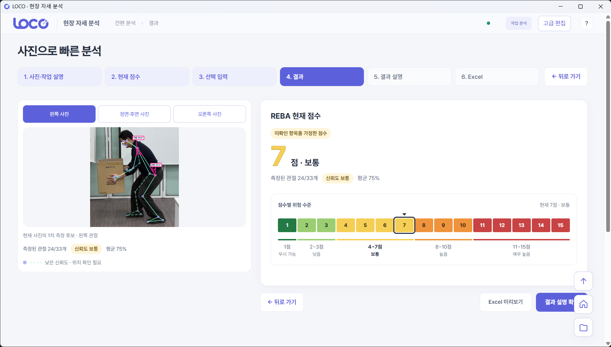
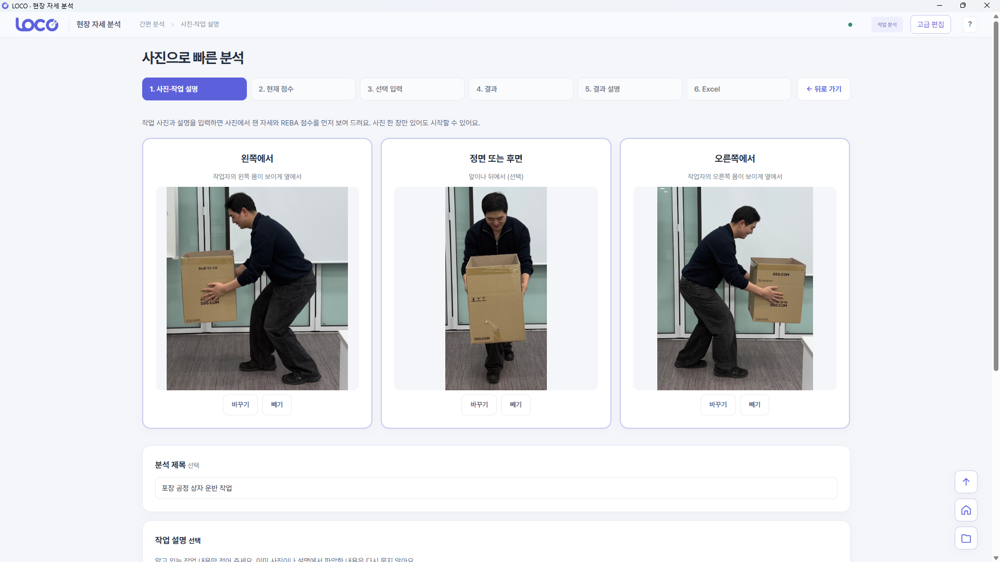
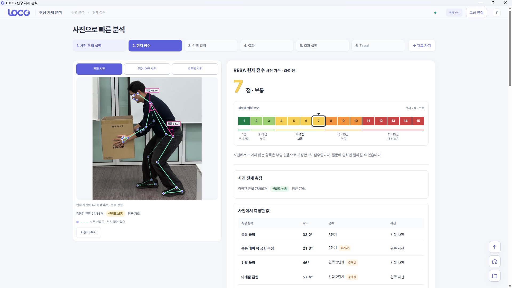
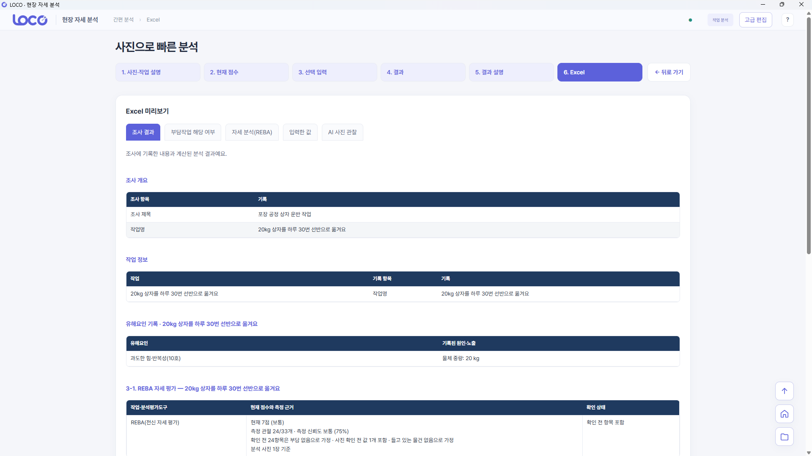
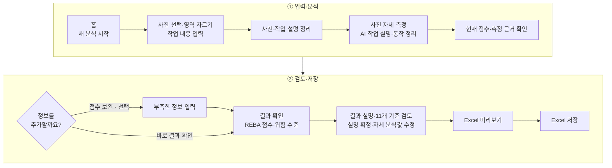

<p align="center">
  
</p>

<h3 align="center">작업 사진 기반 자세 분석과 조사 기록 지원</h3>

<p align="center">
  <a href="https://github.com/LOCO-KOREA/LOCO/releases/download/v2.0.0/LOCO.zip"></a>
  <a href="https://github.com/LOCO-KOREA/LOCO/releases/tag/v2.0.0"></a>
</p>

<p align="center">
  
  
  
</p>

<p align="center"><strong>작업 사진과 설명으로 자세를 분석하고, 조사자가 결과를 검토해 Excel로 정리하는 Windows 데스크톱 앱입니다.</strong></p>

<p align="center">
  <a href="#1-프로젝트-개요">프로젝트 개요</a> ·
  <a href="#2-주요-기능">주요 기능</a> ·
  <a href="#3-다운로드와-실행">다운로드·실행</a> ·
  <a href="#10-개발자-안내">개발자 안내</a> ·
  <a href="#11-참고-자료">관련 문서</a>
</p>

<p align="center">
  
</p>

---

## 1. 프로젝트 개요

| 항목 | 내용 |
| --- | --- |
| <strong>주제</strong> | 사진 기반 REBA 자세 평가와 근골격계부담작업 조사 지원 |
| <strong>대상</strong> | 작업 자세·작업 조건을 확인하고 기록하는 현장 조사자 |
| <strong>목표</strong> | 사진·입력·계산 근거·검토 내용을 모아 Excel로 정리 |
| <strong>개발 인원</strong> | 3명 |

<strong>입력 자료:</strong> 작업 사진 · 작업 설명 · 시간·중량·횟수 등 작업 조건 · 조사자 검토 기록

- <strong>직접 입력:</strong> 사진에서 알 수 없는 작업시간·중량·횟수
- <strong>최종 판단:</strong> 계산 결과와 AI 설명을 확인한 조사자가 결정

---

## 2. 주요 기능

| 기능 | 내용 |
|---|---|
| 사진 등록·크롭 | 사진에서 분석할 영역을 선택하고 방향별로 등록 |
| 관절·각도 표시 | 관절과 자세 각도를 사진 위에 표시하고 측정 근거 확인 |
| REBA 계산 | 자세와 하중 등 입력을 반영한 점수 및 위험 수준 확인 |
| 11개 기준 계산 | 작업 조건별 계산 초안과 부족한 입력 확인 |
| AI 정보 정리·설명 | 작업 설명과 사진 속 동작을 정리하고 계산 결과 설명 |
| 검토·Excel 출력 | 설명 편집·확정, 저장한 입력과 계산 결과 출력 |
| 기록 관리 | 임시 저장·이어쓰기, 기존 기록 재열기, 개선 전후 분석 비교 |

### 화면 예시

| ① 사진·작업 설명 입력 | ② 자세·점수 확인 | ③ Excel 출력 |
| :---: | :---: | :---: |
|  |  |  |
| 1단계 · 사진 등록과 작업 설명 | 사진 위 관절·각도와 REBA 점수 | 6단계 · Excel 미리보기 |
| `docs/images/photo-input.png` | `docs/images/reba-result.png` | `docs/images/excel-preview.png` |

### 사용 순서



- <strong>사진 등록:</strong> 간편 화면에서 왼쪽·정면 또는 후면·오른쪽 사진을 등록할 수 있으며, 사진 한 장으로도 시작할 수 있습니다.
- <strong>점수 보완:</strong> 필요한 경우 직접 선택합니다. 질문창은 자동으로 열리지 않습니다.
- <strong>결과 확인:</strong> 4단계는 REBA 점수·위험 수준·측정 신뢰도를 보여 주며, 계산 근거와 상세 검토는 5단계에서 확인합니다.
- <strong>결과 설명:</strong> 사용자가 확인해 확정한 문장만 현재 분석의 Excel에 포함됩니다.
- <strong>이어서 작업:</strong> 간편 화면의 작성 내용은 임시 저장 후 다시 열 수 있습니다.
- <strong>고급 편집:</strong> 조사·작업별 상세 입력과 기록 관리를 제공합니다.

---

## 3. 다운로드와 실행

<strong>[LOCO.zip 다운로드](https://github.com/LOCO-KOREA/LOCO/releases/download/v2.0.0/LOCO.zip)</strong> · [v2.0.0 릴리즈 안내](https://github.com/LOCO-KOREA/LOCO/releases/tag/v2.0.0)

1. <strong>다운로드</strong> — 위 링크에서 `LOCO.zip`을 받습니다.

2. <strong>압축 해제</strong> — 다운로드한 ZIP을 전체 압축 해제합니다.

3. <strong>실행</strong> — `LOCO` 폴더 안의 `LOCO.exe`를 실행합니다.

별도의 Python·Node.js 설치는 필요하지 않습니다.

> <strong>폴더 전체를 유지해 주세요.</strong><br>
> `LOCO.exe`만 따로 옮기면 실행되지 않을 수 있습니다.

릴리즈에서는 `Source code`가 아닌 <strong>LOCO.zip</strong>을 선택하세요.

### AI 기능 설정

- <strong>키 없이 사용:</strong> 자세 분석 · REBA 계산 · Excel 저장
- <strong>키 연결 후 사용:</strong> AI 정보 정리 · 사진 관찰 · 결과 설명 생성

AI 기능을 사용하려면 아래 순서로 설정하세요.

1. `LOCO.exe` 옆 <strong>`loco.env`</strong>를 메모장으로 엽니다.
2. `OPENAI_API_KEY=` 뒤에 <strong>본인의 API 키</strong>를 입력합니다.
3. 파일을 저장하고 앱을 <strong>완전히 종료한 뒤 다시 실행</strong>합니다.

OpenAI 호환 서버는 `OPENAI_BASE_URL=`에 API 주소도 입력합니다.

> AI 정보 정리·사진 관찰·설명 생성에는 인터넷 연결과 사용 가능한 API 키가 필요합니다.
> <strong>개인 키를 입력한 `loco.env`는 다른 사람에게 공유하지 마세요.</strong>

<details>
<summary><strong>AI 설정 상세 · 우선순위 · 연결 실패 시 동작</strong></summary>

| 항목 | 기본값·설정 방법 |
|---|---|
| 모델 | `gpt-6-luna` — `LOCO_AI_MODEL`로 초기값 지정 |
| 추론 강도 | `high` — `LOCO_AI_REASONING_EFFORT`로 초기값 지정 |
| 환경 변수 입력 | 포터블 앱은 EXE 옆 `loco.env`, 개발 실행은 저장소 루트의 `loco.env` 또는 PowerShell 환경 변수 |
| 설정 우선순위 | Windows·실행 프로세스 환경 변수 → `loco.env` → 코드 기본값. 모델·추론 강도 등은 DB에 저장된 명시값이 있으면 그 값이 우선 |
| OpenAI 호환 서버 | `OPENAI_BASE_URL`로 API 주소 지정 |

- <strong>설정 적용:</strong> 파일 저장 후 앱을 완전히 종료하고 재실행
- <strong>빈 값·파일 없음:</strong> 기존 환경과 기본값으로 실행
- <strong>기존 DB:</strong> 저장된 모델·추론 설정 유지

### 사진 전송·API 키 관리

- <strong>사진 전송:</strong> AI의 작업 사진 설명 기능을 사용하면 사진이 외부 API로 전송됩니다.
- <strong>키 입력:</strong> `loco.env` 또는 실행 환경 변수
- <strong>키 전달:</strong> Python 프로세스에서 사용 · 앱 화면·DB에 저장하지 않음
- <strong>배포 파일:</strong> 키가 빈 템플릿만 포함 · 입력한 개인 키는 공유 금지

### AI 연결·응답 처리

- <strong>연결 실패 시:</strong> AI 연결이 없거나 요청에 실패해도 직접 입력과 규칙 기반 계산을 이용할 수 있습니다.
- <strong>응답 대기:</strong> 앱에서 별도의 요청 시간 제한을 두지 않으며, 응답 시간은 모델과 연결 상태에 따라 달라집니다.
- <strong>재시도:</strong> 같은 요청을 자동으로 다시 보내지 않습니다.

</details>

---

## 4. 분석 과정

```text
사진·작업 설명 입력 → 자세 추정·정보 정리 → 필요한 값 보완 → 계산 → 조사자 검토 → Excel 출력
```

| 구성 | 역할 |
|---|---|
| MediaPipe | 사진의 관절 좌표·자세 각도 추정 — 기본: Pose Landmarker Heavy(33개 관절), 선택: Full·기존 MoveNet Lightning |
| 규칙 엔진 | 입력값·자세 측정 결과를 바탕으로 REBA 점수와 11개 기준 각각 계산 |
| AI | 작업 설명의 정보 정리·사진 속 동작 설명 지원 — 계산 규칙 실행·점수 결정 제외 |
| SQLite | 조사, 작업, 사진 정보, 분석 결과, 설정, 출력 이력 저장 |

- <strong>분석 방식:</strong> 사전 학습된 자세 모델 사용 · 별도 모델 학습 없음
- <strong>노출량:</strong> 사진의 자세 비율을 하루 작업시간·횟수로 환산하지 않음

### 점수 확인 시 유의사항

- <strong>가정값 포함 가능:</strong> 확인하지 못한 값을 가정해 계산한 점수가 포함될 수 있으므로, 화면의 <strong>가정 항목과 측정 상태</strong>를 함께 확인해야 합니다.
- <strong>비교용 기준값 구분:</strong> 비교용 기준값은 자세를 측정해 얻은 점수와 구분해 표시합니다.

### 관절 각도 적용 기준

| 항목 | 적용 기준 |
|---|---|
| 측정 방식 | 2D 측정값과 3D 추정값 구분 |
| 팔꿈치·무릎 굽힘 | 유효한 3D 추정값 우선 적용, 없으면 2D 측정값 사용 |
| 직접 확인한 값 | 자동 측정값보다 우선 적용 |

<strong>3D 추정값의 한계:</strong> 사진 한 장에서 추정한 좌표이므로 실제 공간을 계측한 결과로 볼 수 없습니다.

---

## 5. 기술 스택

### 화면과 데스크톱 앱


### 자세 분석과 이미지 처리


### 데이터 저장·보고서·AI


### Windows 패키징


---

## 6. 저장과 출력

- 작업 입력과 분석 결과는 선택한 SQLite DB에 저장합니다. 작성 중인 미전송 문장과 화면 복구 정보는 이 PC의 로컬 초안에 보관합니다.
- 계산 당시의 입력과 설정은 분석별 snapshot으로 남깁니다. 입력이나 모델 설정을 바꿔도 과거 분석을 새 값으로 덮어쓰지 않습니다.
- Excel에는 저장한 입력, 계산 결과, 확인해 확정한 설명을 정리합니다. 개선 전후 분석을 선택해 비교할 수 있습니다.
- 사용자 출력은 Excel입니다. 저장소의 PDF 모듈은 내부 호환용이며 화면의 출력 기능으로 제공하지 않습니다.

---

## 7. 한계와 개선 방향

- <strong>사진의 가림과 촬영 방향</strong>: 보이지 않는 관절이나 낮은 신뢰도의 측정값은 직접 확인이 필요합니다.
- <strong>3D 추정의 한계</strong>: 사진에서 추정한 좌표는 실제 공간을 계측한 값과 다를 수 있습니다.
- <strong>입력 누락과 가정</strong>: 화면 점수에 가정이 포함될 수 있으므로 측정 상태와 가정 항목을 함께 확인해야 합니다.
- <strong>현장 검증</strong>: 실제 조사자의 사용성과 측정 정확도, 작성 시간 단축 효과는 별도 검증이 필요합니다.

| 검증 범위 | 상태 |
| --- | --- |
| 다른 PC에서 v2.0.0 실행 | 사용자 확인 완료 |
| 별도 PC의 실제 API 호출·전체 출력 | 추가 확인 필요 |
| 촬영 조건별 측정 정확도·사용성 | 별도 검증 필요 |

시험 수치·시연 화면은 기록 당시의 날짜와 조건을 함께 확인하세요.

---

## 8. 역할 분담

| 이름 | 담당 영역 |
|---|---|
| 김나리 | 사용자 화면·입력 흐름 구현, 작업 정보 입력, 사진 등록·영역 선택, 점수 보완·결과 검토 화면, Electron 실행·배포 구성 |
| 유서하 | Application Service 구성, 자세 추론 모델 연동, 사진의 관절 좌표·각도 처리, REBA 점수 계산 |
| 한정욱 | 11개 기준 계산, SQLite DB 설계·구현, 분석 결과 저장·조회, Excel 출력, AI 기능 통합·보완, 기능 간 연결·통합 검증 |

---

## 9. 프로젝트 구조

```text
Electron 화면 → preload/main → Python 서비스 → 분석·저장·출력 모듈
```

| 경로 | 내용 |
|---|---|
| `frontend/` | Electron 앱과 화면 코드 |
| `ergo/service/` | 화면 요청 처리와 기능 연결 |
| `ergo/pose/` | MediaPipe·MoveNet 추론 |
| `ergo/engine/` | 관절 각도, REBA, 11개 기준 계산 |
| `ergo/intake/`, `ergo/vision/`, `ergo/gpt/` | 작업 설명 정리, 사진 관찰, 결과 설명 |
| `ergo/db/`, `ergo/report/` | SQLite 저장과 보고서 출력 |
| `tests/`, `scripts/` | 검증 코드, 모델 다운로드, 패키지 빌드 |
| `docs/` | 설계 문서, 검증 기록, 발표 자료 |

- <strong>서비스 진입점:</strong> `ergo/service/json_lines.py`
- <strong>계산 위치:</strong> Python 기능 모듈
- <strong>SQLite 테이블:</strong> `SURVEY` · `TASK` · `PHOTO` · `ANALYSIS` · `APP_SETTINGS` · `EXPORT_LOG`

---

## 10. 개발자 안내

배포 앱만 실행하려면 위의 <strong>LOCO.zip</strong>을 사용하세요. 아래는 소스 코드 실행·검증·패키지 제작을 위한 안내입니다.

<details>
<summary><strong>개발 환경 설치와 실행</strong></summary>

개발 환경은 Windows x64, CPython 3.12, Node.js/npm입니다. 아래 명령은 저장소 루트의 PowerShell에서 실행합니다.

```powershell
py -3.12 -m venv .venv
.\.venv\Scripts\python.exe -m pip install -r requirements-desktop.txt
npm.cmd --prefix frontend ci
.\.venv\Scripts\python.exe scripts/download_pose_models.py
```

모델 다운로드 명령은 MediaPipe Heavy와 Full을 `models/`에 저장하고 파일 해시를 확인합니다. 모델 파일은 Git에 포함되지 않습니다.

기존 DB를 열면 그 DB에 저장된 모델 설정이 적용됩니다. MediaPipe 파일을 내려받는 것만으로 기존 MoveNet 설정이나 과거 분석 결과가 바뀌지는 않습니다.

### 앱 실행

```powershell
.\run-integrated.ps1 -PythonPath "$PWD\.venv\Scripts\python.exe" -DatabasePath "$PWD\.local\loco.db"
```

- <strong>예시 DB:</strong> `.local/loco.db`
- <strong>기존 기록 열기:</strong> `-DatabasePath`에 사용 중인 DB 경로 지정
- <strong>파일이 없을 때:</strong> 빈 DB 생성
- <strong>데이터 이동:</strong> DB 경로 변경만으로 복사·병합되지 않음

DB 경로를 생략했을 때의 기본값은 실행 방식에 따라 다릅니다.

| 실행 방식 | 기본 DB |
|---|---|
| `run-integrated.ps1` | 저장소의 `frontend/.local/loco_frontend.db` |
| 직접 Electron 실행 또는 포터블 앱 | `%LOCALAPPDATA%\LOCO\loco_demo.db` |

| 상황 | 방법 |
| --- | --- |
| 다른 PC로 기록 이동 | DB와 원본 사진을 함께 보존 · 사진 경로 확인 |
| 설정 파일에서 DB 지정 | `loco.env`의 `LOCO_DB_PATH` 사용 |
| 포터블 앱의 상대 경로 | `LOCO.exe` 폴더 기준 |
| 개발 실행의 상대 경로 | 저장소 루트 기준 |

### AI 연결

개발 환경에서 AI 기능을 사용하려면 앱을 실행할 PowerShell 창에 API 키를 설정합니다. 포터블 앱은 위의 `loco.env` 설정 방법을 사용합니다.

```powershell
$env:OPENAI_API_KEY = '발급받은 API 키'
.\run-integrated.ps1 -PythonPath "$PWD\.venv\Scripts\python.exe" -DatabasePath "$PWD\.local\loco.db"
```

</details>

<details>
<summary><strong>개발자 검증 명령</strong></summary>

```powershell
.\.venv\Scripts\python.exe -B -m unittest discover -s tests
npm.cmd --prefix frontend test
npm.cmd --prefix frontend run build
```

`build` 명령은 화면에서 사용하는 파일과 JavaScript 문법을 검사합니다. 실행 패키지를 만드는 명령은 아닙니다.

- <strong>시험 방법:</strong> [프런트엔드 실행·검증 안내](frontend/README.md)
- <strong>당시 조건·결과:</strong> [검증 기록](docs/local-verification.md)
- <strong>외부 AI 시험:</strong> 별도 키·실행 설정 필요
- <strong>기록 구분:</strong> 로컬 모의 응답과 실제 외부 호출 결과를 구분

</details>

<details>
<summary><strong>Windows 패키지 빌드와 배포 폴더</strong></summary>

Windows x64의 CPython 3.12 환경에서 빌드합니다. 위 개발 환경 설치를 완료하고, Electron 실행 파일과 등록된 세 모델을 모두 준비해야 합니다.

```powershell
.\.venv\Scripts\python.exe scripts/download_pose_models.py mediapipe-heavy mediapipe-full movenet-lightning
.\.venv\Scripts\python.exe -m pip install -r requirements-build.txt
.\.venv\Scripts\python.exe scripts/build_windows.py
```

| 구분 | 결과 |
| --- | --- |
| 빌드 출력 | `dist/LOCO-2.0-windows-x64-<빌드시각>` |
| 기존 배포본 | 덮어쓰지 않음 |
| ZIP 생성·이름 정리 | 빌드 이후 별도 진행 |
| v2.0.0 릴리즈 | `LOCO/` 폴더를 <strong>`LOCO.zip`</strong>으로 압축 |

```text
LOCO/
├─ LOCO.exe              # 실행 파일
├─ loco.env              # API 키·서버 주소·모델 초기값 설정
├─ 실행안내.txt
├─ build-manifest.json   # 빌드 시각·소스 정보·모델 해시
├─ resources/
│  ├─ app/               # Electron 화면 코드
│  ├─ backend/           # Python이 포함된 서비스 실행 파일
│  └─ models/            # MediaPipe Heavy·Full, MoveNet 모델
└─ …                     # Electron 실행에 필요한 DLL·리소스
```

- <strong>제외 항목:</strong> 사용자 DB·사진·실제 API 키·개인 환경 설정
- <strong>환경 파일:</strong> [빈 설정 템플릿](scripts/portable/loco.env.example)에서 `loco.env` 생성
- <strong>실행 방법:</strong> 폴더 전체를 유지하고 `LOCO.exe` 실행

| 배포 검증 | 파일 |
| --- | --- |
| 환경 파일 로딩·별도 DB 실행 | `tests/portable-env-package.cjs` |
| 모델 추론·Excel 저장·재실행 | `tests/portable-service-smoke.py` |

두 검증 모두 실제 외부 AI를 호출하지 않습니다.

</details>

---

## 11. 참고 자료

| 문서 | 내용 |
|---|---|
| [요구사항](docs/requirements.md) · [기능정의서](docs/기능정의서.md) · [화면설계서](docs/화면설계서.md) | 기능과 화면 설계 |
| [ERD](docs/ERD_데이터설계서.md) · [DB 설계](docs/DB아키텍처_설계서.md) · [API 계약](docs/API_계약서.md) | 데이터와 서비스 계약 |
| [자세 엔진](docs/pose-engine.md) · [사진 관찰](docs/photo-vision.md) · [추가 확인 입력](docs/adaptive-intake.md) | 모델과 입력 처리 방식 |
| [모듈 지도](docs/module-map.md) · [기존 자료 호환](docs/legacy-compatibility.md) | 코드 구조와 과거 데이터 읽기 |
| [발표 자료](docs/presentation/LOCO-발표.pptx) · [시연 시나리오](docs/presentation/demo/시연-시나리오.md) | 발표·시연 준비 |
| [시험 사실 기록](docs/presentation/TEST_FACTS.md) · [사진 출처](docs/presentation/assets/PHOTO_CREDITS.md) | 당시 검증 범위와 사용 사진 출처 |
