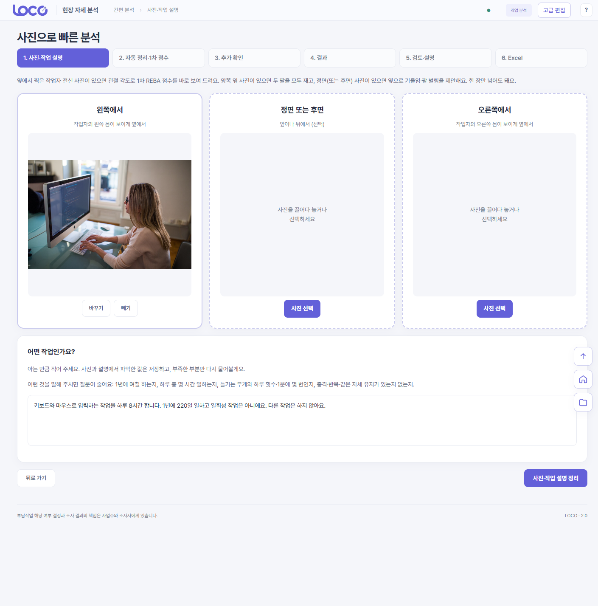
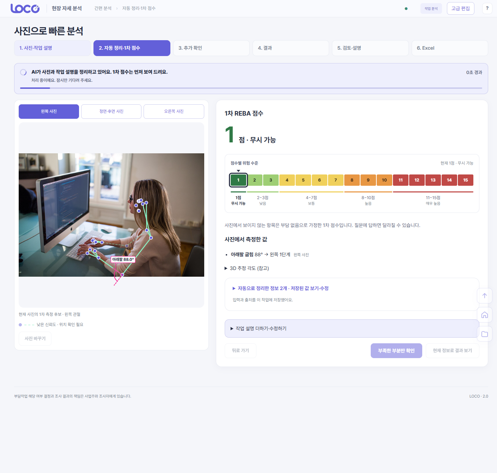
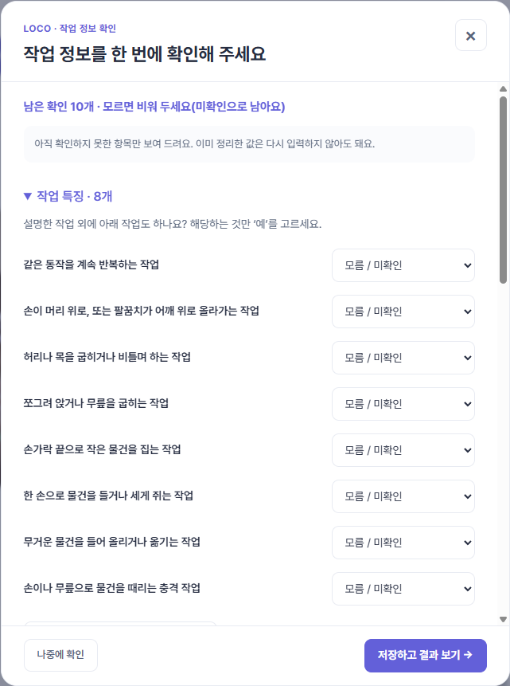
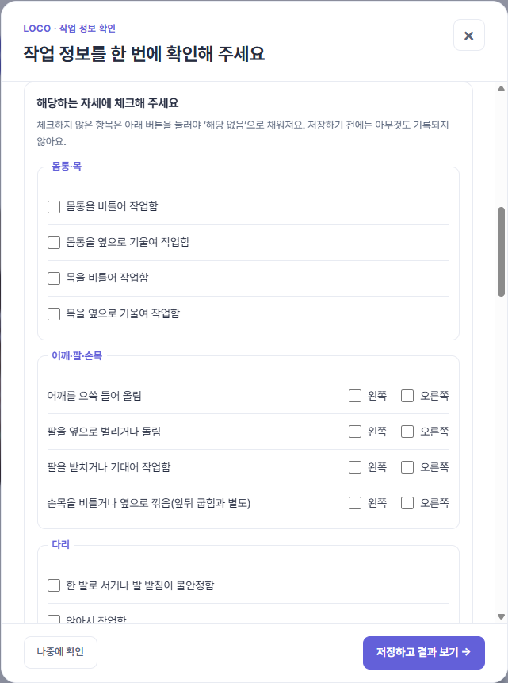
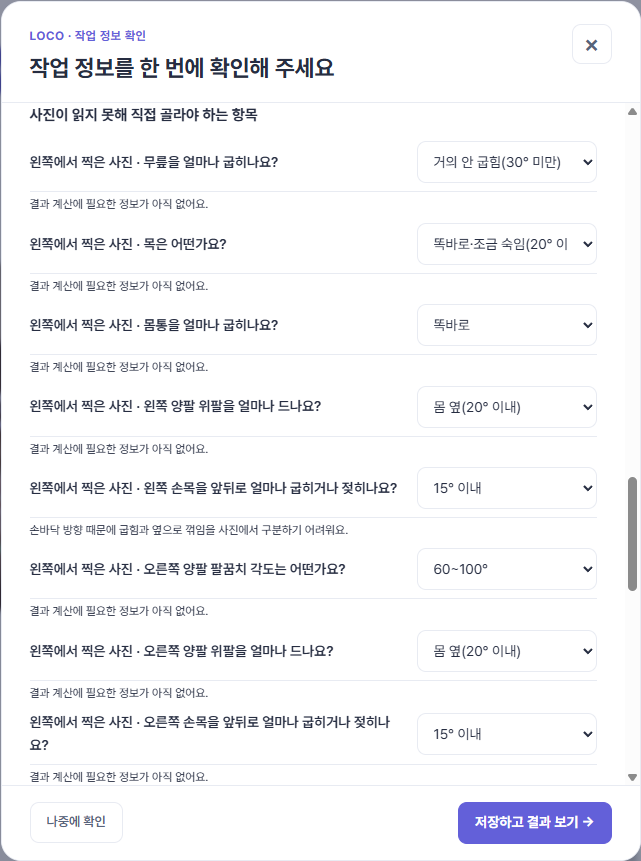
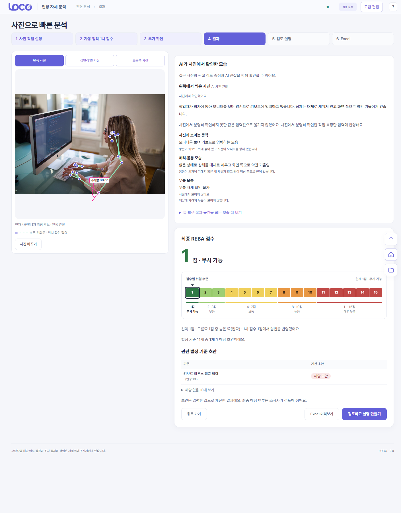

# LOCO 2.0

**사진과 한 문장으로 시작하는 근골격계 유해요인조사 보조 도구** (Windows 데스크톱 앱)

현장 조사자가 작업 사진 1~3장과 한 문장 설명을 넣으면, 필요한 것만 물어 가며 **법정 11개 부담작업 기준의 계산 초안**과 **REBA 점수**를 만들고 **Excel**로 정리해 주는 도구다. 점수와 해당 여부는 조사자가 검토해 정한다.

> **먼저 알아 둘 것**
> - LOCO는 조사자의 사실 확인과 판단을 돕는 보조 도구다. 법정 조사 완료, 질환 진단, 자동 법률 판정, 개선의 임상 효과를 제품 성과로 주장하지 않는다.
> - 지금까지의 시험은 **공개 사진**으로 했다. 우리 현장에서 찍은 사진으로 한 시험이 아니다.
> - 전체 수용 판정은 NOT ACCEPTED다(`AGENTS.md`). 현장 사진·별도 Windows PC·실제 조사자 사용 검증은 아직 하지 않았다.
> - [5장 사용 방법](#5-사용-방법)·[6장 시연 순서](#6-시연-순서)는 입력 화면을 **한 페이지로 합친 변경**("입력 한 페이지, 저장 뒤 다시 묻지 않음") 기준이다. 이 변경은 커밋 `f66f103`로 원격 브랜치에 **푸시 완료**했다.

발표 자료: [LOCO-발표.pptx](docs/presentation/LOCO-발표.pptx)(16장, 슬라이드마다 발표자 노트) · 시험 사실과 알려진 한계: [TEST_FACTS.md](docs/presentation/TEST_FACTS.md) · 화면 속 사진 출처: [PHOTO_CREDITS.md](docs/presentation/assets/PHOTO_CREDITS.md)

## 차례

1. [프로젝트 소개](#1-프로젝트-소개)
2. [핵심 기능](#2-핵심-기능)
3. [개발 환경과 구조](#3-개발-환경과-구조)
4. [설치와 실행](#4-설치와-실행)
5. [사용 방법](#5-사용-방법)
6. [시연 순서](#6-시연-순서)
7. [시험 결과와 알려진 한계](#7-시험-결과와-알려진-한계)
8. [향후 계획](#8-향후-계획)
9. [개발자 참고: 실행·검증 절차(기존 README)](#9-개발자-참고-실행검증-절차기존-readme)

## 1. 프로젝트 소개

### 시작 배경

근골격계 유해요인조사는 작업을 11개 부담작업 기준에 비춰 하나하나 따져 근거와 함께 기록하는 일이다(근거: 고용노동부고시 제2020-12호, [기능정의서](docs/기능정의서.md) 3장·[요구사항](docs/requirements.md) 4장 기준이며 법령 원문과 대조하지는 않았다). 첫 사용자는 현장 조사자와 안전보건 담당자다. 개발하면서 다음 어려움이 드러났다.

- **기준이 겹친다.** 한 작업이 11개 기준 중 여러 곳에 해당할 수 있고, 작업 이름만으로는 호가 정해지지 않는다. 그래서 상자 들기와 사무 작업을 같은 일반 작업으로 입력받는다.
- **사진엔 없는 사실이 있다.** 하루 시간·횟수·무게·힘은 조사자가 직접 확인해 적어야 한다.
- **입력이 많으면 부담이다.** 써 보면서 "질문이 많다", "Excel에서도 입력을 너무 많이 요구한다"는 지적이 나왔다(팀 안에서 써 본 의견이며 현장 조사 결과가 아니다).

그래서 설계 원칙을 **입력은 줄이고, 근거는 남기고, 판단은 조사자가**로 잡았다.

### 기대 효과 (목표이며 아직 입증하지 않았다)

- **기록 누락 줄이기** — 11개 기준마다 입력·누락·계산 초안·조사자 결론이 이어져 빠진 근거가 보인다.
- **입력 부담 줄이기** — 사진과 한 문장에서 읽은 값은 저장하고 부족한 부분만 묻는다.
- **같은 입력, 같은 계산** — 버전이 고정된 규칙으로 계산해 같은 입력이면 같은 근거가 재현된다.
- **조사 시간 단축(가설)** — 입력부터 보고서까지 걸리는 시간의 중앙값을 수기 대비 30% 이상 줄이는 것이 목표다. 실제 조사자로 측정하기 전까지는 목표이지 성과 주장이 아니다([요구사항](docs/requirements.md) 1·8장).

### LOCO가 하지 않는 일

- AI는 점수나 해당 여부를 바꾸지 않는다. 11개 기준과 REBA는 규칙 엔진이 계산하고, AI는 문장 정리·사진 속 동작 설명·설명문을 맡는다.
- REBA 점수와 11개 기준을 한 점수로 합치지 않는다. 높은 REBA를 곧바로 "법정 해당"으로 바꾸지도 않는다.
- 사진의 자세 비율을 하루 노출시간으로 환산하지 않는다. 모르는 값은 0이나 "아니오"로 채우지 않고 미확인으로 남긴다.
- Excel은 작업 분석을 돕는 참고 자료다. 법정 유해요인조사표·증상조사표를 대신하지 않는다.

## 2. 핵심 기능

| 기능 | 내용 |
|---|---|
| 사진 + 한 문장 입력 | 왼쪽·정면(후면)·오른쪽 사진 1~3장(한 장도 된다)과 작업을 설명하는 한 문장으로 시작한다. 사진은 먼저 자르기 영역을 확인한다. |
| AI 자동 정리 | 문장에서 하루 시간·연간 일수·작업 특징을 칸에 채운다. 값마다 입력 방법과 근거(직접 입력·AI 정리·사진 자동 측정)를 남긴다. |
| 사진 자세 측정 | MediaPipe Pose Landmarker Heavy가 관절 33점과 각도를 잰다. 신뢰도가 낮은 관절은 표시한다. |
| AI 사진 설명 | 사진 속 동작·허리·무릎 모습을 말로 설명한다. 분명히 확인하지 못한 값은 입력값으로 옮기지 않는다. |
| 1차 점수(확정 전) | 지금까지 확인한 값으로 REBA 점수를 먼저 보여 준다. 못 잰 항목은 "부담 없음"으로 가정했다고 가정한 항목 수와 함께 알린다. |
| 필요한 것만 묻는 확인 | 입력 창이 한 번만 열리고, 한 페이지 안에서 작업 특징·작업 조건·사진 확인·자세 체크리스트(18개 항목, "확인 끝"으로 나머지는 해당 없음)·사진이 못 읽은 각도에 차례로 답한다. 모르면 비워 두면 미확인으로 남고, 한쪽 팔·손목은 반대쪽으로 복사할 수 있다. 저장한 뒤에는 화면이 스스로 다시 묻지 않는다. |
| 최종 점수와 11개 기준 초안 | 좌우 REBA 중 높은 쪽 점수(1~15점 색상바)와 기준별 "해당 초안 / 입력 필요 / 해당 없음". 두 결과는 따로 보여 준다. |
| 조사자 검토 | AI 설명을 편집·확정하고 조사자 결론을 따로 기록한다. 계산 초안을 덮어쓰지 않는다. |
| Excel 미리보기·저장 | 저장 전에 시트 탭으로 내용을 미리 보고 저장한다. 기록한 값과 계산 가능한 결과가 있는 시트만 만든다. |
| 개선 전후 비교 | 개선 전 결과를 기억해 두었다가 개선 후 사진으로 다시 분석하면 전후를 비교한다. |
| 이어서 하기 | 작성 중인 분석은 이 PC에 보관되어 홈의 "이어서 하기"로 이어 간다. 분석 결과는 SQLite에 바뀌지 않는 snapshot으로 저장한다. |

## 3. 개발 환경과 구조

```text
Electron 화면 → preload → Python JSON Lines 서비스 → 기능 모듈 → SQLite
```

| 영역 | 사용 기술 | 비고 |
|---|---|---|
| 화면 | Electron 44.7 · 네이티브 ES module (`frontend/`) | 간편 흐름은 `quick-flow.js`. 옛 10개 화면은 "고급 편집" |
| 서비스 | CPython 3.12 · JSON Lines 서비스 (`ergo/service/json_lines.py`) | 화면은 계산하지 않고 요청만 보낸다 |
| 계산 | 규칙 엔진 (`ergo/engine`) — 11개 기준(`MOEL_2020_12_GENERAL_V2`)·REBA | 결정적 계산. AI가 바꾸지 못한다 |
| 자세 | MediaPipe Pose Landmarker Heavy (mediapipe 1.1.1, 관절 33점) | Full 모델과 MoveNet Lightning(17점)은 설정에서 선택 |
| AI | OpenAI 호환 API — 기본 `gpt-6-luna`, 추론 강도 `high` | `OPENAI_API_KEY` 필요. 초기값은 `LOCO_AI_MODEL`·`LOCO_AI_REASONING_EFFORT`, 호환 서버는 `OPENAI_BASE_URL` |
| 저장 | SQLite 여섯 테이블 — SURVEY·TASK·PHOTO·ANALYSIS·APP_SETTINGS·EXPORT_LOG | 규칙과 계산은 DB에 넣지 않는다 |
| 출력 | Excel(openpyxl 3.1) | 사용자 출력은 Excel이며 PDF 모듈은 내부 구현이다 |
| 실행 환경 | Windows x64 · 포터블 패키지(`scripts/build_windows.py`) | 패키지에는 사용자 DB·사진·키를 넣지 않는다 |
| 시험 | Python 시험 · Node 화면 시험 · Electron 실화면 E2E · 변이 시험 | 7장 참고 |

| 경로 | 내용 |
|---|---|
| `frontend/` | Electron 화면 |
| `ergo/` | Python 서비스·규칙 엔진·자세 엔진·AI·보고서·저장 ([모듈 지도](docs/module-map.md)) |
| `tests/` | Python·화면·E2E 시험 |
| `scripts/` | 모델 내려받기·패키지 빌드·검증 도구 |
| `docs/` | 설계 정본·검증 기록·발표 자료(`docs/presentation/`) |
| `models/` | 자세 모델 파일(내려받아 두며 git에는 넣지 않는다) |

## 4. 설치와 실행

Windows x64, CPython 3.12, Node.js/npm이 필요하다. 저장소 루트에서 PowerShell로 실행한다.

```powershell
py -3.12 -m venv .venv
.\.venv\Scripts\python.exe -m pip install -r requirements-desktop.txt
.\.venv\Scripts\python.exe scripts/download_pose_models.py
npm.cmd --prefix frontend ci
$env:OPENAI_API_KEY = '<발급받은 키>'
.\run-integrated.ps1 -PythonPath "$PWD\.venv\Scripts\python.exe" -DatabasePath "$PWD\.local\my-loco.db"
```

- `scripts/download_pose_models.py`는 기본 자세 엔진(MediaPipe Heavy)과 Full 모델을 `models/`에 내려받아 해시를 확인한다. 과거 MoveNet 엔진을 쓸 때만 `.\scripts\download_movenet.ps1`이 더 필요하다.
- `OPENAI_API_KEY`는 같은 PowerShell 창의 환경 변수로만 준다. 키는 화면(renderer)·SQLite·패키지에 저장하지 않는다. 키가 없거나 AI 호출이 실패해도 계산은 규칙 엔진이 하고, 설명은 로컬 대체 설명으로 표시한다.
- DB 기본값은 `frontend/.local/loco_frontend.db`이고 `-DatabasePath`로 바꾼다. 기존 DB를 자동으로 복사·병합하지 않고 원본 사진은 경로로 참조하므로 원본 파일을 보존한다.
- Windows 포터블 패키지는 `.\.venv\Scripts\python.exe -m pip install -r requirements-build.txt` 뒤 `.\.venv\Scripts\python.exe scripts/build_windows.py`로 만든다. `dist/LOCO-2.0-windows-x64-<빌드시각>` 폴더 전체를 유지하고 `LOCO.exe`를 실행한다.

더 자세한 개발자용 절차(검증 명령, 패키지 manifest, 자세 엔진 설정)는 [9장](#9-개발자-참고-실행검증-절차기존-readme)에 그대로 남겼다.

## 5. 사용 방법

화면은 6단계(사진·작업 설명 → 자동 정리·1차 점수 → 추가 확인 → 결과 → 검토·설명 → Excel)다.

| 단계 | 하는 일 | 누가 |
|---|---|---|
| 1 | **사진을 올리고 자른다.** 옆에서 찍은 전신 사진 1~3장 | 조사자 |
| 2 | **작업을 한 문장으로 쓴다.** 1년에 며칠, 하루 몇 시간, 들기는 무게·횟수, 충격·반복·같은 자세 유지가 있는지 적으면 질문이 줄어든다 | 조사자 |
| 3 | **"사진·작업 설명 정리"를 누른다.** AI가 문장에서 칸을 채우고 MediaPipe가 관절 각도를 잰다 | LOCO |
| 4 | **1차 점수를 본다.** 사진 측정만으로 나온 점수가 AI 정리를 기다리지 않고 먼저 나타난다. "지금까지 확인한 값 기준 (확정 전)"이며 가정한 항목 수가 함께 나온다 | LOCO |
| 5 | **입력 창에 답한다.** AI 정리가 끝나면 "작업 정보를 한 번에 확인해 주세요" 창이 **한 번만** 열린다. 작업 특징은 `선택하지 않은 나머지 작업은 모두 안 해요`로 한꺼번에 답하고, 작업 조건(숫자 칸에도 선택지가 있다)·사진 속 물건·사진 상황을 고른다. 모르면 비워 둔다 | 조사자 |
| 6 | **해당하는 자세만 체크하고 "확인 끝"을 누른다.** 사진 상황을 고르면 같은 창에 체크리스트가 나타난다. 사진이 못 읽은 각도만 고르고, 한쪽 팔·손목은 반대쪽으로 복사할 수 있다 | 조사자 |
| 7 | **"저장하고 결과 보기 →"를 누른다.** 최종 REBA 점수와 11개 기준 초안이 나온다. 저장한 뒤에는 화면이 스스로 다시 묻지 않고, 비워 둔 칸은 결과 화면의 "입력 수정하기"로 같은 페이지를 다시 연다. 최종 해당 여부는 조사자가 검토해 정한다 | LOCO + 조사자 |
| 8 | **"Excel 미리보기"로 확인하고 "Excel로 저장"한다.** AI 설명 확정("검토하고 설명 만들기")은 선택이다 | 조사자 |



*1~2단계: 사진과 한 문장 입력. 화면 속 사진: Apple-blogging-coder-36990.jpg (CC0, Wikimedia Commons) — 공개 사진이며 현장 사진이 아니다.*



*3~4단계: AI가 정리하는 동안 1차 점수가 먼저 나타난다(확정 전, 못 잰 항목은 "부담 없음"으로 가정). 보내는 버튼은 잠겨 있다. 사진 출처는 위와 같다.*

  

*5~6단계: 한 번만 열리는 입력 창 — 작업 특징(처음엔 모두 "모름 / 미확인") → 해당하는 자세만 체크하는 체크리스트 → 사진이 못 읽은 각도만 선택.*



*7단계: 최종 결과. 이 점수는 사진이 못 읽는 각도를 시험 스크립트가 임의로 고른 값이라 흐름 확인용이다(측정 결과가 아니다). 사진 출처는 위와 같다.*

## 6. 시연 순서

시험에서 실제로 누른 순서다(2026-10-26, [TEST_FACTS.md](docs/presentation/TEST_FACTS.md)). 화면 문구는 앱 버전에 따라 조금 다를 수 있으니 리허설에서 한 번 확인한다. 슬라이드별 시연 스크립트와 대비책은 [LOCO-발표.pptx](docs/presentation/LOCO-발표.pptx)의 발표자 노트에 있다.

시연 대본·큐카드(1~8번, 슬라이드 8~13과 같은 번호)·AI가 도는 동안 말할 거리·플랜 B 표·예상 질문·리허설 기록은 [시연-시나리오.md](docs/presentation/demo/시연-시나리오.md)에 있다. 시연 PC 준비는 시연 키트가 맡는다: `docs\presentation\demo` 폴더에서 `.\prepare-demo.ps1`(시연용 새 DB와 AI 설정을 만들고 가상환경·자세 모델·시연 사진·AI 키·AI 연결을 점검한다)을 실행한 뒤 `.\start-demo.ps1`로 그 DB로 앱을 연다. 시연 사진 2장과 시연 문장은 [demo/photos](docs/presentation/demo/photos/README.md)에 있고 사진은 저장소에 올라가지 않으니 시연 PC에 폴더째 복사한다. 아래 표는 시험에서 누른 순서이며 큐카드 번호와는 다르다.

| 순서 | 화면에서 하는 일 | 말할 것 |
|---|---|---|
| 1 | 앱 실행(`run-integrated.ps1` 또는 `LOCO.exe`) → 홈에서 `＋ 새 분석 시작` | LOCO 한 줄 소개, 공개 사진 시험이라는 점 |
| 2 | `사진 선택`(키보드 작업 사진) → 자르기 확인 → "어떤 작업인가요?"에 한 문장 → `사진·작업 설명 정리` | 입력은 사진 한 장과 한 문장이 전부 |
| 3 | 1차 점수가 먼저 나타난다(분석을 누른 뒤 3.6초·4.1초·6.1초, 세 번 실측). 화면에는 "AI가 사진과 작업 설명을 정리하고 있어요. 1차 점수는 먼저 보여 드려요." 상태 줄이 경과 시간과 함께 보이고 보내는 버튼은 잠긴다. AI 정리(보통 1분 안팎, 4분 넘게 걸린 적도 있다)가 끝나면 입력 창이 한 번 열린다 | "확정 전", 가정한 항목 수. 기다리는 동안 구성: Electron → Python → MediaPipe·AI → SQLite |
| 4 | 입력 창 위쪽 작업 특징 8개: `선택하지 않은 나머지 작업은 모두 안 해요` → 작업 조건 고르기 → 사진 속 물건·사진 상황 선택 | 이미 채운 값은 다시 묻지 않고, 모르면 비워 두면 미확인으로 남는다 |
| 5 | 같은 창에 나타난 체크리스트에서 해당하는 자세만 체크(없으면 체크 없이) → `확인 끝 · 체크 안 한 항목은 해당 없음` | 해당하는 것만 체크하면 된다. 누르지 않고 저장하면 미확인으로 남는다 |
| 6 | 사진이 못 읽은 각도를 선택(한쪽 팔·손목은 반대쪽 복사) → `저장하고 결과 보기 →` | 사진이 못 읽는 각도는 사용자 몫이다. 저장한 뒤에는 다시 묻지 않는다 |
| 7 | 최종 REBA 점수와 11개 기준 초안 확인 | 초안일 뿐이며 최종 판단은 조사자 |
| 8 | `Excel 미리보기` → 시트 탭 확인 → `Excel로 저장` | 값마다 근거가 남고 법정 서식을 대신하지 않는다 |

막혔을 때:

- **AI 응답이 오래 걸리면** 먼저 나온 1차 점수 화면과 구성 설명으로 시간을 쓰고, 4분을 넘기면 발표 자료의 화면 캡처로 같은 순서를 설명한다. 응답이 오지 않거나 연결이 끊기면 앱은 1차 점수 화면을 그대로 두고 오류를 알리며 직접 입력으로 이어 갈 수 있다. 대기 중인 요청은 앱을 끄지 않는다.
- **미리 한 번 돌려 둔 분석**이 있으면 홈의 "이어서 하기"로 열 수 있다.
- **AI 키나 네트워크가 없으면** 문장 정리는 건너뛰고 질문 창에서 직접 고른다. 계산은 AI 없이 규칙 엔진이 한다.
- **사진이 인식되지 않으면** 다른 옆모습 전신 사진으로 바꾸거나, 사진을 쓰지 않고 질문으로 채운다.
- **점수가 달라 보여도** 시연 점수는 흐름 확인용이다. 근거 문장과 초안 상태가 함께 나온다는 점을 보여 준다.

## 7. 시험 결과와 알려진 한계

2026-10-26 기록이다([TEST_FACTS.md](docs/presentation/TEST_FACTS.md)의 한 페이지 입력 반영본). 코드는 원격 브랜치 `fix/quickflow-score-so-far-20261026`에 네 커밋으로 푸시했다(맨 위가 `457b5f5`). `fcfa0a5`는 첫 점수 먼저 표시·자세 체크리스트·추론 강도 `high`, `f66f103`은 "입력 한 페이지, 저장 뒤 다시 묻지 않음", `4fb3dc3`은 "AI 요청이 120초 안에 답이 없으면 같은 요청을 다시 보냄", `457b5f5`는 "점수에 안 쓰이는 입력 4묶음(수시조사 사유·작업장 상황·근로자 참여·증상조사)을 묻지도 보여주지도 받지도 않음"이다. 아래 실제 앱 실행 숫자와 화면 캡처는 `f66f103` 시점의 기록이고, `4fb3dc3`은 실제 AI로 시험하지 못했다(아래 표). 발표 직전에 코드와 `docs/`가 바뀌었는지 다시 확인한다.

**시험 방식.** 실제 Electron 앱(숨김 창)을 화면에서 누르는 방식으로 처음부터 끝까지 돌렸고, 뒤쪽은 실제 Python 서비스·실제 MediaPipe Pose Landmarker Heavy·실제 외부 AI(`gpt-6-luna`)다. 입력 사진은 공개 사진 4종(키보드 작업, 상자 들어 올리기, 재봉틀 작업, 두 사람이 함께 나온 사진)이며 모두 최종 REBA 점수, 11개 기준 초안, Excel 미리보기까지 나왔다.

| 항목 | 값 |
|---|---|
| Python 시험 | 529개 — 알려진 환경 문제 1개(PDF 시험용 `pdfplumber` 미설치). 이 밖에 가끔 실패하는 오래된 시험 2개가 있고 수정 전 기준 커밋의 복사본에서도 같았다 |
| 프런트엔드 시험 | 37개 파일 전부 통과 |
| 독립 검토 | 2회. 두 번째 검토가 찾은 결함 12건(중요 1·보통 5·사소 6)을 모두 고침 |
| 조작 횟수(키보드 사진 1장 + 한 문장, 실제 AI) | 17회(한 페이지 입력). 이전 방식(결과를 본 뒤 다시 여는 두 번째 입력 창)은 19회였다. 처음의 칸별 입력 방식과 비교한 측정은 없어 "몇 배 줄었다"고 말하지 않는다 |
| AI 대기시간(같은 키보드 사진·같은 문장) | 추론 강도 `xhigh` 113~170초(3회 실측: 170·121·113초) → `high` 55초·73초·73초, 한 번은 256초(첫 AI 요청이 235초 만에 "불완전 응답"으로 끝났고 이어진 후속 점검 호출이 같은 값을 채워 결과는 정상). 매번 값이 달라 한 숫자로 말하지 않으며 네트워크·모델 상태에 따라 크게 달라진다. 모두 120초 재전송을 넣기 전의 실측이다 |
| AI 요청 재전송(커밋 `4fb3dc3`) | 요청 한 번은 120초까지만 기다리고 답이 없으면 같은 요청을 다시 보낸다(처음 포함 최대 3번, 시간 초과가 아닌 오류는 다시 보내지 않음). **실제 AI로 120초 초과를 만들어 시험하지는 못했고**, 실제 SDK와 일부러 느리게 만든 로컬 서버(제한을 1초로 줄임)로 두 번째 요청의 답을 쓰는 것을 확인했다. 최악의 경우 시간 초과 오류가 나기까지 120초씩 세 번을 기다린다 |
| 1차 점수가 먼저 보이기까지 | 분석을 누른 뒤 3.6초·4.1초·6.1초(세 번 실측). AI 정리를 기다리지 않는다 |
| 입력 창이 열리는 횟수 | 처음 3번 → 중간 2번 → 지금 1번(한 페이지에서 답하고 저장하면 다시 열리지 않는다. 실제 앱 실행 4번에서 확인) |

숫자의 정본은 최신 [TEST_FACTS.md](docs/presentation/TEST_FACTS.md)다. 시험 개수(Python 529개·프런트엔드 37개 파일)는 커밋 `457b5f5` 기준이다. 코드가 더 바뀌면 개수와 조작 횟수도 달라지므로 발표 직전에 다시 확인한다.

**알려진 한계 (숨기지 않는다).**

- 사진이 못 읽는 각도(목·몸통·손목 등)는 사용자가 골라야 한다(시험 조작 17회 중 6회가 이 각도 고르기). 시연 캡처의 최종 점수는 시험 스크립트가 그 각도를 임의로 고른 값이라 흐름을 확인한 것이지 측정이 아니다.
- AI가 한 문장에서 "반복 작업" 같은 작업 특징을 넓게 읽어 입력칸이 늘어날 때가 있다(원래 있던 동작).
- 상자 사진 결과 화면의 "AI가 사진에서 확인한 모습" 영역에 같은 안내 문장이 두 번 이어서 보인다(원인은 확인하지 않았다).
- AI 정리 시간이 일정하지 않다(보통 1분 안팎, 4분 넘게 걸린 적도 있다). 입력 창은 AI 정리가 끝난 뒤에 열린다. 1차 점수는 사진 측정만으로 AI보다 먼저 몇 초 안에 보여 준다(사진이 없거나 사진 측정만으로 점수를 내지 못하면 상태 줄만 보인다).
- AI 요청은 120초 안에 답이 없으면 같은 요청을 다시 보내도록 바꿨다(처음 포함 최대 3번, 시간 초과가 아닌 오류는 다시 보내지 않음). 실제 AI로 120초 초과를 만들어 시험하지는 못했다. 대기시간이 얼마나 줄어드는지는 측정하지 못했고, 답이 끝내 오지 않으면 시간 초과 오류까지 최대 120초씩 세 번(약 6분)을 기다린다.
- AI 사진 관찰을 쓰면 사진(EXIF를 제거한 JPEG)이 외부 AI API로 전송된다. 키와 이미지 base64는 저장하지 않지만, 현장에 도입하기 전에 사내 보안 정책을 확인해야 한다([사진 관찰 계약](docs/photo-vision.md)).
- 최종 해당 여부와 점수는 조사자가 검토해 정한다. 의학적 효과나 법적 적합성은 입증하지 않았다.

## 8. 향후 계획

[남은 개선 문서](docs/remaining-improvements-20261023.md)와 위 한계에서 가져온 순서다.

1. **더 빠르게** — 1차 점수를 AI보다 먼저 보여 주는 것은 커밋 `fcfa0a5`에, AI 요청이 120초 안에 답이 없으면 같은 요청을 다시 보내는 것(처음 포함 최대 3번, 시간 초과가 아닌 오류는 다시 보내지 않음)은 커밋 `4fb3dc3`에 반영했다. 재전송은 실제 AI로 120초 초과를 만들어 시험하지 못했고 실제 SDK와 일부러 느리게 만든 로컬 서버로 확인했으며, 대기시간이 얼마나 줄어드는지는 측정하지 못했다. 남은 일은 사진 분석과 첫 문장 정리를 동시에 시작하고, AI 요청의 응답 구조를 압축하는 것이다(압축 사본 기준으로 89개 분기를 12개로 묶으면 32,848자가 9,242자로 줄어든다는 설계 확인까지 했고 구현·동치 검증·품질 검증은 아직 없다). 누락 교차확인은 없애지 않는다. 병렬 실행 시제품은 별도 브랜치에 있으며 아직 병합하지 않았다. 완료 기준은 같은 시나리오의 실제 전체 대기시간 감소이며 단일 호출의 성능을 보장하지 않는다.
2. **점수가 서로 맞게** — 화면의 1차(가정) 점수와 확정된 최종 점수·AI 설명이 같은 근거로 이어지게 저장·화면·AI·Excel을 같은 계약으로 연결한다. "확정 전" 표시와 가정한 항목 수를 화면·Excel·AI 요약에 같이 쓰도록 커밋 `fcfa0a5`에서 고쳤고, 실제 AI 문장까지 점검하는 일이 남았다.
3. **덜 묻게** — 입력 화면을 한 페이지로 합치는 변경을 구현해 실제 앱에서 확인하고 커밋 `f66f103`로 푸시했다. 작업 특징·작업 조건·사진 확인·자세 체크리스트·못 읽은 각도를 한 대화상자에 두고, 저장한 뒤에는 스스로 다시 묻지 않는다([적응형 입력 계약](docs/adaptive-intake.md)). 남은 일은 사진이 못 읽는 각도를 고르는 조작을 줄이는 것이다(시험 조작 17회 중 6회). 그 밖에 Excel 생성에 꼭 필요한 정보, 최종 REBA에 필요한 정보, 선택 보완 항목을 실제 경로에서 전수 대조한다. 이미 아는 값은 다시 묻지 않고, 현재 정보로 출력할 수 있으면 선택 보완 때문에 막지 않는다. 미확정 항목은 빈값·확인 필요로 남기고 NO나 0을 임의로 채우지 않는다.
4. **현장에서 확인** — 현장 사진으로 시험하고, 실제 조사자 3~5명이 같은 작업 사례를 수기로 정리한 과정과 LOCO로 정리한 과정의 시간을 비교하고(목표 중앙값 30% 단축, 아직 미측정), 깨끗한 별도 Windows PC에서 설치·실행을 확인한다. 실제 외부 AI 계정과 기존 1.3 DB 표본 검증도 로컬 합성 검증으로 대체하지 않는다.
5. **그 뒤** — 근거 수집과 보고서 연결의 품질을 먼저, 그다음 관찰 보조와 분석 범위 확장. 새 모델 학습이나 사업화는 반복 사용과 비용을 확인한 뒤 결정한다([요구사항](docs/requirements.md) 8장).

### 발표 자료 다시 만들기

`docs/presentation/LOCO-발표.pptx`는 `docs/presentation/deck-src/`의 스크립트로 만든다. 시험 숫자나 문구가 바뀌면 스크립트의 `FACTS`와 슬라이드 문구·노트를 고치고 다시 만든다. 사용법은 [deck-src/README.md](docs/presentation/deck-src/README.md)를 따른다.

## 9. 개발자 참고: 실행·검증 절차(기존 README)

아래는 발표용 정리 이전의 README 내용이다. 개발자용 실행·검증 절차를 그대로 보존했다(제목 단계만 한 단계씩 낮췄다).

### 개요

현장 조사자가 작업 조건과 11개 부담작업 기준의 근거를 기록하고, 계산 초안·좌우 REBA·설명을 검토해 저장·출력·개선 전후 비교를 수행하는 Windows 데스크톱 도구다. 상자 들기와 다른 작업은 같은 일반 작업·가변 사진 흐름을 사용한다. 사진 비율을 하루 노출량으로 환산하거나 GPT가 판정·점수를 변경하지 않는다.

정본은 [요구사항](docs/requirements.md), [기능정의서](docs/기능정의서.md), [화면설계서](docs/화면설계서.md), [ERD](docs/ERD_데이터설계서.md), [DB 아키텍처](docs/DB아키텍처_설계서.md), [API 계약서](docs/API_계약서.md)의 설계 2.0이다. 개정일은 2026-10-16, 목표일은 2026-10-23(Asia/Seoul)이다. 현재 구현과 실제 검증 범위는 [검증 대조표](docs/local-verification.md)를 따른다.

### 실행

Windows x64·CPython 3.12·Node.js/npm 환경에서 저장소 루트 기준으로 실행한다.

```powershell
py -3.12 -m venv .venv
.\.venv\Scripts\python.exe -m pip install -r requirements-desktop.txt
npm.cmd --prefix frontend ci
.\scripts\download_movenet.ps1
.\run-integrated.ps1 -PythonPath "$PWD\.venv\Scripts\python.exe" -DatabasePath "$PWD\.local\my-loco.db"
```

`run-integrated.ps1`의 DB 기본값은 `frontend/.local/loco_frontend.db`다. 직접 Electron 실행과 포터블 실행은 `%LOCALAPPDATA%\LOCO\loco_demo.db`를 기본으로 사용한다. `LOCO_DB_PATH`나 `-DatabasePath`로 명시할 수 있다. 기존 DB를 자동 복사·병합하지 않는다. 원본 사진은 경로로 참조하므로 원본 파일을 보존한다.

실행 서비스는 `ergo/service/json_lines.py` 하나다. 낡은 가짜 서비스·별도 샘플 서버·프론트 저장 adapter·SVG 목업 실행 경로는 제거했다. 프론트는 네이티브 ES module이며 작업·사진·조사·분석 화면의 상태/표시/이벤트를 분리했다. Python 서비스·순수 계산·여섯 테이블 저장·보고서 모듈의 경계는 [모듈 지도](docs/module-map.md)를 따른다.

기존 1.3 입력은 읽기 adapter에서 메모리상 2.0 편집 DTO로 읽는다. 명시 저장 전에는 원문을 재작성하지 않고, 분석/출력 snapshot과 과거 설정·receipt는 보존한다. 자세한 범위는 [기존 자료 읽기 계약](docs/legacy-compatibility.md)을 따른다.

### GPT와 Windows 패키지

GPT를 사용할 때는 실행 환경의 `OPENAI_API_KEY`와 설정 화면의 사용 여부·실제 API 모델 ID를 직접 설정한다. 키는 renderer·SQLite·패키지에 저장하지 않는다. 설정 없음·실패·불완전 응답은 로컬 대체 설명으로 표시하고 계산과 기존 적용문을 보존한다. 로컬 HTTP fixture 성공은 외부 GPT 계정 성공과 구분한다.

```powershell
.\.venv\Scripts\python.exe -m pip install -r requirements-build.txt
.\.venv\Scripts\python.exe scripts/build_windows.py
```

`dist/LOCO-2.0-windows-x64-<빌드시각>` 폴더 전체를 유지하고 `LOCO.exe`를 실행한다. Electron·고정 Python 서비스·공식 모델이 포함된다. 패키지에는 사용자 DB·사진·키를 복사하지 않는다. `실행안내.txt`와 `build-manifest.json`에 기본 DB·소스 커밋·미커밋 여부·실행 소스 해시·모델 해시를 기록한다. 빌드 경로는 `.local/latest-package.txt`에도 남는다.

### 검증

```powershell
.\.venv\Scripts\python.exe -B -m unittest discover -s tests
npm.cmd --prefix frontend test
npm.cmd --prefix frontend run build
.\.venv\Scripts\python.exe -B scripts/audit_contract.py
.\.venv\Scripts\python.exe -B docs_src/erd/build_and_test.py
.\.venv\Scripts\python.exe -B tests/mutation/run_mutations.py
npm.cmd --prefix frontend run test:electron
npm.cmd --prefix frontend run test:explanation
```

Electron 검증에는 공식 모델과 `.local/fixtures/tensorflow-movenet-example.jpeg`가 필요하다. 준비 명령·출처·검증 전용 SQLite·화면 캡처·유형별 Excel·최신 패키지 재현은 검증 대조표를 따른다. 실제 외부 GPT 계정, 깨끗한 별도 Windows PC, 사용자 1.3 DB 표본, 현장 시간 단축·의학적/법적 성과는 로컬 합성 검증으로 대체하지 않는다.

기본 판정은 NOT ACCEPTED다. 로컬 검증이 끝난 범위와 미검증 환경을 분리해 보고한다. 2026-10-16 후속 사용자 지시에 따라 현재 변경을 feat/loco-2.0-oct23 브랜치에만 커밋·push한다. main 반영·PR·병합·운영 배포는 수행하지 않는다. 검증 당시 실행 소스 해시는 [소스 manifest](docs/verification/2026-10-16-source-manifest.json)에 보존한다. DB·사진·모델·실행 패키지와 원본 로그는 로컬 자료로 유지한다.

### 적응형 추가 확인

사진·작업 설명에서 얻은 정보를 자동 저장하고 필요한 항목만 추가 질문하는 흐름은 [적응형 입력 계약](docs/adaptive-intake.md)을 따른다. 새 운영 승인/배포 차단 절차는 추가하지 않는다.

### 자세 엔진

현재 기본값은 MediaPipe Pose Landmarker Heavy다. Full과 과거 MoveNet은 설정에서 선택한다. `python -m pip install -r requirements-desktop.txt`, `python scripts/download_pose_models.py`로 환경/두 모델을 준비한다. `ergo/pose_contract.py`의 단일 registry와 `ergo/pose/providers`의 adapter를 사용하며 [자세 엔진 계약](docs/pose-engine.md)을 따른다. `python scripts/compare_pose_models.py`는 공개 주석 4사진/인물 12개 ROI에서 Heavy/Full을 비교한다. 화면 밖 실스택은 `LOCO_LIVE_AI=1`, `LOCO_LIVE_MODEL=gpt-6-luna`, `LOCO_LIVE_REASONING_EFFORT=xhigh`, `LOCO_LIVE_POSE_MODEL=mediapipe-heavy`로 `npm --prefix frontend run test:adaptive:full-live`를 실행한다.
