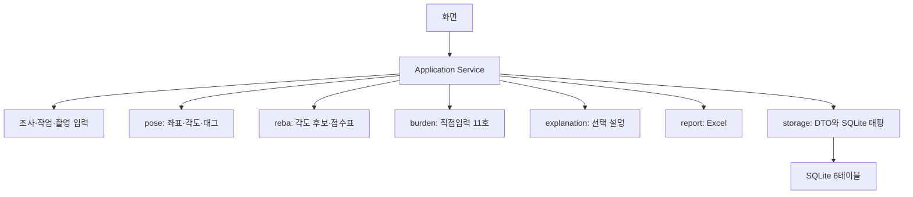

# 데이터베이스 아키텍처 설계서

> 문서 ID ERGO-DBA-001 · 설계 버전 1.3 · 기준일 2026-10-14 · 데모 개발 기준

## 1. 단순 로컬 구조

Windows 로컬 SQLite와6테이블(SURVEY/TASK/PHOTO/ANALYSIS/APP_SETTINGS/EXPORT_LOG)을 사용한다. 세부 입력·계산결과는 DTO JSON으로 저장한다. 별도 revision/각도/점수/법규조건 테이블, SQL 계산뷰, FK/UNIQUE/CHECK/차단 trigger, 보안·암호화·운영 가드는 데모에 넣지 않는다.

DB는 기록을 저장한다. 실제 계산은 pose/reba/burden 모듈이 한다. 이번 문서는 구조를 정의하며 현재 프로토타입 SQL이 새 설계를 구현했다고 주장하지 않는다.

## 2. 파일 배치

| 자료 | 위치 | 처리 |
|---|---|---|
| 앱 DB | %LOCALAPPDATA%\LOCO\loco_demo.db | SQLite6테이블 |
| 원본 사진 | 사용자가 등록한 절대경로 | 앱이 복사/삭제하지 않음 |
| 사진 배정·수동관찰 | TASK.input_json | 명시된 DTO/15슬롯 |
| 분석입력/결과 | ANALYSIS.snapshot_json/result_json | 입력시점 복사,15사진/11기준 |
| 대표사진 | 원본 PHOTO 경로 | 별도 JPEG/BLOB 보관 없음. 못 읽으면 생략 |
| Excel | 사용자가 지정한 경로 | EXPORT_LOG에 생성정보와snapshot 기록 |
| 설정 | APP_SETTINGS.settings_json | 모델/프로필/GPT사용여부/모델명 |
| GPT 키 | 실행환경 OPENAI_API_KEY | DB/OS자격증명 모듈 추가하지 않음 |

파일 해시·암호화·동의/보존 차단·자동백업·복구정책은 구현 이후 검토한다. DB 백업 버튼이나 이를 위한 테이블은 이번 데모에 없다.

## 3. 모듈 분리

- 계산 모듈은 DTO를 받고 DTO를 반환한다. DB 연결/파일저장/다른 계산 모듈 내부 호출은 하지 않는다.
- capture는 등록/미리보기에서 사진을 읽고 pose는 추론을 위해 읽는다. 모델 실행은pose만 담당한다. report는 선택 대표사진을 출력에 넣을 때 읽는다.
- reba는 PoseResult의 각도에서 사진별6개 후보를 만들고 수동값/하중으로 점수표를 계산한다. 후보 적용 전에는 확정 수동값으로 사용하지 않는다. 목은 REBA_TABLE_2000_V2의 수동 구간이다. burden은 작업조건/직접노출시간/횟수로 계산하며 pose/reba 총점에 의존하지 않는다. 확인된 제외→모순→확실한미달→결론에 필요한누락→해석→해당의 순서는 burden이 담당한다.
- explanation은 NumericSummary만 받아 문장을 반환한다. 서비스가 미계산/미완전/완전과 초안/조사자/effective 상태·출처·제외/누락/검토사유를 함께 구성한다. 생성 문장은 계산 모듈로 역입력하지 않는다.
- report.build_overview(snapshot)은 같은 ExportSnapshot에서 선택 분석의 상태/집계/다음 입력 안내를 구성한다. report.render(snapshot,destination)은 그 파생값과 snapshot.include_representative로 네 시트를 쓰고 RenderedReport를 반환한다. UI/DB가 집계나 누락 분류를 별도로 구현하지 않는다. report는 REBA/고시 엔진을 재호출하지 않는다.
- storage는6테이블별 읽기/쓰기/삭제와 JSON 직렬화만 맡는다. 새로운 계산 기능 때문에 DB 구조를 매번 늘리지 않는다.

## 4. 저장 흐름

### 입력 저장

서비스가 Task DTO의 입력부를 TASK.input_json으로 저장하고 input_revision을1증가한다. 짧은 기본 트랜잭션으로 JSON·revision·updated_at을 함께 쓴다. 예상버전 가드나 실행중 잠금은 없다. 변경 시 결과에 ‘이전 입력 기준’ 표시를 한다.

선택사진/같은순간3회차/개별 편집은 UI가 현재 ManualValue[]에 선택 필드만 합쳐 전체 목록을 보낸다. 자동 적용은 각 대상 사진 자신의 후보를 쓰며 source=AUTO_ACCEPTED와 대상photo_id/근거를 기록한다. service/storage는 기존 TASK.input_json.manual에 저장한다. 사진 없는 대상/없는 후보는 미확인으로 남기고 다른 편집은 계속한다. 별도 그룹/템플릿 저장소나 승인 API를 만들지 않는다.

### 사진 분석

1. 서비스가 현재 입력/15배정/수동값/사진메타/설정을 TaskSnapshot으로 복사한다.
2. ANALYSIS행과15개 PENDING 자리를 저장하고 TASK.latest_analysis_id를 새ID로 둔다.
3. DB 트랜잭션 밖에서 pose를 사진별로 실행한다. 빈 슬롯/읽기실패는 해당 진단을 남기고 나머지를 계속 처리한다.
4. 서비스가 tag/reba/burden을 각각 호출한다. 수동값·직접입력이 충분한 모듈은 포즈 불량에도 결과를 낸다. 나머지는 null/누락을 표시한다.
5. 결과 JSON과 완료시각을 저장한다. 실패/취소도15슬롯 상태를 남긴다. 오래된 완료는 latest_analysis_id를 갱신하지 않는다.

Analysis.status는 RUNNING/FINISHED/FAILED/CANCELED라는 요청 실행상태다. FINISHED는 요청 모듈들이 결과/진단을 반환한 상태이며 포즈/REBA의 완전성을 뜻하지 않는다. pose.status는 RUNNING/DONE/PARTIAL_REVIEW/FAILED/CANCELED이고 유효사진 수 기준은 기능정의서 §6이다. DB 저장 자체가 실패하면 정상적으로 저장됐다고 표시하지 않고 DB_ERROR를 반환한다.

### 재계산

현재 입력으로 새 snapshot/ANALYSIS행을 만들고 요청 모듈만 실행한다. 다른 모듈은 관련 입력이 같을 때만 복사하고 달라졌으면null(태그는빈배열)/재계산 안내를 둔다. reba만 수정했으면 pose·고시를 다시 실행하지 않는다. 법적 입력만 바뀌면 burden만 다시 계산한다. 태그만 재계산하는recalculate_tags도 제공한다. 사진/카메라/모델이 바뀌면 pose를 재사용하지 않는다. 모듈 의존 비교는 DTO 값 비교이며 해시/FK/trigger 가드로 만들지 않는다.

## 5. 현재성·검토

현재성은 input_revision와 latest_analysis_id를 비교해 CURRENT/STALE/NONE으로 읽는다. 저장된 과거 결과를 자동으로 최신이라고 표시하지 않는다. 실행중 TASK 수정은 가능하고 결과는 시작 snapshot을 유지한다. 원본 파일 바이트 자체의 변경 자동 감지는 데모에 없다.

조사 검토는 SURVEY.review_json의 분석ID목록/검토자/시각/메모/검토 당시 metadata_revision이다. 조사 메타 변경은 metadata_revision만 증가한다. 기준별 조사자 결론은 ANALYSIS.result_json.judgment에 있으며 계산 초안은 별도 필드다. 미완전 결과도 검토 가능하고 검토 표시가 계산 완전성을 대신하지 않는다.

대표사진/설명문/조사자결론은 해당 분석의 표시영역을 수정한다. 시작 snapshot·앱의 계산 초안은 유지한다. 조사자결론 변경/해제는SURVEY.review_json.reviewed=false로 저장하며 대표/설명문만 수정하면 계산검토 표시는 유지한다. 원본이 사라지면 수치는 보존하고 이미지 보기/출력만 생략한다.

## 6. 출력·삭제·범위

Excel 생성은 선택한 분석과 조사정보를 ExportSnapshot으로 복사한 뒤 DB 밖에서 수행한다. 현재/과거·미완전·검토상태를 기록한다. 생성된 파일과 EXPORT_LOG는 보고서 수치 출처를 연결한다. 생성 후 로그저장 실패면 파일은 남아 있을 수 있으며 결과에 그 사실을 알린다.

서비스는 preview_excel/export_excel에서 같은 작업별 분석 선택 규칙으로 snapshot을 구성한다. report.build_overview가 ReportOverview를 구성하며 미리보기는 파일/로그 저장 없이 DTO를 반환한다. 출력은 호출 시점의 새 snapshot에 ExportSpec.include_representative를 복사하고 render(snapshot,ExportSpec.destination)을 호출한다. 미리보기 내부 옵션은true이며 상태/집계와 무관하다. render가 반환한 overview.state를 ExportReceipt에 옮긴다. 기존 EXPORT_LOG.snapshot_json에 ExportSnapshot, receipt_json에 sheets와reviewed/review_current/has_incomplete/has_stale를 기록한다. report_version/schema_version=1.3, include_representative/exported_at도 이 JSON에 저장하며 새 컬럼은 없다.

출력 reviewed는 선택analysis_id가 검토목록에 있는지와 조사reviewed로 정하고 review_current는 여기에 metadata_revision 일치/분석CURRENT까지 비교한다. has_incomplete는 선택 분석/모듈 결과 유무와 원래 pose/reba/judgment 상태에서 직접 계산한다. 안내는 기존 포즈 diagnostics/REBA missing_fields·좌우 review_reasons/고시 computed_status·missing_fields·review_reasons에서 next_inputs[].message로 구성한다. 별도 미완전 사유 분류/배열이나 그 저장소를 만들지 않는다. UI/Excel은 같은 안내 문구를 사용하고 출력기록에는 기존 네 상태 부울을 기록한다. 상태는 저장·분석·검토·출력 허가 조건으로 사용하지 않는다. SUMMARY 작업표는14열이고 조사정보는 위 개요, 진단/적용 설명은 아래 식별자 붙은 상세영역, 버전/대표슬롯은 기존 상세시트에 표시한다. 데이터와 네 시트는 유지한다.

입력 부족/검토 필요 기준 수, REBA 미완료 사진 수와 next_inputs는 저장 결과에서 파생한다. 조회 SQL/뷰/trigger나 별도 집계 테이블에 계산을 넣지 않는다. 조사자 결론/검토 표시와 부족 항목은 독립이다. 대표사진/구성점수와 판정의 모든 근거는 같은 선택 분석에서 읽으며 원본 사진이 없으면 이미지와 사유만 바뀐다. 필터/정렬 표 밖에 식별자를 붙인 대표블록을 렌더링한다. 출력 수치와 판정은 Excel 수식으로 재계산하지 않는다.

사진삭제: 현재 배정/수동값을 비우고 PHOTO삭제. 작업삭제: 해당 PHOTO→ANALYSIS→TASK. 조사삭제: 소속 작업→EXPORT_LOG→SURVEY. 서비스가 순서대로 수행한다. 실행중 삭제도 잠금으로 막지 않으며 취소를 요청하고 늦은 완료응답은 삭제된행을 재생성하지 않는다. 원본사진/외부Excel은 삭제하지 않는다. 복잡한 DB cascade/감사 trigger는 없다.

데모는 단일 PC·단일 사용자다. 계정/권한/분산DB/동시사용자/암호화/백업복구/자동보존삭제/운영차단은 구현 이후 검토다. 기존 tests/docs_src 검증도구를 새 데모의 의무 실행절차로 연결하지 않는다. 새 테스트/가드는 이번 작업에 추가하지 않는다.
