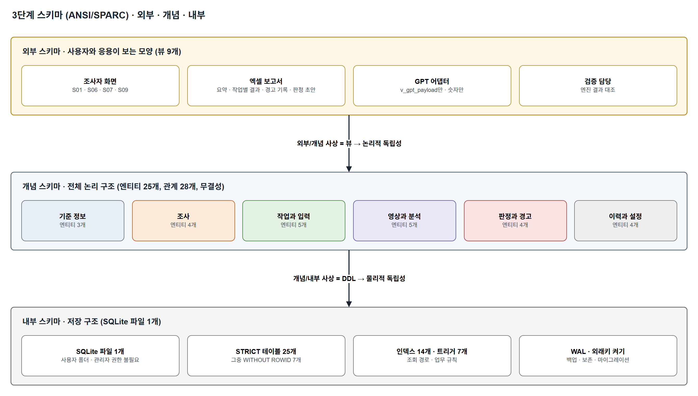
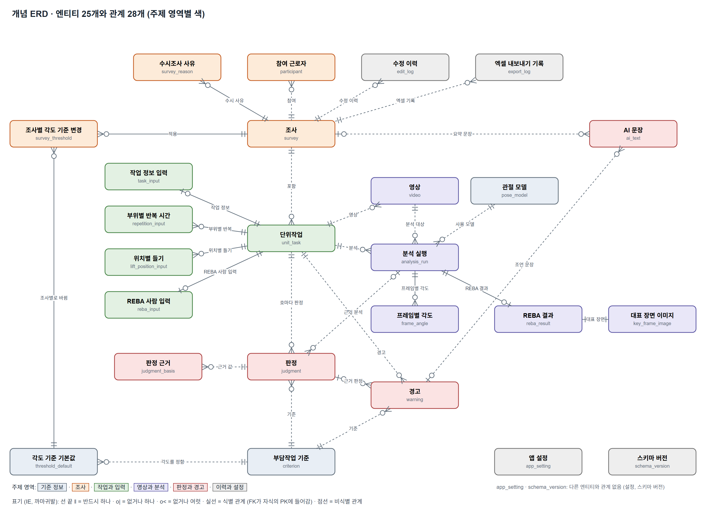
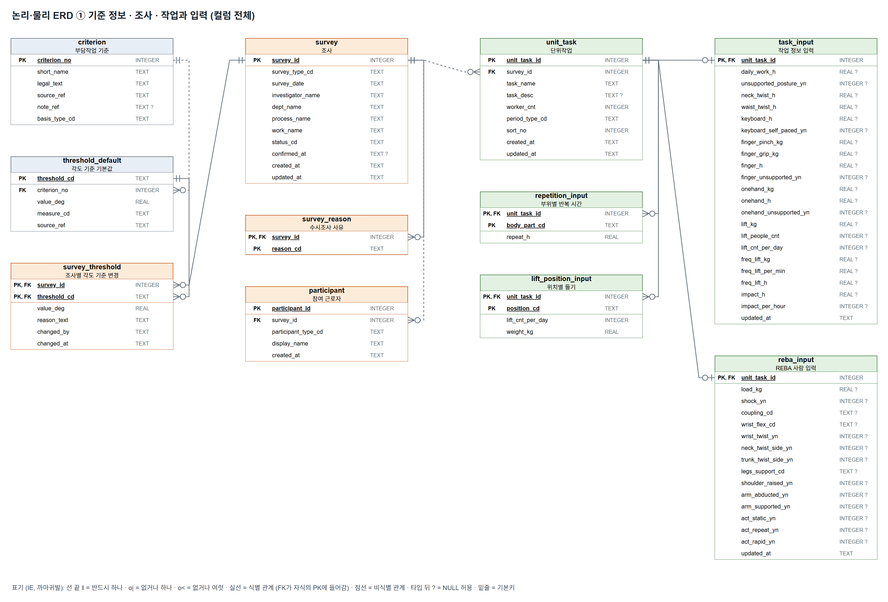
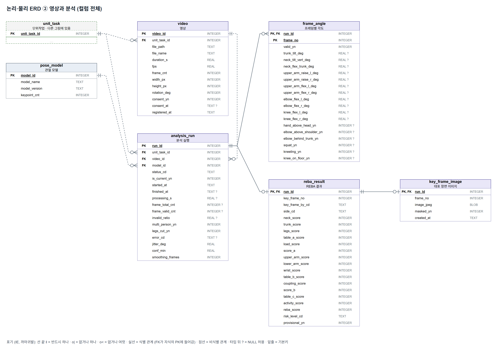
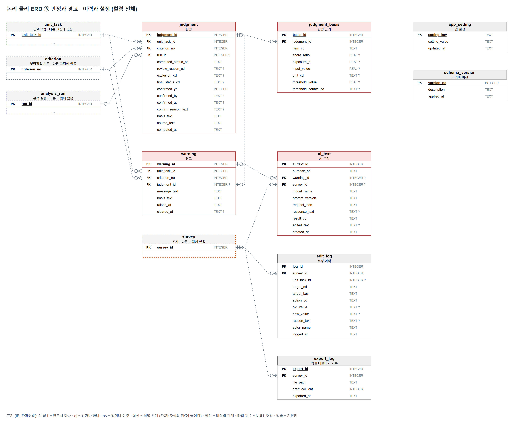

# ERD · 데이터 설계서

> 근골격계 유해요인조사 보조 앱 · 3단계 스키마 (외부 · 개념 · 내부)

## 문서 정보

| 항목 | 내용 |
|---|---|
| 문서 번호 | ERGO-DD-001 |
| 버전 | v0.1 (초안) |
| 작성일 | 2026-10-12 |
| 작성 | 한정욱 (데이터 담당) |
| 검토 | 김나리 · 유서하 · 정혁 |
| 상태 | 초안. 10/14 설계 1차에서 검토, 10/15 확정 |
| 상위 문서 | 기능정의서 v0.3 (ERGO-FD-001), requirements.md |
| 다음 문서 | API 계약서 (ERGO-API-001) |
| DBMS | SQLite 3.45 (Python 3.11 내장 sqlite3). 서버 없이 PC에 파일 하나 |
| 그림 원본 | `ERD.drawio` (draw.io로 열어 고칠 수 있음) · PNG는 `ERD_그림` 폴더 |
| 멘토 WBS | api-data-design.md의 '엑셀·저장 데이터' 부분 |

### 개정 이력

| 버전 | 날짜 | 바뀐 내용 |
|---|---|---|
| v0.1 | 2026-10-12 | 초안. 3단계 스키마, 데이터 표준, 테이블 25개, 뷰 9개, 인덱스 14개, 트리거 7개. SQLite에서 만들어 시험함. API 계약서와 대조해 GPT 뷰(거르기용 번호, 조사의 단위작업 수)와 수정 이력 동작 코드의 뜻을 맞춤 |
| v0.1 | 2026-10-12 | ERD를 그림으로: draw.io 파일 1개(5쪽)와 PNG 5장. 개념 ERD와 5.5절에서 ai_text의 두 부모를 '반드시 하나'로 적었던 것을 '없거나 하나'로 바로잡음 (외래키가 NULL 허용) |
| v0.1.1 | 2026-10-12 | 고시 제2020-12호 원문 대조 (국가법령정보센터 현행 본문): criterion.legal_text의 3호·6호를 원문대로 고침 (띄어쓰기만 다름, 나머지 9개는 일치). 작업 기간 구분 설명을 고시 제2조 표현으로 바꿈. 원문 사본과 시험은 프로젝트의 tests/test_law_text.py |

---

## 1. 이 문서가 정하는 것

- 데이터를 세 층으로 나눠 정한다 (ANSI/SPARC 3단계 스키마).
  - **외부 스키마**: 사용자와 응용 프로그램이 보는 모양. 화면, 엑셀, GPT가 각각 보는 뷰 (7절)
  - **개념 스키마**: 데이터 전체의 논리 구조. 엔티티, 속성, 관계, 무결성 규칙 (5절)
  - **내부 스키마**: 실제로 저장하는 방식. 테이블, 타입, 인덱스, 트리거, 파일 (6절)
- 설계 원칙
  1. **판정의 근거가 남는다.** 같은 입력이면 같은 결과가 나오고, 그 결과가 어떤 값으로 나왔는지 다시 보여 줄 수 있어야 한다 (NFR-004, NFR-005).
  2. **법 기준값은 출처와 함께 저장한다.** 각도 기준은 해설 값이 기본이고, 조사자가 바꾸면 사유가 남는다 (BR-06).
  3. **필요한 것만 저장한다.** 얼굴, 원본 영상, 관절 위치 원자료는 저장하지 않는다 (BR-22, 8절).
  4. **DB가 막을 수 있는 규칙은 DB가 막는다.** 값의 범위, 상태의 조합, 이력 보호는 CHECK, 외래키, 트리거로 건다. 앱 코드에 버그가 있어도 잘못된 데이터가 들어가지 않는다 (9절에서 시험).
  5. **PC 한 대, 파일 하나.** 백업과 이동은 파일 하나를 복사하면 된다.

---

## 2. 3단계 스키마 한눈에 보기



| 층 | 무엇 | 이 프로젝트에서 | 누가 쓰나 |
|---|---|---|---|
| 외부 스키마 | 사용자·응용별로 필요한 부분만 보이는 모양 | 뷰 9개 (조사 목록, 분석 결과, 판정표, 엑셀 시트, GPT 전송, 검증) | 화면, 엑셀 내보내기, GPT 어댑터 |
| 개념 스키마 | 조직 전체의 데이터 논리 구조. 하나만 있다 | 엔티티 25개, 관계, 식별자, 정규화, 무결성 규칙 | 설계자, 모든 기능의 기준 |
| 내부 스키마 | 저장 장치에 어떻게 저장하나 | SQLite 파일, STRICT 테이블, 인덱스, 트리거, 저장 옵션 | DB 엔진 |

**데이터 독립성** (3단계로 나누는 이유)

- **논리적 독립성** (외부 ↔ 개념): 개념 스키마가 바뀌어도 뷰만 고치면 화면과 엑셀 코드는 그대로다. 예: 판정 근거를 `judgment_basis`로 나눠도 화면은 `v_judgment_sheet`만 읽으므로 영향이 없다.
- **물리적 독립성** (개념 ↔ 내부): 저장 방식이 바뀌어도 테이블 구조와 뷰는 그대로다. 예: 인덱스를 더하거나 `WITHOUT ROWID`로 바꿔도 테이블·뷰·앱 코드는 그대로다.

**데이터 모델링 단계와의 대응**

| 모델링 단계 | 하는 일 | 이 문서 |
|---|---|---|
| 개념적 모델링 | 주제 영역, 핵심 엔티티, 관계 | 5.1, 5.2 |
| 논리적 모델링 | 속성, 식별자, 관계의 카디널리티, 정규화 | 5.3 ~ 5.7 → 개념 스키마 |
| 물리적 모델링 | 테이블, 타입, 인덱스, 저장 옵션 | 6절 → 내부 스키마 |
| 뷰 설계 | 사용자별 보기 | 7절 → 외부 스키마 |

---

## 3. 데이터 요건 (기능정의서 → 저장할 정보)

| 기능 | 저장할 정보 | 엔티티 | 메모 |
|---|---|---|---|
| F01-01 | 조사개요, 수시 사유 | survey, survey_reason | 수시 사유는 여러 개라 따로 둠 |
| F01-02 | 모든 입력과 결과 (자동 저장) | 전체 | — |
| F01-03 | 다음 정기조사 예정일 | (저장 안 함) | 확정일 + 3년. 파생 속성이라 뷰에서 계산 |
| F02-01 | 단위작업, 작업 기간 구분 | unit_task | — |
| F02-02 | 하루 작업시간과 호별 입력값 | task_input, repetition_input, lift_position_input | 비어 있음(NULL) = '입력 필요' |
| F02-03 | 참여 근로자 | participant | 개인정보 |
| F03-01, F03-03 | 영상 정보, 촬영 동의 | video | 원본은 위치만 |
| F03-04 | 분석 실행과 상태 | analysis_run | 다시 분석하면 새 행 |
| F04-01 | 관절 위치 | (저장 안 함) | 메모리에서만 씀 |
| F04-02 | 얼굴 가린 대표 장면 | key_frame_image | 가린 것만 저장 (DB가 강제) |
| F04-03, F04-04 | 프레임별 각도와 자세 판별 | frame_angle | 기준을 바꿔도 영상 없이 다시 계산 (OI-12) |
| F04-05 | 자세 비율, 하루 노출 시간 | judgment_basis | 판정 시점의 값을 스냅샷으로 |
| F04-06, F04-07 | REBA 사람 입력, 단계별 점수, 대표 장면 | reba_input, reba_result | — |
| F05-01, F05-02 | 호별 판정, 사람 확인 사유 | judgment, judgment_basis, criterion | 단위작업 × 호마다 1행 |
| F05-03 | 경고 기록 | warning | — |
| F05-05, F05-06 | 확정, 수정 이력 | judgment, edit_log | 이력은 추가만 |
| F06-01 | 엑셀 내보내기 기록 | export_log | 시트 내용은 뷰에서 |
| F06-02, F06-03 | GPT 요청과 결과 | ai_text | 보낸 값을 남김 |
| F07-01 ~ F07-03 | 모델, 각도 기준, 설정 | pose_model, threshold_default, survey_threshold, app_setting | GPT 키는 저장 안 함 |

---

## 4. 데이터 표준

### 4.1 명명 규칙

1. 테이블과 컬럼 이름은 영어 소문자와 밑줄(snake_case)로 쓴다. 테이블은 단수 명사다 (예: `survey`, `unit_task`).
2. 컬럼 이름의 끝은 도메인을 나타낸다 (4.2절). 예: `daily_work_h`는 '시간(시)' 도메인
3. 식별자는 `테이블명_id`로 쓴다. 다른 테이블에서도 같은 이름으로 참조한다 (예: `unit_task_id`).
4. 코드 값은 영어 대문자와 밑줄로 쓰고 4.4절 코드 정의서에 등록한다.
5. 약어는 표준 단어(4.3절)에 있는 것만 쓴다.

### 4.2 도메인 정의

| 도메인 | 컬럼 끝 | SQLite 타입 | 규칙 |
|---|---|---|---|
| 식별자 | `_id` | INTEGER | 1부터 자동 증가 (rowid) |
| 번호 | `_no` | INTEGER | 0 이상 (호 번호는 1~11) |
| 코드 | `_cd` | TEXT | 코드 정의서의 값만 (CHECK) |
| 여부 | `_yn` | INTEGER | 0 또는 1. NULL은 '아직 모름' |
| 일시 | `_at` | TEXT | `YYYY-MM-DDTHH:MM:SS` 로컬 시각 |
| 일자 | `_date` | TEXT | `YYYY-MM-DD` (`date()`로 검증) |
| 시간(시) | `_h` | REAL | 0 ~ 24 |
| 시간(초) | `_s` | REAL | 0 이상 |
| 각도 | `_deg` | REAL | 부위별 범위 (-180 ~ 180, 0 ~ 180) |
| 무게 | `_kg` | REAL | 0 이상 |
| 횟수·개수 | `_cnt`, `_per_day`, `_per_min`, `_per_hour` | INTEGER, REAL | 0 이상 |
| 비율 | `_ratio` | REAL | 0 ~ 1 |
| 점수 | `_score` | INTEGER | REBA 단계별 범위 |
| 이름 | `_name` | TEXT | 빈 글자 금지 |
| 글 | `_text`, `_desc`, `_json` | TEXT | JSON은 `json_valid()` 검사 |
| 위치 | `_path` | TEXT | 원본 파일 위치 |
| 이미지 | `_jpeg` | BLOB | 얼굴 가린 JPEG만 |

### 4.3 표준 단어

| 한글 | 영어 | 한글 | 영어 |
|---|---|---|---|
| 조사 | survey | 단위작업 | unit_task |
| 부담작업 기준(호) | criterion | 각도 기준 | threshold |
| 판정 | judgment | 근거 | basis |
| 경고 | warning | 분석 | analysis_run |
| 영상 | video | 프레임 | frame |
| 참여자 | participant | 수정 이력 | edit_log |
| 계산값(초안) | computed | 확정값 | final |
| 확정 | confirm | 하루 | daily |
| 노출 | exposure | 비율 | ratio, share |
| 굽힘 | flex | 젖힘 | ext |
| 비틀림 | twist | 들기 | lift |
| 몸통 | trunk | 허리 | waist |
| 목 | neck | 위팔 | upper_arm |
| 팔꿈치 | elbow | 무릎 | knee |
| 손잡이 | coupling | 하중 | load |
| 대표 장면 | key_frame | 기울기 | tilt |

### 4.4 코드 정의서

| 코드 컬럼 | 값과 뜻 |
|---|---|
| survey.survey_type_cd | REGULAR 정기 · OCCASIONAL 수시 · INITIAL 최초 |
| survey_reason.reason_cd | MSD_CASE 근골격계질환자 발생 · NEW_TASK 부담작업에 해당하는 새 작업·설비 도입 · ENV_CHANGE 업무량·작업공정 등 작업환경 변경 |
| survey.status_cd | DRAFT 작성 중 · CONFIRMED 확정 |
| participant.participant_type_cd | REPRESENTATIVE 근로자 대표 · WORKER 해당 작업 근로자 |
| unit_task.period_type_cd | ONGOING 상시 (단기간작업도 간헐적인 작업도 아님) · SHORT_TERM 단기간작업 (2개월 이내에 종료되는 1회성 작업) · INTERMITTENT 간헐적인 작업 (연간 총 작업일수 60일 이하). 정의는 고시 제2조 제1·2호 |
| repetition_input.body_part_cd | NECK 목 · SHOULDER 어깨 · ELBOW 팔꿈치 · WRIST 손목 · HAND 손 |
| lift_position_input.position_cd | BELOW_KNEE 무릎 아래 · ABOVE_SHOULDER 어깨 위 · ARM_EXTENDED 팔을 뻗은 상태 |
| reba_input.coupling_cd | GOOD 좋음 (+0) · FAIR 보통 (+1) · POOR 나쁨 (+2) · UNACCEPTABLE 받아들일 수 없음 (+3) |
| reba_input.wrist_flex_cd | LE15 0~15° · GT15 15° 초과 |
| reba_input.legs_support_cd | BILATERAL 양발 지지 · UNILATERAL 한 발 지지·불안정 |
| threshold_default.threshold_cd | NECK_FLEX 목 굽힘 · WAIST_FLEX 허리 굽힘 · WAIST_EXT 허리 젖힘 · NECK_TWIST 목 비틀림 · WAIST_TWIST 허리 비틀림 · UPPER_ARM_RAISE 팔꿈치 들기 (위팔) |
| threshold_default.measure_cd | VIDEO 영상으로 잼 · INVESTIGATOR 조사자 판단 |
| criterion.basis_type_cd | VIDEO 영상 · INPUT 입력 · MIXED 영상과 입력 |
| analysis_run.status_cd | RUNNING 분석 중 · DONE 완료 · FAILED 실패 · CANCELED 취소 |
| reba_result.key_frame_by_cd | AUTO 자동 · INVESTIGATOR 조사자가 고름 |
| reba_result.side_cd | L 왼쪽 · R 오른쪽 |
| reba_result.risk_level_cd | NEGLIGIBLE 무시 (1) · LOW 낮음 (2~3) · MEDIUM 보통 (4~7) · HIGH 높음 (8~10) · VERY_HIGH 매우 높음 (11~15) |
| judgment.computed_status_cd | APPLICABLE 해당 · NOT_APPLICABLE 비해당 · NEEDS_REVIEW 사람 확인 · NEEDS_INPUT 입력 필요 |
| judgment.final_status_cd | APPLICABLE 해당 · NOT_APPLICABLE 비해당 |
| judgment.review_reason_cd | JITTER 기준 각도 근처 · INVALID_FRAMES 판별 불가 프레임이 많음 · INTERPRETATION 따로 본 결과와 합친 결과가 다름 · MULTI_PERSON 여러 사람 · LEGS_CUT 다리 잘림 · KNEE_ON_FLOOR 무릎을 바닥에 댄 자세가 있음 |
| judgment.exclusion_cd | SHORT_TERM 단기간작업 · INTERMITTENT 간헐적인 작업 |
| judgment_basis.unit_cd | H 시간 · KG · CNT_DAY 회/일 · CNT_MIN 회/분 · CNT_HOUR 회/시간 · PERSON 명 · RATIO 비율 · DEG 도 · YN 예/아니오 |
| judgment_basis.threshold_source_cd | NOTICE 고시 · MOEL_NOTE 고용노동부 해설 · INVESTIGATOR 조사자 변경 |
| judgment_basis.item_cd | 자세 항목은 threshold_cd 값과 P3_UNION(3호 합산) · SQUAT · KNEELING, 입력 항목은 KEYBOARD_H · REPEAT_{부위} · FINGER_* · ONEHAND_* · LIFT_KG_PER_PERSON · LIFT_CNT · POS_{위치} · FREQ_LIFT_* · IMPACT_*. CHECK 없이 이 목록으로 관리 (항목이 늘 수 있어서) |
| ai_text.purpose_cd | WARNING_ADVICE 경고 조언 · REPORT_SUMMARY 보고서 요약 |
| ai_text.result_cd | OK 정상 · DISABLED 꺼 둠 · NO_WARNING 열린 경고가 없어 부르지 않음 (보고서 요약) · FALLBACK_NO_KEY 키 없음 · FALLBACK_OFFLINE 인터넷 없음 · FALLBACK_TIMEOUT 시간 초과 · FALLBACK_ERROR 오류 · FALLBACK_NUMBER_MISMATCH 보낸 적 없는 숫자 |
| edit_log.target_cd | SURVEY · TASK_INPUT · REBA_INPUT · THRESHOLD · KEY_FRAME · JUDGMENT |
| edit_log.action_cd | SET 값 입력·교체 (사유 선택) · CHANGE 사유가 필요한 변경 (각도 기준, 확정 결과 고치기) · CONFIRM 확정 · UNCONFIRM 확정 해제 · RESET 기본값으로 (언제 무엇을 쓰는지는 API 계약서 2.1절) |
| app_setting.setting_key | POSE_MODEL_ID · GPT_ENABLED · GPT_MODEL · LAST_EXPORT_DIR |

---

## 5. 개념 스키마

### 5.1 주제 영역

| 주제 영역 | 엔티티 | 설명 |
|---|---|---|
| 기준 정보 | criterion, threshold_default, pose_model | 법의 11개 호, 해설의 각도, 모델 목록. 앱과 함께 배포 |
| 조사 | survey, survey_reason, participant, survey_threshold | 조사 한 건과 그 조사에만 적용하는 값 |
| 작업과 입력 | unit_task, task_input, repetition_input, lift_position_input, reba_input | 단위작업과 조사자가 넣는 값 |
| 영상과 분석 | video, analysis_run, frame_angle, reba_result, key_frame_image | 영상 분석 결과 |
| 판정과 경고 | judgment, judgment_basis, warning, ai_text | 11개 호 판정, 근거, 경고, AI 문장 |
| 이력과 설정 | edit_log, export_log, app_setting, schema_version | 감사 기록, 설정, 스키마 버전 |

### 5.2 개념 ERD (엔티티와 관계)



- 표기: IE 표기법 (까마귀발). 선 끝 `‖` 반드시 하나 · `o|` 없거나 하나 · `o<` 없거나 여럿. 실선은 식별 관계 (부모의 키가 자식의 PK에 들어감), 점선은 비식별 관계.
- 그림의 관계와 카디널리티는 스키마(부록 A)의 외래키에서 자동으로 만든다. 5.5절 표와도 자동으로 대조한다.
- 원본: `ERD.drawio` (draw.io에서 열어 고칠 수 있음. 부록 C)

### 5.3 논리·물리 ERD (컬럼 전체)

테이블마다 모든 컬럼과 타입을 보인다. 타입 뒤 `?`는 NULL 허용, 밑줄은 기본키다. 다른 그림에 있는 테이블은 회색 점선 상자에 기본키만 보인다. 컬럼 설명은 6.2절 테이블 정의서에 있다.

**① 기준 정보 · 조사 · 작업과 입력**



**② 영상과 분석**



**③ 판정과 경고 · 이력과 설정**



### 5.4 엔티티 정의

| 엔티티 | 한글명 | 정의 | 식별자 (종류) | 생기는 때 |
|---|---|---|---|---|
| criterion | 부담작업 기준 | 고시 제3조의 1~11호 | criterion_no (본질 식별자: 법의 호 번호) | 앱 설치 때 |
| threshold_default | 각도 기준 기본값 | 해설이 정한 자세 각도 | threshold_cd (본질 식별자) | 앱 설치 때 |
| pose_model | 관절 모델 | 쓸 수 있는 관절 모델 | model_id (인조) | 앱 설치 때 |
| survey | 조사 | 유해요인조사 한 건 | survey_id (인조) | 조사를 만들 때 |
| survey_reason | 수시조사 사유 | 수시조사의 사유 하나 | survey_id + reason_cd (복합, 식별 관계) | 사유를 고를 때 |
| participant | 참여 근로자 | 면담 참여자 한 명 | participant_id (인조) | 참여자를 넣을 때 |
| survey_threshold | 조사별 각도 기준 변경 | 한 조사에서 바꾼 각도 하나 | survey_id + threshold_cd (복합, 식별 관계) | 조사자가 각도를 바꿀 때 |
| unit_task | 단위작업 | 판정 단위가 되는 작업 | unit_task_id (인조) | 단위작업을 등록할 때 |
| task_input | 작업 정보 입력 | 단위작업의 입력값 묶음 | unit_task_id (1:1 식별 관계) | 처음 입력할 때 |
| repetition_input | 부위별 반복 시간 | 2호 부위 하나의 반복 시간 | unit_task_id + body_part_cd (복합) | 부위 시간을 넣을 때 |
| lift_position_input | 위치별 들기 | 9호 위치 하나의 횟수와 무게 | unit_task_id + position_cd (복합) | 위치별 값을 넣을 때 |
| reba_input | REBA 사람 입력 | 영상으로 못 재는 REBA 항목 | unit_task_id (1:1 식별 관계) | 처음 입력할 때 |
| video | 영상 | 단위작업에 붙인 영상 파일 하나 | video_id (인조) | 영상을 고를 때 |
| analysis_run | 분석 실행 | 영상 하나를 모델 하나로 분석한 한 번 | run_id (인조) | 분석을 시작할 때 |
| frame_angle | 프레임별 각도 | 분석의 프레임 하나 | run_id + frame_no (복합, 식별 관계) | 분석이 끝날 때 |
| reba_result | REBA 결과 | 분석의 대표 장면 REBA | run_id (1:1 식별 관계) | 분석이 끝날 때 |
| key_frame_image | 대표 장면 이미지 | 얼굴 가린 대표 장면 | run_id (1:1 식별 관계) | 대표 장면이 정해질 때 |
| judgment | 판정 | 단위작업의 호 하나에 대한 판정 | judgment_id (인조), 대체키 unit_task_id + criterion_no | 판정을 계산할 때 |
| judgment_basis | 판정 근거 | 판정에 쓴 값 하나 | basis_id (인조), 대체키 judgment_id + item_cd | 판정을 계산할 때 |
| warning | 경고 | 띄운 경고 하나 | warning_id (인조) | '해당' 초안이 생길 때 |
| ai_text | AI 문장 | GPT 요청 한 번 | ai_text_id (인조) | 문장을 요청할 때 |
| edit_log | 수정 이력 | 바뀐 일 하나 | log_id (인조) | 값이 바뀔 때 |
| export_log | 엑셀 내보내기 기록 | 엑셀 파일 하나 | export_id (인조) | 엑셀을 만들 때 |
| app_setting | 앱 설정 | 설정 하나 | setting_key (본질) | 설정을 바꿀 때 |
| schema_version | 스키마 버전 | 스키마 변경 한 번 | version_no | 설치·업그레이드 때 |

### 5.5 관계 정의

| 부모 | 자식 | 카디널리티 | 관계 | 부모를 지우면 |
|---|---|---|---|---|
| survey | unit_task, survey_reason, participant, survey_threshold, edit_log, export_log | 1 : 0..N | 비식별 (survey_reason, survey_threshold는 식별) | 함께 지움 (CASCADE) |
| survey | ai_text (요약) | 0..1 : 0..N | 비식별, 선택 (AI 문장은 경고나 조사 중 하나에만 딸림, CHECK로 강제) | 함께 지움 |
| threshold_default | survey_threshold | 1 : 0..N | 식별 | 지울 수 없음 (기준 정보) |
| criterion | threshold_default, judgment, warning | 1 : 0..N | 비식별 | 지울 수 없음 (기준 정보) |
| unit_task | task_input, reba_input | 1 : 0..1 | 식별 (1:1) | 함께 지움 |
| unit_task | repetition_input, lift_position_input | 1 : 0..N | 식별 | 함께 지움 |
| unit_task | video, analysis_run, judgment, warning | 1 : 0..N | 비식별 | 함께 지움 |
| video | analysis_run | 1 : 0..N | 비식별 | 분석이 남아 있으면 영상만 지울 수 없음 (증거 보호) |
| pose_model | analysis_run | 1 : 0..N | 비식별 | 지울 수 없음 |
| analysis_run | frame_angle | 1 : 0..N | 식별 | 함께 지움 |
| analysis_run | reba_result | 1 : 0..1 | 식별 (1:1) | 함께 지움 |
| reba_result | key_frame_image | 1 : 0..1 | 식별 (1:1) | 함께 지움 |
| analysis_run | judgment | 0..1 : 0..N | 비식별, 선택 (입력만 쓰는 호는 분석이 없음) | 판정이 남아 있으면 지울 수 없음 |
| judgment | judgment_basis | 1 : 0..N | 비식별 | 함께 지움 |
| judgment | warning | 0..1 : 0..N | 비식별, 선택 | 경고의 연결만 끊음 (SET NULL) |
| warning | ai_text (조언) | 0..1 : 0..N | 비식별, 선택 (위와 같음) | 함께 지움 |

### 5.6 정규화 검토

| 단계 | 검토 | 이 설계에서 |
|---|---|---|
| 1정규형 | 한 칸에 값 하나, 반복 그룹 없음 | 수시 사유(여러 개) → survey_reason. 2호 부위별 시간 → repetition_input. 9호 위치별 횟수 → lift_position_input |
| 2정규형 | 복합키의 일부에만 딸린 속성 없음 | frame_angle의 각도는 (run_id, frame_no) 전체에 딸림. survey_threshold의 값·사유는 (survey_id, threshold_cd) 전체에 딸림 |
| 3정규형 | 키가 아닌 속성끼리의 이행 종속 없음 | 호의 이름·법 문구는 criterion에만. 모델 이름·버전은 pose_model에만. 조사자 이름은 survey에만 |

**의도적 반정규화** (이유가 있어 계산 결과를 저장한 곳)

| 어디 | 무엇을 저장 | 이유 |
|---|---|---|
| judgment_basis | 자세 비율, 하루 노출 시간, 비교한 기준값 | 판정 시점의 근거를 그대로 남기기 위해 (재현성, 감사). 나중에 기준이 바뀌어도 확정 당시 값이 남는다 |
| judgment.basis_text, source_text | 근거·출처 문장 | 화면과 엑셀에 같은 문장을 보이기 위해 |
| reba_result | REBA 단계별 점수 | 점수가 어떻게 나왔는지 보여 주기 위해. 합계 규칙은 CHECK로 묶어 서로 어긋나지 않게 함 |
| analysis_run.invalid_ratio | 판별 불가 비율 | 사람 확인 판단에 바로 쓰기 위해 |

파생 속성이지만 **저장하지 않는 것**: 다음 정기조사 예정일 (확정일 + 3년, v_survey_list에서 계산), 조사별로 실제 쓰는 각도 (v_effective_threshold에서 계산)

### 5.7 무결성 제약

| 종류 | 무엇을 지키나 | 어떻게 | 기능정의서 |
|---|---|---|---|
| 개체 무결성 | 모든 행은 식별된다 | 모든 테이블에 PK. 복합키 테이블은 WITHOUT ROWID | — |
| 참조 무결성 | 없는 조사·작업·분석을 가리키지 않는다 | 외래키 + 삭제 규칙 (5.5절). 연결마다 `PRAGMA foreign_keys = ON` | — |
| 도메인 무결성 | 값의 범위와 코드 | CHECK: 하루 작업시간 0~24, REBA 1~15, 코드 목록, 날짜 형식, JSON 형식 | F02-02 처리 규칙 2 |
| 상태 무결성 | 상태와 값의 조합 | 확정 = 확정 시각 있음. '입력 필요'는 확정 불가. '사람 확인'과 초안과 다른 확정은 사유 필수 | 3.2절, EX-14, EX-15 |
| 계산 무결성 | 점수 합계 | 점수 A = 표 A + 하중, 점수 B = 표 B + 손잡이, REBA = 표 C + 활동, 위험 단계 = 점수 구간 | F04-06 |
| 업무 규칙 (트리거) | 행 하나로는 못 거는 규칙 | 수시조사에만 사유 · 동의한 영상만 분석 · 같은 작업의 영상·분석만 · 수정 이력은 고치거나 지울 수 없음 | F03-03, F05-06 |
| 개인정보 | 얼굴은 저장하지 않음 | key_frame_image.masked_yn = 1만 허용 | BR-22 |

표 A·B·C의 조회 값(어떤 각도 점수 조합이 몇 점인지)은 DB가 확인하지 않는다. 분석 엔진이 계산하고 워크시트 예시로 시험한다 (AC-18).

---

## 6. 내부 스키마

### 6.1 저장 구조

| 항목 | 정한 것 | 이유 |
|---|---|---|
| 파일 | `%LOCALAPPDATA%\ergo-assist\ergo_assist.db` 하나 | 설치형 PC 프로그램. 사용자 폴더라 관리자 권한이 필요 없음 |
| 연결 설정 | `PRAGMA foreign_keys = ON` (연결마다), `PRAGMA journal_mode = WAL` (파일 만들 때), `PRAGMA busy_timeout = 3000` | SQLite는 외래키가 기본으로 꺼져 있음. WAL은 분석 중 화면이 읽어도 막히지 않고 갑자기 꺼져도 안전함 |
| STRICT 테이블 | 모든 테이블 | SQLite는 원래 타입을 느슨하게 받음. STRICT면 'abc'를 REAL 칸에 넣을 수 없음 |
| WITHOUT ROWID | 복합키 테이블 (survey_reason, survey_threshold, repetition_input, lift_position_input, frame_angle), 문자 PK 테이블 (threshold_default, app_setting) | PK 순서로 바로 저장해 조회가 빠르고 공간이 적음 |
| 이미지 | 대표 장면 JPEG를 BLOB로 DB에 저장 | 백업·이동이 파일 하나로 끝남 (결정 D-02) |
| 시각 | 로컬 시각 ISO 문자열 | SQLite에 날짜 타입이 없음. 문자열이라도 정렬이 시간순과 같음 |

### 6.2 테이블 정의서

#### T01. criterion (부담작업 기준)

고시 제3조 1~11호 (기준 정보). 저장 방식: STRICT

| 컬럼 | 타입 | NULL | 기본값 | 키 | 설명 |
|---|---|---|---|---|---|
| criterion_no | INTEGER | 아니오 |  | PK | 호 번호 (1~11) |
| short_name | TEXT | 아니오 |  |  | 짧은 이름 |
| legal_text | TEXT | 아니오 |  |  | 고시 원문 |
| source_ref | TEXT | 아니오 |  |  | 근거 조문 |
| note_ref | TEXT | 예 |  |  | 해설 '주' 위치 |
| basis_type_cd | TEXT | 아니오 |  |  | 판정 근거 종류: 영상·입력·혼합 |

#### T02. threshold_default (각도 기준 기본값)

해설의 각도 값 (F07-02, BR-06). 저장 방식: STRICT, WITHOUT ROWID

| 컬럼 | 타입 | NULL | 기본값 | 키 | 설명 |
|---|---|---|---|---|---|
| threshold_cd | TEXT | 아니오 |  | PK | 각도 기준 코드 |
| criterion_no | INTEGER | 아니오 |  | FK → criterion.criterion_no | 적용 호 |
| value_deg | REAL | 아니오 |  |  | 기준 각도 (°) |
| measure_cd | TEXT | 아니오 |  |  | 측정 방법: 영상·조사자 판단 |
| source_ref | TEXT | 아니오 |  |  | 출처 (해설 호·주) |

#### T03. pose_model (관절 모델)

분석에 쓸 수 있는 관절 모델 (F07-01). 저장 방식: STRICT

| 컬럼 | 타입 | NULL | 기본값 | 키 | 설명 |
|---|---|---|---|---|---|
| model_id | INTEGER | 아니오 |  | PK | 모델 식별자 |
| model_name | TEXT | 아니오 |  |  | 모델 이름 |
| model_version | TEXT | 아니오 |  |  | 버전 |
| keypoint_cnt | INTEGER | 아니오 |  |  | 관절 점 개수 |

고유 제약: (model_name, model_version)

#### T04. survey (조사)

유해요인조사 한 건 (F01-01). 저장 방식: STRICT

| 컬럼 | 타입 | NULL | 기본값 | 키 | 설명 |
|---|---|---|---|---|---|
| survey_id | INTEGER | 아니오 |  | PK | 조사 식별자 |
| survey_type_cd | TEXT | 아니오 |  |  | 조사 구분: 정기·수시·최초 |
| survey_date | TEXT | 아니오 |  |  | 조사일 |
| investigator_name | TEXT | 아니오 |  |  | 조사자 이름 (개인정보) |
| dept_name | TEXT | 아니오 |  |  | 부서 |
| process_name | TEXT | 아니오 |  |  | 작업공정명 |
| work_name | TEXT | 아니오 |  |  | 작업명 |
| status_cd | TEXT | 아니오 | 'DRAFT' |  | 조사 상태: 작성 중·확정 (3.3절) |
| confirmed_at | TEXT | 예 |  |  | 확정 시각 |
| created_at | TEXT | 아니오 | 지금 시각 |  | 만든 시각 |
| updated_at | TEXT | 아니오 | 지금 시각 |  | 고친 시각 |

#### T05. survey_reason (수시조사 사유)

수시조사의 사유 (여러 개, 1NF로 분리). 저장 방식: STRICT, WITHOUT ROWID

| 컬럼 | 타입 | NULL | 기본값 | 키 | 설명 |
|---|---|---|---|---|---|
| survey_id | INTEGER | 아니오 |  | PK · FK → survey.survey_id | 조사 |
| reason_cd | TEXT | 아니오 |  | PK | 사유 코드 |

#### T06. participant (참여 근로자)

면담에 참여한 근로자·근로자 대표 (F02-03). 저장 방식: STRICT

| 컬럼 | 타입 | NULL | 기본값 | 키 | 설명 |
|---|---|---|---|---|---|
| participant_id | INTEGER | 아니오 |  | PK | 참여자 식별자 |
| survey_id | INTEGER | 아니오 |  | FK → survey.survey_id | 조사 |
| participant_type_cd | TEXT | 아니오 |  |  | 구분: 근로자 대표·해당 작업 근로자 |
| display_name | TEXT | 아니오 |  |  | 표시 이름 (개인정보, 실명 대신 '근로자 A' 가능) |
| created_at | TEXT | 아니오 | 지금 시각 |  | 기록 시각 |

#### T07. survey_threshold (조사별 각도 기준 변경)

'특별한 사정'으로 바꾼 각도 (F07-02, EX-14). 저장 방식: STRICT, WITHOUT ROWID

| 컬럼 | 타입 | NULL | 기본값 | 키 | 설명 |
|---|---|---|---|---|---|
| survey_id | INTEGER | 아니오 |  | PK · FK → survey.survey_id | 조사 |
| threshold_cd | TEXT | 아니오 |  | PK · FK → threshold_default.threshold_cd | 각도 기준 코드 |
| value_deg | REAL | 아니오 |  |  | 바꾼 각도 (°) |
| reason_text | TEXT | 아니오 |  |  | 바꾼 사유 (필수) |
| changed_by | TEXT | 아니오 |  |  | 바꾼 사람 |
| changed_at | TEXT | 아니오 | 지금 시각 |  | 바꾼 시각 |

#### T08. unit_task (단위작업)

판정 단위가 되는 작업 (F02-01). 저장 방식: STRICT

| 컬럼 | 타입 | NULL | 기본값 | 키 | 설명 |
|---|---|---|---|---|---|
| unit_task_id | INTEGER | 아니오 |  | PK | 단위작업 식별자 |
| survey_id | INTEGER | 아니오 |  | FK → survey.survey_id | 조사 |
| task_name | TEXT | 아니오 |  |  | 단위작업명 |
| task_desc | TEXT | 예 |  |  | 작업 내용 |
| worker_cnt | INTEGER | 아니오 |  |  | 작업 인원 |
| period_type_cd | TEXT | 아니오 |  |  | 작업 기간 구분: 상시·단기간·간헐 (BR-02) |
| sort_no | INTEGER | 아니오 | 0 |  | 보여 줄 순서 |
| created_at | TEXT | 아니오 | 지금 시각 |  | 만든 시각 |
| updated_at | TEXT | 아니오 | 지금 시각 |  | 고친 시각 |

고유 제약: (survey_id, task_name)

#### T09. task_input (작업 정보 입력)

조사자가 면담으로 넣는 값. NULL은 미입력 = '입력 필요' (F02-02). 저장 방식: STRICT

| 컬럼 | 타입 | NULL | 기본값 | 키 | 설명 |
|---|---|---|---|---|---|
| unit_task_id | INTEGER | 아니오 |  | PK · FK → unit_task.unit_task_id | 단위작업 |
| daily_work_h | REAL | 예 |  |  | 하루 작업시간 (시간) |
| unsupported_posture_yn | INTEGER | 예 |  |  | 4호 전제: 지지 없음·자세 변경 불가 (BR-09) |
| neck_twist_h | REAL | 예 |  |  | 목 비틀림 시간 (시간/일, 4호) |
| waist_twist_h | REAL | 예 |  |  | 허리 비틀림 시간 (시간/일, 4호) |
| keyboard_h | REAL | 예 |  |  | 키보드·마우스 집중 입력 시간 (1호) |
| keyboard_self_paced_yn | INTEGER | 예 |  |  | 입력 시간을 마음대로 조절 가능 (1호, BR-14) |
| finger_pinch_kg | REAL | 예 |  |  | 손가락으로 집어 옮기는 무게 (6호) |
| finger_grip_kg | REAL | 예 |  |  | 손가락으로 쥐는 힘 (kg 환산, 6호) |
| finger_h | REAL | 예 |  |  | 6호 작업 시간 |
| finger_unsupported_yn | INTEGER | 예 |  |  | 6호 지지 없음 |
| onehand_kg | REAL | 예 |  |  | 한 손으로 드는 무게·쥐는 힘 (7호) |
| onehand_h | REAL | 예 |  |  | 7호 작업 시간 |
| onehand_unsupported_yn | INTEGER | 예 |  |  | 7호 지지 없음 |
| lift_kg | REAL | 예 |  |  | 드는 물체 무게 (8호) |
| lift_people_cnt | INTEGER | 예 |  |  | 함께 드는 인원 (8호, BR-11) |
| lift_cnt_per_day | INTEGER | 예 |  |  | 하루 드는 횟수 (8호) |
| freq_lift_kg | REAL | 예 |  |  | 자주 드는 무게 (10호) |
| freq_lift_per_min | REAL | 예 |  |  | 분당 드는 횟수 (10호) |
| freq_lift_h | REAL | 예 |  |  | 10호 작업 시간 |
| impact_h | REAL | 예 |  |  | 충격 작업 시간 (11호) |
| impact_per_hour | INTEGER | 예 |  |  | 시간당 충격 횟수 (11호) |
| updated_at | TEXT | 아니오 | 지금 시각 |  | 고친 시각 |

#### T10. repetition_input (부위별 반복 시간)

2호 같은 동작 반복, 부위마다 1행. 저장 방식: STRICT, WITHOUT ROWID

| 컬럼 | 타입 | NULL | 기본값 | 키 | 설명 |
|---|---|---|---|---|---|
| unit_task_id | INTEGER | 아니오 |  | PK · FK → unit_task.unit_task_id | 단위작업 |
| body_part_cd | TEXT | 아니오 |  | PK | 부위 |
| repeat_h | REAL | 아니오 |  |  | 반복 시간 (시간/일) |

#### T11. lift_position_input (위치별 들기)

9호 무릎 아래·어깨 위·팔 뻗음, 위치마다 1행. 저장 방식: STRICT, WITHOUT ROWID

| 컬럼 | 타입 | NULL | 기본값 | 키 | 설명 |
|---|---|---|---|---|---|
| unit_task_id | INTEGER | 아니오 |  | PK · FK → unit_task.unit_task_id | 단위작업 |
| position_cd | TEXT | 아니오 |  | PK | 들기 위치 |
| lift_cnt_per_day | INTEGER | 아니오 |  |  | 하루 횟수 |
| weight_kg | REAL | 아니오 |  |  | 무게 (kg) |

#### T12. reba_input (REBA 사람 입력)

영상으로 못 재는 REBA 항목. NULL은 '사람 확인' (F04-06). 저장 방식: STRICT

| 컬럼 | 타입 | NULL | 기본값 | 키 | 설명 |
|---|---|---|---|---|---|
| unit_task_id | INTEGER | 아니오 |  | PK · FK → unit_task.unit_task_id | 단위작업 |
| load_kg | REAL | 예 |  |  | 하중 (5단계) |
| shock_yn | INTEGER | 예 |  |  | 충격·급격한 힘 (5단계) |
| coupling_cd | TEXT | 예 |  |  | 손잡이 (11단계) |
| wrist_flex_cd | TEXT | 예 |  |  | 손목 굽힘 0~15°·15° 초과 (9단계) |
| wrist_twist_yn | INTEGER | 예 |  |  | 손목 꺾임·비틀림 (9a) |
| neck_twist_side_yn | INTEGER | 예 |  |  | 목 비틀림·옆굽힘 (1a) |
| trunk_twist_side_yn | INTEGER | 예 |  |  | 몸통 비틀림·옆굽힘 (2a) |
| legs_support_cd | TEXT | 예 |  |  | 다리 지지 (3단계) |
| shoulder_raised_yn | INTEGER | 예 |  |  | 어깨 올림 (7a) |
| arm_abducted_yn | INTEGER | 예 |  |  | 위팔 벌림 (7a) |
| arm_supported_yn | INTEGER | 예 |  |  | 팔 받침·기댐 (7a) |
| act_static_yn | INTEGER | 예 |  |  | 1분 넘는 정적 자세 (13단계) |
| act_repeat_yn | INTEGER | 예 |  |  | 분당 4회 넘는 작은 반복 (13단계) |
| act_rapid_yn | INTEGER | 예 |  |  | 급격한 큰 자세 변화 (13단계) |
| updated_at | TEXT | 아니오 | 지금 시각 |  | 고친 시각 |

#### T13. video (영상)

단위작업 영상. 원본은 복사하지 않고 위치만 저장 (F03-01, BR-22). 저장 방식: STRICT

| 컬럼 | 타입 | NULL | 기본값 | 키 | 설명 |
|---|---|---|---|---|---|
| video_id | INTEGER | 아니오 |  | PK | 영상 식별자 |
| unit_task_id | INTEGER | 아니오 |  | FK → unit_task.unit_task_id | 단위작업 |
| file_path | TEXT | 아니오 |  |  | 원본 위치 |
| file_name | TEXT | 아니오 |  |  | 파일 이름 |
| duration_s | REAL | 아니오 |  |  | 길이 (초) |
| fps | REAL | 아니오 |  |  | 초당 프레임 |
| frame_cnt | INTEGER | 아니오 |  |  | 프레임 수 |
| width_px | INTEGER | 아니오 |  |  | 가로 (픽셀) |
| height_px | INTEGER | 아니오 |  |  | 세로 (픽셀) |
| rotation_deg | INTEGER | 아니오 | 0 |  | 회전 정보 |
| consent_yn | INTEGER | 아니오 | 0 |  | 촬영 동의 확인 (F03-03) |
| consent_at | TEXT | 예 |  |  | 동의 확인 시각 |
| registered_at | TEXT | 아니오 | 지금 시각 |  | 등록 시각 |

#### T14. analysis_run (분석 실행)

영상 1개를 모델 1개로 분석한 한 번 (F03-04). 다시 분석하면 새 행. 저장 방식: STRICT

| 컬럼 | 타입 | NULL | 기본값 | 키 | 설명 |
|---|---|---|---|---|---|
| run_id | INTEGER | 아니오 |  | PK | 분석 식별자 |
| unit_task_id | INTEGER | 아니오 |  | FK → unit_task.unit_task_id | 단위작업 |
| video_id | INTEGER | 아니오 |  | FK → video.video_id | 분석한 영상 |
| model_id | INTEGER | 아니오 |  | FK → pose_model.model_id | 쓴 모델 |
| status_cd | TEXT | 아니오 |  |  | 분석 상태 (3.1절) |
| is_current_yn | INTEGER | 아니오 | 0 |  | 현재 결과 여부 (단위작업마다 1개) |
| started_at | TEXT | 아니오 | 지금 시각 |  | 시작 시각 |
| finished_at | TEXT | 예 |  |  | 끝난 시각 |
| processing_s | REAL | 예 |  |  | 분석 시간 (초) |
| frame_total_cnt | INTEGER | 예 |  |  | 전체 프레임 |
| frame_valid_cnt | INTEGER | 예 |  |  | 판별 가능 프레임 |
| invalid_ratio | REAL | 예 |  |  | 판별 불가 비율 (TP-03 비교) |
| multi_person_yn | INTEGER | 아니오 | 0 |  | 여러 사람 (EX-05) |
| legs_cut_yn | INTEGER | 아니오 | 0 |  | 다리 잘림 (EX-06) |
| error_cd | TEXT | 예 |  |  | 실패 코드 |
| jitter_deg | REAL | 아니오 | 5 |  | 확신도 흔들기 폭 (TP-01) |
| conf_min | REAL | 아니오 | 0.5 |  | 관절 신뢰도 하한 (TP-02) |
| smoothing_frames | INTEGER | 아니오 | 5 |  | 평활화 프레임 수 (TP-09) |

#### T15. frame_angle (프레임별 각도)

프레임마다 각도와 자세 판별 결과 (F04-03, F04-04, OI-12). 관절 위치 원자료는 저장하지 않음. 저장 방식: STRICT, WITHOUT ROWID

| 컬럼 | 타입 | NULL | 기본값 | 키 | 설명 |
|---|---|---|---|---|---|
| run_id | INTEGER | 아니오 |  | PK · FK → analysis_run.run_id | 분석 |
| frame_no | INTEGER | 아니오 |  | PK | 프레임 번호 |
| valid_yn | INTEGER | 아니오 |  |  | 판별 가능 |
| trunk_tilt_deg | REAL | 예 |  |  | 몸통 기울기 (수직 기준, 앞 +) |
| neck_tilt_vert_deg | REAL | 예 |  |  | 목 기울기 (수직 기준, 4호) |
| neck_flex_trunk_deg | REAL | 예 |  |  | 목 굽힘 (몸통 기준, REBA) |
| upper_arm_raise_l_deg | REAL | 예 |  |  | 왼 위팔 들림 (수직 기준, 3호) |
| upper_arm_raise_r_deg | REAL | 예 |  |  | 오른 위팔 들림 (수직 기준, 3호) |
| upper_arm_flex_l_deg | REAL | 예 |  |  | 왼 위팔 굽힘 (몸통 기준, REBA) |
| upper_arm_flex_r_deg | REAL | 예 |  |  | 오른 위팔 굽힘 (몸통 기준, REBA) |
| elbow_flex_l_deg | REAL | 예 |  |  | 왼 팔꿈치 굽힘 |
| elbow_flex_r_deg | REAL | 예 |  |  | 오른 팔꿈치 굽힘 |
| knee_flex_l_deg | REAL | 예 |  |  | 왼 무릎 굽힘 |
| knee_flex_r_deg | REAL | 예 |  |  | 오른 무릎 굽힘 |
| hand_above_head_yn | INTEGER | 예 |  |  | 손이 머리 위 (3호 a) |
| elbow_above_shoulder_yn | INTEGER | 예 |  |  | 팔꿈치가 어깨 위 (3호 b) |
| elbow_behind_trunk_yn | INTEGER | 예 |  |  | 팔꿈치가 몸통 뒤 (3호 d) |
| squat_yn | INTEGER | 예 |  |  | 쪼그려 앉기 (5호 a) |
| kneeling_yn | INTEGER | 예 |  |  | 무릎 굽힌 자세 (5호 b) |
| knee_on_floor_yn | INTEGER | 예 |  |  | 무릎이 바닥에 닿음 (4호 제외, BR-08) |

#### T16. reba_result (REBA 결과)

대표 장면의 REBA 단계별 점수 (F04-06, F04-07). 저장 방식: STRICT

| 컬럼 | 타입 | NULL | 기본값 | 키 | 설명 |
|---|---|---|---|---|---|
| run_id | INTEGER | 아니오 |  | PK · FK → analysis_run.run_id | 분석 |
| key_frame_no | INTEGER | 아니오 |  |  | 대표 장면 프레임 |
| key_frame_by_cd | TEXT | 아니오 | 'AUTO' |  | 대표 장면을 고른 주체: 자동·조사자 |
| side_cd | TEXT | 아니오 |  |  | 쓴 쪽: 왼쪽·오른쪽 (TP-10) |
| neck_score | INTEGER | 아니오 |  |  | 1단계 목 |
| trunk_score | INTEGER | 아니오 |  |  | 2단계 몸통 |
| legs_score | INTEGER | 아니오 |  |  | 3단계 다리 |
| table_a_score | INTEGER | 아니오 |  |  | 4단계 표 A |
| load_score | INTEGER | 아니오 |  |  | 5단계 하중 |
| score_a | INTEGER | 아니오 |  |  | 6단계 점수 A |
| upper_arm_score | INTEGER | 아니오 |  |  | 7단계 위팔 |
| lower_arm_score | INTEGER | 아니오 |  |  | 8단계 아래팔 |
| wrist_score | INTEGER | 아니오 |  |  | 9단계 손목 |
| table_b_score | INTEGER | 아니오 |  |  | 10단계 표 B |
| coupling_score | INTEGER | 아니오 |  |  | 11단계 손잡이 |
| score_b | INTEGER | 아니오 |  |  | 12단계 점수 B |
| table_c_score | INTEGER | 아니오 |  |  | 12단계 표 C |
| activity_score | INTEGER | 아니오 |  |  | 13단계 활동 |
| reba_score | INTEGER | 아니오 |  |  | REBA 점수 (1~15) |
| risk_level_cd | TEXT | 아니오 |  |  | 위험 단계 |
| provisional_yn | INTEGER | 아니오 |  |  | 임시 점수 (사람 입력 빈칸 있음) |

#### T17. key_frame_image (대표 장면 이미지)

얼굴을 가린 대표 장면 (엑셀에 넣음, BR-22). 저장 방식: STRICT

| 컬럼 | 타입 | NULL | 기본값 | 키 | 설명 |
|---|---|---|---|---|---|
| run_id | INTEGER | 아니오 |  | PK · FK → reba_result.run_id | 분석 |
| frame_no | INTEGER | 아니오 |  |  | 프레임 번호 |
| image_jpeg | BLOB | 아니오 |  |  | JPEG 이미지 |
| masked_yn | INTEGER | 아니오 |  |  | 얼굴 가림 (항상 1) |
| created_at | TEXT | 아니오 | 지금 시각 |  | 만든 시각 |

#### T18. judgment (판정)

단위작업 × 호마다 1행. 지금 값만 두고 바뀐 내역은 수정 이력에 (F05-01, F05-05). 저장 방식: STRICT

| 컬럼 | 타입 | NULL | 기본값 | 키 | 설명 |
|---|---|---|---|---|---|
| judgment_id | INTEGER | 아니오 |  | PK | 판정 식별자 |
| unit_task_id | INTEGER | 아니오 |  | FK → unit_task.unit_task_id | 단위작업 |
| criterion_no | INTEGER | 아니오 |  | FK → criterion.criterion_no | 호 |
| run_id | INTEGER | 예 |  | FK → analysis_run.run_id | 근거 분석 (영상 근거 호만) |
| computed_status_cd | TEXT | 아니오 |  |  | 계산 결과 (3.2절) |
| review_reason_cd | TEXT | 예 |  |  | 사람 확인 사유 |
| exclusion_cd | TEXT | 예 |  |  | 제외 사유: 단기간·간헐 |
| final_status_cd | TEXT | 예 |  |  | 확정 결과 |
| confirmed_yn | INTEGER | 아니오 | 0 |  | 확정 여부 |
| confirmed_by | TEXT | 예 |  |  | 확정한 사람 |
| confirmed_at | TEXT | 예 |  |  | 확정 시각 |
| confirm_reason_text | TEXT | 예 |  |  | 확정 사유 |
| basis_text | TEXT | 아니오 |  |  | 근거 문장 |
| source_text | TEXT | 아니오 |  |  | 출처 문장 |
| computed_at | TEXT | 아니오 | 지금 시각 |  | 계산 시각 |

고유 제약: (unit_task_id, criterion_no)

#### T19. judgment_basis (판정 근거)

판정에 쓴 값의 스냅샷 (재현성, 의도적 반정규화). 저장 방식: STRICT

| 컬럼 | 타입 | NULL | 기본값 | 키 | 설명 |
|---|---|---|---|---|---|
| basis_id | INTEGER | 아니오 |  | PK | 근거 식별자 |
| judgment_id | INTEGER | 아니오 |  | FK → judgment.judgment_id | 판정 |
| item_cd | TEXT | 아니오 |  |  | 근거 항목 코드 |
| share_ratio | REAL | 예 |  |  | 자세 비율 (0~1) |
| exposure_h | REAL | 예 |  |  | 하루 노출 시간 |
| input_value | REAL | 예 |  |  | 입력값 |
| unit_cd | TEXT | 예 |  |  | 입력값 단위 |
| threshold_value | REAL | 예 |  |  | 비교한 기준값 |
| threshold_source_cd | TEXT | 예 |  |  | 기준 출처: 고시·해설·조사자 |

고유 제약: (judgment_id, item_cd)

#### T20. warning (경고)

'해당' 초안이 생길 때 띄운 경고 기록 (F05-03). 저장 방식: STRICT

| 컬럼 | 타입 | NULL | 기본값 | 키 | 설명 |
|---|---|---|---|---|---|
| warning_id | INTEGER | 아니오 |  | PK | 경고 식별자 |
| unit_task_id | INTEGER | 아니오 |  | FK → unit_task.unit_task_id | 단위작업 |
| criterion_no | INTEGER | 아니오 |  | FK → criterion.criterion_no | 호 |
| judgment_id | INTEGER | 예 |  | FK → judgment.judgment_id | 근거 판정 |
| message_text | TEXT | 아니오 |  |  | 기본 경고 문구 |
| basis_text | TEXT | 아니오 |  |  | 근거 문장 |
| raised_at | TEXT | 아니오 | 지금 시각 |  | 뜬 시각 |
| cleared_at | TEXT | 예 |  |  | 사라진 시각 (다시 계산으로) |

#### T21. ai_text (AI 문장)

GPT 요청과 결과 기록. 보낸 값을 남겨 개인정보가 없었음을 증명 (F06-02, F06-03). 저장 방식: STRICT

| 컬럼 | 타입 | NULL | 기본값 | 키 | 설명 |
|---|---|---|---|---|---|
| ai_text_id | INTEGER | 아니오 |  | PK | 식별자 |
| purpose_cd | TEXT | 아니오 |  |  | 용도: 경고 조언·보고서 요약 |
| warning_id | INTEGER | 예 |  | FK → warning.warning_id | 경고 (조언일 때) |
| survey_id | INTEGER | 예 |  | FK → survey.survey_id | 조사 (요약일 때) |
| model_name | TEXT | 아니오 |  |  | GPT 모델 이름 |
| prompt_version | TEXT | 아니오 |  |  | 프롬프트 버전 |
| request_json | TEXT | 아니오 |  |  | 보낸 값 (JSON) |
| response_text | TEXT | 예 |  |  | 받은 문장 |
| result_cd | TEXT | 아니오 |  |  | 결과: 정상·기본 문구로 대체 사유 |
| edited_text | TEXT | 예 |  |  | 조사자가 고친 문장 |
| created_at | TEXT | 아니오 | 지금 시각 |  | 요청 시각 |

#### T22. edit_log (수정 이력)

추가만 가능. 누가·언제·무엇을·왜 (F05-06). 저장 방식: STRICT

| 컬럼 | 타입 | NULL | 기본값 | 키 | 설명 |
|---|---|---|---|---|---|
| log_id | INTEGER | 아니오 |  | PK | 이력 식별자 |
| survey_id | INTEGER | 아니오 |  | FK → survey.survey_id | 조사 |
| unit_task_id | INTEGER | 예 |  |  | 단위작업 (외래키 없음: 작업을 지워도 이력은 남김) |
| target_cd | TEXT | 아니오 |  |  | 바뀐 대상 |
| target_key | TEXT | 아니오 |  |  | 대상 위치 (예: criterion=4) |
| action_cd | TEXT | 아니오 |  |  | 동작 |
| old_value | TEXT | 예 |  |  | 이전 값 |
| new_value | TEXT | 예 |  |  | 새 값 |
| reason_text | TEXT | 예 |  |  | 사유 |
| actor_name | TEXT | 아니오 |  |  | 바꾼 사람 |
| logged_at | TEXT | 아니오 | 지금 시각 |  | 기록 시각 |

#### T23. export_log (엑셀 내보내기 기록)

엑셀을 만든 기록 (F06-01). 저장 방식: STRICT

| 컬럼 | 타입 | NULL | 기본값 | 키 | 설명 |
|---|---|---|---|---|---|
| export_id | INTEGER | 아니오 |  | PK | 식별자 |
| survey_id | INTEGER | 아니오 |  | FK → survey.survey_id | 조사 |
| file_path | TEXT | 아니오 |  |  | 저장 위치 |
| draft_cell_cnt | INTEGER | 아니오 |  |  | '초안' 칸 수 |
| exported_at | TEXT | 아니오 | 지금 시각 |  | 만든 시각 |

#### T24. app_setting (앱 설정)

모델·GPT 사용 여부 등. GPT 키는 여기 두지 않음 (F07-03). 저장 방식: STRICT, WITHOUT ROWID

| 컬럼 | 타입 | NULL | 기본값 | 키 | 설명 |
|---|---|---|---|---|---|
| setting_key | TEXT | 아니오 |  | PK | 설정 이름 |
| setting_value | TEXT | 아니오 |  |  | 값 |
| updated_at | TEXT | 아니오 | 지금 시각 |  | 고친 시각 |

#### T25. schema_version (스키마 버전)

스키마 변경 기록 (마이그레이션). 저장 방식: STRICT

| 컬럼 | 타입 | NULL | 기본값 | 키 | 설명 |
|---|---|---|---|---|---|
| version_no | INTEGER | 아니오 |  | PK | 버전 |
| description | TEXT | 아니오 |  |  | 설명 |
| applied_at | TEXT | 아니오 | 지금 시각 |  | 적용 시각 |


### 6.3 인덱스

외래키 열에는 인덱스를 둔다 (부모를 지울 때 자식을 빨리 찾으려고). 복합 UNIQUE의 첫 열은 그 UNIQUE 인덱스가 대신하므로 따로 두지 않는다 (예: unit_task.survey_id는 UNIQUE(survey_id, task_name)이 대신함).

| 인덱스 | 테이블 | 열 | 종류 |
|---|---|---|---|
| ix_participant_survey | participant | survey_id | 일반 |
| ix_video_task | video | unit_task_id | 일반 |
| ix_run_task | analysis_run | unit_task_id | 일반 |
| ix_run_video | analysis_run | video_id | 일반 |
| ix_run_model | analysis_run | model_id | 일반 |
| ux_run_current | analysis_run | unit_task_id | 고유·부분 (is_current_yn = 1) |
| ix_judgment_run | judgment | run_id | 일반 |
| ix_judgment_criterion | judgment | criterion_no | 일반 |
| ix_warning_task | warning | unit_task_id | 일반 |
| ix_warning_judgment | warning | judgment_id | 일반 |
| ix_ai_text_warning | ai_text | warning_id | 일반 |
| ix_ai_text_survey | ai_text | survey_id | 일반 |
| ix_edit_log_survey | edit_log | survey_id, logged_at | 일반 |
| ix_export_log_survey | export_log | survey_id | 일반 |

**실행 계획으로 확인** (`EXPLAIN QUERY PLAN`)

| 조회 | 실행 계획 |
|---|---|
| 현재 분석 찾기 | SEARCH analysis_run USING INDEX ux_run_current (unit_task_id=?) |
| 조사의 수정 이력 시간순 | SEARCH edit_log USING INDEX ix_edit_log_survey (survey_id=?) |
| 단위작업의 판정 11개 | SEARCH judgment USING INDEX sqlite_autoindex_judgment_1 (unit_task_id=?) |

### 6.4 트리거

| 트리거 | 언제 | 막는 것 (오류 문구) |
|---|---|---|
| trg_survey_reason_occasional | BEFORE INSERT ON survey_reason | survey_reason: 수시조사에만 사유를 넣을 수 있습니다 |
| trg_run_same_task | BEFORE INSERT ON analysis_run | analysis_run: 다른 단위작업의 영상입니다 |
| trg_run_consent | BEFORE INSERT ON analysis_run | analysis_run: 촬영 동의 확인 전에는 분석할 수 없습니다 |
| trg_judgment_run_task_ins | BEFORE INSERT ON judgment | judgment: 다른 단위작업의 분석 결과입니다 |
| trg_judgment_run_task_upd | BEFORE UPDATE OF run_id ON judgment | judgment: 다른 단위작업의 분석 결과입니다 |
| trg_edit_log_no_update | BEFORE UPDATE ON edit_log | edit_log: 수정 이력은 고칠 수 없습니다 |
| trg_edit_log_no_delete | BEFORE DELETE ON edit_log | edit_log: 수정 이력은 지울 수 없습니다 (조사 전체를 지울 때만 함께 지워집니다) |

### 6.5 용량 추정

- 30초 영상 1건(900프레임)의 분석 데이터가 파일에서 차지하는 크기: **약 100 KB** (실측: 900프레임을 넣고 VACUUM 전후 파일 크기 비교)
- 대표 장면 JPEG 1장: 수십 KB (해상도에 따라)
- 조사 1건 (단위작업 10개, 각 30초 영상): 수 MB 수준. 한 PC에 수백 건을 저장해도 문제없음

### 6.6 백업 · 보존 · 삭제

- **백업**: 엑셀을 내보낼 때 DB 파일을 같은 폴더에 함께 복사하는 기능을 둔다 (SQLite 온라인 백업 API). 파일 하나라 USB로 옮길 수 있다.
- **보존**: 지침 11절의 보존 기간(새 조사가 끝날 때까지, 신상정보가 있으면 5년, 개선계획은 해당 설비가 있는 동안)을 화면과 엑셀에 안내한다. 자동으로 지우지는 않는다.
- **삭제**: 조사를 지우면 그 조사의 모든 데이터와 수정 이력이 함께 지워진다. 수정 이력을 한 줄씩 지우는 것은 막는다 (9절 P7, M06).

### 6.7 스키마 변경 (마이그레이션)

1. 스키마를 바꾸면 `schema_version`에 한 줄을 넣고 `PRAGMA user_version`을 같은 번호로 올린다.
2. 앱이 시작할 때 `user_version`을 보고 필요한 변경 SQL을 순서대로 실행한다.
3. 변경 전에 DB 파일을 백업한다.

---

## 7. 외부 스키마

### 7.1 뷰 목록

| 뷰 | 사용자·응용 | 쓰는 곳 | 보여 주는 것 | 감추는 것 |
|---|---|---|---|---|
| v_survey_list | 조사자 | S01 조사 목록 | 조사, 작업 수, 남은 초안 수, 다음 정기조사 예정일 | 판정 세부 |
| v_task_result | 조사자, 엑셀 | S06 분석 결과, 엑셀 '작업별 결과' | 현재 분석, REBA, 모델, 열린 경고 수 | 과거 분석 |
| v_judgment_sheet | 조사자, 엑셀 | S07 판정, 엑셀 '판정 초안' | 호별 상태(초안·확정), 근거, 출처, 확정자 | 계산 중간값 |
| v_excel_summary | 엑셀 | 엑셀 '요약' | 단위작업별 해당 호, 초안 수, REBA | — |
| v_warning_log | 엑셀 | 엑셀 '경고 기록' | 경고, 근거, AI 문장 결과 | 보낸 요청 원문 |
| v_edit_log | 조사자 | S07 수정 이력 | 누가·언제·무엇을·왜 | — |
| v_effective_threshold | 판정 엔진, 조사자 | S09 설정, 판정 계산 | 조사별로 실제 쓰는 각도와 출처 (해설 / 조사자 변경) | — |
| v_gpt_payload | GPT 어댑터 | F06-02 | 호, 기준 요약, 고시 원문(공개 법령), 하루 작업시간, 비율, 노출 시간, REBA, 조사의 단위작업 수. 거르기·묶기용 번호 (보내지 않음) | **이름, 조사·부서·작업명, 파일 위치, 자유 입력 글** (BR-21, AC-30) |
| v_posture_exposure_check | 검증 담당 | 시험 | 저장된 각도로 다시 계산한 비율과 노출 시간 | — (판정에는 쓰지 않음) |

**응용별 규칙**

1. 화면과 엑셀은 뷰로 읽고, 쓰기는 API 계약서의 서비스 함수로만 한다.
2. GPT 어댑터는 `v_gpt_payload`만 읽는다. 다른 테이블을 읽는 코드는 리뷰에서 막는다. `warning_id`·`survey_id`·`unit_task_id`는 거르고 묶는 데만 쓰고 GPT에 보내지 않는다 (API 계약서 6.2절).
3. `v_posture_exposure_check`는 분석 엔진(Python)의 계산을 SQL로 따로 계산해 대조하는 시험용이다. 두 계산이 같으면 엔진을 믿을 근거가 된다 (9절 P1·P2).

### 7.2 뷰 정의

```sql
-- 조사별로 실제 쓰는 각도 기준 (기본값 + 조사자 변경)
CREATE VIEW v_effective_threshold AS
SELECT s.survey_id, d.threshold_cd, d.criterion_no, d.measure_cd,
       COALESCE(o.value_deg, d.value_deg)                    AS value_deg,
       CASE WHEN o.threshold_cd IS NULL THEN 0 ELSE 1 END    AS overridden_yn,
       CASE WHEN o.threshold_cd IS NULL THEN d.source_ref
            ELSE '조사자 변경: ' || o.reason_text END        AS source_label
FROM survey s
CROSS JOIN threshold_default d
LEFT JOIN survey_threshold o ON o.survey_id = s.survey_id AND o.threshold_cd = d.threshold_cd;

-- S01 조사 목록
CREATE VIEW v_survey_list AS
SELECT s.survey_id, s.survey_date, s.survey_type_cd, s.process_name, s.work_name, s.status_cd,
       (SELECT COUNT(*) FROM unit_task t WHERE t.survey_id = s.survey_id) AS task_cnt,
       (SELECT COUNT(*) FROM judgment j JOIN unit_task t ON t.unit_task_id = j.unit_task_id
         WHERE t.survey_id = s.survey_id AND j.confirmed_yn = 0)           AS draft_judgment_cnt,
       CASE WHEN s.survey_type_cd IN ('REGULAR','INITIAL') AND s.confirmed_at IS NOT NULL
            THEN date(s.confirmed_at, '+3 years') END                       AS next_regular_due_date
FROM survey s;

-- S06 분석 결과 · 엑셀 '작업별 결과'
CREATE VIEW v_task_result AS
SELECT t.unit_task_id, t.survey_id, t.task_name, t.period_type_cd, i.daily_work_h,
       r.run_id, r.status_cd AS run_status_cd, r.invalid_ratio, m.model_name, m.model_version,
       rb.reba_score, rb.risk_level_cd, rb.key_frame_no, rb.provisional_yn,
       (SELECT COUNT(*) FROM warning w WHERE w.unit_task_id = t.unit_task_id AND w.cleared_at IS NULL) AS open_warning_cnt
FROM unit_task t
LEFT JOIN task_input   i  ON i.unit_task_id = t.unit_task_id
LEFT JOIN analysis_run r  ON r.unit_task_id = t.unit_task_id AND r.is_current_yn = 1
LEFT JOIN pose_model   m  ON m.model_id = r.model_id
LEFT JOIN reba_result  rb ON rb.run_id = r.run_id;

-- S07 판정 · 엑셀 '판정 초안'
CREATE VIEW v_judgment_sheet AS
SELECT t.survey_id, j.unit_task_id, t.task_name, j.criterion_no, c.short_name,
       COALESCE(j.final_status_cd, j.computed_status_cd)       AS status_cd,
       CASE WHEN j.confirmed_yn = 1 THEN '확정' ELSE '초안' END AS draft_label,
       j.review_reason_cd, j.exclusion_cd, j.basis_text, j.source_text,
       j.confirmed_by, j.confirmed_at, j.confirm_reason_text
FROM judgment j
JOIN unit_task t ON t.unit_task_id = j.unit_task_id
JOIN criterion c ON c.criterion_no = j.criterion_no;

-- 엑셀 '요약'의 단위작업별 결론
CREATE VIEW v_excel_summary AS
SELECT t.survey_id, t.unit_task_id, t.task_name,
       (SELECT group_concat(j.criterion_no || '호', ', ' ORDER BY j.criterion_no)
          FROM judgment j
         WHERE j.unit_task_id = t.unit_task_id
           AND COALESCE(j.final_status_cd, j.computed_status_cd) = 'APPLICABLE') AS applicable_criteria,
       (SELECT COUNT(*) FROM judgment j WHERE j.unit_task_id = t.unit_task_id AND j.confirmed_yn = 0) AS draft_cnt,
       tr.reba_score, tr.risk_level_cd
FROM unit_task t
LEFT JOIN v_task_result tr ON tr.unit_task_id = t.unit_task_id;

-- 엑셀 '경고 기록'
CREATE VIEW v_warning_log AS
SELECT t.survey_id, w.warning_id, t.task_name, w.criterion_no, w.message_text, w.basis_text,
       w.raised_at, w.cleared_at,
       (SELECT a.result_cd FROM ai_text a WHERE a.warning_id = w.warning_id
         ORDER BY a.ai_text_id DESC LIMIT 1) AS latest_ai_result_cd
FROM warning w
JOIN unit_task t ON t.unit_task_id = w.unit_task_id;

-- warning_id · survey_id · unit_task_id는 거르고 묶는 데만 쓰고 GPT에 보내지 않는다
CREATE VIEW v_gpt_payload AS
SELECT w.warning_id, t.survey_id, w.unit_task_id,
       (SELECT COUNT(*) FROM unit_task t2 WHERE t2.survey_id = t.survey_id) AS survey_task_cnt,
       w.criterion_no, c.short_name AS criterion_summary,
       c.legal_text AS criterion_legal_text,      -- 공개 법령 문구 (숫자 검증용)
       i.daily_work_h,
       (SELECT MAX(b.share_ratio) FROM judgment_basis b WHERE b.judgment_id = w.judgment_id) AS max_share_ratio,
       (SELECT MAX(b.exposure_h)  FROM judgment_basis b WHERE b.judgment_id = w.judgment_id) AS max_exposure_h,
       rb.reba_score, rb.risk_level_cd
FROM warning w
JOIN unit_task t          ON t.unit_task_id = w.unit_task_id
JOIN criterion c          ON c.criterion_no = w.criterion_no
LEFT JOIN task_input i    ON i.unit_task_id = w.unit_task_id
LEFT JOIN analysis_run r  ON r.unit_task_id = w.unit_task_id AND r.is_current_yn = 1
LEFT JOIN reba_result rb  ON rb.run_id = r.run_id
WHERE w.cleared_at IS NULL;

-- S07 수정 이력
CREATE VIEW v_edit_log AS
SELECT survey_id, unit_task_id, logged_at, actor_name, target_cd, target_key, action_cd,
       old_value, new_value, reason_text
FROM edit_log;

-- 앱의 판정에는 쓰지 않고, 분석 엔진의 결과와 대조하는 데만 쓴다.
CREATE VIEW v_posture_exposure_check AS
SELECT r.run_id, r.unit_task_id, t.survey_id, i.daily_work_h,
       SUM(f.valid_yn) AS valid_frame_cnt,
       AVG(CASE WHEN f.valid_yn = 1 THEN (f.trunk_tilt_deg >= wf.value_deg AND COALESCE(f.knee_on_floor_yn, 0) = 0) END) AS waist_flex_ratio,
       AVG(CASE WHEN f.valid_yn = 1 THEN (f.trunk_tilt_deg <= -we.value_deg) END)                                    AS waist_ext_ratio,
       AVG(CASE WHEN f.valid_yn = 1 THEN (f.neck_tilt_vert_deg >= nf.value_deg) END)                                 AS neck_flex_ratio,
       AVG(CASE WHEN f.valid_yn = 1 THEN (f.hand_above_head_yn = 1 OR f.elbow_above_shoulder_yn = 1
                                          OR f.elbow_behind_trunk_yn = 1
                                          OR MAX(COALESCE(f.upper_arm_raise_l_deg, -1), COALESCE(f.upper_arm_raise_r_deg, -1)) >= ua.value_deg) END) AS p3_union_ratio,
       AVG(CASE WHEN f.valid_yn = 1 THEN f.squat_yn END)    AS squat_ratio,
       AVG(CASE WHEN f.valid_yn = 1 THEN f.kneeling_yn END) AS kneeling_ratio,
       AVG(CASE WHEN f.valid_yn = 1 THEN (f.trunk_tilt_deg >= wf.value_deg AND COALESCE(f.knee_on_floor_yn, 0) = 0) END) * i.daily_work_h AS waist_flex_h
FROM analysis_run r
JOIN unit_task t   ON t.unit_task_id = r.unit_task_id
JOIN frame_angle f ON f.run_id = r.run_id
LEFT JOIN task_input i ON i.unit_task_id = r.unit_task_id
JOIN v_effective_threshold wf ON wf.survey_id = t.survey_id AND wf.threshold_cd = 'WAIST_FLEX'
JOIN v_effective_threshold we ON we.survey_id = t.survey_id AND we.threshold_cd = 'WAIST_EXT'
JOIN v_effective_threshold nf ON nf.survey_id = t.survey_id AND nf.threshold_cd = 'NECK_FLEX'
JOIN v_effective_threshold ua ON ua.survey_id = t.survey_id AND ua.threshold_cd = 'UPPER_ARM_RAISE'
GROUP BY r.run_id;
```

---

## 8. 개인정보 분류

| 데이터 | 분류 | 저장 | 처리 |
|---|---|---|---|
| 조사자 이름 (survey.investigator_name, confirmed_by, actor_name, changed_by) | 개인정보 | 저장 | 화면과 엑셀에 보임. GPT에 보내지 않음 |
| 참여 근로자 표시 이름 | 개인정보 | 저장 | 실명 대신 '근로자 A' 권장. GPT에 보내지 않음 |
| 근로자 얼굴 | 개인정보 (영상) | **저장하지 않음** | 대표 장면은 가린 것만 (masked_yn = 1 강제) |
| 원본 영상 | 개인정보 | **복사하지 않음** | 위치(file_path)만 저장 |
| 관절 위치 원자료 | 신체 정보 | **저장하지 않음** | 각도와 자세 판별 결과만 저장 |
| 작업명, 작업 내용 (자유 입력) | 개인정보가 섞일 수 있음 | 저장 | GPT에 보내지 않음 (OI-05) |
| 건강 정보 | 민감정보 | 지금은 없음 | 증상조사(FR-032)를 넣으면 민감정보라 따로 설계 (OI-04) |
| GPT API 키 | 비밀 | **DB에 저장하지 않음** | 저장 위치는 API 계약서에서 정함 |

---

## 9. 검증 결과

제약은 '있다'가 아니라 '잡는다'로 증명한다. 정상 데이터가 들어가는지(P)와, 잘못된 데이터를 일부러 넣어 DB가 막는지(M)를 시험했다.

SQLite 3.45.1에서 실행. **30/30 기대대로** (통과해야 할 것 8개, 막혀야 할 것 22개)

| ID | 시험 | 기대 | 결과 | 실제 메시지 |
|---|---|---|---|---|
| P1 | 저장된 프레임별 각도로 자세 비율과 하루 노출을 다시 계산 (35% × 6시간) | 통과해야 함 | 맞음 | 허리 굽힘 비율 0.35, 하루 노출 2.10시간 |
| P2 | 각도 기준을 사유와 함께 바꾸면 뷰와 다시 계산 결과가 바뀜 | 통과해야 함 | 맞음 | 기본 20°(해설 4호 주3) → 변경 40° '조사자 변경: 허리를 받치는 지지대가 있음' → 비율 0.00 |
| P3 | 2026-10-30 확정 정기조사 → 다음 정기조사 예정일 (AC-03) | 통과해야 함 | 맞음 | 다음 정기조사 예정일 2029-10-30 |
| P4 | GPT 전송 뷰에 이름·경로·자유 입력 글이 없음 (AC-30) | 통과해야 함 | 맞음 | 열 12개: warning_id, survey_id, unit_task_id, survey_task_cnt, criterion_no, criterion_summary, criterion_legal_text, d… |
| P5 | 엑셀 요약 뷰가 해당 호와 초안 개수를 보여 줌 | 통과해야 함 | 맞음 | 해당 호 '4호', 초안 4개 |
| P6 | 정상 확정 (초안과 같으면 사유 없이, 사람 확인은 사유와 함께) | 통과해야 함 | 맞음 | 초안과 같은 결과는 사유 없이, '사람 확인'은 사유와 함께 확정됨 |
| P7 | 조사 전체 삭제는 수정 이력까지 함께 지움 (보존 기간이 끝난 조사 정리) | 통과해야 함 | 맞음 | 조사를 지우면 단위작업·영상·분석·판정·경고·이력이 함께 지워짐 |
| P8 | 단위작업 삭제: 분석은 함께 지워지고 이력은 남음 | 통과해야 함 | 맞음 | 단위작업을 지우면 영상·분석은 지워지고 수정 이력 1줄은 남음 |
| M01 | REBA 점수 16점 | 막혀야 함 | 맞음 | CHECK constraint failed: reba_score BETWEEN 1 AND 15 |
| M02 | REBA 9점인데 위험 단계 '보통' | 막혀야 함 | 맞음 | CHECK constraint failed: risk_level_cd = CASE WHEN reba_score = 1 THEN 'NEGLIGIBLE' WHEN reba_score <= 3 THEN 'LOW' W… |
| M03 | REBA 점수 ≠ 표 C 점수 + 활동 점수 | 막혀야 함 | 맞음 | CHECK constraint failed: reba_score = table_c_score + activity_score |
| M04 | 얼굴을 가리지 않은 대표 장면 저장 | 막혀야 함 | 맞음 | CHECK constraint failed: masked_yn = 1 |
| M05 | 수정 이력 고치기 | 막혀야 함 | 맞음 | edit_log: 수정 이력은 고칠 수 없습니다 |
| M06 | 수정 이력 한 줄만 지우기 | 막혀야 함 | 맞음 | edit_log: 수정 이력은 지울 수 없습니다 (조사 전체를 지울 때만 함께 지워집니다) |
| M07 | 사유 없이 각도 기준 변경 | 막혀야 함 | 맞음 | CHECK constraint failed: length(trim(reason_text)) > 0 |
| M08 | '입력 필요' 판정 확정 | 막혀야 함 | 맞음 | CHECK constraint failed: NOT (confirmed_yn = 1 AND computed_status_cd = 'NEEDS_INPUT') |
| M09 | '사람 확인'을 사유 없이 확정 | 막혀야 함 | 맞음 | CHECK constraint failed: confirmed_yn = 0 OR (computed_status_cd <> 'NEEDS_REVIEW' AND final_status_cd = computed_sta… |
| M10 | 초안과 다른 결과로 사유 없이 확정 | 막혀야 함 | 맞음 | CHECK constraint failed: confirmed_yn = 0 OR (computed_status_cd <> 'NEEDS_REVIEW' AND final_status_cd = computed_sta… |
| M11 | 촬영 동의 없는 영상으로 분석 | 막혀야 함 | 맞음 | analysis_run: 촬영 동의 확인 전에는 분석할 수 없습니다 |
| M12 | 한 단위작업에 '현재' 분석이 2개 | 막혀야 함 | 맞음 | UNIQUE constraint failed: analysis_run.unit_task_id |
| M13 | 다른 단위작업의 영상으로 분석 | 막혀야 함 | 맞음 | analysis_run: 다른 단위작업의 영상입니다 |
| M14 | 없는 조사에 단위작업 추가 (외래키) | 막혀야 함 | 맞음 | FOREIGN KEY constraint failed |
| M15 | 하루 작업시간 25시간 | 막혀야 함 | 맞음 | CHECK constraint failed: daily_work_h BETWEEN 0 AND 24 |
| M16 | 정기조사에 수시 사유 넣기 | 막혀야 함 | 맞음 | survey_reason: 수시조사에만 사유를 넣을 수 있습니다 |
| M17 | 같은 단위작업·같은 호 판정 2개 | 막혀야 함 | 맞음 | UNIQUE constraint failed: judgment.unit_task_id, judgment.criterion_no |
| M18 | 분석에 쓴 영상만 지우기 | 막혀야 함 | 맞음 | FOREIGN KEY constraint failed |
| M19 | 확정 시각 없이 조사 확정 | 막혀야 함 | 맞음 | CHECK constraint failed: (status_cd = 'CONFIRMED') = (confirmed_at IS NOT NULL) |
| M20 | 다른 단위작업의 분석 결과로 판정 | 막혀야 함 | 맞음 | judgment: 다른 단위작업의 분석 결과입니다 |
| M21 | AI 문장이 경고와 조사 둘 다를 가리킴 | 막혀야 함 | 맞음 | CHECK constraint failed: (purpose_cd = 'WARNING_ADVICE' AND warning_id IS NOT NULL AND survey_id IS NULL) OR (purpose… |
| M22 | 비틀림 시간이 하루 작업시간보다 큼 | 막혀야 함 | 맞음 | CHECK constraint failed: waist_twist_h IS NULL OR daily_work_h IS NULL OR waist_twist_h <= daily_work_h |

---

## 10. 예시 쿼리 (업무 질의 겸 SQLD 연습)

같은 시험 데이터에서 실행한 결과다.

**Q1 작업별 REBA 순위 (윈도우 함수)**

```sql
SELECT survey_id, task_name, reba_score, RANK() OVER (PARTITION BY survey_id ORDER BY reba_score DESC) AS reba_rank FROM v_task_result
```

결과: (1, '상자 들어 옮기기', 9, 1), (1, '선반 정리', None, 2)

**Q2 해당 호가 1개 이상인 단위작업 (GROUP BY · HAVING)**

```sql
SELECT unit_task_id, COUNT(*) AS applicable_cnt FROM judgment WHERE COALESCE(final_status_cd, computed_status_cd)='APPLICABLE' GROUP BY unit_task_id HAVING COUNT(*) >= 1
```

결과: (10, 1)

**Q3 8호 다시 계산: 무게 ÷ 인원 (CTE · CASE)**

```sql
WITH lift AS (SELECT unit_task_id, lift_kg*1.0/lift_people_cnt AS kg_per_person, lift_cnt_per_day FROM task_input WHERE lift_kg IS NOT NULL) SELECT unit_task_id, kg_per_person, CASE WHEN kg_per_person >= 25 AND lift_cnt_per_day >= 10 THEN 'APPLICABLE' ELSE 'NOT_APPLICABLE' END AS c8 FROM lift
```

결과: (10, 15.0, 'NOT_APPLICABLE')

**Q4 아직 분석하지 않은 단위작업 (LEFT JOIN · IS NULL)**

```sql
SELECT t.unit_task_id, t.task_name FROM unit_task t LEFT JOIN analysis_run r ON r.unit_task_id=t.unit_task_id AND r.is_current_yn=1 WHERE r.run_id IS NULL
```

결과: (11, '선반 정리')

**Q5 '사람 확인'이 남은 조사 (EXISTS)**

```sql
SELECT s.survey_id FROM survey s WHERE EXISTS (SELECT 1 FROM judgment j JOIN unit_task t ON t.unit_task_id=j.unit_task_id WHERE t.survey_id=s.survey_id AND j.computed_status_cd='NEEDS_REVIEW' AND j.confirmed_yn=0)
```

결과: (1,)


---

## 11. 추적표 (기능 → 데이터)

| 기능 | 테이블 | 뷰 |
|---|---|---|
| F01-01 조사 만들기 | survey, survey_reason | v_survey_list |
| F01-02 저장·목록 | (전체) | v_survey_list |
| F01-03 다음 정기조사 예정일 | survey | v_survey_list |
| F02-01 단위작업 등록 | unit_task | v_task_result |
| F02-02 작업 정보 입력 | task_input, repetition_input, lift_position_input | — |
| F02-03 참여 근로자 | participant | — |
| F03-01 ~ F03-03 영상·동의 | video | — |
| F03-04 분석 실행 | analysis_run | v_task_result |
| F04-02 얼굴 모자이크 | key_frame_image | — |
| F04-03 ~ F04-05 각도·자세·노출 | frame_angle, judgment_basis | v_posture_exposure_check |
| F04-06, F04-07 REBA·대표 장면 | reba_input, reba_result, key_frame_image | v_task_result |
| F05-01, F05-02 판정·확신도 | judgment, judgment_basis, criterion | v_judgment_sheet |
| F05-03 경고 | warning | v_warning_log, v_gpt_payload |
| F05-04 다시 계산 | frame_angle, task_input, survey_threshold | v_effective_threshold |
| F05-05 확정 | judgment | v_judgment_sheet |
| F05-06 수정 이력 | edit_log | v_edit_log |
| F06-01 엑셀 | export_log | v_excel_summary, v_task_result, v_warning_log, v_judgment_sheet |
| F06-02, F06-03 GPT | ai_text | v_gpt_payload |
| F07-01 모델 | pose_model, app_setting | — |
| F07-02 각도 기준 | threshold_default, survey_threshold | v_effective_threshold |
| F07-03 GPT 설정 | app_setting | — |

---

## 12. 설계 결정과 미결 사항

### 12.1 결정

| ID | 결정 | 다른 선택지 | 이유 |
|---|---|---|---|
| D-01 | 프레임별 각도를 저장한다 (기능정의서 OI-12) | 요약만 저장 | 각도 기준을 바꿔도 영상 없이 다시 계산하고, 같은 결과를 증명할 수 있다. 30초 영상에 약 100 KB |
| D-02 | 대표 장면 이미지는 DB에 BLOB로 | 이미지 파일을 폴더에 따로 | 파일 하나로 백업·이동. 얼굴 가림을 DB가 강제할 수 있음 |
| D-03 | 판정은 현재 값 1행, 바뀐 내역은 수정 이력에 | 판정 버전 테이블 | 화면과 엑셀은 현재 값만 쓰고, 감사는 이력으로 충분 |
| D-04 | 코드는 CHECK 목록으로 | 공통 코드 테이블 | 코드가 적고 거의 안 바뀜. DB가 바로 막음. 바뀌면 마이그레이션 |
| D-05 | 단위작업을 지워도 수정 이력은 남긴다 | 함께 지움 | 누가 무엇을 지웠는지 남기기 위해. 조사 전체를 지울 때만 함께 지움 |
| D-06 | GPT 키는 DB에 두지 않는다 | 설정 테이블에 저장 | DB 파일을 복사해도 키가 새지 않게 |
| D-07 | 조사별 각도 변경은 survey_threshold에, 기본값은 threshold_default에 | 설정 하나로 | 변경이 다른 조사로 퍼지지 않게 (F07-02 처리 규칙 1) |
| D-08 | 관절 위치 원자료는 저장하지 않는다 | 저장 | 데이터 최소화. 기술 파라미터(TP-04~06)를 바꾸면 다시 분석해야 하는 대가가 있음 |

### 12.2 미결 사항이 바뀌면 생기는 스키마 변경

| 기능정의서 미결 | 이렇게 정해지면 | 스키마 변경 |
|---|---|---|
| OI-01 4·5·9호를 합쳐 보기로 | 판정 계산만 바뀜 | 없음 (judgment_basis 항목만 추가) |
| OI-03 2호·7~10호를 영상으로도 잼 | 영상 참고값 저장 | frame_angle에 동작 판별 열 추가 |
| OI-04 증상설문조사를 넣음 | 근로자 응답 저장 | 증상조사 테이블 추가 (민감정보 설계 필요) |
| OI-06 분석 구간 지정 | 구간 저장 | analysis_run에 start_frame_no, end_frame_no 추가 |
| OI-07 정면 영상 추가 | 영상 방향 구분 | video에 view_cd (측면·정면) 추가 |
| OI-08 분석할 사람 선택 | 고른 사람 저장 | analysis_run에 person_index 추가 |

---

## 부록 A. DDL (schema_v1.sql)

```sql
-- =====================================================================
-- 근골격계 유해요인조사 보조 앱 · 내부 스키마 v1 (SQLite 3.45 이상)
-- 연결할 때마다:      PRAGMA foreign_keys = ON;
-- 파일을 만들 때 한 번: PRAGMA journal_mode = WAL;
-- 시각은 모두 로컬 시각 ISO 8601 문자열 'YYYY-MM-DDTHH:MM:SS'
-- =====================================================================

-- ---------------------------------------------------------------------
-- A. 기준 정보
-- ---------------------------------------------------------------------
CREATE TABLE criterion (
  criterion_no   INTEGER PRIMARY KEY CHECK (criterion_no BETWEEN 1 AND 11),
  short_name     TEXT    NOT NULL CHECK (length(trim(short_name)) > 0),
  legal_text     TEXT    NOT NULL,
  source_ref     TEXT    NOT NULL,
  note_ref       TEXT,
  basis_type_cd  TEXT    NOT NULL CHECK (basis_type_cd IN ('VIDEO','INPUT','MIXED'))
) STRICT;

CREATE TABLE threshold_default (
  threshold_cd   TEXT    PRIMARY KEY CHECK (threshold_cd IN
                   ('NECK_FLEX','WAIST_FLEX','WAIST_EXT','NECK_TWIST','WAIST_TWIST','UPPER_ARM_RAISE')),
  criterion_no   INTEGER NOT NULL REFERENCES criterion(criterion_no),
  value_deg      REAL    NOT NULL CHECK (value_deg > 0 AND value_deg < 180),
  measure_cd     TEXT    NOT NULL CHECK (measure_cd IN ('VIDEO','INVESTIGATOR')),
  source_ref     TEXT    NOT NULL
) STRICT, WITHOUT ROWID;

CREATE TABLE pose_model (
  model_id       INTEGER PRIMARY KEY,
  model_name     TEXT    NOT NULL,
  model_version  TEXT    NOT NULL,
  keypoint_cnt   INTEGER NOT NULL CHECK (keypoint_cnt >= 17),
  UNIQUE (model_name, model_version)
) STRICT;

-- ---------------------------------------------------------------------
-- B. 조사
-- ---------------------------------------------------------------------
CREATE TABLE survey (
  survey_id          INTEGER PRIMARY KEY,
  survey_type_cd     TEXT    NOT NULL CHECK (survey_type_cd IN ('REGULAR','OCCASIONAL','INITIAL')),
  survey_date        TEXT    NOT NULL CHECK (date(survey_date) IS survey_date),
  investigator_name  TEXT    NOT NULL CHECK (length(trim(investigator_name)) > 0),
  dept_name          TEXT    NOT NULL CHECK (length(trim(dept_name)) > 0),
  process_name       TEXT    NOT NULL CHECK (length(trim(process_name)) > 0),
  work_name          TEXT    NOT NULL CHECK (length(trim(work_name)) > 0),
  status_cd          TEXT    NOT NULL DEFAULT 'DRAFT' CHECK (status_cd IN ('DRAFT','CONFIRMED')),
  confirmed_at       TEXT    CHECK (confirmed_at IS NULL OR datetime(confirmed_at) IS NOT NULL),
  created_at         TEXT    NOT NULL DEFAULT (strftime('%Y-%m-%dT%H:%M:%S','now','localtime')),
  updated_at         TEXT    NOT NULL DEFAULT (strftime('%Y-%m-%dT%H:%M:%S','now','localtime')),
  CHECK ((status_cd = 'CONFIRMED') = (confirmed_at IS NOT NULL))
) STRICT;

CREATE TABLE survey_reason (
  survey_id   INTEGER NOT NULL REFERENCES survey(survey_id) ON DELETE CASCADE,
  reason_cd   TEXT    NOT NULL CHECK (reason_cd IN ('MSD_CASE','NEW_TASK','ENV_CHANGE')),
  PRIMARY KEY (survey_id, reason_cd)
) STRICT, WITHOUT ROWID;

CREATE TABLE participant (
  participant_id       INTEGER PRIMARY KEY,
  survey_id            INTEGER NOT NULL REFERENCES survey(survey_id) ON DELETE CASCADE,
  participant_type_cd  TEXT    NOT NULL CHECK (participant_type_cd IN ('REPRESENTATIVE','WORKER')),
  display_name         TEXT    NOT NULL CHECK (length(trim(display_name)) > 0),
  created_at           TEXT    NOT NULL DEFAULT (strftime('%Y-%m-%dT%H:%M:%S','now','localtime'))
) STRICT;

CREATE TABLE survey_threshold (
  survey_id     INTEGER NOT NULL REFERENCES survey(survey_id) ON DELETE CASCADE,
  threshold_cd  TEXT    NOT NULL REFERENCES threshold_default(threshold_cd),
  value_deg     REAL    NOT NULL CHECK (value_deg > 0 AND value_deg < 180),
  reason_text   TEXT    NOT NULL CHECK (length(trim(reason_text)) > 0),
  changed_by    TEXT    NOT NULL CHECK (length(trim(changed_by)) > 0),
  changed_at    TEXT    NOT NULL DEFAULT (strftime('%Y-%m-%dT%H:%M:%S','now','localtime')),
  PRIMARY KEY (survey_id, threshold_cd)
) STRICT, WITHOUT ROWID;

-- ---------------------------------------------------------------------
-- C. 단위작업과 입력
-- ---------------------------------------------------------------------
CREATE TABLE unit_task (
  unit_task_id    INTEGER PRIMARY KEY,
  survey_id       INTEGER NOT NULL REFERENCES survey(survey_id) ON DELETE CASCADE,
  task_name       TEXT    NOT NULL CHECK (length(trim(task_name)) > 0),
  task_desc       TEXT,
  worker_cnt      INTEGER NOT NULL CHECK (worker_cnt >= 1),
  period_type_cd  TEXT    NOT NULL CHECK (period_type_cd IN ('ONGOING','SHORT_TERM','INTERMITTENT')),
  sort_no         INTEGER NOT NULL DEFAULT 0,
  created_at      TEXT    NOT NULL DEFAULT (strftime('%Y-%m-%dT%H:%M:%S','now','localtime')),
  updated_at      TEXT    NOT NULL DEFAULT (strftime('%Y-%m-%dT%H:%M:%S','now','localtime')),
  UNIQUE (survey_id, task_name)
) STRICT;

CREATE TABLE task_input (
  unit_task_id            INTEGER PRIMARY KEY REFERENCES unit_task(unit_task_id) ON DELETE CASCADE,
  daily_work_h            REAL    CHECK (daily_work_h BETWEEN 0 AND 24),
  unsupported_posture_yn  INTEGER CHECK (unsupported_posture_yn IN (0,1)),
  neck_twist_h            REAL    CHECK (neck_twist_h BETWEEN 0 AND 24),
  waist_twist_h           REAL    CHECK (waist_twist_h BETWEEN 0 AND 24),
  keyboard_h              REAL    CHECK (keyboard_h BETWEEN 0 AND 24),
  keyboard_self_paced_yn  INTEGER CHECK (keyboard_self_paced_yn IN (0,1)),
  finger_pinch_kg         REAL    CHECK (finger_pinch_kg >= 0),
  finger_grip_kg          REAL    CHECK (finger_grip_kg >= 0),
  finger_h                REAL    CHECK (finger_h BETWEEN 0 AND 24),
  finger_unsupported_yn   INTEGER CHECK (finger_unsupported_yn IN (0,1)),
  onehand_kg              REAL    CHECK (onehand_kg >= 0),
  onehand_h               REAL    CHECK (onehand_h BETWEEN 0 AND 24),
  onehand_unsupported_yn  INTEGER CHECK (onehand_unsupported_yn IN (0,1)),
  lift_kg                 REAL    CHECK (lift_kg >= 0),
  lift_people_cnt         INTEGER CHECK (lift_people_cnt >= 1),
  lift_cnt_per_day        INTEGER CHECK (lift_cnt_per_day >= 0),
  freq_lift_kg            REAL    CHECK (freq_lift_kg >= 0),
  freq_lift_per_min       REAL    CHECK (freq_lift_per_min >= 0),
  freq_lift_h             REAL    CHECK (freq_lift_h BETWEEN 0 AND 24),
  impact_h                REAL    CHECK (impact_h BETWEEN 0 AND 24),
  impact_per_hour         INTEGER CHECK (impact_per_hour >= 0),
  updated_at              TEXT    NOT NULL DEFAULT (strftime('%Y-%m-%dT%H:%M:%S','now','localtime')),
  CHECK (neck_twist_h  IS NULL OR daily_work_h IS NULL OR neck_twist_h  <= daily_work_h),
  CHECK (waist_twist_h IS NULL OR daily_work_h IS NULL OR waist_twist_h <= daily_work_h)
) STRICT;

CREATE TABLE repetition_input (
  unit_task_id  INTEGER NOT NULL REFERENCES unit_task(unit_task_id) ON DELETE CASCADE,
  body_part_cd  TEXT    NOT NULL CHECK (body_part_cd IN ('NECK','SHOULDER','ELBOW','WRIST','HAND')),
  repeat_h      REAL    NOT NULL CHECK (repeat_h BETWEEN 0 AND 24),
  PRIMARY KEY (unit_task_id, body_part_cd)
) STRICT, WITHOUT ROWID;

CREATE TABLE lift_position_input (
  unit_task_id      INTEGER NOT NULL REFERENCES unit_task(unit_task_id) ON DELETE CASCADE,
  position_cd       TEXT    NOT NULL CHECK (position_cd IN ('BELOW_KNEE','ABOVE_SHOULDER','ARM_EXTENDED')),
  lift_cnt_per_day  INTEGER NOT NULL CHECK (lift_cnt_per_day >= 0),
  weight_kg         REAL    NOT NULL CHECK (weight_kg >= 0),
  PRIMARY KEY (unit_task_id, position_cd)
) STRICT, WITHOUT ROWID;

CREATE TABLE reba_input (
  unit_task_id         INTEGER PRIMARY KEY REFERENCES unit_task(unit_task_id) ON DELETE CASCADE,
  load_kg              REAL    CHECK (load_kg >= 0),
  shock_yn             INTEGER CHECK (shock_yn IN (0,1)),
  coupling_cd          TEXT    CHECK (coupling_cd IN ('GOOD','FAIR','POOR','UNACCEPTABLE')),
  wrist_flex_cd        TEXT    CHECK (wrist_flex_cd IN ('LE15','GT15')),
  wrist_twist_yn       INTEGER CHECK (wrist_twist_yn IN (0,1)),
  neck_twist_side_yn   INTEGER CHECK (neck_twist_side_yn IN (0,1)),
  trunk_twist_side_yn  INTEGER CHECK (trunk_twist_side_yn IN (0,1)),
  legs_support_cd      TEXT    CHECK (legs_support_cd IN ('BILATERAL','UNILATERAL')),
  shoulder_raised_yn   INTEGER CHECK (shoulder_raised_yn IN (0,1)),
  arm_abducted_yn      INTEGER CHECK (arm_abducted_yn IN (0,1)),
  arm_supported_yn     INTEGER CHECK (arm_supported_yn IN (0,1)),
  act_static_yn        INTEGER CHECK (act_static_yn IN (0,1)),
  act_repeat_yn        INTEGER CHECK (act_repeat_yn IN (0,1)),
  act_rapid_yn         INTEGER CHECK (act_rapid_yn IN (0,1)),
  updated_at           TEXT    NOT NULL DEFAULT (strftime('%Y-%m-%dT%H:%M:%S','now','localtime'))
) STRICT;

-- ---------------------------------------------------------------------
-- D. 영상과 분석
-- ---------------------------------------------------------------------
CREATE TABLE video (
  video_id       INTEGER PRIMARY KEY,
  unit_task_id   INTEGER NOT NULL REFERENCES unit_task(unit_task_id) ON DELETE CASCADE,
  file_path      TEXT    NOT NULL,
  file_name      TEXT    NOT NULL,
  duration_s     REAL    NOT NULL CHECK (duration_s > 0),
  fps            REAL    NOT NULL CHECK (fps > 0),
  frame_cnt      INTEGER NOT NULL CHECK (frame_cnt > 0),
  width_px       INTEGER NOT NULL CHECK (width_px > 0),
  height_px      INTEGER NOT NULL CHECK (height_px > 0),
  rotation_deg   INTEGER NOT NULL DEFAULT 0 CHECK (rotation_deg IN (0,90,180,270)),
  consent_yn     INTEGER NOT NULL DEFAULT 0 CHECK (consent_yn IN (0,1)),
  consent_at     TEXT    CHECK (consent_at IS NULL OR datetime(consent_at) IS NOT NULL),
  registered_at  TEXT    NOT NULL DEFAULT (strftime('%Y-%m-%dT%H:%M:%S','now','localtime')),
  CHECK ((consent_yn = 1) = (consent_at IS NOT NULL))
) STRICT;

CREATE TABLE analysis_run (
  run_id            INTEGER PRIMARY KEY,
  unit_task_id      INTEGER NOT NULL REFERENCES unit_task(unit_task_id) ON DELETE CASCADE,
  video_id          INTEGER NOT NULL REFERENCES video(video_id),
  model_id          INTEGER NOT NULL REFERENCES pose_model(model_id),
  status_cd         TEXT    NOT NULL CHECK (status_cd IN ('RUNNING','DONE','FAILED','CANCELED')),
  is_current_yn     INTEGER NOT NULL DEFAULT 0 CHECK (is_current_yn IN (0,1)),
  started_at        TEXT    NOT NULL DEFAULT (strftime('%Y-%m-%dT%H:%M:%S','now','localtime')),
  finished_at       TEXT,
  processing_s      REAL    CHECK (processing_s >= 0),
  frame_total_cnt   INTEGER CHECK (frame_total_cnt >= 0),
  frame_valid_cnt   INTEGER CHECK (frame_valid_cnt >= 0),
  invalid_ratio     REAL    CHECK (invalid_ratio BETWEEN 0 AND 1),
  multi_person_yn   INTEGER NOT NULL DEFAULT 0 CHECK (multi_person_yn IN (0,1)),
  legs_cut_yn       INTEGER NOT NULL DEFAULT 0 CHECK (legs_cut_yn IN (0,1)),
  error_cd          TEXT,
  jitter_deg        REAL    NOT NULL DEFAULT 5   CHECK (jitter_deg >= 0),
  conf_min          REAL    NOT NULL DEFAULT 0.5 CHECK (conf_min BETWEEN 0 AND 1),
  smoothing_frames  INTEGER NOT NULL DEFAULT 5   CHECK (smoothing_frames >= 1),
  CHECK (is_current_yn = 0 OR status_cd = 'DONE'),
  CHECK (status_cd = 'RUNNING' OR finished_at IS NOT NULL),
  CHECK (frame_valid_cnt IS NULL OR frame_total_cnt IS NULL OR frame_valid_cnt <= frame_total_cnt)
) STRICT;

CREATE TABLE frame_angle (
  run_id                   INTEGER NOT NULL REFERENCES analysis_run(run_id) ON DELETE CASCADE,
  frame_no                 INTEGER NOT NULL CHECK (frame_no >= 0),
  valid_yn                 INTEGER NOT NULL CHECK (valid_yn IN (0,1)),
  trunk_tilt_deg           REAL    CHECK (trunk_tilt_deg      BETWEEN -180 AND 180),
  neck_tilt_vert_deg       REAL    CHECK (neck_tilt_vert_deg  BETWEEN -180 AND 180),
  neck_flex_trunk_deg      REAL    CHECK (neck_flex_trunk_deg BETWEEN -180 AND 180),
  upper_arm_raise_l_deg    REAL    CHECK (upper_arm_raise_l_deg BETWEEN 0 AND 180),
  upper_arm_raise_r_deg    REAL    CHECK (upper_arm_raise_r_deg BETWEEN 0 AND 180),
  upper_arm_flex_l_deg     REAL    CHECK (upper_arm_flex_l_deg BETWEEN -180 AND 180),
  upper_arm_flex_r_deg     REAL    CHECK (upper_arm_flex_r_deg BETWEEN -180 AND 180),
  elbow_flex_l_deg         REAL    CHECK (elbow_flex_l_deg BETWEEN 0 AND 180),
  elbow_flex_r_deg         REAL    CHECK (elbow_flex_r_deg BETWEEN 0 AND 180),
  knee_flex_l_deg          REAL    CHECK (knee_flex_l_deg BETWEEN 0 AND 180),
  knee_flex_r_deg          REAL    CHECK (knee_flex_r_deg BETWEEN 0 AND 180),
  hand_above_head_yn       INTEGER CHECK (hand_above_head_yn IN (0,1)),
  elbow_above_shoulder_yn  INTEGER CHECK (elbow_above_shoulder_yn IN (0,1)),
  elbow_behind_trunk_yn    INTEGER CHECK (elbow_behind_trunk_yn IN (0,1)),
  squat_yn                 INTEGER CHECK (squat_yn IN (0,1)),
  kneeling_yn              INTEGER CHECK (kneeling_yn IN (0,1)),
  knee_on_floor_yn         INTEGER CHECK (knee_on_floor_yn IN (0,1)),
  PRIMARY KEY (run_id, frame_no)
) STRICT, WITHOUT ROWID;

CREATE TABLE reba_result (
  run_id           INTEGER PRIMARY KEY REFERENCES analysis_run(run_id) ON DELETE CASCADE,
  key_frame_no     INTEGER NOT NULL CHECK (key_frame_no >= 0),
  key_frame_by_cd  TEXT    NOT NULL DEFAULT 'AUTO' CHECK (key_frame_by_cd IN ('AUTO','INVESTIGATOR')),
  side_cd          TEXT    NOT NULL CHECK (side_cd IN ('L','R')),
  neck_score       INTEGER NOT NULL CHECK (neck_score      BETWEEN 1 AND 3),
  trunk_score      INTEGER NOT NULL CHECK (trunk_score     BETWEEN 1 AND 5),
  legs_score       INTEGER NOT NULL CHECK (legs_score      BETWEEN 1 AND 4),
  table_a_score    INTEGER NOT NULL CHECK (table_a_score   BETWEEN 1 AND 9),
  load_score       INTEGER NOT NULL CHECK (load_score      BETWEEN 0 AND 3),
  score_a          INTEGER NOT NULL CHECK (score_a         BETWEEN 1 AND 12),
  upper_arm_score  INTEGER NOT NULL CHECK (upper_arm_score BETWEEN 1 AND 6),
  lower_arm_score  INTEGER NOT NULL CHECK (lower_arm_score BETWEEN 1 AND 2),
  wrist_score      INTEGER NOT NULL CHECK (wrist_score     BETWEEN 1 AND 3),
  table_b_score    INTEGER NOT NULL CHECK (table_b_score   BETWEEN 1 AND 9),
  coupling_score   INTEGER NOT NULL CHECK (coupling_score  BETWEEN 0 AND 3),
  score_b          INTEGER NOT NULL CHECK (score_b         BETWEEN 1 AND 12),
  table_c_score    INTEGER NOT NULL CHECK (table_c_score   BETWEEN 1 AND 12),
  activity_score   INTEGER NOT NULL CHECK (activity_score  BETWEEN 0 AND 3),
  reba_score       INTEGER NOT NULL CHECK (reba_score      BETWEEN 1 AND 15),
  risk_level_cd    TEXT    NOT NULL CHECK (risk_level_cd IN ('NEGLIGIBLE','LOW','MEDIUM','HIGH','VERY_HIGH')),
  provisional_yn   INTEGER NOT NULL CHECK (provisional_yn IN (0,1)),
  CHECK (score_a    = table_a_score + load_score),
  CHECK (score_b    = table_b_score + coupling_score),
  CHECK (reba_score = table_c_score + activity_score),
  CHECK (risk_level_cd = CASE WHEN reba_score = 1   THEN 'NEGLIGIBLE'
                              WHEN reba_score <= 3  THEN 'LOW'
                              WHEN reba_score <= 7  THEN 'MEDIUM'
                              WHEN reba_score <= 10 THEN 'HIGH'
                              ELSE 'VERY_HIGH' END)
) STRICT;

CREATE TABLE key_frame_image (
  run_id      INTEGER PRIMARY KEY REFERENCES reba_result(run_id) ON DELETE CASCADE,
  frame_no    INTEGER NOT NULL CHECK (frame_no >= 0),
  image_jpeg  BLOB    NOT NULL CHECK (length(image_jpeg) > 0),
  masked_yn   INTEGER NOT NULL CHECK (masked_yn = 1),
  created_at  TEXT    NOT NULL DEFAULT (strftime('%Y-%m-%dT%H:%M:%S','now','localtime'))
) STRICT;

-- ---------------------------------------------------------------------
-- E. 판정·경고·AI 문장
-- ---------------------------------------------------------------------
CREATE TABLE judgment (
  judgment_id          INTEGER PRIMARY KEY,
  unit_task_id         INTEGER NOT NULL REFERENCES unit_task(unit_task_id) ON DELETE CASCADE,
  criterion_no         INTEGER NOT NULL REFERENCES criterion(criterion_no),
  run_id               INTEGER REFERENCES analysis_run(run_id),
  computed_status_cd   TEXT    NOT NULL CHECK (computed_status_cd IN
                         ('APPLICABLE','NOT_APPLICABLE','NEEDS_REVIEW','NEEDS_INPUT')),
  review_reason_cd     TEXT    CHECK (review_reason_cd IN
                         ('JITTER','INVALID_FRAMES','INTERPRETATION','MULTI_PERSON','LEGS_CUT','KNEE_ON_FLOOR')),
  exclusion_cd         TEXT    CHECK (exclusion_cd IN ('SHORT_TERM','INTERMITTENT')),
  final_status_cd      TEXT    CHECK (final_status_cd IN ('APPLICABLE','NOT_APPLICABLE')),
  confirmed_yn         INTEGER NOT NULL DEFAULT 0 CHECK (confirmed_yn IN (0,1)),
  confirmed_by         TEXT,
  confirmed_at         TEXT    CHECK (confirmed_at IS NULL OR datetime(confirmed_at) IS NOT NULL),
  confirm_reason_text  TEXT,
  basis_text           TEXT    NOT NULL,
  source_text          TEXT    NOT NULL,
  computed_at          TEXT    NOT NULL DEFAULT (strftime('%Y-%m-%dT%H:%M:%S','now','localtime')),
  UNIQUE (unit_task_id, criterion_no),
  CHECK ((computed_status_cd = 'NEEDS_REVIEW') = (review_reason_cd IS NOT NULL)),
  CHECK (exclusion_cd IS NULL OR computed_status_cd = 'NOT_APPLICABLE'),
  CHECK ((confirmed_yn = 1) = (final_status_cd IS NOT NULL)),
  CHECK (confirmed_yn = 0 OR (confirmed_by IS NOT NULL AND confirmed_at IS NOT NULL)),
  CHECK (NOT (confirmed_yn = 1 AND computed_status_cd = 'NEEDS_INPUT')),
  CHECK (confirmed_yn = 0
         OR (computed_status_cd <> 'NEEDS_REVIEW' AND final_status_cd = computed_status_cd)
         OR length(trim(coalesce(confirm_reason_text, ''))) > 0)
) STRICT;

CREATE TABLE judgment_basis (
  basis_id             INTEGER PRIMARY KEY,
  judgment_id          INTEGER NOT NULL REFERENCES judgment(judgment_id) ON DELETE CASCADE,
  item_cd              TEXT    NOT NULL,
  share_ratio          REAL    CHECK (share_ratio BETWEEN 0 AND 1),
  exposure_h           REAL    CHECK (exposure_h  BETWEEN 0 AND 24),
  input_value          REAL,
  unit_cd              TEXT    CHECK (unit_cd IN ('H','KG','CNT_DAY','CNT_MIN','CNT_HOUR','PERSON','RATIO','DEG','YN')),
  threshold_value      REAL,
  threshold_source_cd  TEXT    CHECK (threshold_source_cd IN ('NOTICE','MOEL_NOTE','INVESTIGATOR')),
  UNIQUE (judgment_id, item_cd)
) STRICT;

CREATE TABLE warning (
  warning_id     INTEGER PRIMARY KEY,
  unit_task_id   INTEGER NOT NULL REFERENCES unit_task(unit_task_id) ON DELETE CASCADE,
  criterion_no   INTEGER NOT NULL REFERENCES criterion(criterion_no),
  judgment_id    INTEGER REFERENCES judgment(judgment_id) ON DELETE SET NULL,
  message_text   TEXT    NOT NULL,
  basis_text     TEXT    NOT NULL,
  raised_at      TEXT    NOT NULL DEFAULT (strftime('%Y-%m-%dT%H:%M:%S','now','localtime')),
  cleared_at     TEXT,
  CHECK (cleared_at IS NULL OR cleared_at >= raised_at)
) STRICT;

CREATE TABLE ai_text (
  ai_text_id      INTEGER PRIMARY KEY,
  purpose_cd      TEXT    NOT NULL CHECK (purpose_cd IN ('WARNING_ADVICE','REPORT_SUMMARY')),
  warning_id      INTEGER REFERENCES warning(warning_id) ON DELETE CASCADE,
  survey_id       INTEGER REFERENCES survey(survey_id) ON DELETE CASCADE,
  model_name      TEXT    NOT NULL,
  prompt_version  TEXT    NOT NULL,
  request_json    TEXT    NOT NULL CHECK (json_valid(request_json)),
  response_text   TEXT,
  result_cd       TEXT    NOT NULL CHECK (result_cd IN ('OK','DISABLED','NO_WARNING','FALLBACK_NO_KEY','FALLBACK_OFFLINE',
                                                         'FALLBACK_TIMEOUT','FALLBACK_ERROR','FALLBACK_NUMBER_MISMATCH')),
  edited_text     TEXT,
  created_at      TEXT    NOT NULL DEFAULT (strftime('%Y-%m-%dT%H:%M:%S','now','localtime')),
  CHECK ((purpose_cd = 'WARNING_ADVICE' AND warning_id IS NOT NULL AND survey_id IS NULL)
      OR (purpose_cd = 'REPORT_SUMMARY' AND survey_id IS NOT NULL AND warning_id IS NULL)),
  CHECK (result_cd <> 'OK' OR response_text IS NOT NULL)
) STRICT;

-- ---------------------------------------------------------------------
-- F. 이력·내보내기·설정
-- ---------------------------------------------------------------------
CREATE TABLE edit_log (
  log_id        INTEGER PRIMARY KEY,
  survey_id     INTEGER NOT NULL REFERENCES survey(survey_id) ON DELETE CASCADE,
  unit_task_id  INTEGER,   -- 외래키를 걸지 않음: 단위작업을 지워도 이력은 남긴다
  target_cd     TEXT    NOT NULL CHECK (target_cd IN ('SURVEY','TASK_INPUT','REBA_INPUT','THRESHOLD','KEY_FRAME','JUDGMENT')),
  target_key    TEXT    NOT NULL,
  action_cd     TEXT    NOT NULL CHECK (action_cd IN ('SET','CHANGE','CONFIRM','UNCONFIRM','RESET')),
  old_value     TEXT,
  new_value     TEXT,
  reason_text   TEXT,
  actor_name    TEXT    NOT NULL CHECK (length(trim(actor_name)) > 0),
  logged_at     TEXT    NOT NULL DEFAULT (strftime('%Y-%m-%dT%H:%M:%S','now','localtime')),
  CHECK (action_cd <> 'CHANGE' OR length(trim(coalesce(reason_text, ''))) > 0)
) STRICT;

CREATE TABLE export_log (
  export_id       INTEGER PRIMARY KEY,
  survey_id       INTEGER NOT NULL REFERENCES survey(survey_id) ON DELETE CASCADE,
  file_path       TEXT    NOT NULL,
  draft_cell_cnt  INTEGER NOT NULL CHECK (draft_cell_cnt >= 0),
  exported_at     TEXT    NOT NULL DEFAULT (strftime('%Y-%m-%dT%H:%M:%S','now','localtime'))
) STRICT;

CREATE TABLE app_setting (
  setting_key    TEXT PRIMARY KEY CHECK (setting_key IN ('POSE_MODEL_ID','GPT_ENABLED','GPT_MODEL','LAST_EXPORT_DIR')),
  setting_value  TEXT NOT NULL,
  updated_at     TEXT NOT NULL DEFAULT (strftime('%Y-%m-%dT%H:%M:%S','now','localtime'))
) STRICT, WITHOUT ROWID;

CREATE TABLE schema_version (
  version_no   INTEGER PRIMARY KEY,
  description  TEXT    NOT NULL,
  applied_at   TEXT    NOT NULL DEFAULT (strftime('%Y-%m-%dT%H:%M:%S','now','localtime'))
) STRICT;

-- ---------------------------------------------------------------------
-- 인덱스 (외래키 열 + 조회 경로). 복합 UNIQUE의 첫 열은 별도 인덱스가 필요 없다.
-- ---------------------------------------------------------------------
CREATE INDEX ix_participant_survey  ON participant(survey_id);
CREATE INDEX ix_video_task          ON video(unit_task_id);
CREATE INDEX ix_run_task            ON analysis_run(unit_task_id);
CREATE INDEX ix_run_video           ON analysis_run(video_id);
CREATE INDEX ix_run_model           ON analysis_run(model_id);
CREATE UNIQUE INDEX ux_run_current  ON analysis_run(unit_task_id) WHERE is_current_yn = 1;
CREATE INDEX ix_judgment_run        ON judgment(run_id);
CREATE INDEX ix_judgment_criterion  ON judgment(criterion_no);
CREATE INDEX ix_warning_task        ON warning(unit_task_id);
CREATE INDEX ix_warning_judgment    ON warning(judgment_id);
CREATE INDEX ix_ai_text_warning     ON ai_text(warning_id);
CREATE INDEX ix_ai_text_survey      ON ai_text(survey_id);
CREATE INDEX ix_edit_log_survey     ON edit_log(survey_id, logged_at);
CREATE INDEX ix_export_log_survey   ON export_log(survey_id);

-- ---------------------------------------------------------------------
-- 트리거 (행 하나의 CHECK로는 못 거는 업무 규칙)
-- ---------------------------------------------------------------------
CREATE TRIGGER trg_survey_reason_occasional BEFORE INSERT ON survey_reason
WHEN (SELECT survey_type_cd FROM survey WHERE survey_id = NEW.survey_id) IS NOT 'OCCASIONAL'
BEGIN SELECT RAISE(ABORT, 'survey_reason: 수시조사에만 사유를 넣을 수 있습니다'); END;

CREATE TRIGGER trg_run_same_task BEFORE INSERT ON analysis_run
WHEN (SELECT unit_task_id FROM video WHERE video_id = NEW.video_id) IS NOT NEW.unit_task_id
BEGIN SELECT RAISE(ABORT, 'analysis_run: 다른 단위작업의 영상입니다'); END;

CREATE TRIGGER trg_run_consent BEFORE INSERT ON analysis_run
WHEN (SELECT consent_yn FROM video WHERE video_id = NEW.video_id) IS NOT 1
BEGIN SELECT RAISE(ABORT, 'analysis_run: 촬영 동의 확인 전에는 분석할 수 없습니다'); END;

CREATE TRIGGER trg_judgment_run_task_ins BEFORE INSERT ON judgment
WHEN NEW.run_id IS NOT NULL
 AND (SELECT unit_task_id FROM analysis_run WHERE run_id = NEW.run_id) IS NOT NEW.unit_task_id
BEGIN SELECT RAISE(ABORT, 'judgment: 다른 단위작업의 분석 결과입니다'); END;

CREATE TRIGGER trg_judgment_run_task_upd BEFORE UPDATE OF run_id ON judgment
WHEN NEW.run_id IS NOT NULL
 AND (SELECT unit_task_id FROM analysis_run WHERE run_id = NEW.run_id) IS NOT NEW.unit_task_id
BEGIN SELECT RAISE(ABORT, 'judgment: 다른 단위작업의 분석 결과입니다'); END;

CREATE TRIGGER trg_edit_log_no_update BEFORE UPDATE ON edit_log
BEGIN SELECT RAISE(ABORT, 'edit_log: 수정 이력은 고칠 수 없습니다'); END;

CREATE TRIGGER trg_edit_log_no_delete BEFORE DELETE ON edit_log
WHEN EXISTS (SELECT 1 FROM survey WHERE survey_id = OLD.survey_id)
BEGIN SELECT RAISE(ABORT, 'edit_log: 수정 이력은 지울 수 없습니다 (조사 전체를 지울 때만 함께 지워집니다)'); END;

-- ---------------------------------------------------------------------
-- 외부 스키마: 뷰
-- ---------------------------------------------------------------------
-- 조사별로 실제 쓰는 각도 기준 (기본값 + 조사자 변경)
CREATE VIEW v_effective_threshold AS
SELECT s.survey_id, d.threshold_cd, d.criterion_no, d.measure_cd,
       COALESCE(o.value_deg, d.value_deg)                    AS value_deg,
       CASE WHEN o.threshold_cd IS NULL THEN 0 ELSE 1 END    AS overridden_yn,
       CASE WHEN o.threshold_cd IS NULL THEN d.source_ref
            ELSE '조사자 변경: ' || o.reason_text END        AS source_label
FROM survey s
CROSS JOIN threshold_default d
LEFT JOIN survey_threshold o ON o.survey_id = s.survey_id AND o.threshold_cd = d.threshold_cd;

-- S01 조사 목록
CREATE VIEW v_survey_list AS
SELECT s.survey_id, s.survey_date, s.survey_type_cd, s.process_name, s.work_name, s.status_cd,
       (SELECT COUNT(*) FROM unit_task t WHERE t.survey_id = s.survey_id) AS task_cnt,
       (SELECT COUNT(*) FROM judgment j JOIN unit_task t ON t.unit_task_id = j.unit_task_id
         WHERE t.survey_id = s.survey_id AND j.confirmed_yn = 0)           AS draft_judgment_cnt,
       CASE WHEN s.survey_type_cd IN ('REGULAR','INITIAL') AND s.confirmed_at IS NOT NULL
            THEN date(s.confirmed_at, '+3 years') END                       AS next_regular_due_date
FROM survey s;

-- S06 분석 결과 · 엑셀 '작업별 결과'
CREATE VIEW v_task_result AS
SELECT t.unit_task_id, t.survey_id, t.task_name, t.period_type_cd, i.daily_work_h,
       r.run_id, r.status_cd AS run_status_cd, r.invalid_ratio, m.model_name, m.model_version,
       rb.reba_score, rb.risk_level_cd, rb.key_frame_no, rb.provisional_yn,
       (SELECT COUNT(*) FROM warning w WHERE w.unit_task_id = t.unit_task_id AND w.cleared_at IS NULL) AS open_warning_cnt
FROM unit_task t
LEFT JOIN task_input   i  ON i.unit_task_id = t.unit_task_id
LEFT JOIN analysis_run r  ON r.unit_task_id = t.unit_task_id AND r.is_current_yn = 1
LEFT JOIN pose_model   m  ON m.model_id = r.model_id
LEFT JOIN reba_result  rb ON rb.run_id = r.run_id;

-- S07 판정 · 엑셀 '판정 초안'
CREATE VIEW v_judgment_sheet AS
SELECT t.survey_id, j.unit_task_id, t.task_name, j.criterion_no, c.short_name,
       COALESCE(j.final_status_cd, j.computed_status_cd)       AS status_cd,
       CASE WHEN j.confirmed_yn = 1 THEN '확정' ELSE '초안' END AS draft_label,
       j.review_reason_cd, j.exclusion_cd, j.basis_text, j.source_text,
       j.confirmed_by, j.confirmed_at, j.confirm_reason_text
FROM judgment j
JOIN unit_task t ON t.unit_task_id = j.unit_task_id
JOIN criterion c ON c.criterion_no = j.criterion_no;

-- 엑셀 '요약'의 단위작업별 결론
CREATE VIEW v_excel_summary AS
SELECT t.survey_id, t.unit_task_id, t.task_name,
       (SELECT group_concat(j.criterion_no || '호', ', ' ORDER BY j.criterion_no)
          FROM judgment j
         WHERE j.unit_task_id = t.unit_task_id
           AND COALESCE(j.final_status_cd, j.computed_status_cd) = 'APPLICABLE') AS applicable_criteria,
       (SELECT COUNT(*) FROM judgment j WHERE j.unit_task_id = t.unit_task_id AND j.confirmed_yn = 0) AS draft_cnt,
       tr.reba_score, tr.risk_level_cd
FROM unit_task t
LEFT JOIN v_task_result tr ON tr.unit_task_id = t.unit_task_id;

-- 엑셀 '경고 기록'
CREATE VIEW v_warning_log AS
SELECT t.survey_id, w.warning_id, t.task_name, w.criterion_no, w.message_text, w.basis_text,
       w.raised_at, w.cleared_at,
       (SELECT a.result_cd FROM ai_text a WHERE a.warning_id = w.warning_id
         ORDER BY a.ai_text_id DESC LIMIT 1) AS latest_ai_result_cd
FROM warning w
JOIN unit_task t ON t.unit_task_id = w.unit_task_id;

-- GPT 어댑터가 읽을 수 있는 유일한 뷰: 이름·경로·자유 입력 글은 담지 않는다
-- warning_id · survey_id · unit_task_id는 거르고 묶는 데만 쓰고 GPT에 보내지 않는다
CREATE VIEW v_gpt_payload AS
SELECT w.warning_id, t.survey_id, w.unit_task_id,
       (SELECT COUNT(*) FROM unit_task t2 WHERE t2.survey_id = t.survey_id) AS survey_task_cnt,
       w.criterion_no, c.short_name AS criterion_summary,
       c.legal_text AS criterion_legal_text,      -- 공개 법령 문구 (숫자 검증용)
       i.daily_work_h,
       (SELECT MAX(b.share_ratio) FROM judgment_basis b WHERE b.judgment_id = w.judgment_id) AS max_share_ratio,
       (SELECT MAX(b.exposure_h)  FROM judgment_basis b WHERE b.judgment_id = w.judgment_id) AS max_exposure_h,
       rb.reba_score, rb.risk_level_cd
FROM warning w
JOIN unit_task t          ON t.unit_task_id = w.unit_task_id
JOIN criterion c          ON c.criterion_no = w.criterion_no
LEFT JOIN task_input i    ON i.unit_task_id = w.unit_task_id
LEFT JOIN analysis_run r  ON r.unit_task_id = w.unit_task_id AND r.is_current_yn = 1
LEFT JOIN reba_result rb  ON rb.run_id = r.run_id
WHERE w.cleared_at IS NULL;

-- S07 수정 이력
CREATE VIEW v_edit_log AS
SELECT survey_id, unit_task_id, logged_at, actor_name, target_cd, target_key, action_cd,
       old_value, new_value, reason_text
FROM edit_log;

-- 검증용: 저장된 프레임별 각도로 자세 비율과 하루 노출 시간을 다시 계산한다.
-- 앱의 판정에는 쓰지 않고, 분석 엔진의 결과와 대조하는 데만 쓴다.
CREATE VIEW v_posture_exposure_check AS
SELECT r.run_id, r.unit_task_id, t.survey_id, i.daily_work_h,
       SUM(f.valid_yn) AS valid_frame_cnt,
       AVG(CASE WHEN f.valid_yn = 1 THEN (f.trunk_tilt_deg >= wf.value_deg AND COALESCE(f.knee_on_floor_yn, 0) = 0) END) AS waist_flex_ratio,
       AVG(CASE WHEN f.valid_yn = 1 THEN (f.trunk_tilt_deg <= -we.value_deg) END)                                    AS waist_ext_ratio,
       AVG(CASE WHEN f.valid_yn = 1 THEN (f.neck_tilt_vert_deg >= nf.value_deg) END)                                 AS neck_flex_ratio,
       AVG(CASE WHEN f.valid_yn = 1 THEN (f.hand_above_head_yn = 1 OR f.elbow_above_shoulder_yn = 1
                                          OR f.elbow_behind_trunk_yn = 1
                                          OR MAX(COALESCE(f.upper_arm_raise_l_deg, -1), COALESCE(f.upper_arm_raise_r_deg, -1)) >= ua.value_deg) END) AS p3_union_ratio,
       AVG(CASE WHEN f.valid_yn = 1 THEN f.squat_yn END)    AS squat_ratio,
       AVG(CASE WHEN f.valid_yn = 1 THEN f.kneeling_yn END) AS kneeling_ratio,
       AVG(CASE WHEN f.valid_yn = 1 THEN (f.trunk_tilt_deg >= wf.value_deg AND COALESCE(f.knee_on_floor_yn, 0) = 0) END) * i.daily_work_h AS waist_flex_h
FROM analysis_run r
JOIN unit_task t   ON t.unit_task_id = r.unit_task_id
JOIN frame_angle f ON f.run_id = r.run_id
LEFT JOIN task_input i ON i.unit_task_id = r.unit_task_id
JOIN v_effective_threshold wf ON wf.survey_id = t.survey_id AND wf.threshold_cd = 'WAIST_FLEX'
JOIN v_effective_threshold we ON we.survey_id = t.survey_id AND we.threshold_cd = 'WAIST_EXT'
JOIN v_effective_threshold nf ON nf.survey_id = t.survey_id AND nf.threshold_cd = 'NECK_FLEX'
JOIN v_effective_threshold ua ON ua.survey_id = t.survey_id AND ua.threshold_cd = 'UPPER_ARM_RAISE'
GROUP BY r.run_id;
```

## 부록 B. 기준 정보 초기 데이터 (seed_v1.sql)

```sql
-- 기준 정보 초기 데이터 v1
INSERT INTO criterion (criterion_no, short_name, legal_text, source_ref, note_ref, basis_type_cd) VALUES
 (1,  '키보드·마우스 집중 입력', '하루에 4시간 이상 집중적으로 자료입력 등을 위해 키보드 또는 마우스를 조작하는 작업', '고시 제3조 제1호', '해설 1호 주1~4, 각주 3·4', 'INPUT'),
 (2,  '같은 동작 반복', '하루에 총 2시간 이상 목, 어깨, 팔꿈치, 손목 또는 손을 사용하여 같은 동작을 반복하는 작업', '고시 제3조 제2호', '해설 2호 주1·2', 'INPUT'),
 (3,  '팔을 들거나 뒤로 한 자세', '하루에 총 2시간 이상 머리 위에 손이 있거나, 팔꿈치가 어깨위에 있거나, 팔꿈치를 몸통으로부터 들거나, 팔꿈치를 몸통뒤쪽에 위치하도록 하는 상태에서 이루어지는 작업', '고시 제3조 제3호', '해설 3호 주1·2', 'VIDEO'),
 (4,  '목·허리 굽힘·비틀림', '지지되지 않은 상태이거나 임의로 자세를 바꿀 수 없는 조건에서, 하루에 총 2시간 이상 목이나 허리를 구부리거나 트는 상태에서 이루어지는 작업', '고시 제3조 제4호', '해설 4호 주1~4', 'MIXED'),
 (5,  '쪼그림·무릎 굽힘', '하루에 총 2시간 이상 쪼그리고 앉거나 무릎을 굽힌 자세에서 이루어지는 작업', '고시 제3조 제5호', '해설 5호 주1·2', 'VIDEO'),
 (6,  '손가락 집기·쥐기', '하루에 총 2시간 이상 지지되지 않은 상태에서 1kg 이상의 물건을 한손의 손가락으로 집어 옮기거나, 2kg 이상에 상응하는 힘을 가하여 한손의 손가락으로 물건을 쥐는 작업', '고시 제3조 제6호', '해설 6호 주1·2', 'INPUT'),
 (7,  '한 손 들기·쥐기', '하루에 총 2시간 이상 지지되지 않은 상태에서 4.5kg 이상의 물건을 한 손으로 들거나 동일한 힘으로 쥐는 작업', '고시 제3조 제7호', '해설 7호 주1·2', 'INPUT'),
 (8,  '25kg 이상 들기', '하루에 10회 이상 25kg 이상의 물체를 드는 작업', '고시 제3조 제8호', '해설 8호 주1~3', 'INPUT'),
 (9,  '불편한 위치에서 10kg 들기', '하루에 25회 이상 10kg 이상의 물체를 무릎 아래에서 들거나, 어깨 위에서 들거나, 팔을 뻗은 상태에서 드는 작업', '고시 제3조 제9호', '해설 9호 주1·2', 'INPUT'),
 (10, '자주 드는 작업', '하루에 총 2시간 이상, 분당 2회 이상 4.5kg 이상의 물체를 드는 작업', '고시 제3조 제10호', NULL, 'INPUT'),
 (11, '손·무릎 충격', '하루에 총 2시간 이상 시간당 10회 이상 손 또는 무릎을 사용하여 반복적으로 충격을 가하는 작업', '고시 제3조 제11호', '해설 11호 주', 'INPUT');

INSERT INTO threshold_default (threshold_cd, criterion_no, value_deg, measure_cd, source_ref) VALUES
 ('NECK_FLEX',       4, 20, 'VIDEO',        '해설 4호 주3'),
 ('WAIST_FLEX',      4, 20, 'VIDEO',        '해설 4호 주3'),
 ('WAIST_EXT',       4, 20, 'VIDEO',        '해설 4호 주3'),
 ('NECK_TWIST',      4,  5, 'INVESTIGATOR', '해설 4호 주4'),
 ('WAIST_TWIST',     4, 20, 'INVESTIGATOR', '해설 4호 주4'),
 ('UPPER_ARM_RAISE', 3, 45, 'VIDEO',        '해설 3호 주1');

INSERT INTO pose_model (model_id, model_name, model_version, keypoint_cnt) VALUES
 (1, 'MoveNet Lightning',    'pose2 sample', 17),
 (2, 'MoveNet Thunder',      'pose2 sample', 17),
 (3, 'MediaPipe Pose Lite',  '1.1.0',        33),
 (4, 'MediaPipe Pose Full',  '1.1.0',        33),
 (5, 'MediaPipe Pose Heavy', '1.1.0',        33);

INSERT INTO app_setting (setting_key, setting_value) VALUES
 ('POSE_MODEL_ID', '4'),
 ('GPT_ENABLED',   '0');

INSERT INTO schema_version (version_no, description) VALUES (1, 'v1 초안 (2026-10-12)');
```

## 부록 C. 그림 원본

`ERD.drawio` 한 파일에 5쪽이 있다. 스키마(부록 A)에서 자동으로 만들고, draw.io에서 열어 고칠 수 있다.

| 쪽 | 그림 | 이 문서 |
|---|---|---|
| 0 | 3단계 스키마 | 2절 |
| 1 | 개념 ERD | 5.2절 |
| 2 | 논리·물리 ERD ① 기준 정보 · 조사 · 작업과 입력 | 5.3절 |
| 3 | 논리·물리 ERD ② 영상과 분석 | 5.3절 |
| 4 | 논리·물리 ERD ③ 판정과 경고 · 이력과 설정 | 5.3절 |
