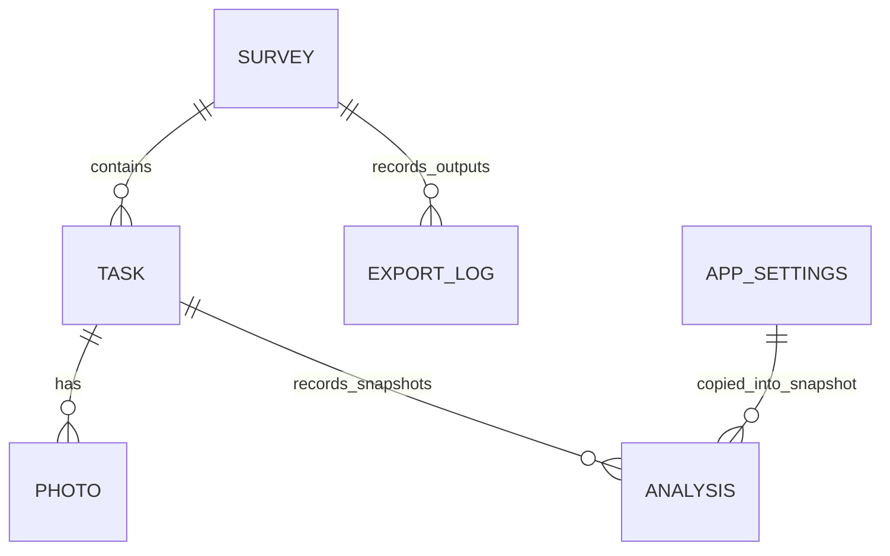

# ERD · 데이터 설계서

> 문서 ID ERGO-DD-001 · 설계 버전 1.4 · 기준일 2026-10-14 · 데모 개발 기준

## 1. 설계 원칙

DB는 **6개 테이블**만 사용한다. 복잡한 revision/관절/REBA구성점수/판정근거 개별 테이블은 만들지 않는다. 상세 데이터는 [API 계약서](API_계약서.md)의 명시된 DTO를 JSON으로 저장한다. 계산은 기능 모듈에서 수행하고 SQL/뷰/트리거에 넣지 않는다.

데모 단계의 DB는 단순 SQLite다. PK 이외의 FK/UNIQUE/CHECK/차단 trigger, 암호화, 보안·운영 가드는 구현 요구에 넣지 않는다. 아래 관계는 저장/조회/삭제를 이해하기 위한 **논리 관계**다. 보안·백업·보존정책은 구현 이후 검토한다.

Electron renderer/preload/main은 Python Application Service를 호출하고 DB 저장은 Python storage가 담당한다. Electron IPC/JSON Lines의request_id는 통신 중 요청·응답 연결용이며 저장하지 않는다. PhotoPreview.data_url/픽셀 크기는 화면 조회 응답이며 PHOTO의 기존 원본경로 참조를 대체하거나 미리보기 컬럼/BLOB 테이블을 만들지 않는다. 문서 버전1.4와 저장 schema_version/report_version=1.3을 구분한다.

## 2. 논리 ERD

TASK.latest_analysis_id는 그 작업에서 마지막으로 요청한 분석을 가리킨다. 사진은 하나의 작업에 속한다. 과거 ANALYSIS는 snapshot 안의 사진 메타데이터/15배정을 보유하므로 PHOTO 삭제 뒤에도 수치 출처를 읽을 수 있다. APP_SETTINGS 관계는 참조 FK가 아니라 분석시점 설정 복사다.

## 3. 테이블·컬럼

| 테이블 | 컬럼 | API 대응·의미 |
|---|---|---|
| SURVEY | survey_id INTEGER PK, metadata_revision INTEGER, metadata_json TEXT, review_json TEXT, created_at TEXT, updated_at TEXT | metadata_json=SurveyDraft 전체, review_json=ReviewMark. Survey의 조회용 래퍼는 ID/시각/metadata_revision 포함 |
| TASK | task_id INTEGER PK, survey_id INTEGER, input_revision INTEGER, latest_analysis_id INTEGER nullable, input_json TEXT, created_at TEXT, updated_at TEXT | input_json={task_kind,task_name,worker_count,conditions,legal,capture,manual}. Task의 나머지 키는 컬럼에서 구성 |
| PHOTO | photo_id INTEGER PK, task_id INTEGER, metadata_json TEXT | metadata_json={file_path,file_name,width_px,height_px,consent,notes}. PhotoInfo의 ID는 컬럼에서 구성 |
| ANALYSIS | analysis_id INTEGER PK, task_id INTEGER, input_revision INTEGER, status TEXT, snapshot_json TEXT, result_json TEXT, created_at TEXT, finished_at TEXT nullable | snapshot_json=TaskSnapshot 전체. result_json={pose,slot_tags,tags,reba,judgment,ai,notes}. Analysis의 ID/상태/시각은 컬럼에서 구성, currentness는 조회 계산 |
| APP_SETTINGS | settings_id INTEGER PK, settings_json TEXT | settings_id=1을 사용. Settings의 analysis/gpt_enabled/gpt_model 저장, gpt_key_present는 환경에서 파생 |
| EXPORT_LOG | export_id INTEGER PK, survey_id INTEGER, file_path TEXT, snapshot_json TEXT, receipt_json TEXT, created_at TEXT | snapshot_json=ExportSnapshot, receipt_json={sheets,reviewed,review_current,has_incomplete,has_stale}. ExportReceipt의 나머지는 컬럼에서 구성 |

모든 JSON은 UTF-8 text다. null을 보존하고 배열 순서는 slot_no/criterion_no/condition_code 기준으로 정한다. JSON 버전은 TaskSnapshot/ExportSnapshot.schema_version='1.3'. 테이블 수를 늘리는 범용 EAV나 DB JSON Schema 검증장치를 넣지 않는다.

## 4. JSON 내부 구조

### TASK.input_json

- conditions는 TaskConditions. 상자무게/선반높이/작업시간/작업자/방법/단기간·연간일수 입력이다.
- legal은 LegalInputs. lift_count_day, 기준1..11의 조건 인자,20조건의 직접 노출시간과 근거를 가진다.
- capture는 CaptureSet.3회×5사건=15고정 자리. 각 자리는 photo_id 또는null, 사건/하중 관찰값을 가진다.
- manual은 ManualValue 배열. 슬롯·photo_id·COMMON/LEFT/RIGHT·필드·값·출처·근거를 가진다. 빈 배열도 가능하다. 선택사진/같은순간3회차/개별 편집을 모두 대상별 값으로 펼쳐 이 배열에 저장하며 그룹/템플릿 테이블은 없다. 자동 후보 적용은 AUTO_ACCEPTED, 대상 사진ID를 기록한다.
- worker_count=1, task_kind=FLOOR_TO_SHELF_BOX_SINGLE_PERSON. UI가 데모 범위를 고정하며 DB 제약으로 운영 차단하지 않는다.

### ANALYSIS.snapshot_json

TaskSnapshot은 분석 시작 시의 작업명/input_revision/조건/직접입력/15배정/수동값/사진 메타/모델·프로필·규칙을 복사한다. 실행 중 TASK가 바뀌어도 이 값은 유지한다. 원본 사진 바이트는 저장하지 않으므로 외부에서 파일 내용을 바꾸는 것을 완전히 고정했다고 주장하지 않는다.

### ANALYSIS.result_json

- pose: PoseResult 또는null.15슬롯 각각의 상태·진단·17좌표·좌우7각도다. 미처리 좌표/각도는 빈 배열.
- slot_tags: SlotTag 배열.15슬롯×11태그의YES/NO/UNKNOWN과ANGLE/MANUAL/UNKNOWN 출처다.
- tags: TagSummary 배열. YES수/관찰분모/수동관찰수/유효포즈수/비율. 시간으로 바꾼 값은 없다.
- reba: RebaResult 또는null.15사진의 candidates/하중·좌우 구성점수·총점·위험·누락, available_max/full_max/대표슬롯. candidates에는 각 슬롯의 몸통/무릎 공통2개와 좌우 위팔·아래팔4개의 제안값/근거각도/confidence/사유를 보관한다. 후보는 확정 수동값이 아니다.
- judgment: JudgmentResult 또는null.11기준의 초안·직접 비교값·누락·해석·조사자 결론/사유/근거.
- ai: purpose별 AiText. 생성/수정/적용문을 별도 필드에 둔다.
- notes: 부분분석·중복사용·파일누락 등의 Diagnostic 배열.

REBA total/risk는 미완전이면null이다. 표본 최대를 저장할 때 available_max와15완전조건 full_max를 구분한다. 고시 시간은 직접 입력이며 사진 발생비율을 곱한 시간을 저장하지 않는다. 사진이 중복 배정되어도 DB가 차단하지 않고 결과 notes로 안내한다.

### EXPORT_LOG.snapshot_json과 출력 파생값

ExportSnapshot 전체를 기존 snapshot_json에 저장한다. schema_version='1.3', report_version='1.3', survey/tasks/선택analyses/unanalysed_task_ids/include_representative/exported_at을 가진다. 대표이미지 옵션/보고서 버전/출력 시각을 위한 새 컬럼은 만들지 않는다. 출력 당시의 조사정보와 선택 분석 snapshot/결과를 함께 보관한다.

ReportOverview/ReportCounts/NextInputItem은 report가 이 snapshot에서 구성하는 파생 DTO다. needs_input_count/needs_review_count는 computed_status별 기준 수, incomplete_reba_count는15−complete_count이며 미계산은null이다. next_inputs는 missing_fields/review_reasons와 슬롯·좌우·기준 식별정보에서 만든다. TASK/ANALYSIS/EXPORT_LOG에 별도 집계/안내 필드를 중복 저장하지 않는다. 조사자 결론/검토가 초안의 부족 항목을 제거하지 않는다. 기준/사진 단위와 조사 합계의 null처리는 기능정의서 §9.2를 따른다.

ReportState의reviewed/review_current/has_incomplete/has_stale와 작업별review_status는 report가 선택 analysis_id·SURVEY.review·metadata_revision·현재 TASK·pose/reba/judgment에서 파생한다. has_incomplete는 분석/모듈 결과 유무와 원래 결과 상태를 직접 읽어 계산한다. 별도 미완전 사유 분류/배열을 저장하거나 반환하지 않는다. 검토한 다른 분석의 부울을 복사하지 않는다. next_inputs는 기존 포즈 diagnostics/REBA missing_fields·좌우 review_reasons/고시 computed_status·missing_fields·review_reasons와 결과 유무에서 구성한다. 포즈 안내를 고시 기준수와 합치지 않는다. 네 부울만 출력 당시 receipt_json에 기록한다. 계산 규칙은 기능정의서 §9.2/API §7.2이며 상태/집계 테이블은 추가하지 않는다.

NumericSummary는 저장 결과에서 서비스가 구성해 explanation에 전달하는 DTO다. REBA 미계산 완전수null, 초안/조사자/effective 상태와 출처, 제외/누락/검토사유를 보내고 자유입력 근거는 보내지 않는다. 별도 GPT입력 테이블은 없으며 생성/수정/적용문은 기존 ai에 저장한다. SUMMARY14열로 배치를 바꿔도 snapshot의 조사정보/진단/설명/버전/대표식별자를 제거하지 않는다.

대표 상세는 snapshot.capture.slots의photo_id와 result.reba.slots의슬롯/좌우 구성점수를 연결한다. 대표이미지는 원본경로 참조이며 BLOB/마스킹 이미지 테이블을 추가하지 않는다. 기준 근거는 judgment.judgments[].basis 전항목과 investigator.evidence를 별도로 출력한다. 새 경고 이력/조치 완료 테이블은 없다.

## 5. 현재성·검토·재계산

TASK 입력 변경 시 input_revision만 증가한다. 별도 입력 revision 테이블은 없다. ANALYSIS에는 해당 숫자와 snapshot을 저장한다. 현재성은 `(analysis_id==latest_analysis_id) AND (분석input_revision==작업input_revision)`이면CURRENT, 결과없음NONE, 그 외STALE다.

재계산은 새 ANALYSIS행에 현재 snapshot과 결과를 저장한다. 이전 pose/REBA/고시는 관련 입력이 같을 때만 복사한다. 수정 영향은 기능정의서 §6 표다. ANALYSIS의 status는 분석작업 상태, result.pose.status는 포즈15장 상태로 구분한다. 명령 시작 때 latest_analysis_id를 정하고 오래된 완료는 이 포인터를 바꾸지 않는다.

조사자 결론/대표사진/AI적용은 ANALYSIS.result_json의 표시 영역을 수정한다. 계산 초안과 시작 snapshot은 유지한다. 검토는 SURVEY.review_json에 분석ID목록과 검토 당시 metadata_revision을 기록한다. 조사자 결론 변경/해제는reviewed=false로 저장한다. 대표/설명문만 변경하면 계산검토 표시를 유지한다. 부분 결과도 검토 가능하며 DB가 승인/완전성 게이트를 만들지 않는다.

## 6. 초기화·삭제

작업 생성 시 빈15슬롯·11기준·20시간을 TASK JSON에 만든다. 분석 시작은15결과 자리를 ANALYSIS JSON에 만든다. 수동값은 빈 배열, 아직 결과가 없으면null이다. 조회 currentness는 서비스가 DTO에서 계산하고 보고서의 완전성/선택 분석 검토현재성은 report.build_overview가 산출한다. DB가 별도로 판정하지 않는다.

delete_photo는 현재 capture의 배정을 비우고 해당 manual/관찰을 비운 뒤 PHOTO행을 삭제한다. 역사 snapshot의 메타/수치는 남기며 이미지가 없으면 못 읽음 표시다. delete_task는 PHOTO→ANALYSIS→TASK 순서로 서비스가 삭제한다. delete_survey는 소속 작업과 EXPORT_LOG→SURVEY를 삭제한다. 원본 사진/외부 Excel은 삭제하지 않는다.

여러 행 삭제·입력/버전 저장은 짧은 기본 트랜잭션으로 묶는다. DB 차단장치가 아니라 저장 중 오류에 대한 일관성 처리다. trigger/FK cascade/복잡한 감사로그는 만들지 않는다. 상세 운영·보존·보안은 데모 구현 이후 검토한다.
