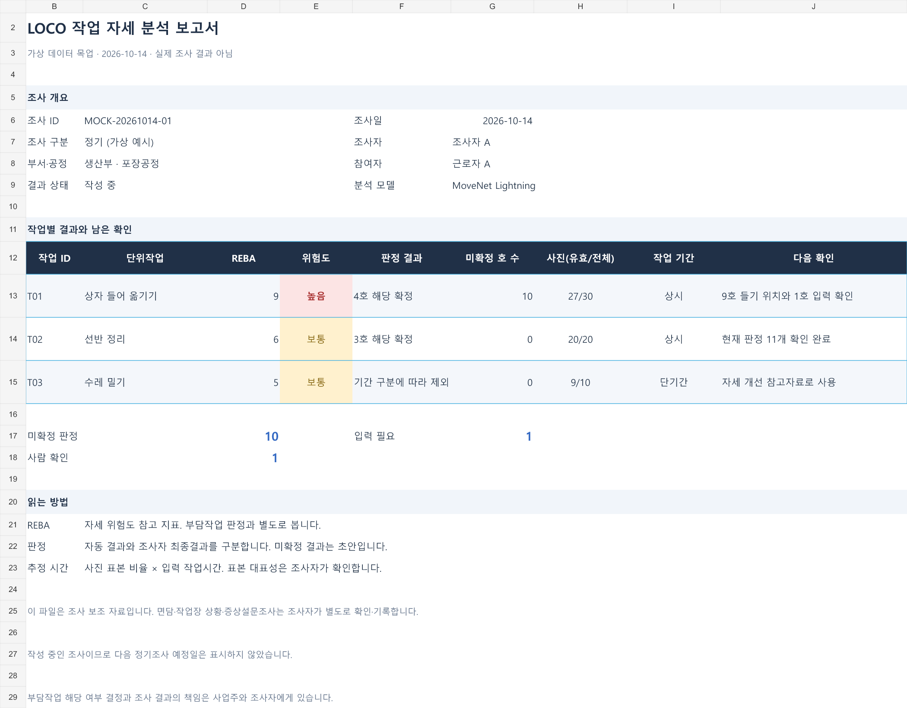
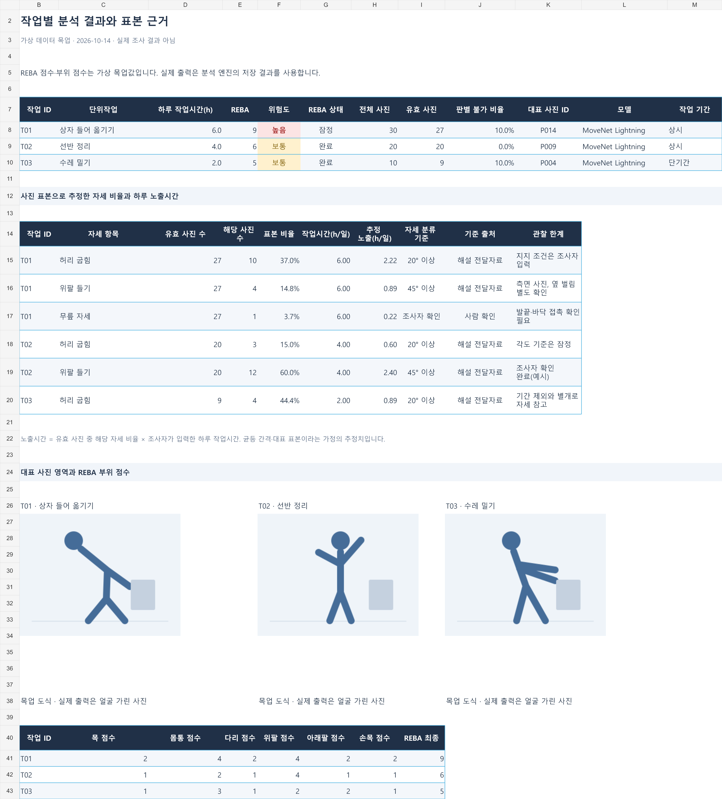
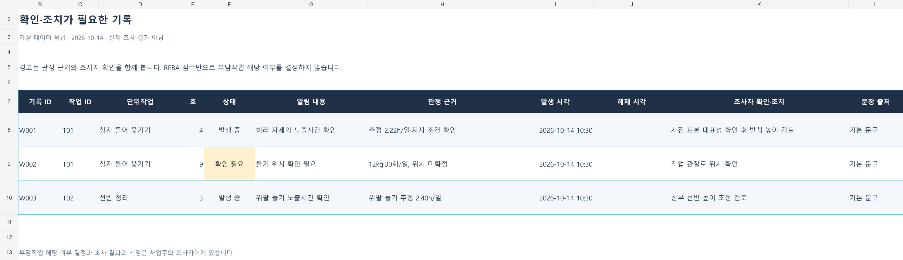
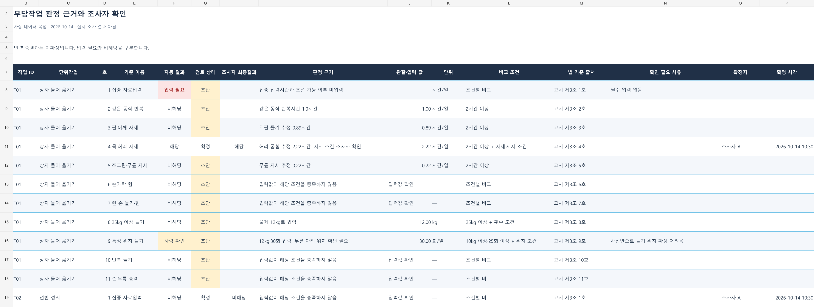

# 엑셀 출력 설계서

> LOCO 작업 자세 분석 보조 보고서 · 4개 시트의 배치, 컬럼, 데이터 연결과 출력 규칙

## 문서 정보

| 항목 | 내용 |
|---|---|
| 문서 번호 | LOCO-EXCEL-001 (검토용) |
| 버전 | v0.1 초안 |
| 작성일 | 2026-10-14 |
| 상태 | 목업을 바탕으로 한 구현 제안. 팀의 API·ERD 계약 변경은 아직 확정하지 않음 |
| 관련 요구사항 | FR-026, FR-028, NFR-010, NFR-013, NFR-014 |
| 관련 기능·화면 | F06-01, S08 결과와 엑셀 내보내기 |
| 관련 구현 | `ergo/report/excel.py`, `ergo/contracts.py`의 `export_excel`, `ExportResult` |
| 참고 목업 | [LOCO 작업 자세 분석 엑셀 목업](작업자세분석_목업/LOCO_작업자세분석_엑셀목업.xlsx) |

### 개정 이력

| 버전 | 날짜 | 내용 |
|---|---|---|
| v0.1 | 2026-10-14 | 기존 4시트 계약을 기준으로 목업의 배치·컬럼·표시 규칙을 정의하고, 실제 구현에서 보완하거나 결정할 차이를 정리 |

## 1. 목적과 범위

조사자는 이 파일에서 작업별 REBA 위험도와 부담작업 판정 근거를 살펴보고, 남은 입력·확인 항목을 찾는다. 파일은 **작업 자세 분석의 참고자료와 판정 초안**을 제공한다. 고시 별지 제1·2호서식 전체 작성 기능은 이 설계의 범위에 포함하지 않는다.

내보내기 시점에 저장된 입력·분석·판정·확정 정보를 한 파일에 담는다. 판정과 점수 계산은 앱의 엔진이 담당하며, 실제 보고서는 그 결과의 스냅샷이다. 엑셀에서 값을 바꿔 법 기준이나 REBA를 다시 판정하는 기능은 제공하지 않는다. 조사자가 내용을 수정할 때는 앱에서 이력을 남기고 다시 내보낸다.

| 구분 | 적용 |
|---|---|
| 기존 계약 유지 | 시트 4개, 얼굴을 가린 대표 사진, 미확정 결과의 초안 표시, 책임 문구, 인터넷 없이 내보내기 |
| 이 문서의 제안 | 자동·최종 결과 분리, 확인 필요 건수, 표본 근거 표, 작업 ID와 분석 ID를 통한 추적 |
| 목업 전용 | 가상 조사자·작업·점수·판정·시각, 사진 대신 도식, 표본 비율·건수를 확인하기 위한 엑셀 수식 |

## 2. 참고 문서와 적용 순서

| 문서 | 참고 부분 | 적용 내용 |
|---|---|---|
| [requirements.md](requirements.md) | FR-026·FR-028, NFR-010·013·014 | 4시트, 오프라인 출력, 얼굴 가림, 책임·보존 안내 |
| [기능정의서](기능정의서.md) | F06-01, F05-05·06, BR-15·17·22 | 시트별 내용, 조사자 확정, 이력, REBA와 판정의 구분 |
| [API 계약서](API_계약서.md) | 7.1절, `export_excel`, `ExportResult` | 파일 이름, 컬럼, 출력 결과·오류 |
| [ERD 데이터 설계서](ERD_데이터설계서.md) | `judgment`, `judgment_basis`, `analysis_run`, `key_still_image`, 7절 뷰 | 저장값과 시트 연결, 판정 당시 근거 보존 |
| [화면설계서](화면설계서.md) | S08 | 내보내기 위치, DB 사본 선택, 초안 안내 |
| [법정서식 검증목록](법정서식_검증목록.md) | 9절 | 앱 결과와 법정 조사·서식의 경계, 각도 출처의 확인 상태 |

본 문서는 배치를 구체화하는 초안이다. 기존 계약과 다른 데이터·기능을 제안하는 경우에는 9절에 기록하며, 구현 전에 해당 담당자가 계약을 확인한다.

## 3. 파일과 데이터 단위

### 3.1 파일 기본값

| 항목 | 설계 |
|---|---|
| 형식 | `.xlsx` |
| 파일 이름 | 기존 계약의 `유해요인조사_{조사일}_{작업공정명}.xlsx` 사용. 화면·시트 제목은 `LOCO 작업 자세 분석 보고서` |
| 같은 이름 | `_2`, `_3` 등 번호를 붙임 |
| 내보내기 단위 | 조사 1건과 그 조사에 등록된 단위작업 전체 |
| 시트 순서 | 요약 → 작업별 결과 → 경고 기록 → 판정 초안 |
| 기준 데이터 | 내보내기 시점의 저장값. 단위작업별 현재 분석과 판정 당시 근거를 구분해서 사용 |
| 연계 식별자 | 조사 ID, 단위작업 ID, 분석 ID, 대표 사진 ID. 사용자의 로컬 파일 경로는 출력하지 않음 |
| DB 사본 | 기존 `with_db_backup` 옵션 적용. 결과의 `backup_path`로 안내 |

출력 시각과 계약·보고서 버전은 보고서 식별을 위한 제안 필드다. 분석 모델의 이름·버전은 기존 `pose_model`과 현재 분석에서 읽는다. 입력 변경 후 분석 결과가 이전 상태라면 최신 결과처럼 표시하지 않으며, 상태 판단에 필요한 정보는 9절에서 계약 확인 대상으로 둔다.

### 3.2 행과 집계 단위

| 표 | 1행이 의미하는 것 | 키 |
|---|---|---|
| 요약 작업표 | 단위작업 1개 | 단위작업 ID |
| 작업 결과표 | 단위작업의 현재 분석 1개 | 단위작업 ID + 분석 ID |
| 자세 근거표 | 단위작업의 자세 항목 1개 | 단위작업 ID + 분석 ID + 자세 항목 코드 |
| 경고표 | 저장된 경고 1건 | 경고 ID |
| 판정표 | 단위작업의 부담작업 기준 1개 | 단위작업 ID + 호 번호 |
| 판정 근거 상세 | 판정에 사용한 값 1개 | 판정 ID + 근거 항목 코드 |

판정표는 단위작업당 11행을 유지한다. 근거가 여러 개이면 첫 값 하나만 출력하지 않고 근거 상세를 같은 시트의 별도 표에 펼친다. 예를 들어 9호의 무게·횟수·위치 값은 각각 식별할 수 있어야 한다.

## 4. 시트별 설계

### 4.1 요약

**읽는 사람:** 조사자와 결과를 검토하는 팀원. 먼저 전체 상태와 작업별 결론, 다음 확인 사항을 본다.

**배치:** 제목·조사개요 → 작업별 결과표 → 미확정·입력 필요·사람 확인 건수 → 결과 읽는 방법과 기존 안내 문구.

조사개요에는 조사 ID, 구분, 조사일, 조사자, 부서, 작업공정명, 작업명, 참여자, 조사 상태를 표시한다. 출력 시각·보고서 버전은 식별 정보로 추가하는 안이다. 다음 정기조사 예정일은 기존 서비스의 값을 사용하며, 계산 전·미확정 상태를 날짜 0으로 채우지 않는다.

| 컬럼 | 형식 | 의미·데이터 |
|---|---|---|
| 작업 ID | 식별자 | `unit_task_id`. 모든 시트에서 동일하게 사용 |
| 단위작업 | 글자 | `task_name` |
| REBA | 정수 | 현재 분석의 `reba_score`. 목업의 작업당 점수는 대표 자세 점수 |
| 위험도 | 글자 | `risk_level_cd`를 사용자용 이름으로 표시 |
| REBA 상태 | 글자 | 잠정 / 사람 입력 완료. **판정 확정 여부와 별개**이며 실제 요약에 추가 권장 |
| 판정 결과 | 글자 | 확정된 해당 호와 해당 초안을 구분해서 표시. 초안 포함 결과를 모두 확정으로 표기하지 않음 |
| 미확정 호 수 | 정수 | `confirmed_yn = 0`인 판정 수 |
| 사진(유효/전체) | 글자 | 같은 분석의 유효·전체 사진 수를 함께 표시 |
| 작업 기간 | 글자 | 상시 / 단기간 / 간헐. 판정 제외 사유를 함께 식별 |
| 다음 확인 | 글자 | 입력 필요·사람 확인 사유를 우선 표시. 개선이 완료됐다는 의미로 사용하지 않음 |

`미확정 판정`은 단위작업별 미확정 호 수의 합이다. `입력 필요`, `사람 확인`은 자동 판정 상태별 건수다. 작업 수와 판정 건수를 혼용하지 않는다. 조사자가 확인을 마친 판정은 남은 확인 건수에 포함하지 않는 집계안을 사용한다.

요약 문장에는 저장된 AI 문장 또는 기본 문구를 사용하고 `AI 작성` 여부를 표시한다. AI 문장은 점수·판정을 바꾸지 않는다. 기존 계약의 증상설문조사 별도 필요, 기록 보존, 책임 문구도 이 영역에 포함한다.

### 4.2 작업별 결과

**읽는 사람:** 점수·판정의 근거를 확인하는 조사자. 표본 규모와 분석 한계, 대표 자세를 함께 본다.

**배치:** 작업 결과표 → 자세별 표본·노출 근거표 → 대표 사진과 REBA 부위 점수 → 필요한 입력·기준 출처.

| 작업 결과표 컬럼 | 형식·단위 | 데이터 |
|---|---|---|
| 작업 ID, 단위작업 | 식별자·글자 | `unit_task` |
| 분석 ID·시각 | 식별자·날짜시각 | 현재 `analysis_run`의 식별·시각 정보. 실제 출력에 추가 권장 |
| 하루 작업시간 | 숫자, h/일 | `task_input.daily_work_h` |
| REBA, 위험도 | 정수·글자 | `reba_result` |
| REBA 상태 | 글자 | `provisional_yn`과 미입력 항목 |
| 전체·유효 사진 수 | 정수 | 같은 분석의 `still_total_cnt`, `still_valid_cnt` |
| 판별 불가 비율 | 백분율 | 같은 분석의 `invalid_ratio` |
| 대표 사진 ID | 식별자 | `key_still_id` |
| 모델·버전 | 글자 | 해당 분석의 `pose_model` |
| 작업 기간 | 글자 | `period_type_cd` |

| 자세 근거표 컬럼 | 형식·단위 | 표시 규칙 |
|---|---|---|
| 작업 ID, 자세 항목 | 식별자·글자 | `item_cd`를 사람이 읽을 수 있는 이름으로 변환 |
| 유효·해당 사진 수 | 정수 | **자세 항목별 분모·분자**를 확보할 때 표시. 전체 분석의 유효 수를 모든 항목에 그대로 적용하지 않음 |
| 표본 비율 | 백분율 | 엔진의 `share_ratio` 사용 |
| 작업시간 | 숫자, h/일 | 계산에 사용한 입력값 |
| 추정 노출시간 | 숫자, h/일 | 엔진의 `exposure_h` 사용. 실제 출력에서 반올림한 비율로 다시 계산하지 않음 |
| 자세 분류 기준 | 숫자+단위·글자 | `threshold_value` 및 관련 조건 |
| 기준 출처·변경 사유 | 글자 | 고시 / 해설 전달자료 / 조사자 변경을 구분. 변경 사유는 저장 이력에서 연결 |
| 관찰 한계 | 글자 | 측정 불가 부위, 작은 표본, 지지 조건 등 해당 작업의 구체적인 사유 |

사진 표본으로 계산하는 항목은 `해당 자세 비율 × 하루 작업시간`이라는 추정 방법과 표본 대표성 가정을 밝힌다. 자세 항목마다 판별 가능한 사진이 다를 수 있다. 누락된 분모나 사진 수를 비율에서 역산해 만들어 넣지 않는다.

**대표 사진:** `key_still_image`의 얼굴 가린 이미지를 삽입한다. 원본 사진이나 원본 파일 경로는 사용하지 않는다. 사진 아래에 작업 ID·사진 ID를 적으며, 여러 사진을 붙여넣어 행 높이가 과도하게 커지는 방식은 피한다.

**REBA 상세:** 목·몸통·다리·위팔·아래팔·손목 점수와 최종 점수를 보여준다. 최종 점수는 부위 점수의 합이 아니다. 상세 검토가 필요하면 같은 시트에 표 A·B·C 점수, 하중·손잡이·활동 가산점, 평가한 좌우 방향과 미입력 항목을 추가한다. REBA 계산은 엔진 결과를 사용한다.

### 4.3 경고 기록

**읽는 사람:** 어떤 경고가 발생했고 어떤 근거로 유지·해제됐는지 확인하는 조사자.

| 컬럼 | 데이터·규칙 |
|---|---|
| 기록 ID, 작업 ID, 단위작업, 호 | `warning_id`, `unit_task_id`, 작업명, `criterion_no` |
| 상태 | `cleared_at`이 없으면 발생 중, 있으면 해제 |
| 알림 내용, 판정 근거 | 저장된 `message_text`, `basis_text` |
| 발생·해제 시각 | `raised_at`, `cleared_at`. 활성 경고의 해제 시각은 빈칸 |
| 조언 문장·문장 출처 | 해당 경고의 AI 조언 또는 기본 문구와 출처 표시 |
| 조사자 확인·조치 | **추가 제안**. 현재 계약에는 전용 저장 필드가 없음. 저장·수정 이력이 정의되기 전에는 자동 조언을 수행 완료 기록처럼 표시하지 않음 |

경고 해제는 기존 규칙의 재계산 결과에 따른다. 조사자가 해당 판정을 확정했다는 이유만으로 경고를 해제하지 않는다.

목업의 W002 `확인 필요` 행은 **검토사항을 보여주는 배치 예시**다. 현재 `warning`은 해당 초안에 대한 경고 기록이므로, 모든 `사람 확인` 판정을 새 경고로 저장하는 뜻은 아니다. 실제 구현에서는 이 행을 경고표에서 제외하고 요약·판정표에 보여주는 안을 기본으로 한다. 별도 검토사항 표를 추가할지는 팀 결정 대상이다.

### 4.4 판정 초안

**읽는 사람:** 작업별 11개 기준의 결과를 확인·확정하는 조사자. 해당·비해당뿐 아니라 입력 부족과 해석상의 제한을 확인한다.

| 컬럼 | 데이터·표시 |
|---|---|
| 작업 ID, 단위작업 | `unit_task_id`, `task_name` |
| 호, 기준 이름 | `criterion_no`, `criterion.short_name` |
| 자동 결과 | `computed_status_cd`: 해당 / 비해당 / 사람 확인 / 입력 필요 |
| 검토 상태 | `confirmed_yn`: 초안 / 확정 |
| 조사자 최종결과 | `final_status_cd`: 해당 / 비해당. 미확정이면 빈칸 |
| 판정 근거 | `basis_text` |
| 관찰·입력값, 단위, 비교 조건 | `judgment_basis`의 값·단위·기준. 여러 항목은 근거 상세표에서 각각 표시 |
| 법 기준 출처 | `source_text`. 자세 각도 기준의 출처와 구분 |
| 각도 기준 출처·변경 사유 | **실제 출력에 보완 권장**. `threshold_source_cd` 및 관련 수정 이력 |
| 확인 필요 사유 | `review_reason_cd`, `exclusion_cd`의 설명. 사진으로 못 잼·표본 부족·기간 제외 등을 구분 |
| 확정자, 확정 시각, 확정 사유 | `confirmed_by`, `confirmed_at`, `confirm_reason_text` |

미확정 최종결과를 자동 결과로 채우지 않는다. 조사자가 자동 결과와 다른 결과로 확정한 경우 두 결과와 수정 사유가 함께 남아야 한다. 근거값·비교 기준은 **판정 시점의 `judgment_basis`**를 사용하고, 현재 설정의 각도 기준으로 바꿔 출력하지 않는다.

## 5. 표시와 계산 규칙

| 항목 | 규칙 |
|---|---|
| 수치 타입 | 숫자·백분율·날짜는 Excel의 실제 타입으로 저장 |
| 시간 | 내부 정밀도 유지, 화면은 `0.00` h/일 권장 |
| 비율 | 내부 값은 0~1, 화면은 `0.0%` |
| 개수·호·REBA | 정수 |
| 날짜·시각 | `yyyy-mm-dd`, `yyyy-mm-dd hh:mm`. 앱의 저장 시각을 Asia/Seoul 기준으로 표시 |
| 누락 | 입력 필요 / 분석 전 / 산출 불가 / 빈 미확정값을 구분. 숫자 0으로 대체하지 않음 |
| 비해당 | 필요한 입력·조건을 확인한 결과가 있을 때 표시 |
| 기간 제외 | 비해당 결과와 별도로 단기간·간헐 제외 사유를 표시. REBA는 자세 참고자료로 계속 표시 |
| 미확정 | `초안` 글자와 연노랑 배경. 색만으로 상태를 구분하지 않음 |
| REBA 잠정 | 미입력 항목과 함께 표시. 부담작업 판정의 확정 여부와 별도로 관리 |
| 요약 집계 | 저장된 판정·확정 상태를 기준으로 계산. 입력 필요를 비해당에 포함하지 않음 |

목업의 미확정 건수와 자세 비율은 Excel 수식으로 연결해 배치를 검증했다. 실제 보고서는 엔진·서비스가 만든 값을 기록하므로 수식 재계산에 의존하지 않는 안을 권장한다. 목업의 수식 존재가 REBA·법 기준 판정 엔진 구현을 의미하지 않는다.

## 6. 배치와 사용성

- 제목은 16~17pt, 표는 11pt 수준의 한글 글꼴을 사용한다. 긴 근거·사유는 줄바꿈하며 글자를 줄여 맞추지 않는다.
- 표 머리글은 진한 남색·흰 글자, 본문은 흰색·옅은 회색을 번갈아 사용한다. 초안·확인 필요는 연노랑, 중요한 입력 부족은 옅은 빨강으로 표시한다.
- 상세 표는 필터를 사용하고 제목 행·작업 식별 컬럼을 고정한다. 데이터 표에서는 병합 셀을 사용하지 않는다.
- 작업 ID를 모든 표의 왼쪽에 놓는다. 정렬해도 사진·근거가 다른 작업으로 바뀌지 않도록 사진 블록에는 작업·사진 ID를 명시한다.
- 요약은 한 페이지에서 읽는 구성을 목표로 하고, 상세 시트는 가로 인쇄와 머리글 반복을 검토한다. 긴 판정표를 한 페이지에 강제로 축소하지 않는다. **현재 목업의 인쇄 설정과 Microsoft Excel에서의 실제 페이지 배치는 아직 검증하지 않았다.**
- 모든 시트에 기존 계약의 책임 문구를 넣고, 요약에는 기록 보존과 증상설문조사 별도 안내를 함께 넣는다.

## 7. 데이터 연결과 출력 흐름

| 시트·영역 | 기존 데이터 | 구현 주의 |
|---|---|---|
| 조사개요 | `SurveyDetail`, `v_survey_list`, `participant` | 이름 등 자유 입력은 셀 텍스트로 쓰며 수식으로 실행하지 않음 |
| 요약 작업표 | `v_excel_summary`, `v_task_result`, `judgment` | 해당 초안과 확정 해당을 별도로 집계 |
| 작업 분석 | `TaskResult`, `v_task_result`, `reba_result`, `pose_model` | 현재 분석 ID·모델·사진 수를 같은 실행으로 맞춤 |
| 자세 근거 | `PostureShare`, `judgment_basis` | 현재 분석 비율과 확정 당시 판정 근거가 다르면 구분 |
| 사진 | `key_still_image` | `masked_yn = 1`인 저장 이미지 사용 |
| 경고 | `v_warning_log`, `warning`, `ai_text` | 저장된 경고와 판정의 검토사항을 혼합하지 않음 |
| 판정 | `Judgment`, `judgment`, `criterion`, `judgment_basis` | 자동·최종 결과와 다중 근거를 모두 보존 |
| 문장·변경 사유 | `ai_text`, 수정 이력 | 기본/AI/조사자 작성의 출처와 실제 저장 여부 확인 |

서비스의 `export_excel(survey_id, path, actor, with_db_backup)`이 데이터를 모으고 출력 모듈을 호출한다. 출력 모듈은 화면이나 DB에 직접 의존하지 않는 기존 구조를 따른다. 점수·판정은 재계산하지 않는다.

저장 데이터 조회 → 상태·이미지 검사 → 4시트 작성 → 저장 성공 확인 → 내보내기 결과·로그 기록 순서로 처리한다. 조회 중 데이터가 바뀌어 서로 다른 실행의 결과가 섞이지 않도록 저장소 담당과 스냅샷 조회 방식을 정한다.

파일이 열려 있거나 쓰기 권한이 없으면 기존 E-EXPORT-001/EX-12에 따라 실패를 알리고 다른 이름·위치를 선택하게 한다. 임시 파일을 쓰는 경우 정상 저장 후 최종 경로로 옮기는 구현을 권장한다. 실패한 출력을 성공 로그로 남기지 않는다.

## 8. 목업 검증 결과와 실제 출력 수용 기준

### 8.1 목업에서 확인한 것

| 항목 | 결과 |
|---|---|
| 구성 | 시트 4개, 필터 표 6개, 대표 사진 자리 도식 3개 |
| 데이터 | 가상 단위작업 3개, 판정 33행, 미확정 10행 |
| 수식 | 표본 수 변경 시 비율·추정 시간이 갱신됨. 수식 오류 없음 |
| 파일 보존 | `.xlsx`에 표·이미지·틀 고정과 계산값이 포함됨 |
| 화면 확인 | 4시트를 렌더링해 글자·상태·이미지 배치를 확인 |
| 미검증 | 실제 사업장 사진, 실제 엔진 결과와의 일치, Microsoft Excel 열기·인쇄 |

### 8.2 실제 구현 수용 기준

| ID | 확인할 것 |
|---|---|
| EXL-01 | 조사 1건을 내보내면 정해진 이름의 시트 4개가 생성되고 Excel에서 열린다 (AC-29) |
| EXL-02 | 작업이 N개면 판정표는 N×11행이며, 모든 행이 올바른 작업 ID로 연결된다 |
| EXL-03 | 해당 초안·확정 해당·입력 필요·사람 확인의 혼합 사례에서 자동·최종 결과와 요약 건수가 맞는다 |
| EXL-04 | 작업시간 미입력·분모 0·분석 전·실제 0의 사례를 구분하며, 산출 불가를 0시간·비해당으로 표시하지 않는다 |
| EXL-05 | 판정 기준을 나중에 변경해도 저장된 확정 판정의 근거값·출처가 다른 값으로 바뀌지 않는다 |
| EXL-06 | 모든 삽입 이미지는 얼굴이 가려져 있다. 이미지를 확보하지 못한 경우 원본 대신 미첨부 사유를 표시한다 |
| EXL-07 | 활성·해제 경고의 시각이 맞고, 해당 판정을 확정했다는 이유만으로 경고가 해제되지 않는다 |
| EXL-08 | GPT·인터넷 없이 점수·판정·이미지·기본 문구와 엑셀 출력이 동작한다 (FR-028) |
| EXL-09 | 파일 잠금·권한 오류를 표시하고 기존 정상 파일을 손상시키지 않는다 |
| EXL-10 | 저장 성공 경로·DB 사본 경로와 `ExportResult`가 일치한다. `draft_cell_cnt`의 집계 단위를 문서·코드에서 동일하게 사용한다 |
| EXL-11 | Excel에서 필터·정렬·틀 고정이 동작하며 긴 근거·한글·날짜가 잘리지 않는다. 인쇄가 필요하면 각 시트의 페이지도 확인한다 |

## 9. 팀이 확인할 차이와 보완 항목

| ID | 현재 계약·목업과의 차이 | 권장 처리 |
|---|---|---|
| EXL-OI-01 | `v_judgment_sheet.status_cd`는 자동·최종 결과를 COALESCE로 합친다 | `Judgment` 또는 `judgment`의 두 필드를 각각 읽어 컬럼을 구성. 기존 뷰 변경 여부는 데이터 담당 결정 |
| EXL-OI-02 | `v_excel_summary.applicable_criteria`는 해당 초안도 포함할 수 있다 | 초안·확정 구분을 붙이거나 목록을 분리. 전부 확정된 목록처럼 표시하지 않음 |
| EXL-OI-03 | `PostureShare`는 자세별 유효·해당 사진 수를 제공하지 않는다 | 엔진에서 같은 분모 기준의 수를 제공할지 결정. 확보 전에는 수를 추정해 만들지 않고 비율·한계만 표시 |
| EXL-OI-04 | 목업 W002의 검토사항과 `조사자 확인·조치` 컬럼은 현재 경고 저장 계약과 다르다 | W002는 요약·판정표에서 표시. 조치 기록을 별도 기능으로 채택하면 저장·이력을 먼저 정의 |
| EXL-OI-05 | 목업은 출처·사유·REBA 상세 일부만 예시로 담았다 | 실제 출력에는 각도 변경·확정 사유, 미입력 REBA 항목, 필요 시 가산점 상세를 기존 저장값으로 보완 |
| EXL-OI-06 | 목업에는 기존 계약의 보존 안내·AI 요약 일부가 생략됐다 | 실제 출력에는 계약 문구·저장 문장을 반영. GPT 실패 시 문장 생략/기본 문구의 문서 간 차이는 담당자 확인 |
| EXL-OI-07 | 대표 REBA·작업별 최고 REBA·좌우 선택의 의미가 독자에게 혼동될 수 있다 | 엔진에서 반환한 점수의 의미를 그대로 명시. 사진 전체 점수를 저장하지 않으면 작업 전체의 최고값이라고 새로 주장하지 않음 |
| EXL-OI-08 | `draft_cell_cnt`라는 이름과 화면의 미확정 '호 수'가 다르다 | 셀 수인지 미확정 판정 수인지 집계 단위를 API 담당과 확정. 여러 근거 셀 때문에 건수를 부풀리지 않음 |
| EXL-OI-09 | 입력 변경 후 분석·판정의 최신성 표시와 인쇄 설정은 목업에서 구현하지 않았다 | 기존 상태·분석 ID로 판단 가능한지 확인하고, 추가 계약이 필요하면 팀 검토 후 반영 |

시트 구조·라이브러리·인쇄 배치와 위 차이는 회의에서 검토한다. 이 설계서를 작성하면서 기존 요구사항·기능정의서·API·ERD와 목업 파일은 수정하지 않았다.
