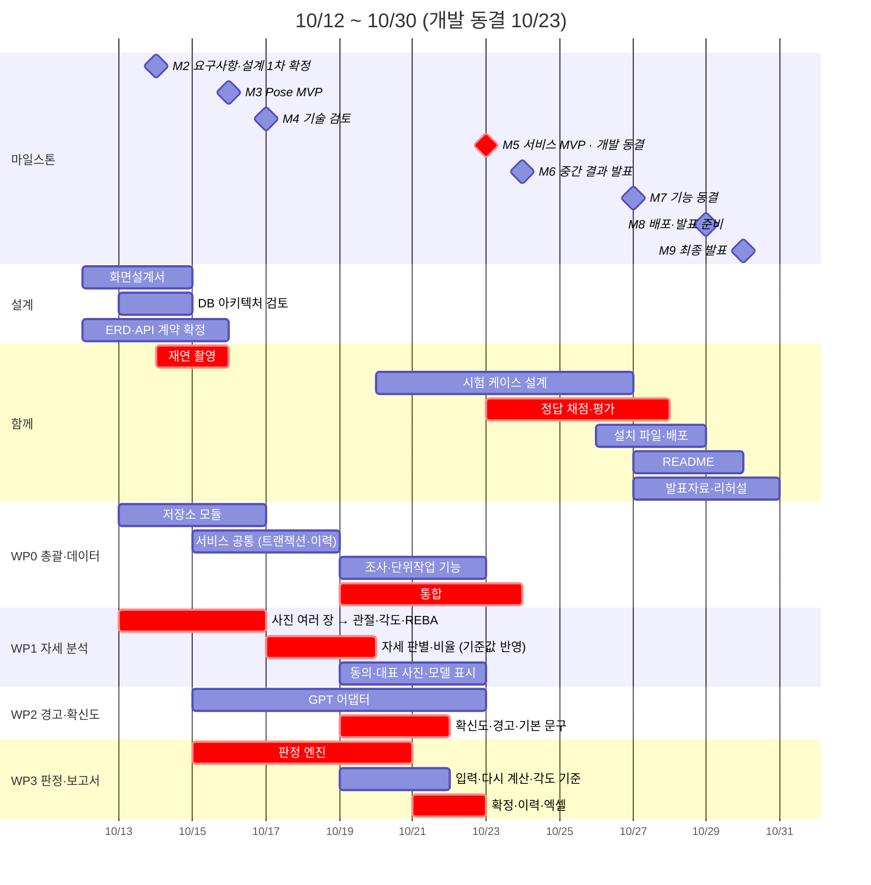
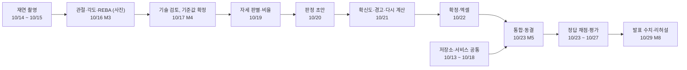

# 일정서

> 근골격계 유해요인조사 보조 앱 · 2026-10-12 ~ 10-30 · **개발 동결 10/23 (금)**

## 문서 정보

| 항목 | 내용 |
|---|---|
| 문서 번호 | ERGO-SCH-001 |
| 버전 | v0.6 (초안) |
| 작성일 | 2026-10-12 |
| 작성 | 한정욱 (총괄) |
| 검토 | 김나리 · 유서하 · 정혁 |
| 상태 | 초안. 10/13에 담당을 먼저 정하고 10/14 설계 1차 회의에서 확정 |
| 상위 문서 | 기능정의서 v0.5 (ERGO-FD-001), 화면설계서 v0.3 (ERGO-UI-001), ERD v0.3 (ERGO-DD-001), DB 아키텍처 설계서 v0.3 (ERGO-DBA-001), API 계약서 v0.4 (ERGO-API-001) |
| 기준 일정 | 멘토 WBS (마일스톤 9개, 작업 20개) |

### 개정 이력

| 버전 | 날짜 | 바뀐 내용 |
|---|---|---|
| v0.1 | 2026-10-12 | 초안. 개발 동결을 10/23으로 정하고 기능 30개의 끝나는 날, 날짜별 계획, 결정 기한 22개, 위험을 정함 |
| v0.2 | 2026-10-12 | 화면설계서 초안과 ERD 그림(draw.io)이 생겨 10/12·10/13 계획과 멘토 산출물 대응표를 고침 |
| v0.3 | 2026-10-12 | 고시 원문 대조를 마쳐 10/12 계획과 위험, 결정 일정을 고침 (해설 각도 값 대조는 10/14로 남음) |
| v0.4 | 2026-10-12 | DB 아키텍처 설계서와 저장소 LOCO-KOREA/LOCO의 프로젝트 뼈대(스텁, 시험, 문서 생성 도구)가 생겨 10/12·10/13 계획, 멘토 산출물 3.2를 고침. 같은 날 해설 각도 값의 확인 상태(글 3건으로 확인, 고용노동부 원문은 문의)를 고침 |
| v0.5 | 2026-10-12 | MVP의 분석 입력을 사진(스틸샷)으로, 관절 모델을 MoveNet Lightning으로 정함 (기능정의서 v0.4). 영상 단계(짧은 영상, 긴 영상)를 MVP 이후로 빼고 사진 여러 장(표본)으로 일정을 고침. 모델이 정해져 F07-04 모델 비교 도구를 일정에서 뺌 (기능 30개에서 29개가 됨) |
| v0.6 | 2026-10-14 | F04-02 얼굴 모자이크를 일정에서 뺐다 (기능 29개에서 28개가 됨). 10/20의 얼굴 가림 작업과 대표 사진 저장 순서의 제약을 없앴다 (기능정의서 v0.5) |

---

## 1. 한눈에 보기

- **10/23 (금) 개발 동결.** Must와 Should 기능을 이날까지 모두 넣는다. 그 뒤로는 새 기능을 만들지 않고 고치기, 시험, 평가, 배포, 발표 준비만 한다.
- 10/9 멘토링 조언: 일정은 마무리 1주 전에 끝낸다. 그래서 개발 끝을 10/23으로 약속했다. 멘토 WBS의 기능 동결(10/27, M7)보다 4일 이르고, 서비스 MVP (M5)와 같은 날이다. 당기면 생기는 것:
  1. 10/24 중간 발표 (M6)를 동결 버전으로 하고, 받은 피드백을 10/27까지 고칠 수 있다.
  2. 정답 채점과 일치율 측정 (NFR-015)을 바뀌지 않는 코드로 한다. 측정 중에 코드가 바뀌면 다시 재야 한다.
  3. 설치 파일을 팀원 PC 2대와 발표 노트북에서 시험할 시간이 생긴다 (NFR-016, NFR-007).
- **만드는 순서도 10/9 조언을 따른다**: 사진 한 장 → 사진 여러 장 (표본, 사진별 각도를 DB에 저장). MVP는 여기까지이고 영상은 시간이 남을 때 사진을 뽑아 쓰는 방식으로 붙인다 (기능정의서 D-MVP-01).
- **주요 경로**: 재연 촬영 → 관절·각도 → 기술 검토 (기준값 확정) → 자세 판별 → 판정 → 확정·엑셀 → 통합. 이 줄이 하루 밀리면 동결이 하루 밀린다 (8절).

---

## 2. 마일스톤과 완료 기준

| 날짜 | 마일스톤 | 멘토가 보는 것 | 우리 완료 기준 |
|---|---|---|---|
| 10/09 (금) | M1 방향 확정 (멘토링) | 벤치앱 조사 · 사용자/문제 · MVP 후보 정리 | 완료 (주제 발표) |
| 10/14 (수) | M2 요구사항·설계 1차 확정 | FR/NFR · User Flow · 화면 · 기술구조 | 기능정의서 v0.5, 화면설계서, ERD, API 계약서 확정 표시. 담당 확정. 결정 D-API-01, D-API-02, OI-01, OI-02, OI-04, OI-09, OI-11 |
| 10/16 (금) | M3 Pose MVP | 입력 → Pose → 핵심 분석 → 화면까지 동작 | 사진 한 장, 이어서 사진 여러 장(표본)으로 관절 → 각도 → REBA 점수와 자세 비율이 화면에 나온다. 진행률과 취소가 동작한다 (AC-10). 사진 30장 처리 시간을 잰다 (NFR-007) |
| 10/17 (토) | M4 기술 검토 (멘토링) | Pose 구현 검토 · 기술 이슈 · 개선 방향 | 측정 표: 각도 오차 (AC-13), 판별 불가 비율, MoveNet Lightning 속도. 결정 AC-13, NFR-015, OI-03, OI-07, OI-08, OI-13, TP-01 ~ TP-12, 배포 형태 |
| **10/23 (금)** | **M5 서비스 MVP** | Frontend/Backend/Pose 통합 · 선택 기능 포함 | **개발 동결.** UC-001 → UC-002 → UC-003이 처음부터 끝까지 된다. 수용 기준 AC-01 ~ AC-36 확인. 계약 시험과 DB 시험 통과. 인터넷을 끊어도 동작 (AC-32) |
| 10/24 (토) | M6 중간 결과 발표 (멘토링) | 동작 데모 · 피드백 · 최종 수정 목록 | 동결 버전으로 데모하고 수정 목록을 만든다 |
| 10/27 (화) | M7 기능 동결 | 신규 기능 종료 · 테스트/평가 중심 | 수정 목록 처리 끝. evaluation.md 초안 (NFR-015 수치) |
| 10/29 (목) | M8 배포·발표 준비 | 배포 URL · 평가 · 발표자료 · 리허설 | 설치 파일을 팀원 PC 2대와 발표 노트북에서 확인 (NFR-016, NFR-007). README. 리허설 2회 |
| 10/30 (금) | M9 최종 발표 | 최종 서비스 · 결과 · 한계 · 데모 | 발표 |

---

## 3. 개발 동결 규칙

| 기간 | 해도 되는 것 | 하지 않는 것 |
|---|---|---|
| ~ 10/23 (금) | 기능 개발. 계약(ERD, API)을 바꾸면 같은 날 문서를 개정하고 계약 시험을 다시 돌린다 | — |
| 10/24 (토) ~ 10/27 (화) | 버그 수정 (기능정의서 수용 기준대로 동작하지 않는 것), 문구·표시, 속도, 10/24 피드백 중 수정 목록에 올린 것 | 새 기능, 새 화면, 계약 변경 |
| 10/28 (수) ~ 10/29 (목) | 발표를 막는 버그만. 고치면 설치 파일을 다시 만들고 다시 시험한다 | 그 밖의 코드 변경 |
| 10/29 (목) 리허설 뒤 | 없음. 발표 버전 고정 | 코드 변경 |

- 동결한 코드에 이름을 붙인다: `freeze-1023`. 중간 발표와 평가는 이 버전으로 한다.
- 동결 뒤에 고치는 것은 모두 수정 목록(번호, 내용, 고친 사람, 확인한 사람)에 적고 총괄이 승인한다.
- 계약을 바꿔야만 고칠 수 있는 버그는 총괄이 판단하고, ERD와 API 계약서를 개정한다.

---

## 4. 역할과 작업 묶음 (제안)

10/9 발표에서 정한 나눔 (자세 분석 · 경고와 확신도 · 판정과 보고서 · 총괄)을 기능 ID로 옮겼다. 사람 이름은 10/13에 정하고 10/14에 확정한다. 묶음마다 맡은 기능의 엔진 함수, 서비스 함수, 화면, 시험까지 끝낸다.

| 묶음 | 담당 | 기능 | 화면 | 엔진·서비스 (API 계약서 4·5절) |
|---|---|---|---|---|
| WP0 총괄·데이터 | 한정욱 | F01-01, F01-02, F01-03, F02-01, F02-03 | S01, S02, S03 (단위작업) | 저장소 (ERD), 트랜잭션과 수정 이력 공통 부분, 조사·단위작업 서비스 함수, 통합, 계약 시험 |
| WP1 자세 분석 | 배정 | F03-01, F03-02, F03-03, F03-04, F04-01, F04-03, F04-04, F04-05, F04-06, F04-07, F07-01 | S04, S05, S06 (REBA·대표 사진) | extract_keypoints, compute_angles, classify_postures, posture_shares, reba_for_still, pick_key_still |
| WP2 경고·확신도 | 배정 | F05-02, F05-03, F06-02, F06-03, F07-03 | S06 (경고), S09 (GPT) | 확신도 (각도를 ±5° 흔들어 세 번 판정), 경고, GPT 어댑터 |
| WP3 판정·보고서 | 배정 | F02-02, F05-01, F05-04, F05-05, F05-06, F06-01, F07-02 | S03 (작업 정보), S07, S08, S09 (각도 기준) | judge_criteria, 다시 계산, 엑셀 작성기 |
| 함께 | 전원 | 재연 촬영, 정답 채점 (팀원 2명이 따로 채점, requirements 3절), 시험, 평가, 발표 | | |

- WP1이 기능이 가장 많고 주요 경로에 있다. F03-02 촬영 안내, F03-03 촬영 동의, F07-01 모델 선택은 화면 작업이라 WP0이 가져가도 된다 (10/14에 정함).
- 10/9 멘토 조언대로 모듈마다 POC(단위 시험)를 먼저 하고, 함수를 부르듯 조립한다.
- **계약 덕분에 동시에 시작할 수 있다.** 스텁(가짜 값을 돌려주는 서비스)은 이미 있다 (`ergo/service/stub.py`, 값은 화면설계서의 예시와 같다). 화면은 스텁에 붙여 만들고, 진짜 함수는 하나씩 바꿔 끼운다. 바꿀 때마다 `tests/contract_suite.py`를 통과해야 한다.

---

## 5. 기능별 일정

기능 목록과 우선순위는 기능정의서 4절, 확인 항목은 기능정의서의 수용 기준(AC)에서 가져왔다. '끝'은 수용 기준을 확인한 날이다.

| 기능 | 이름 | 우선순위 | 묶음 | 끝 | 확인 (수용 기준) |
|---|---|---|---|---|---|
| F01-01 | 조사 만들기와 조사개요 입력 | Must | WP0 | 10/19 (월) | AC-01 |
| F01-02 | 조사 저장, 목록, 다시 열기 | Must | WP0 | 10/20 (화) | AC-02 |
| F01-03 | 다음 정기조사 예정일 | Should | WP0 | 10/22 (목) | AC-03 |
| F02-01 | 단위작업 등록 | Must | WP0 | 10/19 (월) | AC-04 |
| F02-02 | 작업 정보 입력 | Must | WP3 | 10/19 (월) | AC-05 |
| F02-03 | 참여 근로자 기록 | Should | WP0 | 10/22 (목) | AC-06 |
| F03-01 | 사진 선택과 검사 | Must | WP1 | 10/16 (금) ★ | AC-07 |
| F03-02 | 촬영 안내 | Must | WP1 | 10/21 (수) | AC-08 |
| F03-03 | 촬영 동의 확인 | Must | WP1 | 10/20 (화) | AC-09 |
| F03-04 | 분석 실행, 진행률, 취소 | Must | WP1 | 10/16 (금) ★ | AC-10 |
| F04-01 | 관절 추출 | Must | WP1 | 10/16 (금) ★ | AC-11 |
| F04-03 | 관절 각도 계산 | Must | WP1 | 10/16 (금) ★ | AC-13 |
| F04-04 | 법 문구 자세 판별 | Must | WP1 | 10/19 (월) | AC-14, AC-15 |
| F04-05 | 자세 비율과 하루 노출 시간 | Must | WP1 | 10/19 (월) | AC-16, AC-17 |
| F04-06 | REBA 계산 | Must | WP1 | 10/20 (화) ★ | AC-18, AC-19 |
| F04-07 | 대표 사진 | Must | WP1 | 10/20 (화) | AC-20 |
| F05-01 | 11개 기준 판정 초안 | Must | WP3 | 10/20 (화) | AC-21, AC-22, AC-23 |
| F05-02 | 확신도와 사람 확인 | Must | WP2 | 10/21 (수) | AC-24, AC-37 |
| F05-03 | 경고 | Must | WP2 | 10/21 (수) | AC-25 |
| F05-04 | 다시 계산 | Must | WP3 | 10/21 (수) | AC-26 |
| F05-05 | 확인, 수정, 확정 | Must | WP3 | 10/22 (목) | AC-27 |
| F05-06 | 수정 이력 | Should | WP3 | 10/22 (목) | AC-28 |
| F06-01 | 엑셀 보고서 | Must | WP3 | 10/22 (목) | AC-29 |
| F06-02 | GPT 문장 | Should | WP2 | 10/22 (목) | AC-30, AC-31 |
| F06-03 | GPT 없이 기본 문구 | Must | WP2 | 10/21 (수) | AC-32 |
| F07-01 | 관절 모델 표시 (MVP는 MoveNet Lightning 하나) | Should | WP1 | 10/22 (목) | AC-33 |
| F07-02 | 각도 기준 보기와 변경 | Must | WP3 | 10/21 (수) | AC-34 |
| F07-03 | GPT 설정 | Should | WP2 | 10/22 (목) | AC-35 |

★ = 10/16 Pose MVP에 핵심이 먼저 동작한다.

- Must 22개와 Should 6개가 모두 10/23 동결 전에 끝난다.
- 10/16 Pose MVP에는 F03-01, F03-04, F04-01, F04-03, F04-06의 핵심이 먼저 동작한다 (requirements.md 우선순위: 사진 올리기부터 REBA까지).
- 앞 기능이 끝나야 하는 관계 28개를 확인했다 (예: F05-01 판정은 F04-05 비율과 F02-02 입력 뒤).

---

## 6. 날짜별 계획

| 날짜 | 누가 | 할 일 |
|---|---|---|
| 10/12 (월) | 한정욱 | 설계 문서 (기능정의서, 화면설계서, ERD, DB 아키텍처, API 계약서, 일정서)를 담은 저장소 LOCO-KOREA/LOCO를 팀에 공유 |
|  | 총괄 | 고시 원문 대조 완료 (OI-10 해결). 해설 '주'의 각도 값은 글 3건으로 확인했고 고용노동부 원문은 못 찾아 10/14까지 문의 (OI-09) |
|  | 노트북 담당 | 발표 노트북에서 사진 30장 처리 시간 실측 (NFR-007) |
|  | 한정욱 | 화면설계서 초안과 ERD 그림(ERD.drawio) 공유 (WBS 3.1) |
| 10/13 (화) | 전원 | 설계 문서 읽고 질문 적기 (10/14 회의 준비). 담당 가배정 (4절) |
|  | WP1 | 사진 한 장 → 관절 (MoveNet Lightning) → 각도 → REBA부터 시작. 이어서 사진 여러 장을 한 단위작업으로 묶어 비율을 낸다 (WBS 4.1, 멘토 10/9: 정지 영상 먼저) |
|  | WP0 | 저장소 계층 시작. 연결 규칙은 ergo/db/connection.py에 있음. 남은 것: 저장소 클래스, 마이그레이션 틀 (DB 아키텍처 4·7절) |
|  | WP0 | DB 아키텍처 설계서 검토: 구성도, 연결·트랜잭션 규칙, 결정 DB-01 ~ DB-09 (WBS 3.2) |
|  | 각 묶음 | 저장소를 받아 (git clone) 시험을 돌려 본다 (python -m unittest discover -s tests -t .). 스텁은 이미 있다. 맡은 모듈의 POC 단위 시험을 시작 (멘토 10/9) |
|  | 한정욱 | ERD.drawio를 draw.io에서 열어 검토하고 이름 확정 (멘토 10/9: 많이 쓰는 도구로) |
| **10/14 (수) M2** | 전원 | 설계 1차 확정 회의: 기능정의서, 화면설계서, ERD, API 계약서 |
|  | 전원 | 결정 D-API-01, D-API-02, OI-01, OI-02, OI-04, OI-09, OI-11. 담당 확정 |
|  | 함께 | 재연 촬영 1차: AC-14, AC-15, AC-24 자세를 각도기로 재며 찍음 |
|  | WP1 | 사진 여러 장(표본)을 메모리에서 한 장씩 처리해 자세 비율을 낸다 |
| 10/15 (목) | WP0 | ERD·API 계약 확정 (WBS 3.3 끝). 결정 D-API-03, D-API-04, OI-05, OI-12 |
|  | WP3 | 판정 엔진을 judge_criteria로 옮기고 지침 부록 1 예시 11개로 시험 (AC-21) |
|  | WP2 | GPT 어댑터 시작: v_gpt_payload → 요청 → 숫자 검사 |
|  | 함께 | 재연 촬영 2차 (필요하면) |
| **10/16 (금) M3** | WP1 | Pose MVP (사진 기준): 사진 선택 (F03-01), 분석 실행·진행률·취소 (F03-04), 관절 (F04-01), 각도 (F04-03) 끝. REBA 잠정 점수까지 |
|  | WP1 | 결정 D-API-05 (분석 중 화면이 멈추는지 재 봄) |
|  | 노트북 담당 | 사진 30장 처리 시간 다시 잼 (NFR-007) |
|  | WP0 | 분석 결과 저장 연결: still_angle, reba_result, key_still_image |
| **10/17 (토) M4** | 전원 + 멘토 | 기술 검토: 각도 오차 (AC-13), 판별 불가 비율 (TP-03), MoveNet Lightning 속도, 표본 최소 장수 (TP-12) |
|  | 전원 | 결정 AC-13, NFR-015, OI-03, OI-07, OI-08, OI-13, TP-01 ~ TP-12, 배포 형태 |
|  | 한정욱 | 배포 형태를 멘토에게 확인 |
| 10/18 (일) | 전원 | 예비일. 밀린 주요 경로 작업만 |
| 10/19 (월) | WP0 | 통합 시작 (WBS 5.3): 스텁을 실제 함수로 바꿈. 조사 만들기 (F01-01), 단위작업 (F02-01) 끝 |
|  | WP1 | 기술 검토 결정을 반영해 자세 판별 (F04-04), 비율·노출 시간 (F04-05) 끝. 사진별 각도를 DB에 저장하고 표본이 적으면 '사람 확인'을 낸다 (TP-12) |
|  | WP3 | 작업 정보 입력 (F02-02) 끝 |
|  | WP2 | 확신도·경고 시작 |
| 10/20 (화) | WP3 | 판정 초안 (F05-01) 끝 |
|  | WP1 | 촬영 동의 (F03-03), REBA 사람 입력 (F04-06), 대표 사진 (F04-07) 끝 |
|  | WP0 | 저장·목록 (F01-02) 끝 |
|  | 함께 | 시험 케이스 설계 시작 (WBS 6.1) |
|  | 총괄 | 중간 점검: 통합하지 못한 Must가 있으면 9절 적용 |
| 10/21 (수) | WP2 | 확신도 (F05-02), 경고 (F05-03), 기본 문구 (F06-03) 끝. 인터넷을 끊고 확인 (AC-32) |
|  | WP3 | 다시 계산 (F05-04), 각도 기준 (F07-02) 끝 |
|  | WP1 | 촬영 안내 (F03-02) 끝 |
| 10/22 (목) | WP3 | 확정 (F05-05), 수정 이력 (F05-06), 엑셀 보고서 (F06-01) 끝 |
|  | WP2 | GPT 문장 (F06-02), GPT 설정 (F07-03) 끝 |
|  | WP1 | 모델 표시 (F07-01) 끝 |
|  | WP0 | 다음 정기조사 예정일 (F01-03), 참여 근로자 (F02-03) 끝 |
|  | 함께 | 정답 채점표 양식 |
|  | 전원 | 동결 전 리허설: UC-001 → UC-002 → UC-003 |
| **10/23 (금) M5 · 개발 동결** | 전원 | 서비스 MVP 확인: 수용 기준, 계약 시험, DB 시험 |
|  | 한정욱 | 개발 동결. 코드에 `freeze-1023` 이름 붙임 |
|  | 함께 | 정답 채점 시작 (팀원 2명이 따로), 평가 (WBS 6.2) |
| **10/24 (토) M6** | 전원 + 멘토 | 중간 결과 발표 (동결 버전 데모) |
|  | 한정욱 | 수정 목록 작성 |
| 10/25 (일) | 전원 | 예비일 |
| 10/26 (월) | 각 묶음 | 수정 목록 처리 |
|  | 배정 | 설치 파일 만들기 (WBS 7.1) |
|  | 함께 | 시험 케이스 설계 끝 (WBS 6.1) |
| **10/27 (화) M7** | 각 묶음 | 수정 목록 마감 |
|  | 함께 | evaluation.md 초안: NFR-015 수치 (WBS 6.2 끝) |
|  | 배정 | README 시작 (WBS 7.2), 발표자료 시작 (WBS 7.3) |
| 10/28 (수) | 배정 | 설치 파일 시험: 팀원 PC 2대와 발표 노트북 (NFR-016, NFR-007). 배포 (WBS 7.1 끝) |
|  | 전원 | 발표자료 |
| **10/29 (목) M8** | 전원 | 배포본 확정, README 끝, 리허설 2회 |
| **10/30 (금) M9** | 전원 | 최종 발표 |

---

## 7. 결정 일정

기한까지 정하지 못하면 '기본안'으로 간다. OI의 기본안은 기능정의서 10절에 적힌 것이고, 나머지는 이 일정서가 제안하는 것이다 (10/14 회의에서 확인).

| 기한 | ID | 무엇 | 기본안 | 누가 |
|---|---|---|---|---|
| 10/12 (월) | NFR-007 | 발표 노트북에서 사진 30장 처리 시간 실측 | 10/16 Pose MVP 때 다시 잼 | 노트북 담당 |
| 10/13 (화) | 담당 | WP1 ~ WP3 담당 가배정 (10/14 확정) | 총괄이 정함 | 전원 |
| 10/14 (수) | D-API-01 | 화면 도구 | 총괄이 정함 | 전원 |
| 10/14 (수) | D-API-02 | 엑셀 라이브러리 | 총괄이 정함 | WP3 |
| 10/14 (수) | OI-01 | 4호(목·허리, 굽힘·비틀림), 5호(쪼그림·무릎 굽힘), 9호(위치별 횟수)를 자세별로 따로 볼지 합쳐 볼지. 해설은 3호만 합산을 명시함 | 자세별로 따로 판정하고, 합친 결과와 다르면 '사람 확인' | 원문 확인 후 팀 |
| 10/14 (수) | OI-02 | 8호의 '2명 이상이면 인원수로 나눔'을 9·10호에도 쓸지. 해설은 8호에만 적음 | 8호에만 씀 | 원문 확인 후 팀 |
| 10/14 (수) | OI-04 | 증상설문조사가 필수로 해석됨 (BR-18). FR-032(Could)의 우선순위 | 화면과 엑셀에 '증상설문조사 별도 필요' 안내 | 팀 |
| 10/14 (수) | OI-09 | 고용노동부 해설 '주'의 각도 값(4호 굽힘 20°·젖힘 20°·비틀림 목 5°·허리 20°, 3호 팔꿈치 들기 45°)을 해설 원문과 대조. 고시 본문은 2026-10-12에 국가법령정보센터 원문과 대조를 마쳤다 (11개 호와 제2·4조 모두 같음). 해설 원문은 공개 사이트에서 찾지 못했고, 같은 값을 싣는 글 3건(2010 논문·2011 발표·2014 기고)으로 확인했다 | 그 글 3건의 값을 쓰고 출처에 밝힘 | 총괄 |
| 10/14 (수) | OI-11 | 확정 뒤 입력값이 바뀌면 확정을 풀지 | 풀고 이력에 남김 | 팀 |
| 10/15 (목) | D-API-03 | GPT 모델과 비용 상한 | GPT 끔 (기본 문구만, F06-03) | WP2 |
| 10/15 (목) | D-API-04 | 키 보관 | keyring (API 계약서 6.6절) | WP2 |
| 10/15 (목) | OI-05 | GPT에 작업명을 보낼지. 보내면 조언이 구체적이지만 자유 입력 글이라 개인정보가 섞일 수 있음 | 보내지 않음 | 팀 |
| 10/15 (목) | OI-12 | 사진별 각도를 저장할지. 저장하면 기준을 바꿔도 사진을 다시 분석하지 않고 다시 계산할 수 있고 같은 결과를 증명할 수 있음 (사진 30장에 숫자 약 400개) | 저장한다 (ERD D-01에 반영됨) (ERD D-01에 반영됨) | 한정욱 (데이터) |
| 10/16 (금) | D-API-05 | 분석을 스레드로 돌릴지 별도 프로세스로 돌릴지 | 스레드. 화면이 멈추면 별도 프로세스 | WP1 |
| 10/17 (토) | AC-13, NFR-015 | 각도 오차와 평가 지표의 목표치 | 첫 측정값을 보고 팀이 정함 | 전원 + 멘토 |
| 10/17 (토) | OI-03 | 2호 반복, 7~10호 들기 횟수와 높이를 사진으로 잴지. 사진 한 장으로는 반복을 못 잰다. 발표 8장에는 영상이 잰다고 적었음 | 조사자 입력. 사진 참고값은 넣지 않음 (영상 도입 때 다시 검토) | 전원 + 멘토 (기술 검토) |
| 10/17 (토) | OI-07 | 정면 사진을 추가로 받을지 (사진마다 촬영 방향을 입력받을지). 측면만으로는 3호의 옆으로 팔꿈치 들기와 REBA 위팔 벌림을 못 잼 | 측면 사진만 받고 해당 칸은 '사람 확인' | 전원 + 멘토 (기술 검토) |
| 10/17 (토) | OI-08 | 여러 사람이 찍힌 사진에서 분석할 사람을 고르게 할지. MoveNet 한 사람 모델은 사람 수를 세지 못해 다인 모델이 필요 | 촬영 안내로 막고 조사자가 관절 겹쳐 보기로 확인 | 전원 + 멘토 (기술 검토) |
| 10/17 (토) | OI-13 | 표본(사진) 최소 장수(TP-12)를 몇 장으로 할지, 그리고 사진 수의 상한을 둘지. 작을수록 데모가 쉽고 비율이 거칠다 (n=5면 한 장이 20%p, n=10이면 10%p) | 최소 5장, 상한 없음 | 전원 + 멘토 (기술 검토) |
| 10/17 (토) | TP-01 ~ TP-12 | 기술 파라미터 값 (판정 기준이 아님) | 기능정의서 8절의 제안값 | 전원 + 멘토 |
| 10/17 (토) | 배포 형태 | PC 설치 파일인지 웹 주소인지 (10/9 발표에서 질문함) | PC 설치 파일 (NFR-016) | 한정욱 → 멘토 |
| 10/20 (화) | 빼는 기능 | 9절 순서를 적용할지 | 빼지 않음 | 전원 |

---

## 8. 주요 경로와 버퍼

- **버퍼**: 10/18 (일)과 10/25 (일)은 예비일이다. 주요 경로가 밀렸을 때만 쓴다. 동결 뒤 10/24 ~ 10/27은 수정 목록을 처리하는 기간이다.
- **점검일**
  - 10/16 (M3): 관절·각도·REBA가 동작하지 않으면 REBA를 임시 점수로 두고 자세 판별 (F04-04)부터 끝낸다. 판정은 각도로 하고 REBA는 위험 정도만 보여 주기 때문이다.
  - 10/20 (화): 아직 통합하지 못한 Must가 있으면 9절 순서대로 Should를 뺀다.
  - 10/22 (목): 동결 전 리허설. UC-001 → UC-002 → UC-003을 처음부터 끝까지 한다.

---

## 9. 늦어질 때 빼는 순서

Should만 뺀다. Must는 빼지 않는다. 10/20 점검에서 팀이 정한다.

- Must 안에서 줄일 수 있는 것은 한 단위작업에 받는 사진 수의 상한 하나다. 처리가 늦으면 상한을 둔다 (표본이 줄면 TP-12 때문에 '사람 확인'이 늘어난다). 판정 방법 (자세 비율 × 하루 작업시간)은 그대로다.

| 순서 | 뺄 기능 | 빼면 대신하는 것 |
|---|---|---|
| 1 | F07-01 관절 모델 표시 | 모델 이름은 S04·S06 정보 줄에만 보이고 설정 화면에는 두지 않는다 |
| 2 | F02-03 참여 근로자 기록 | 면담 참여자는 엑셀에 손으로 적는다 |
| 3 | F01-03 다음 정기조사 예정일 | 화면 표시만 뺀다 (DB 뷰는 이미 계산함) |
| 4 | F05-06 수정 이력 화면 | 이력은 DB에 계속 남기고 화면 목록만 뺀다 |
| 5 | F06-02 GPT 문장, F07-03 GPT 설정 | 기본 문구로 동작한다 (F06-03은 Must). 과정이 생성형 AI 기반이라 마지막에 뺀다 |

---

## 10. 위험

| 위험 | 생기면 | 미리 하는 것 | 확인일 |
|---|---|---|---|
| 재연 촬영 공간을 못 구함 | 10/17에 각도 오차와 기준값을 못 정함 | 강의실에서 휴대폰으로 찍는다. 각도기·상자·선반은 있음 (requirements 3절) | 10/14 |
| 발표 노트북이 느림 | 사진 30장 1분 안 (NFR-007) 실패 | 10/16에 실측. MoveNet Lightning이 가장 가벼운 모델이라 느리면 사진 수의 상한을 둔다 | 10/16 |
| 담당이 늦게 정해짐 | 동시에 개발하지 못함 | 10/13에 먼저 정하고 10/14에 확정 | 10/13 |
| 화면 도구 결정이 늦음 | 화면 개발이 밀림 | 10/14에 못 정하면 총괄이 정함 | 10/14 |
| 통합 때 데이터 모양이 서로 다름 | 10/19 ~ 10/23 통합이 늦어짐 | 모두 contracts.py를 가져다 쓰고, 코드를 합치기 전에 계약 시험을 돌린다 | 매일 |
| GPT 키나 비용 문제 | GPT 문장을 시연하지 못함 | 기본 문구로 동작 (F06-03). 팀 키 1개에 사용 한도를 건다 | 10/15 |
| 정답 채점 시간이 모자람 | NFR-015 수치를 발표하지 못함 | 채점표 양식을 10/22까지 만들고 10/23부터 채점 | 10/22 |
| 배포를 웹 주소로 하라고 함 | 7.1 배포 작업이 커짐 | 10/17에 멘토 답을 받는다. 웹이면 D-API-01에서 Streamlit 쪽이 유리 | 10/17 |
| 해설 원문이 논문·기고와 다름 | 각도 기본값과 출처가 바뀜 | 값과 출처만 고친다 (ERD 기준 정보 초기 데이터). 고시 본문은 10/12에 원문 대조를 마쳤다. 해설 원문은 공개 사이트에서 못 찾아 문의한다 | 10/14 |

---

## 11. 멘토 산출물 대응표

| WBS | 멘토 산출물 | 우리 문서 | 기한 | 상태 |
|---|---|---|---|---|
| 1.1, 1.3 | project-overview.md | project-overview.md | 10/09 (금) | 있음. 10/12에 동결일 반영 |
| 1.2 | benchmark-apps.md | benchmark-apps.md (ergo-C 포함) | 10/09 (금) | 있음 |
| 2.1 | requirements.md | requirements.md | 10/12 (월) | 있음. 10/12에 동결일 반영 |
| 2.2 | requirements.md (Use Case) | requirements.md 5절 UC-001 ~ UC-003 | 10/13 (화) | 있음 |
| (팀 추가) | — | 기능정의서 v0.5 | 10/14 (수) | 초안 있음 |
| 3.1 | user-flow-wireframe.md | 화면설계서.md (와이어프레임 14장 + 화면 흐름도) | 10/14 (수) | 초안 있음 (10/12) |
| 3.2 | architecture.md | DB 아키텍처 설계서 (시스템 구성도 포함) + API 계약서 9.1절 (분석 흐름) | 10/14 (수) | 초안 있음 (10/12) |
| 3.3 | api-data-design.md | API 계약서 + ERD (ERD.drawio 그림 포함) | 10/15 (목) | 초안 있음 |
| 4.1, 4.2 | pose module, analysis module | 코드 (WP1) | 10/16 (금) | — |
| 4.3 | Pose MVP | 코드 (M3 시연) | 10/17 (토) | — |
| 5.1, 5.2 | frontend, backend | 코드 (각 묶음) | 10/22 (목) | — |
| 5.3 | Service MVP | 통합 앱 (M5) | 10/23 (금) | — |
| 5.4 | extension (DB 기록 / 생성형 AI 피드백 / 비교 기능) | 저장소, GPT 문장으로 이미 범위에 있음 (모델 비교는 모델을 정해 MVP 이후) | 10/23 (금) | — |
| 6.1, 6.2 | evaluation.md | evaluation.md | 10/27 (화) | — |
| 7.1 | Deployment URL | 설치 파일 (웹 주소가 필요한지 멘토 확인) | 10/28 (수) | — |
| 7.2 | README.md | README.md | 10/29 (목) | — |
| 7.3 | presentation + demo | 발표자료, 데모 순서 | 10/30 (금) | — |

---

## 12. 매일 하는 것

- **아침 10분**: 어제 한 것, 오늘 할 것, 막힌 것. 멘토 WBS의 상태(예정·진행·완료·보류)를 그날 고친다.
- **코드를 합치기 전**: 계약 시험 (API 계약서 10절)과 DB 시험 (ERD 9절)을 돌린다. 실패하면 합치지 않는다.
- **주요 경로 작업이 반나절 넘게 막히면** 바로 총괄에게 알린다. 하루를 넘기면 9절을 검토한다.

---

## 13. 다른 문서에 반영한 것

| 문서 | 고친 것 |
|---|---|
| requirements.md | 우선순위의 뜻: Should 기한 10/27 기능 동결 → 10/23 개발 동결. 3절 개발 기간 줄에 개발 동결 10/23 추가 |
| project-overview.md | MVP 우선순위 표: Should 목표일 10/27 → 10/23 |
