# 화면설계서

> 근골격계 유해요인조사 보조 앱 · 화면 9개 · 대화상자 6개 · 와이어프레임과 동작

## 문서 정보

| 항목 | 내용 |
|---|---|
| 문서 번호 | ERGO-UI-001 |
| 버전 | v0.1 (초안) |
| 작성일 | 2026-10-12 |
| 작성 | 한정욱 (총괄) |
| 검토 | 김나리 · 유서하 · 정혁 |
| 상태 | 초안. 10/14 설계 1차 회의에서 확정 |
| 상위 문서 | 기능정의서 v0.3 (ERGO-FD-001), requirements.md 7절 (화면 ID) |
| 함께 보는 문서 | API 계약서 v0.2 (ERGO-API-001), ERD v0.1 (ERGO-DD-001), 화면명세서_GPT용.md (10/8, 그림 생성용) |
| 멘토 WBS | 3.1 User Flow / Wireframe (10/12 ~ 10/14, 산출물 user-flow-wireframe.md) |
| 그림 | `화면설계서_그림` 폴더의 PNG 15장 (화면 10장, 대화상자 4장, 흐름도 1장) |

### 개정 이력

| 버전 | 날짜 | 바뀐 내용 |
|---|---|---|
| v0.1 | 2026-10-12 | 초안. 화면 9개와 대화상자 6개의 와이어프레임, 요소 99개, 화면 흐름, 공통 규칙, 메시지 22개, 추적표. 서비스 함수 43개를 모두 화면에 연결함 |

---

## 1. 이 문서가 정하는 것

- 화면마다 **배치 (와이어프레임) → 요소 → 데이터와 동작 (API 함수) → 규칙과 메시지 → 상태**를 정한다.
- 와이어프레임의 빨간 번호는 각 화면 요소 표의 번호와 같다.
- 숫자와 이름은 예시다. 2026-10-23 정기조사, 포장공정의 '상자 들어 옮기기'를 끝까지 같은 예로 쓴다 (ERD 시험 데이터, 10/9 발표 화면과 같은 값).
- 정하지 않는 것
  - 화면 도구 (API 계약서 D-API-01, 10/14 결정). 와이어프레임은 배치와 동작을 정하고, 실제 모양은 도구에 맞춘다.
  - 계산. **화면은 판정, 점수, 시간을 계산하지 않는다.** 서비스가 돌려준 값을 보여 준다 (예: 8호의 1인 무게, 하루 노출 시간).

---

## 2. 화면 목록

| ID | 화면 | 탭 | 목적 | 기능 | 쓰는 API 함수 |
|---|---|---|---|---|---|
| S01 | 조사 목록 | 조사 | 조사를 만들고, 저장된 조사를 고르거나 지운다 | F01-02, F01-03 | `delete_survey`, `get_survey`, `list_surveys` |
| S02 | 조사 개요 | 조사 | 조사 한 건의 기본 정보를 넣는다 | F01-01 | `create_survey`, `update_survey` |
| S03 | 단위작업과 작업 정보 | 작업 | 단위작업을 등록하고, 판정에 필요한 값을 넣는다 | F02-01, F02-02, F02-03, F05-04 | `add_participant`, `create_unit_task`, `delete_unit_task`, `get_survey`, `get_task_inputs`, `get_task_result`, `remove_participant`, `save_repetition_inputs`, `save_task_inputs`, `update_unit_task` |
| S03-2 | 단위작업과 작업 정보 · 들기 탭 | 작업 | 8·9·10호에 필요한 무게와 횟수를 넣는다 | F02-02 | `save_lift_position_inputs`, `save_task_inputs` |
| S04 | 영상 올리기 | 영상 | 찍어 둔 작업 영상을 고르고, 촬영 동의를 확인한 뒤 분석을 시작한다 | F03-01, F03-02, F03-03, F03-04 | `attach_video`, `confirm_consent`, `get_settings`, `inspect_video`, `list_models`, `list_videos`, `start_analysis` |
| S05 | 분석 진행 | 영상 | 분석이 어디까지 됐는지 보여 주고, 취소할 수 있게 한다 | F03-04, F04-01, F04-02 | `cancel_analysis`, `get_frame_preview` |
| S06 | 분석 결과와 경고 | 결과 | 대표 장면, REBA 점수, 법 문구의 자세별 하루 노출, 경고를 한 화면에서 본다 | F04-02, F04-03, F04-04, F04-05, F04-06, F04-07, F05-02, F05-03, F05-04, F06-02, F06-03 | `edit_ai_text`, `get_frame_preview`, `get_posture_timeline`, `get_task_result`, `request_warning_advice`, `set_key_frame` |
| S07 | 부담작업 판정 | 판정 | 단위작업의 11개 호 판정 초안과 근거를 보고, 조사자가 확정한다 | F02-02, F05-01, F05-02, F05-04, F05-05, F05-06 | `confirm_all`, `confirm_judgment`, `confirm_survey`, `get_task_result`, `list_edit_log`, `unconfirm_judgment` |
| S08 | 결과와 엑셀 내보내기 | 내보내기 | 모든 단위작업의 결과를 모아 보고, 엑셀 보고서로 내보낸다 | F06-01, F06-02, F06-03 | `edit_ai_text`, `export_excel`, `get_settings`, `get_survey`, `get_task_result`, `request_report_summary` |
| S09 | 설정 | 설정 | 관절 모델과 GPT 사용을 정하고, 열린 조사의 각도 기준(고용노동부 해설)을 보고 사유와 함께 바꾼다 | F07-01, F07-02, F07-03 | `delete_gpt_api_key`, `get_settings`, `get_thresholds`, `list_models`, `reset_threshold`, `save_settings`, `set_gpt_api_key`, `set_threshold` |
| D01 | 확정 · 확정 풀기 사유 | (대화상자) | '사람 확인'을 확정하거나, 초안과 다른 결과로 확정하거나, 확정을 풀거나, 확정 결과를 바꿀 때 사유를 받는다 | F05-05 | `confirm_judgment`, `unconfirm_judgment` |
| D02 | 각도 기준 변경 | (대화상자) | 열린 조사의 각도 기준 하나를 사유와 함께 바꾼다 | F07-02 | `reset_threshold`, `set_threshold` |
| D03 | REBA 사람 입력 | (대화상자) | 영상으로 재기 어려운 REBA 항목을 조사자가 넣는다 | F04-06 | `get_reba_inputs`, `save_reba_inputs` |
| D05 | 단위작업 추가 · 수정 | (대화상자) | 단위작업을 등록하거나 이름·인원·작업 기간 구분을 고친다 | F02-01 | `create_unit_task`, `update_unit_task` |
| D04 | 삭제 확인 | (대화상자) | 조사나 단위작업을 지우기 전에 한 번 더 묻는다 | — | `delete_survey`, `delete_unit_task` |
| D06 | 참여자 추가 | (대화상자) | 면담에 참여한 근로자를 기록한다 (F02-03) | — | `add_participant` |

---

## 3. 화면 흐름

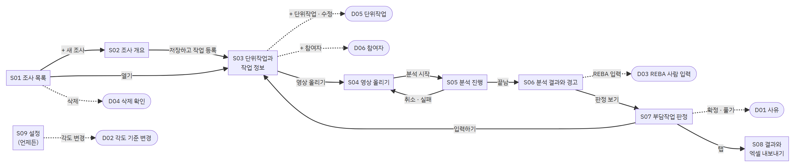

| 시나리오 (requirements.md 5절) | 거치는 화면 |
|---|---|
| UC-001 작업 영상 분석하기 | S03 (하루 작업시간) → S04 (영상, 동의) → S05 (진행) → S06 (결과, 경고) → D03 (REBA 사람 입력) |
| UC-002 부담작업 판정 확정하기 | S07 (초안과 근거) → D01 (사유) → S07 (확정) · '입력 필요'는 S03으로 갔다가 돌아옴 |
| UC-003 엑셀 보고서 내보내기 | S08 (결과 확인 → 엑셀로 내보내기) |

- 탭으로 언제든 다른 화면으로 갈 수 있다. 조사를 열기 전에는 '조사'와 '설정' 탭만 켜진다.
- 단위작업마다 다른 화면 (S03 ~ S07)은 탭 줄 오른쪽의 '단위작업' 고르기로 작업을 바꾼다.

---

## 4. 공통 규칙

### 4.1 창 구성

| 영역 | 높이 | 내용 |
|---|---|---|
| 제목 표시줄 | 36px | 프로그램 이름, 열린 조사 (조사일 · 구분 · 작업공정명), 조사 상태 (작성 중 · 확정) |
| 탭 줄 | 44px | 조사 · 작업 · 영상 · 결과 · 판정 · 내보내기 · 설정. 오른쪽에 단위작업 고르기 (작업 ~ 판정 탭) |
| 본문 | 나머지 | 화면마다 다름 |
| 아래 띠 | 26px | 왼쪽: 책임 문구 "부담작업 해당 여부 결정과 조사 결과의 책임은 사업주와 조사자에게 있습니다." (모든 화면, NFR-013). 오른쪽: 마지막 자동 저장 시각 |

- 기준 창 크기 1366×768, 최소 1280×720. 그보다 작으면 본문에 스크롤이 생긴다.

### 4.2 상태 표시

| 표시 | 뜻 | 모양 |
|---|---|---|
| 해당 (초안) | 계산 결과 기준 이상, 아직 확정 전 | 연주황 바탕, 진한 주황 글씨 |
| 비해당 (초안) | 계산 결과 기준 미만, 또는 단기간·간헐 작업 | 연회색 바탕 |
| 사람 확인 | 계산은 됐지만 믿기 어려움 (확신도, 해석 차이, 관절 미검출). 사유와 함께 확정 | 연노랑 바탕 (#F6E2B8) |
| 입력 필요 | 판정에 필요한 값이 없음. 확정할 수 없음 | 흰 바탕, 점선 테두리 |
| 해당 · 확정 / 비해당 · 확정 | 조사자가 확정함. 확정자와 시각을 함께 보임 | 연초록 바탕 |
| AI 작성 | GPT가 쓴 문장. 조사자가 고칠 수 있음 | 연보라 바탕 |
| 조사자 변경 | 해설 값과 다른 각도 기준 (사유와 함께) | 연노랑 바탕 |
| 임시 점수 | REBA 사람 입력이 비어 있음 | 연노랑 바탕 |

- 색만으로 구분하지 않는다. 배지에는 항상 글자가 있다.

### 4.3 저장과 다시 계산

1. **입력 화면은 자동 저장한다** (기능정의서 F01-02 규칙 1). 칸에서 벗어나거나 Enter를 누르면 그 칸을 저장한다. '저장' 버튼이 없다.
2. 범위를 벗어난 값은 저장하지 않는다. 칸을 빨간 테두리로 바꾸고 칸 아래에 이유를 적는다. 이전 값을 지킨다.
3. 저장하면 서비스가 그 값을 쓰는 호를 바로 다시 판정한다 (API 계약서 2.2절). 화면 아래에 알림을 5초 띄운다: 바뀐 호 (예: "4호 비해당 → 해당 (초안)"), 새로 뜬 경고와 사라진 경고.
4. 확정된 호가 풀리면 노란 알림으로 따로 알린다: "4호 확정이 풀렸습니다 (수정 이력에 남음)".
5. **대화상자와 설정은 버튼을 누를 때 저장한다** (D01 ~ D06, S09).
6. 저장하지 못하면 (E-DB-002) 화면 위 띠에 알리고 입력값을 그대로 둔다.

### 4.4 메시지 위치

| 종류 | 위치 | 예 |
|---|---|---|
| 칸 오류 | 그 칸 아래 빨간 글씨 | E-INPUT-001 |
| 막는 오류 | 화면 위 띠 (닫을 때까지) | E-DB-001 |
| 알림 | 화면 아래 (5초) | 다시 계산 결과, I-ANALYSIS-005 |
| 되돌릴 수 없는 일 | 확인 대화상자 | D04 삭제 |
| 분석 실패 | S05 본문을 바꿈 | E-ANALYSIS-001 |

문구는 API 계약서 8절을 그대로 쓴다. 코드별 위치는 7절.

### 4.5 색과 글꼴

- 색은 10/9 발표 화면과 같다: 제목 표시줄 진한 남색 (#18232F), 탭 줄 연회색 (#E6EBF0), 바탕 (#F2F4F6), 카드 (#FBFCFD), 주 버튼과 경고 주황 (#D9661F), 위험 글자 진한 주황 (#B5521A), 확인 필요 연노랑 (#F6E2B8).
- 주황은 주 버튼과 경고에만 쓴다. 한 화면에 주 버튼은 하나다.
- 글꼴: 한글 고딕 (IBM Plex Sans KR, 없으면 맑은 고딕). 본문 13px 이상.

### 4.6 키보드

- Tab 순서는 위에서 아래, 왼쪽에서 오른쪽. Enter는 그 화면의 주 버튼, Esc는 대화상자 닫기.
- 숫자 칸은 숫자만 받는다. 단위는 칸 안 오른쪽에 회색으로 보인다.

### 4.7 개인정보 표시

- 화면, 대표 장면, 미리보기, 엑셀 이미지에는 얼굴을 가린 장면만 쓴다 (BR-22). 원본 영상은 앱 안에서 재생하지 않는다.
- GPT 키는 가려서 보인다. 다시 보여 주지 않는다.
- 참여자는 '근로자 A'처럼 적어도 된다. 참여자와 작업 이름은 GPT에 보내지 않는다 (BR-21, OI-05).

---

## 5. 화면 상세

### S01 조사 목록

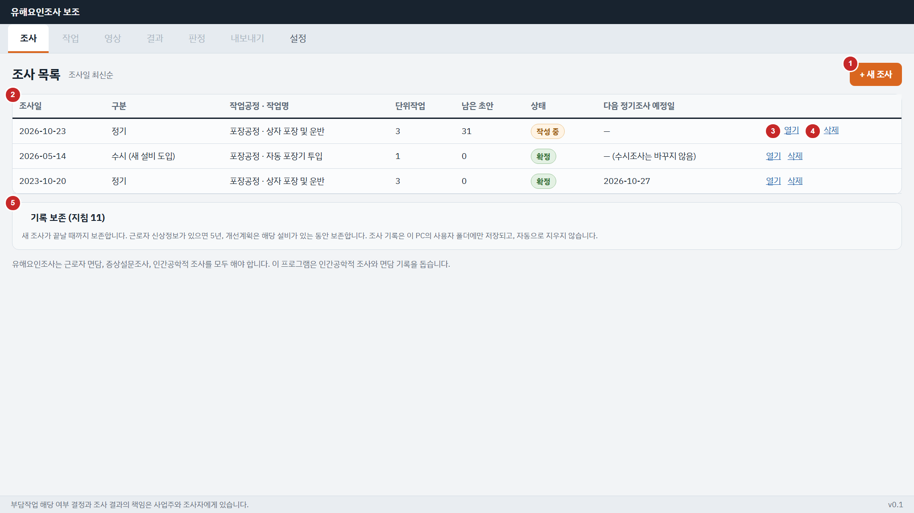

- **목적**: 조사를 만들고, 저장된 조사를 고르거나 지운다. 프로그램을 켜면 처음 보이는 화면이다.
- **들어오는 길**: 프로그램 시작, 탭 '조사'
- **나가는 길**: S02 (새 조사), S03 (열기), D04 (삭제)
- **기능**: F01-02 조사 저장, 목록, 다시 열기, F01-03 다음 정기조사 예정일

| 번호 | 요소 | 종류 | 데이터 · 동작 | 규칙 · 메시지 |
|---|---|---|---|---|
| 1 | + 새 조사 | 버튼 (주) | S02를 빈 양식으로 연다 | — |
| 2 | 조사 목록 표 | 표 | list_surveys() → SurveySummary.survey_date, SurveySummary.survey_type_cd, SurveySummary.process_name, SurveySummary.work_name, SurveySummary.task_cnt, SurveySummary.draft_judgment_cnt, SurveySummary.status_cd, SurveySummary.next_regular_due_date | 조사일 최신순 (F01-02 규칙 2). 예정일은 정기·최초 조사의 확정일 + 3년, 수시조사는 '—' (F01-03, AC-03) |
| 3 | 열기 | 링크 | get_survey(survey_id) → S03. 마지막 상태 그대로 연다 | 영상이 옮겨졌어도 결과는 보인다. 다시 분석할 때만 위치를 다시 고른다 (F01-02 규칙 4) |
| 4 | 삭제 | 링크 | D04 → delete_survey(survey_id, actor) | 조사와 수정 이력이 함께 지워진다. 보존 기간을 확인하게 한다 |
| 5 | 기록 보존 안내 | 안내 | 고정 문구 | NFR-014, BR-20 |

**상태**

- 조사가 없으면 표 대신 "아직 조사가 없습니다. '+ 새 조사'로 시작하세요."
- 저장소 파일을 열 수 없으면 화면 위 띠에 E-DB-001

### S02 조사 개요

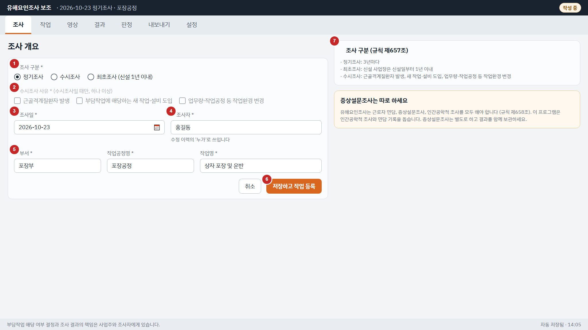

- **목적**: 조사 한 건의 기본 정보를 넣는다. 처음 저장하면 조사가 만들어지고, 그 뒤로는 바꿀 때마다 자동 저장된다.
- **들어오는 길**: S01 '+ 새 조사', 탭 '조사'
- **나가는 길**: S03 (저장하고 작업 등록)
- **기능**: F01-01 조사 만들기와 조사개요 입력

| 번호 | 요소 | 종류 | 데이터 · 동작 | 규칙 · 메시지 |
|---|---|---|---|---|
| 1 | 조사 구분 | 라디오 | SurveyCreate.survey_type_cd (REGULAR · OCCASIONAL · INITIAL) | 필수 |
| 2 | 수시조사 사유 | 체크 (여러 개) | SurveyCreate.occasional_reasons | 수시조사일 때만 켜짐. 하나 이상 고르지 않으면 E-INPUT-002 (BR-19) |
| 3 | 조사일 | 날짜 | SurveyCreate.survey_date | 필수. YYYY-MM-DD |
| 4 | 조사자 | 글자 | SurveyCreate.investigator_name | 필수. 이 조사의 수정 이력에서 '누가'로 쓴다 (F01-01 규칙 3) |
| 5 | 부서 · 작업공정명 · 작업명 | 글자 3칸 | SurveyCreate.dept_name, SurveyCreate.process_name, SurveyCreate.work_name | 필수. 작업공정명은 엑셀 파일 이름에 들어간다 |
| 6 | 저장하고 작업 등록 | 버튼 (주) | 새 조사: create_survey(data) → S03. 있는 조사: 칸마다 자동 저장 update_survey(survey_id, data, actor) | 빈 필수 칸은 칸 아래 "입력해 주세요" (E-INPUT-002) |
| 7 | 조사 구분 안내 | 안내 | 고정 문구 | BR-19. 아래 카드는 증상설문조사 별도 안내 (BR-18) |

**상태**

- 확정된 조사를 고치면 조사가 '작성 중'으로 돌아가고 위 띠에 알린다 (API 2.1절 ⑩)

### S03 단위작업과 작업 정보

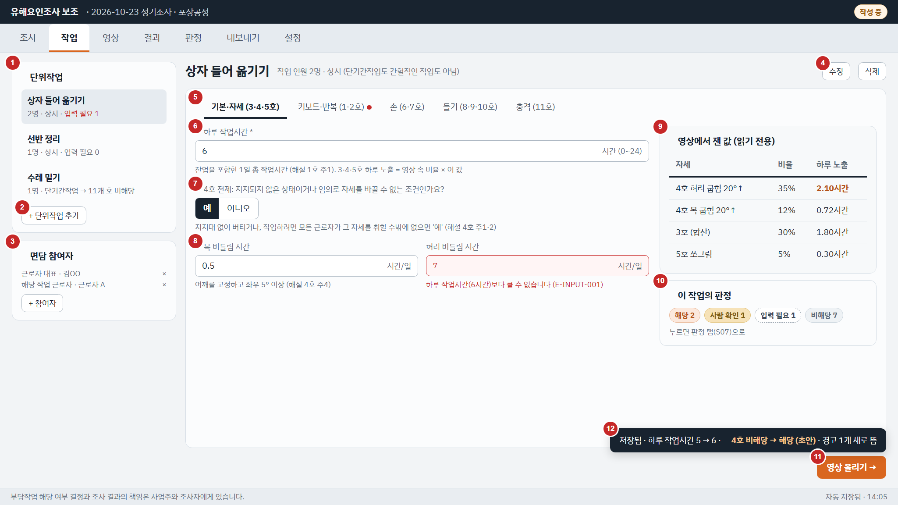

- **목적**: 단위작업을 등록하고, 판정에 필요한 값을 넣는다. 값을 넣으면 자동 저장되고 그 값을 쓰는 호가 바로 다시 판정된다.
- **들어오는 길**: S02 '저장하고 작업 등록', S01 '열기', S07 '입력하기', 탭 '작업'
- **나가는 길**: S04 (영상 올리기)
- **기능**: F02-01 단위작업 등록, F02-02 작업 정보 입력, F02-03 참여 근로자 기록, F05-04 다시 계산

| 번호 | 요소 | 종류 | 데이터 · 동작 | 규칙 · 메시지 |
|---|---|---|---|---|
| 1 | 단위작업 목록 | 목록 | get_survey(survey_id) → SurveyDetail.unit_tasks (UnitTask.task_name, UnitTask.worker_cnt, UnitTask.period_type_cd). 작업마다 '입력 필요' 수는 get_task_result(unit_task_id) → TaskResult.judgments | 고르면 오른쪽이 그 작업으로 바뀐다 |
| 2 | + 단위작업 추가 | 버튼 | D05 → create_unit_task(survey_id, data) | F02-01 |
| 3 | 면담 참여자 | 목록 | SurveyDetail.participants (Participant.participant_type_cd, Participant.display_name). '+ 참여자' → D06 → add_participant(...), × → remove_participant(participant_id) | 실명 대신 '근로자 A'처럼 적어도 된다. 참여자 이름은 GPT에 보내지 않는다 (F02-03, BR-21) |
| 4 | 수정 · 삭제 | 버튼 | D05 → update_unit_task(unit_task_id, data, actor) · D04 → delete_unit_task(unit_task_id, actor) | 작업 기간 구분을 바꾸면 11개 호를 다시 판정한다 (BR-02). 단위작업을 지워도 수정 이력은 남는다 |
| 5 | 입력 묶음 탭 | 탭 5개 | get_task_inputs(unit_task_id) → TaskInputBundle.inputs, TaskInputBundle.repetitions, TaskInputBundle.lift_positions. 키보드·반복 탭의 2호 부위별 표는 save_repetition_inputs(unit_task_id, items, actor) | 판정에 필요한 값이 빈 탭에는 빨간 점. 탭 구성은 기능정의서 F02-02 표의 '쓰는 곳'을 따른다 |
| 6 | 하루 작업시간 | 숫자 (시간) | TaskInputs.daily_work_h → save_task_inputs(unit_task_id, inputs, actor) | 0~24. 비우면 3·4·5호가 '입력 필요' (AC-05). 25를 넣으면 저장하지 않고 칸 아래 E-INPUT-001 |
| 7 | 4호 전제 | 예 / 아니오 | TaskInputs.unsupported_posture_yn | 비우면 4호는 '입력 필요'. '아니오'면 노출이 길어도 4호 비해당 (AC-23, BR-09) |
| 8 | 목 · 허리 비틀림 시간 | 숫자 2칸 | TaskInputs.neck_twist_h, TaskInputs.waist_twist_h | 측면 영상으로는 못 재서 조사자가 넣는다. 하루 작업시간보다 크면 저장하지 않는다 (E-INPUT-001, ERD 시험 M22) |
| 9 | 영상에서 잰 값 | 표 (읽기 전용) | get_task_result(unit_task_id) → TaskResult.shares (PostureShare.share_ratio, PostureShare.exposure_h) | 영상 분석 전에는 '영상을 분석하면 채워집니다'. 시간은 소수 둘째 자리 (F04-05 규칙 5) |
| 10 | 이 작업의 판정 | 상태 배지 | TaskResult.judgments (Judgment.computed_status_cd를 상태별로 셈) | 누르면 S07 |
| 11 | 영상 올리기 | 버튼 (주) | S04로 이동 | — |
| 12 | 다시 계산 알림 | 알림 (5초) | save_* 함수가 돌려준 RecalcResult.changes (JudgmentChange.before → JudgmentChange.after), RecalcResult.warnings_raised, RecalcResult.warnings_cleared | 확정이 풀리면 노란 알림 "4호 확정이 풀렸습니다 (수정 이력에 남음)" (JudgmentChange.unconfirmed, API 2.2절) |

**상태**

- 단위작업이 없으면 오른쪽에 "단위작업을 먼저 추가하세요"와 '+ 단위작업 추가'
- 작업 기간 구분이 단기간·간헐이면 입력 칸 위에 띠: "단기간작업이라 11개 호를 모두 비해당으로 판정합니다 (BR-02). 영상 분석과 REBA는 그대로 보여 줍니다."
- 저장은 칸에서 벗어나거나 Enter를 누를 때 한다 (자동 저장, F01-02 규칙 1). 범위 밖 값은 저장하지 않고 이전 값을 지킨다

### S03-2 단위작업과 작업 정보 · 들기 탭

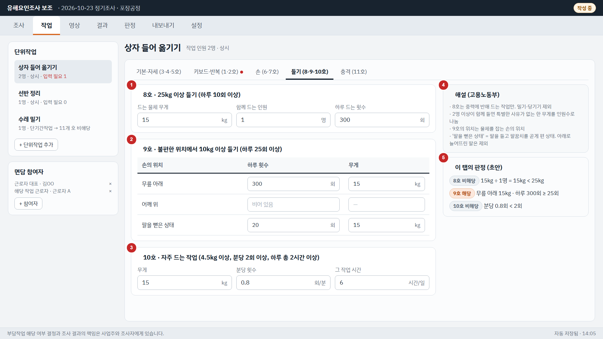

- **목적**: 8·9·10호에 필요한 무게와 횟수를 넣는다. 9호는 손의 위치별로 따로 넣는다.
- **들어오는 길**: S03의 '들기 (8·9·10호)' 탭
- **나가는 길**: S03의 다른 탭
- **기능**: F02-02 작업 정보 입력

| 번호 | 요소 | 종류 | 데이터 · 동작 | 규칙 · 메시지 |
|---|---|---|---|---|
| 1 | 8호 입력 | 숫자 3칸 | TaskInputs.lift_kg, TaskInputs.lift_people_cnt, TaskInputs.lift_cnt_per_day → save_task_inputs(unit_task_id, inputs, actor) | 1인 무게는 화면이 계산하지 않고 판정 근거(Judgment.basis_text)를 보여 준다 (BR-11, AC-22) |
| 2 | 9호 위치별 표 | 표 (3행 × 2칸) | LiftPositionInput.position_cd, LiftPositionInput.lift_cnt_per_day, LiftPositionInput.weight_kg → save_lift_position_inputs(unit_task_id, items, actor) | 보낸 표로 통째로 바꾼다. 빈 행은 보내지 않는다. 위치별로 따로 판정 (OI-01 기본안, BR-12) |
| 3 | 10호 입력 | 숫자 3칸 | TaskInputs.freq_lift_kg, TaskInputs.freq_lift_per_min, TaskInputs.freq_lift_h | 시간은 하루 작업시간 이하 |
| 4 | 해설 도움말 | 안내 | 고정 문구 | BR-11, BR-12 |
| 5 | 이 탭의 판정 | 배지 + 근거 | TaskResult.judgments → Judgment.computed_status_cd, Judgment.basis_text | 저장할 때마다 다시 계산된 값으로 바뀐다 (F05-04) |

**상태**

- 다른 탭(키보드·반복, 손, 충격)도 같은 모양이다: 왼쪽에 입력 카드, 오른쪽에 해설과 그 탭의 판정

### S04 영상 올리기

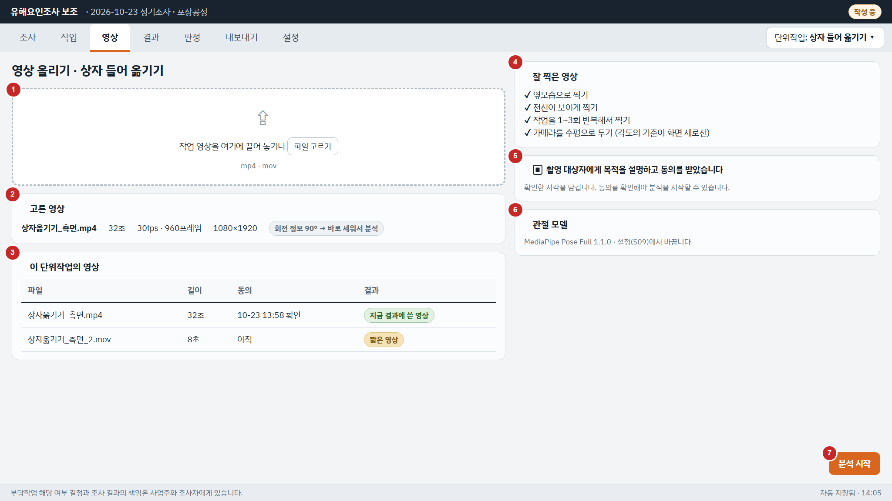

- **목적**: 찍어 둔 작업 영상을 고르고, 촬영 동의를 확인한 뒤 분석을 시작한다.
- **들어오는 길**: S03 '영상 올리기', 탭 '영상'
- **나가는 길**: S05 (분석 시작)
- **기능**: F03-01 영상 선택과 검사, F03-02 촬영 안내, F03-03 촬영 동의 확인, F03-04 분석 실행, 진행률, 취소

| 번호 | 요소 | 종류 | 데이터 · 동작 | 규칙 · 메시지 |
|---|---|---|---|---|
| 1 | 영상 고르기 | 끌어 놓기 + 버튼 | inspect_video(path) → VideoInfo | mp4·mov. 열 수 없으면 선택을 취소하고 E-VIDEO-001 (EX-01) |
| 2 | 고른 영상 정보 | 정보 줄 | VideoInfo.file_name, VideoInfo.duration_s, VideoInfo.fps, VideoInfo.frame_cnt, VideoInfo.width_px, VideoInfo.height_px, VideoInfo.rotation_deg, VideoInfo.notices | 회전 정보가 있으면 바로 세워 분석한다는 표시 (F03-01 규칙 2). 10초보다 짧으면 W-VIDEO-002 (TP-07, EX-02). 원본은 복사하지 않는다 |
| 3 | 이 단위작업의 영상 | 표 | list_videos(unit_task_id) → VideoInfo.consent_yn. 지금 결과에 쓴 영상은 TaskResult.run (RunHandle.video_id) | 영상이 옮겨졌으면 '위치를 다시 고르기' (E-VIDEO-004) |
| 4 | 촬영 안내 4줄 | 안내 | 고정 문구 | F03-02, AC-08 |
| 5 | 촬영 동의 | 체크 | 고른 영상을 붙일 때 attach_video(unit_task_id, path, consent, actor), 붙인 뒤에는 confirm_consent(video_id, actor) | 체크 전에는 '분석 시작'이 꺼져 있다 (AC-09, E-VIDEO-003). 확인 시각을 남긴다 |
| 6 | 관절 모델 표시 | 정보 | get_settings() → Settings.pose_model_id, list_models() → PoseModel.model_name, PoseModel.model_version | 바꾸려면 S09 |
| 7 | 분석 시작 | 버튼 (주) | start_analysis(unit_task_id, video_id, on_progress) → RunHandle → S05 | 다른 분석이 돌고 있으면 E-ANALYSIS-004. 영상을 찾을 수 없으면 E-VIDEO-004 |

**상태**

- 영상을 아직 고르지 않았으면 2·3번 카드 대신 촬영 안내만 크게 보인다

### S05 분석 진행

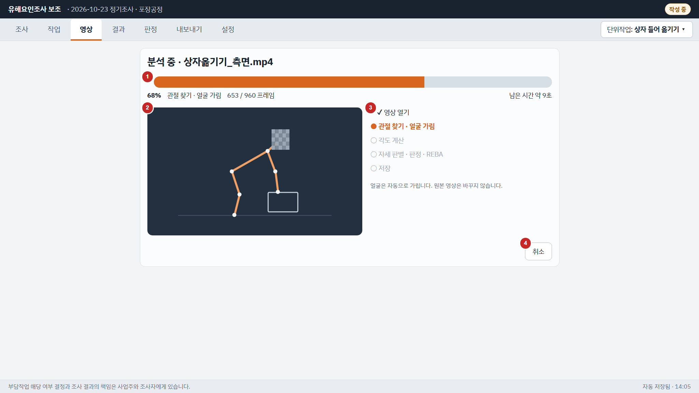

- **목적**: 분석이 어디까지 됐는지 보여 주고, 취소할 수 있게 한다. 끝나면 결과 화면으로 넘어간다.
- **들어오는 길**: S04 '분석 시작'
- **나가는 길**: S06 (끝남), S04 (취소·실패)
- **기능**: F03-04 분석 실행, 진행률, 취소, F04-01 관절 추출, F04-02 얼굴 모자이크

| 번호 | 요소 | 종류 | 데이터 · 동작 | 규칙 · 메시지 |
|---|---|---|---|---|
| 1 | 진행 막대 | 진행 표시 | on_progress로 받는 Progress.percent, Progress.stage, Progress.processed_frames, Progress.total_frames, Progress.eta_s | 콜백은 분석 스레드에서 온다. 화면은 자기 스레드로 넘겨 그린다 (API 4.3절) |
| 2 | 미리보기 | 그림 | get_frame_preview(run_id, frame_no) — 지금 처리한 프레임 근처를 1초에 한 번 | 얼굴을 가린 장면만 (BR-22) |
| 3 | 단계 목록 | 목록 | Progress.stage (DECODE · KEYPOINT · ANGLE · JUDGE · SAVE) | — |
| 4 | 취소 | 버튼 | cancel_analysis(run_id) → I-ANALYSIS-005 → S04 | 결과를 저장하지 않는다 (EX-07, AC-10) |

**상태**

- 실패하면 본문이 바뀐다: 마지막 Progress가 FAILED이고 Progress.error_code가 E-ANALYSIS-001이면 "사람을 찾지 못했습니다…" + '다시 찍는 방법', E-ANALYSIS-009면 "분석 중 문제가 생겼습니다" + '다시 시도' · '영상 바꾸기'
- 끝나면 (DONE) 자동으로 S06으로 넘어간다

### S06 분석 결과와 경고

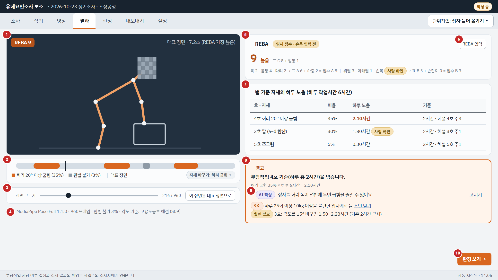

- **목적**: 대표 장면, REBA 점수, 법 문구의 자세별 하루 노출, 경고를 한 화면에서 본다. REBA 사람 입력과 대표 장면을 고칠 수 있다.
- **들어오는 길**: S05 (분석이 끝남), 탭 '결과'
- **나가는 길**: S07 (판정 보기), D03 (REBA 입력)
- **기능**: F04-02 얼굴 모자이크, F04-03 관절 각도 계산, F04-04 법 문구 자세 판별, F04-05 자세 비율과 하루 노출 시간, F04-06 REBA 계산, F04-07 대표 장면, F05-02 확신도와 사람 확인, F05-03 경고, F05-04 다시 계산, F06-02 GPT 문장, F06-03 GPT 없이 기본 문구

| 번호 | 요소 | 종류 | 데이터 · 동작 | 규칙 · 메시지 |
|---|---|---|---|---|
| 1 | 대표 장면 | 그림 | get_task_result(unit_task_id) → TaskResult.key_frame_jpeg, TaskResult.key_frame_no, RebaScore.reba_score | 얼굴을 가린 JPEG만 (BR-22). 기본은 REBA가 가장 높은 프레임 (F04-07 규칙 1) |
| 2 | 자세 시간 막대 | 막대 | get_posture_timeline(unit_task_id) → PostureTimeline.segments (PostureSegment.item_cd, PostureSegment.start_frame_no, PostureSegment.end_frame_no) | 자세를 고르면 그 자세 구간을 칠한다. 판별 불가 구간은 회색. 각도 기준을 바꾸면 다시 계산된다 |
| 3 | 장면 고르기 | 슬라이더 + 버튼 | get_frame_preview(run_id, frame_no)로 미리 보고, '이 장면을 대표 장면으로' → set_key_frame(unit_task_id, frame_no, actor) | 바꾸면 REBA를 다시 계산하고 수정 이력에 남긴다 (AC-20) |
| 4 | 분석 정보 | 정보 줄 | RunHandle.model_id → PoseModel.model_name, TaskResult.invalid_ratio, TaskResult.notices | 판별 불가 비율이 20%(TP-03)를 넘으면 노란 표시. 여러 사람·다리 잘림은 W-ANALYSIS-002 · W-ANALYSIS-003 |
| 5 | REBA 카드 | 점수 + 단계 | TaskResult.reba → RebaScore.neck_score, RebaScore.trunk_score, RebaScore.legs_score, RebaScore.table_a_score, RebaScore.load_score, RebaScore.upper_arm_score, RebaScore.lower_arm_score, RebaScore.wrist_score, RebaScore.table_b_score, RebaScore.coupling_score, RebaScore.table_c_score, RebaScore.activity_score, RebaScore.reba_score, RebaScore.risk_level_cd, RebaScore.provisional_yn, RebaScore.needs_review_items | 사람 입력이 빈 칸은 '사람 확인'이고 점수는 '임시' (F04-06 규칙 5, AC-19). REBA는 판정과 경고에 쓰지 않는다 (BR-15) |
| 6 | REBA 입력 | 버튼 | D03 | — |
| 7 | 하루 노출 표 | 표 | TaskResult.shares → PostureShare.item_cd, PostureShare.share_ratio, PostureShare.exposure_h, PostureShare.threshold_value, PostureShare.threshold_source_cd | 각도 출처를 함께 보인다 (해설 / 조사자 변경). 확신도 때문에 '사람 확인'이면 노란 배지 (F05-02) |
| 8 | 경고 | 강조 상자 | TaskResult.warnings → WarningItem.criterion_no, WarningItem.message_text, WarningItem.basis_text | 문구: "부담작업 {N}호 기준({기준 요약})을 넘습니다." (F05-03). '사람 확인'인 호는 경고 대신 '확인 필요'. 인터넷이 없어도 뜬다 (AC-25) |
| 9 | AI 조언 | 문장 + 표시 | WarningItem.ai_text, WarningItem.ai_result_cd. '조언 받기' → request_warning_advice(warning_id) → AiTextResult.text, AiTextResult.is_ai. '고치기' → edit_ai_text(ai_text_id, text, actor) | GPT 문장에는 'AI 작성'. GPT를 쓸 수 없으면 기본 문구만 보이고 표시가 없다 (F06-03, W-GPT-001) |
| 10 | 판정 보기 | 버튼 (주) | S07로 이동 | — |

**상태**

- 분석 결과가 없으면 "영상을 분석하면 결과가 나옵니다"와 'S04로'
- 분석 뒤 각도 기준이나 입력값이 바뀌면 화면이 저장된 각도로 다시 계산된 값으로 바뀐다 (영상을 다시 분석하지 않음, F05-04)

### S07 부담작업 판정

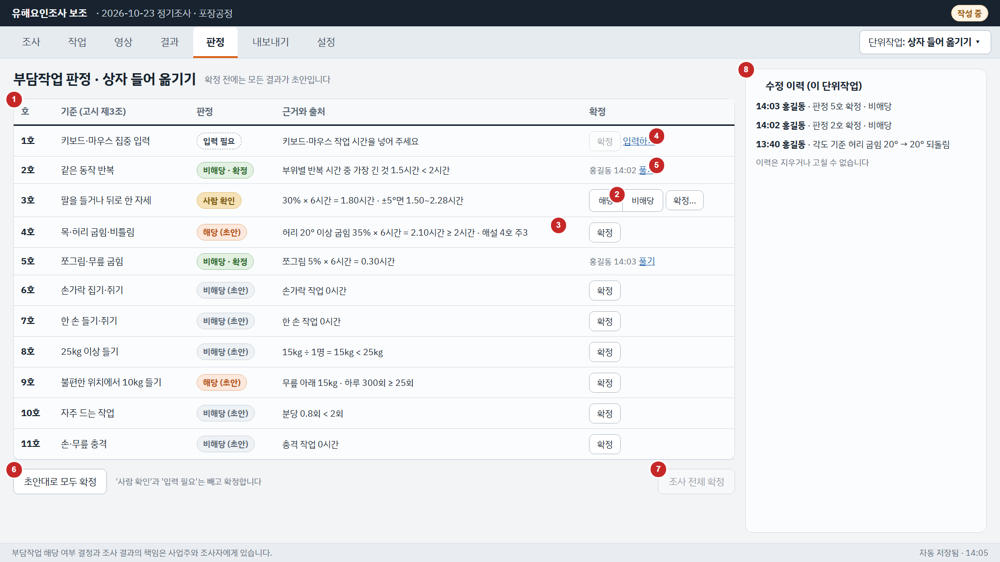

- **목적**: 단위작업의 11개 호 판정 초안과 근거를 보고, 조사자가 확정한다. 확정과 변경은 수정 이력에 남는다.
- **들어오는 길**: S06 '판정 보기', 탭 '판정'
- **나가는 길**: S03 (입력하기), D01 (확정·풀기 사유), S08
- **기능**: F02-02 작업 정보 입력, F05-01 11개 기준 판정 초안, F05-02 확신도와 사람 확인, F05-04 다시 계산, F05-05 확인, 수정, 확정, F05-06 수정 이력

| 번호 | 요소 | 종류 | 데이터 · 동작 | 규칙 · 메시지 |
|---|---|---|---|---|
| 1 | 11개 호 판정표 | 표 | get_task_result(unit_task_id) → TaskResult.judgments: Judgment.criterion_no, Judgment.short_name, Judgment.computed_status_cd, Judgment.basis_text, Judgment.source_text, Judgment.final_status_cd, Judgment.confirmed_by, Judgment.confirmed_at | 작업 기간 구분이 단기간·간헐이면 표 위에 띠 "11개 호 모두 비해당 (단기간작업)" (BR-02) |
| 2 | '사람 확인' 행 | 고르기 + 버튼 | 해당·비해당을 고르고 '확정…' → D01 (사유 필수) → confirm_judgment(unit_task_id, criterion_no, final_status, reason, actor) | 사유 없이 확정되지 않는다 (AC-27, E-CONFIRM-002). 사람 확인 사유는 Judgment.review_reason_cd |
| 3 | '해당 · 비해당 (초안)' 행 | 버튼 | '확정' → confirm_judgment(unit_task_id, criterion_no, final_status, reason, actor). 초안과 같은 결과면 사유 없이 | 초안과 다른 결과로 확정하려면 D01에서 사유 (기능정의서 3.2절 규칙 2) |
| 4 | '입력 필요' 행 | 버튼 꺼짐 + 링크 | '입력하기' → S03의 그 호 탭 (F02-02는 S03과 S07에서 입력) | 확정 버튼이 꺼져 있다 (AC-27, E-CONFIRM-001) |
| 5 | 확정된 행 | 링크 | '풀기' → D01 → unconfirm_judgment(unit_task_id, criterion_no, reason, actor). 결과를 바꾸면 D01 → confirm_judgment (API 2.1절 ②) | 확정 결과를 고칠 때도 사유가 있어야 한다 (3.2절 규칙 4) |
| 6 | 초안대로 모두 확정 | 버튼 | confirm_all(unit_task_id, actor) → ConfirmAllResult.confirmed, ConfirmAllResult.needs_decision, ConfirmAllResult.blocked | '사람 확인'이 남아 있으면 먼저 알린다 (F05-05 규칙 5): "3호는 사람 확인이라 따로 확정하세요" |
| 7 | 조사 전체 확정 | 버튼 | confirm_survey(survey_id, actor) | 모든 단위작업의 11개 호가 확정돼야 켜진다 (E-CONFIRM-003, 기능정의서 3.3절) |
| 8 | 수정 이력 | 목록 | list_edit_log(survey_id) → EditLogEntry.logged_at, EditLogEntry.actor_name, EditLogEntry.target_cd, EditLogEntry.action_cd, EditLogEntry.old_value, EditLogEntry.new_value, EditLogEntry.reason_text (EditLogEntry.unit_task_id로 이 작업만) | 추가만 된다. 지우거나 고칠 수 없다 (AC-28, F05-06) |

**상태**

- 판정이 하나도 없으면 (분석·입력 전) 11개 호가 모두 '입력 필요'로 보인다
- 다른 화면에서 입력값이 바뀌어 확정이 풀리면 그 행이 초안으로 돌아오고 이력에 '확정 해제 (입력값 변경)'이 남는다 (API 2.2절)

### S08 결과와 엑셀 내보내기

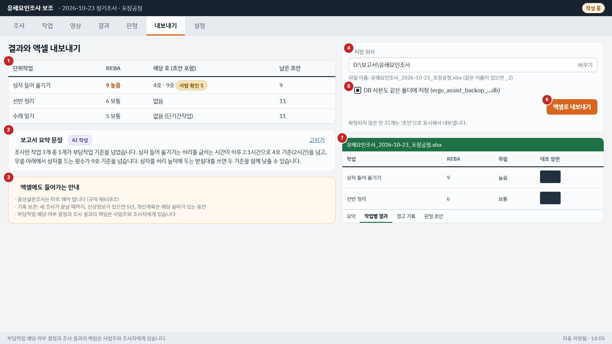

- **목적**: 모든 단위작업의 결과를 모아 보고, 엑셀 보고서로 내보낸다. 확정되지 않은 칸은 '초안'으로 표시해서 내보낸다.
- **들어오는 길**: S07, 탭 '내보내기'
- **나가는 길**: 엑셀 파일 (폴더 열기)
- **기능**: F06-01 엑셀 보고서, F06-02 GPT 문장, F06-03 GPT 없이 기본 문구

| 번호 | 요소 | 종류 | 데이터 · 동작 | 규칙 · 메시지 |
|---|---|---|---|---|
| 1 | 작업별 결과 표 | 표 | get_survey(survey_id) → SurveyDetail.unit_tasks, 작업마다 get_task_result(unit_task_id) → RebaScore.reba_score, RebaScore.risk_level_cd, Judgment.computed_status_cd, Judgment.confirmed_yn | 확정되지 않은 판정 수를 함께 보인다 |
| 2 | 보고서 요약 문장 | 문장 + 표시 | request_report_summary(survey_id) → AiTextResult.text, AiTextResult.is_ai, AiTextResult.result_cd. '고치기' → edit_ai_text(ai_text_id, text, actor) | GPT를 쓸 수 없으면 기본 문구, 열린 경고가 없으면 "법 기준(고시 제3조)을 넘는 작업이 없습니다." (NO_WARNING). 작업 이름은 보내지 않는다 (OI-05) |
| 3 | 엑셀에도 들어가는 안내 | 안내 | 고정 문구 | BR-18, NFR-014, NFR-013 |
| 4 | 저장 위치 | 폴더 고르기 | get_settings() → Settings.last_export_dir | 파일 이름 규칙은 API 7.1절 |
| 5 | DB 사본도 저장 | 체크 | export_excel의 with_db_backup | 기본 켜짐. SQLite 온라인 백업 (ERD 6.6절) |
| 6 | 엑셀로 내보내기 | 버튼 (주) | export_excel(survey_id, path, actor, with_db_backup) → ExportResult.file_path, ExportResult.draft_cell_cnt, ExportResult.backup_path | 파일이 열려 있으면 저장하지 않고 다른 이름으로 저장하게 한다 (E-EXPORT-001, EX-12). 끝나면 '폴더 열기' |
| 7 | 엑셀 미리보기 | 그림 | 고정 그림 (시트 4개: 요약 · 작업별 결과 · 경고 기록 · 판정 초안) | 실제 내용은 API 7.1절 (AC-29) |

**상태**

- 인터넷이 없으면 요약 문장은 기본 문구로 바뀌고, 엑셀 내보내기는 그대로 된다 (AC-32)

### S09 설정

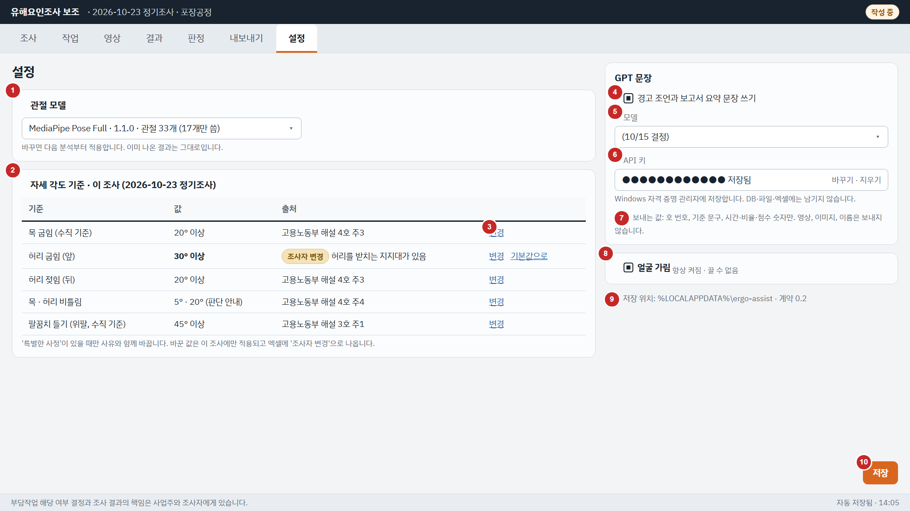

- **목적**: 관절 모델과 GPT 사용을 정하고, 열린 조사의 각도 기준(고용노동부 해설)을 보고 사유와 함께 바꾼다.
- **들어오는 길**: 탭 '설정' (언제든)
- **나가는 길**: D02 (각도 기준 변경)
- **기능**: F07-01 관절 모델 선택, F07-02 각도 기준 보기와 변경, F07-03 GPT 설정

| 번호 | 요소 | 종류 | 데이터 · 동작 | 규칙 · 메시지 |
|---|---|---|---|---|
| 1 | 관절 모델 | 고르기 | list_models() → PoseModel.model_name, PoseModel.model_version, PoseModel.keypoint_cnt. 저장은 save_settings(pose_model_id, gpt_enabled, gpt_model) | 다음 분석부터 적용 (F07-01 규칙 2). 분석 결과마다 모델 이름과 버전을 남긴다 (AC-33) |
| 2 | 각도 기준 표 | 표 | get_thresholds(survey_id) → Threshold.threshold_cd, Threshold.value_deg, Threshold.source_label, Threshold.overridden_yn | 열린 조사가 없으면 기본값만 보이고 바꿀 수 없다. 쪼그려 앉기는 각도가 아니라서 표에 없다 (무릎이 발끝보다 앞, 해설 5호 주1) |
| 3 | 변경 · 기본값으로 | 링크 | '변경' → D02 → set_threshold(...). '기본값으로' → reset_threshold(survey_id, threshold_cd, actor) | 사유 없이 바꿀 수 없다 (AC-34, E-THRESHOLD-001). 바꾸면 이 조사의 모든 단위작업을 다시 판정한다 |
| 4 | GPT 사용 | 체크 | Settings.gpt_enabled | 끄면 기본 문구만 나온다 (AC-35, DISABLED) |
| 5 | GPT 모델 | 고르기 | Settings.gpt_model | D-API-03 (10/15) |
| 6 | API 키 | 가린 칸 | set_gpt_api_key(key), delete_gpt_api_key(). 있는지만 Settings.has_gpt_key로 안다 | 키 자체는 다시 보여 주지 않는다. 빈 키는 E-INPUT-002 |
| 7 | 보내는 값 안내 | 안내 | 고정 문구 (API 6.2절) | BR-21 |
| 8 | 얼굴 가림 | 표시 (끌 수 없음) | — | BR-22 |
| 9 | 저장 위치 | 정보 | 고정 (ERD 6.1절) | — |
| 10 | 저장 | 버튼 (주) | get_settings()로 열고 save_settings(pose_model_id, gpt_enabled, gpt_model)로 저장 | 설정은 '저장'을 누를 때 저장한다 (입력 화면의 자동 저장과 다름) |

**상태**

- GPT 키가 없으면 키 칸에 "키 없음 · 기본 문구로 동작" (FALLBACK_NO_KEY)

---

## 6. 대화상자

### D01 확정 · 확정 풀기 사유

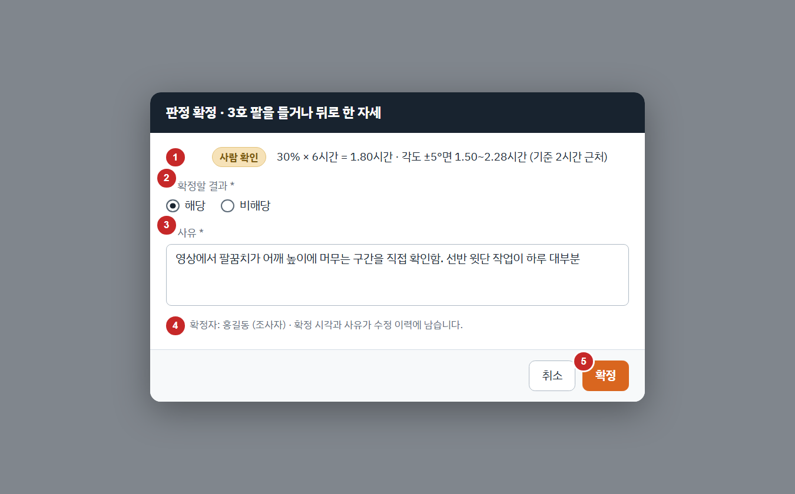

- **목적**: '사람 확인'을 확정하거나, 초안과 다른 결과로 확정하거나, 확정을 풀거나, 확정 결과를 바꿀 때 사유를 받는다.
- **기능**: F05-05 확인, 수정, 확정

| 번호 | 요소 | 종류 | 데이터 · 동작 | 규칙 · 메시지 |
|---|---|---|---|---|
| 1 | 호와 초안 | 정보 | Judgment.criterion_no, Judgment.short_name, Judgment.computed_status_cd, Judgment.basis_text | — |
| 2 | 확정할 결과 | 라디오 | FinalStatus (APPLICABLE · NOT_APPLICABLE) | 확정을 풀 때는 이 칸이 없다 |
| 3 | 사유 | 글자 (여러 줄) | reason | 필수 조건: '사람 확인', 초안과 다른 결과, 확정 결과 바꾸기, 확정 풀기. 비면 E-CONFIRM-002 |
| 4 | 확정자 | 정보 | SurveyDetail.investigator_name (actor) | — |
| 5 | 확정 · 풀기 | 버튼 (주) | confirm_judgment(unit_task_id, criterion_no, final_status, reason, actor) 또는 unconfirm_judgment(unit_task_id, criterion_no, reason, actor) → Judgment | '입력 필요'는 이 창을 열 수 없다 (E-CONFIRM-001) |

### D02 각도 기준 변경

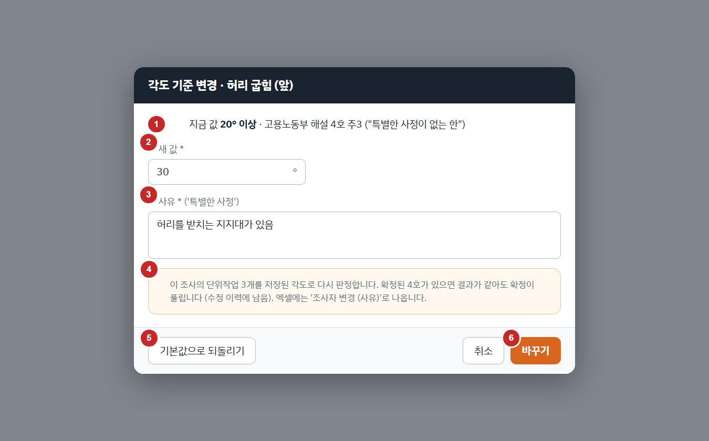

- **목적**: 열린 조사의 각도 기준 하나를 사유와 함께 바꾼다. 바꾸면 그 조사의 모든 단위작업을 다시 판정한다.
- **기능**: F07-02 각도 기준 보기와 변경

| 번호 | 요소 | 종류 | 데이터 · 동작 | 규칙 · 메시지 |
|---|---|---|---|---|
| 1 | 지금 값과 출처 | 정보 | Threshold.value_deg, Threshold.source_label | — |
| 2 | 새 값 | 숫자 (°) | value_deg | 범위 밖이면 E-INPUT-001 |
| 3 | 사유 | 글자 | reason | 필수 (BR-06). 비면 E-THRESHOLD-001 |
| 4 | 영향 안내 | 안내 | API 2.2절의 규칙을 그대로 알린다 | — |
| 5 | 기본값으로 되돌리기 | 버튼 | reset_threshold(survey_id, threshold_cd, actor) | 해설 값으로 돌아간다. 이력에 RESET |
| 6 | 바꾸기 | 버튼 (주) | set_threshold(survey_id, threshold_cd, value_deg, reason, actor) → RecalcResult 목록 | 끝나면 "단위작업 3개 다시 판정 · 4호 1개 바뀜 · 확정 1개 풀림" 알림 |

### D03 REBA 사람 입력

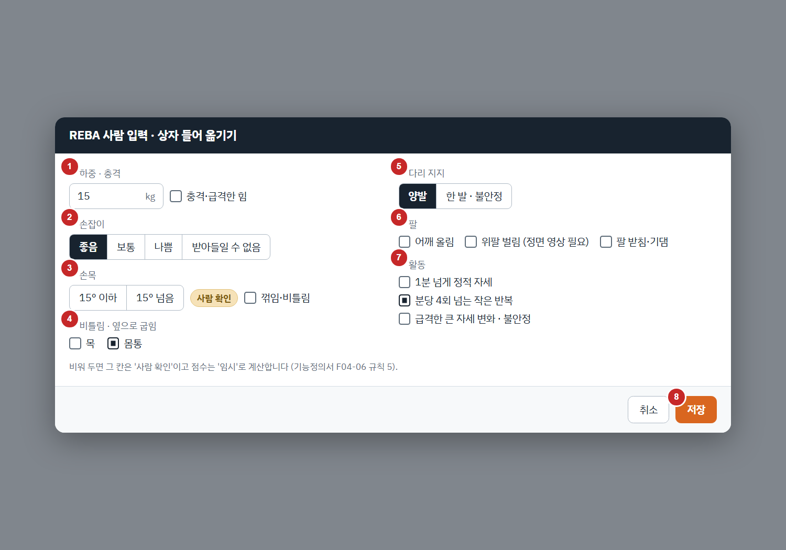

- **목적**: 영상으로 재기 어려운 REBA 항목을 조사자가 넣는다. 넣으면 REBA만 다시 계산한다 (판정에는 쓰지 않음).
- **기능**: F04-06 REBA 계산

| 번호 | 요소 | 종류 | 데이터 · 동작 | 규칙 · 메시지 |
|---|---|---|---|---|
| 1 | 하중 · 충격 | 숫자 + 체크 | RebaInputs.load_kg, RebaInputs.shock_yn | REBA 5단계 (kg 구간) |
| 2 | 손잡이 | 4단 | RebaInputs.coupling_cd | REBA 11단계 |
| 3 | 손목 | 2단 + 체크 | RebaInputs.wrist_flex_cd, RebaInputs.wrist_twist_yn | 영상 정확도가 낮아 조사자가 넣는다 (REBA 9단계) |
| 4 | 비틀림 · 옆 굽힘 | 체크 2개 | RebaInputs.neck_twist_side_yn, RebaInputs.trunk_twist_side_yn | REBA 1a · 2a |
| 5 | 다리 지지 | 2단 | RebaInputs.legs_support_cd | REBA 3단계 |
| 6 | 팔 | 체크 3개 | RebaInputs.shoulder_raised_yn, RebaInputs.arm_abducted_yn, RebaInputs.arm_supported_yn | 벌림은 측면 영상으로 못 잰다 (OI-07) |
| 7 | 활동 | 체크 3개 | RebaInputs.act_static_yn, RebaInputs.act_repeat_yn, RebaInputs.act_rapid_yn | REBA 13단계 |
| 8 | 저장 | 버튼 (주) | 열 때 get_reba_inputs(unit_task_id), 저장은 save_reba_inputs(unit_task_id, inputs, actor) → RecalcResult | REBA만 다시 계산한다. 확정은 풀리지 않는다 (BR-15, API 2.2절) |

### D05 단위작업 추가 · 수정

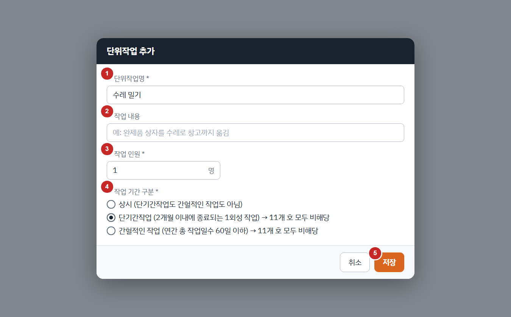

- **목적**: 단위작업을 등록하거나 이름·인원·작업 기간 구분을 고친다.
- **기능**: F02-01 단위작업 등록

| 번호 | 요소 | 종류 | 데이터 · 동작 | 규칙 · 메시지 |
|---|---|---|---|---|
| 1 | 단위작업명 | 글자 | UnitTaskCreate.task_name | 필수 (E-INPUT-002). 한 조사 안에서 겹치면 E-INPUT-003 |
| 2 | 작업 내용 | 글자 | UnitTaskCreate.task_desc | 선택. GPT에 보내지 않는다 (OI-05) |
| 3 | 작업 인원 | 정수 | UnitTaskCreate.worker_cnt | 1 이상 (E-INPUT-001) |
| 4 | 작업 기간 구분 | 라디오 | UnitTaskCreate.period_type_cd (ONGOING · SHORT_TERM · INTERMITTENT) | 단기간·간헐이면 11개 호를 모두 비해당으로 판정 (BR-02, AC-04) |
| 5 | 저장 | 버튼 (주) | 추가: create_unit_task(survey_id, data) · 수정: update_unit_task(unit_task_id, data, actor) | 새 단위작업은 11개 호 판정 행이 '입력 필요'로 생긴다 |

### D04 삭제 확인

- **목적**: 조사나 단위작업을 지우기 전에 한 번 더 묻는다.

| 항목 | 내용 |
|---|---|
| 문구 (조사) | "조사와 수정 이력이 모두 지워집니다. 기록 보존 기간(새 조사가 끝날 때까지, 신상정보가 있으면 5년)이 지났는지 확인하세요." |
| 문구 (단위작업) | "단위작업과 영상 분석 결과, 판정이 지워집니다. 수정 이력은 남습니다." |
| 동작 | '삭제' → delete_survey(survey_id, actor) 또는 delete_unit_task(unit_task_id, actor). 기본 단추는 '취소' |

### D06 참여자 추가

- **목적**: 면담에 참여한 근로자를 기록한다 (F02-03).

| 항목 | 내용 |
|---|---|
| 구분 | Participant.participant_type_cd (근로자 대표 · 해당 작업 근로자) |
| 표시 이름 | Participant.display_name. 실명 대신 '근로자 A'처럼 적어도 된다. GPT에 보내지 않는다 (BR-21) |
| 동작 | '추가' → add_participant(survey_id, participant_type_cd, display_name). 빈 이름은 E-INPUT-002 |

---

## 7. 메시지 목록

API 계약서 8절의 코드 22개가 어느 화면에 어떻게 나오는지 정한다. 문구는 API 계약서를 따른다.

| 코드 | 종류 | 화면 문구 (API 계약서) | 나오는 화면 | 위치 · 방법 |
|---|---|---|---|---|
| E-INPUT-001 | 오류 | "{항목}은 {최소}~{최대} 사이로 입력해 주세요." | S02 · S03 · D02 · D05 | 그 칸 아래 빨간 글씨. 값은 저장하지 않고 이전 값을 지킨다 |
| E-INPUT-002 | 오류 | "{항목}을 입력해 주세요." | S02 · D05 · D06 · S09 | 그 칸 아래 빨간 글씨 |
| E-INPUT-003 | 오류 | "같은 이름의 단위작업이 이미 있습니다." | D05 | 단위작업명 칸 아래 |
| E-NOTFOUND-001 | 오류 | "찾을 수 없습니다. 목록을 새로 고쳐 주세요." | 모든 화면 | 화면 위 띠 + 목록으로 돌아감 |
| E-VIDEO-001 | 오류 | "이 파일을 열 수 없습니다. mp4나 mov 파일을 골라 주세요." | S04 | 끌어 놓기 상자 아래. 선택을 취소 |
| W-VIDEO-002 | 알림 | "작업 한 사이클 이상 찍었는지 확인해 주세요." | S04 | 고른 영상 정보 줄의 노란 배지 |
| E-VIDEO-003 | 오류 | "촬영 동의를 먼저 확인해 주세요." | S04 | '분석 시작'이 꺼져 있고, 누르면 동의 칸을 강조 |
| E-VIDEO-004 | 오류 | "영상을 찾을 수 없습니다. 위치를 다시 골라 주세요." | S04 · S06 | 영상 목록의 그 줄에 '위치를 다시 고르기' |
| E-ANALYSIS-001 | 오류 | "사람을 찾지 못했습니다. 전신이 보이게 옆에서 다시 찍어 주세요." | S05 | 본문이 실패 안내로 바뀜 + 다시 찍는 방법 |
| W-ANALYSIS-002 | 알림 | "여러 사람이 보입니다. 분석한 사람이 맞는지 확인해 주세요." | S06 | 분석 정보 줄의 노란 배지 |
| W-ANALYSIS-003 | 알림 | "다리가 보이지 않아 쪼그림·무릎 자세는 확인이 필요합니다." | S06 | 분석 정보 줄의 노란 배지 |
| E-ANALYSIS-004 | 오류 | "다른 분석이 끝난 뒤 시작해 주세요." | S04 | '분석 시작' 옆 알림 |
| I-ANALYSIS-005 | 알림 | "분석을 취소했습니다." | S04 | 화면 아래 알림 (5초) |
| E-ANALYSIS-009 | 오류 | "분석 중 문제가 생겼습니다. 다시 시도해 주세요." | S05 | 본문이 실패 안내로 바뀜 + '다시 시도' |
| E-CONFIRM-001 | 오류 | "입력이 필요한 기준이 있어 확정할 수 없습니다." | S07 | 확정 버튼이 꺼져 있음 + 행의 '입력하기' |
| E-CONFIRM-002 | 오류 | "확정하는 이유를 입력해 주세요." | D01 | 사유 칸 아래 |
| E-CONFIRM-003 | 오류 | "확정하지 않은 판정이 있어 조사를 확정할 수 없습니다." | S07 | '조사 전체 확정'이 꺼져 있고, 남은 판정 수를 표시 |
| E-THRESHOLD-001 | 오류 | "바꾸는 이유를 입력해 주세요." | D02 | 사유 칸 아래 |
| E-EXPORT-001 | 오류 | "엑셀 파일이 열려 있습니다. 닫고 다시 저장하거나 다른 이름으로 저장해 주세요." | S08 | 확인 대화상자: 닫고 다시 저장 · 다른 이름으로 저장 |
| E-DB-001 | 오류 | "저장된 조사를 열 수 없습니다." | S01 | 화면 위 띠. 저장 위치를 알려 줌 |
| E-DB-002 | 오류 | "저장하지 못했습니다." (앱 버그 신호, 로그에 제약 이름) | 모든 화면 | 화면 위 띠 "저장하지 못했습니다". 로그에 제약 이름 (앱 버그 신호) |
| W-GPT-001 | 알림 | (기본 문구만 보임) | S06 · S08 | 따로 띄우지 않음. 'AI 작성' 표시 없이 기본 문구만 보임 |

---

## 8. 추적표 (기능 → 화면 → API)

| 기능 | 이름 | 화면 | API 함수 (그 화면에서) |
|---|---|---|---|
| F01-01 | 조사 만들기와 조사개요 입력 | S02 | `create_survey`, `update_survey` |
| F01-02 | 조사 저장, 목록, 다시 열기 | S01 | `delete_survey`, `get_survey`, `list_surveys` |
| F01-03 | 다음 정기조사 예정일 | S01 | `delete_survey`, `get_survey`, `list_surveys` |
| F02-01 | 단위작업 등록 | S03, D05 | `add_participant`, `create_unit_task`, `delete_unit_task`, `get_survey`, `get_task_inputs`, `get_task_result`, `remove_participant`, `save_repetition_inputs`, `save_task_inputs`, `update_unit_task` |
| F02-02 | 작업 정보 입력 | S03, S03-2, S07 | `add_participant`, `confirm_all`, `confirm_judgment`, `confirm_survey`, `create_unit_task`, `delete_unit_task`, `get_survey`, `get_task_inputs`, `get_task_result`, `list_edit_log`, `remove_participant`, `save_lift_position_inputs`, `save_repetition_inputs`, `save_task_inputs`, `unconfirm_judgment`, `update_unit_task` |
| F02-03 | 참여 근로자 기록 | S03 | `add_participant`, `create_unit_task`, `delete_unit_task`, `get_survey`, `get_task_inputs`, `get_task_result`, `remove_participant`, `save_repetition_inputs`, `save_task_inputs`, `update_unit_task` |
| F03-01 | 영상 선택과 검사 | S04 | `attach_video`, `confirm_consent`, `get_settings`, `inspect_video`, `list_models`, `list_videos`, `start_analysis` |
| F03-02 | 촬영 안내 | S04 | `attach_video`, `confirm_consent`, `get_settings`, `inspect_video`, `list_models`, `list_videos`, `start_analysis` |
| F03-03 | 촬영 동의 확인 | S04 | `attach_video`, `confirm_consent`, `get_settings`, `inspect_video`, `list_models`, `list_videos`, `start_analysis` |
| F03-04 | 분석 실행, 진행률, 취소 | S04, S05 | `attach_video`, `cancel_analysis`, `confirm_consent`, `get_frame_preview`, `get_settings`, `inspect_video`, `list_models`, `list_videos`, `start_analysis` |
| F04-01 | 관절 추출 | S05 | `cancel_analysis`, `get_frame_preview` |
| F04-02 | 얼굴 모자이크 | S05, S06 | `cancel_analysis`, `edit_ai_text`, `get_frame_preview`, `get_posture_timeline`, `get_task_result`, `request_warning_advice`, `set_key_frame` |
| F04-03 | 관절 각도 계산 | S06 | `edit_ai_text`, `get_frame_preview`, `get_posture_timeline`, `get_task_result`, `request_warning_advice`, `set_key_frame` |
| F04-04 | 법 문구 자세 판별 | S06 | `edit_ai_text`, `get_frame_preview`, `get_posture_timeline`, `get_task_result`, `request_warning_advice`, `set_key_frame` |
| F04-05 | 자세 비율과 하루 노출 시간 | S06 | `edit_ai_text`, `get_frame_preview`, `get_posture_timeline`, `get_task_result`, `request_warning_advice`, `set_key_frame` |
| F04-06 | REBA 계산 | S06, D03 | `edit_ai_text`, `get_frame_preview`, `get_posture_timeline`, `get_reba_inputs`, `get_task_result`, `request_warning_advice`, `save_reba_inputs`, `set_key_frame` |
| F04-07 | 대표 장면 | S06 | `edit_ai_text`, `get_frame_preview`, `get_posture_timeline`, `get_task_result`, `request_warning_advice`, `set_key_frame` |
| F05-01 | 11개 기준 판정 초안 | S07 | `confirm_all`, `confirm_judgment`, `confirm_survey`, `get_task_result`, `list_edit_log`, `unconfirm_judgment` |
| F05-02 | 확신도와 사람 확인 | S06, S07 | `confirm_all`, `confirm_judgment`, `confirm_survey`, `edit_ai_text`, `get_frame_preview`, `get_posture_timeline`, `get_task_result`, `list_edit_log`, `request_warning_advice`, `set_key_frame`, `unconfirm_judgment` |
| F05-03 | 경고 | S06 | `edit_ai_text`, `get_frame_preview`, `get_posture_timeline`, `get_task_result`, `request_warning_advice`, `set_key_frame` |
| F05-04 | 다시 계산 | S03, S06, S07 | `add_participant`, `confirm_all`, `confirm_judgment`, `confirm_survey`, `create_unit_task`, `delete_unit_task`, `edit_ai_text`, `get_frame_preview`, `get_posture_timeline`, `get_survey`, `get_task_inputs`, `get_task_result`, `list_edit_log`, `remove_participant`, `request_warning_advice`, `save_repetition_inputs`, `save_task_inputs`, `set_key_frame`, `unconfirm_judgment`, `update_unit_task` |
| F05-05 | 확인, 수정, 확정 | S07, D01 | `confirm_all`, `confirm_judgment`, `confirm_survey`, `get_task_result`, `list_edit_log`, `unconfirm_judgment` |
| F05-06 | 수정 이력 | S07 | `confirm_all`, `confirm_judgment`, `confirm_survey`, `get_task_result`, `list_edit_log`, `unconfirm_judgment` |
| F06-01 | 엑셀 보고서 | S08 | `edit_ai_text`, `export_excel`, `get_settings`, `get_survey`, `get_task_result`, `request_report_summary` |
| F06-02 | GPT 문장 | S06, S08 | `edit_ai_text`, `export_excel`, `get_frame_preview`, `get_posture_timeline`, `get_settings`, `get_survey`, `get_task_result`, `request_report_summary`, `request_warning_advice`, `set_key_frame` |
| F06-03 | GPT 없이 기본 문구 | S06, S08 | `edit_ai_text`, `export_excel`, `get_frame_preview`, `get_posture_timeline`, `get_settings`, `get_survey`, `get_task_result`, `request_report_summary`, `request_warning_advice`, `set_key_frame` |
| F07-01 | 관절 모델 선택 | S09 | `delete_gpt_api_key`, `get_settings`, `get_thresholds`, `list_models`, `reset_threshold`, `save_settings`, `set_gpt_api_key`, `set_threshold` |
| F07-02 | 각도 기준 보기와 변경 | S09, D02 | `delete_gpt_api_key`, `get_settings`, `get_thresholds`, `list_models`, `reset_threshold`, `save_settings`, `set_gpt_api_key`, `set_threshold` |
| F07-03 | GPT 설정 | S09 | `delete_gpt_api_key`, `get_settings`, `get_thresholds`, `list_models`, `reset_threshold`, `save_settings`, `set_gpt_api_key`, `set_threshold` |
| F07-04 | 모델 비교 도구 | (내부, 화면 없음) | — |

모든 서비스 함수 43개가 적어도 한 화면에서 쓰인다 (자동 확인).

---

## 9. 미결 사항

| ID | 무엇 | 언제 |
|---|---|---|
| UI-OI-01 | 화면 도구 (D-API-01)가 정해지면 와이어프레임의 배치는 그대로 두고 모양만 도구에 맞춘다. Streamlit이면 탭이 위쪽 메뉴, PySide6면 창 위 탭 | 10/14 |
| UI-OI-02 | 기준 해상도. 발표 노트북 사양이 정해지면 바꿀 수 있음 (지금 1366×768, 최소 1280×720) | 10/16 |
| UI-OI-03 | 분석할 사람을 고르는 화면 (OI-08). 지금은 가장 크게 보이는 한 명 + '사람 확인' | 10/17 |
| UI-OI-04 | 분석 구간(작업 한 사이클)을 S04에서 지정할지 (OI-06). 지금은 영상 전체 | 10/17 |
| UI-OI-05 | 정면 영상을 따로 받을지 (OI-07). 받으면 S04에 '정면 영상' 칸 추가 | 10/17 |

---

## 10. 다른 문서에 반영한 것

| 문서 | 고친 것 | 이유 |
|---|---|---|
| API 계약서 v0.2 | `get_task_inputs`, `get_reba_inputs`, `list_videos`, `get_posture_timeline` 추가 | 화면이 저장된 값을 다시 읽을 함수가 없었음 (S03, S04, S06, D03) |
| API 계약서 v0.2 | 오류 코드 E-INPUT-003 (같은 이름의 단위작업) 추가 | D05. 이름이 겹치면 지금은 DB 제약 오류 (E-DB-002)로만 드러났음 |
| 일정서 | 3.1 화면설계서를 '초안 있음'으로, 10/12 계획에 반영 | — |

---

## 부록 A. 화면 흐름도 원본 (Mermaid)

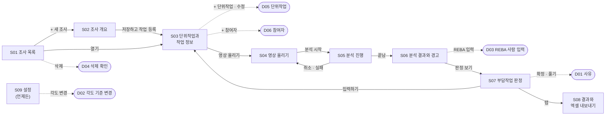

## 부록 B. 그림을 다시 만드는 방법

와이어프레임과 이 문서는 스크립트로 만든다. 화면을 고치려면 `ui_screens.py`의 그 화면 HTML과 요소 표를 함께 고치고 `gen_ui.py`를 돌린다. 스크립트는 다음을 확인하고, 하나라도 어긋나면 문서를 쓰지 않는다.

1. 와이어프레임의 빨간 번호와 요소 표의 번호가 같다.
2. 요소 표에 적힌 API 함수와 `DTO.필드`가 API 계약서의 계약 코드(contracts.py)에 있다.
3. 기능정의서 4절에서 그 화면에 배정된 기능이 그 화면 상세에 있다.
4. 서비스 함수 43개가 모두 어느 화면에서 쓰인다.
5. API 계약서 8절의 오류 코드가 모두 7절에 있다.
6. 인용한 기능정의서·요구사항 ID가 실제로 있다.
