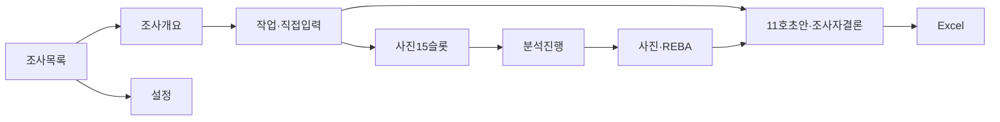

# 화면설계서

> 문서 ID ERGO-UI-001 · 설계 버전 1.5 · 기준일 2026-10-15 · 데모 개발 기준

## 1. 공통 원칙

Windows Electron 데스크톱 창1366×768 이상을 기준으로 한다. 화면은 renderer에서 표시하고 서비스 호출은 preload의 window.loco.call(method,params)→main→로컬 Python으로 전달한다. 모든 화면의 서비스명/params/Result는 API 계약서와 같다. 파일 선택은 DesktopBridge의 네이티브 선택 기능을 사용한다. 사진은 여러 장을 한 번에 등록하고3회×5사건=15슬롯에 배정한다. 사용자가 영상 구간/임의 작업 단계를 나누지 않는다. 사진 빈도와 하루 직접 노출시간은 별도 영역이다.

데모에 입력/확정/보안 가드와 운영 차단장치를 넣지 않는다. 사진·수동값·근거가 부족해도 저장/분석/검토/초안 Excel이 가능하다. 누락은 해당 셀/카드에 표시한다. 앱 초안·조사자 결론·계산 완전성·현재성·검토 표시는 각각 구분한다. 처리 실패는 해당 기능의 오류이며 다른 기능을 일괄 막지 않는다.

### 로코 현장 안내 위젯

제공된 HTML 프로토타입의 로코 위젯을 화면 공통 요소로 쓴다. 데스크톱에서 뷰포트 오른쪽 아래(z-index45)에 고정하며 로봇은 94×115px, 오른쪽 여백24px·아래 여백21px이다. 말풍선은 로봇 왼쪽에 폭252px로 붙이고, 로봇과 함께 화면 위에 겹쳐 표시한다. 위젯 전체는 클릭을 가로채지 않으며 로봇과 말풍선 버튼만 조작 대상이다. MVP의 정식 화면 흐름은 S01–S09이며 각 화면 SVG는 해당 안내 상태를 정적으로 그린다. `docs/ui/01_대시보드.svg`와 전체 미리보기 안의 대시보드 컷은 탐색용 시안으로 보존하며 MVP 화면/기능에 포함하지 않는다. 실제 renderer는 `docs/ui/loco-guide.js`를 로드하고 `<loco-guide page="S01"></loco-guide>`를 공통 레이어에 둔다. 독립 조작 예시는 `docs/ui/loco-guide-demo.html`이다.

| 현재 화면 | 처음 표시할 안내 | CTA 문구 | 전달 동작 |
|---|---|---|---|
| S01 조사 목록 | 안녕하세요, 로코예요! 현장의 움직임을 기록하는 동안 옆에서 필요한 입력을 짚어드릴게요. | 진행 중인 조사 열기 | S02 |
| S02 조사 개요 | 어떤 현장인지 먼저 알려주세요. 모르는 항목은 비워둬도 괜찮아요. 기록은 차근차근 채워가요. | 작업 조건 살펴보기 | S03 |
| S03 작업·직접입력 | 하루 작업시간과 자세에 노출된 시간은 달라요. 사진 비율로 시간을 채우지 않도록 함께 살펴봐요. | 사진 등록으로 | S04 |
| S04 사진15슬롯 | 가운데 순간의 기준은 상자 “바닥면”이에요! 사진을 놓은 뒤, 순간과 하중을 직접 확인해 주세요. | 촬영 안내 다시 보기 | guide |
| S05 분석 진행 | 포즈 처리 완료와 점수 계산 완료는 달라요. 가려진 관절이나 빈 슬롯도 결과에서 확인할 수 있어요. | 사진·REBA 살펴보기 | S06 |
| S06 사진·REBA | 부분 최대와 전체 최대는 다르게 읽어요. 점수가 없는 사진은 0점이 아니라, 아직 입력이 필요한 사진이에요. | 현재 사진 관찰값 보기 | manual |
| S07 조사자 확인 | 앱의 초안과 조사자의 결론은 나란히 남아요. 결론을 적어도 부족한 입력을 숨기지는 않아요. | 4호 합산 해석 살펴보기 | criterion4 |
| S08 Excel | 빠진 항목도 보고서의 일부예요. 아래 “다음 입력 안내”에는 어느 사진, 어느 기준인지 모두 적어두었어요. | 다음 입력으로 이동 | next |
| S09 설정 | 저는 작고 조용한 현장 동료예요. 바쁠 땐 조용한 모드를 켜 주세요. 판단은 늘 조사자의 몫이에요. | 조용한 모드 전환 | quiet |

일반 모드에서는 화면별 말풍선을 처음부터 표시한다. 로봇을 누르면 세 가지 고정 질문 선택지를 펼친다. × 또는 Escape는 현재 화면의 말풍선을 접는다(모달이 열려 있으면 Escape는 모달에 맡긴다). 다음 화면으로 이동하면 안내·접기 상태를 초기화한다. 로봇은 끌어 옮길 수 있고, 화면 크기를 바꾸면 기본 오른쪽 아래 위치로 돌아온다. 조용한 모드는 로봇만 보이고 눌렀을 때 안내가 열리며, 설정의 표시/조용한 모드 스위치로 각각 제어한다. 표시와 조용한 모드는 앱 설정에 저장한다. 입력칸에 포커스가 가면 말풍선을 접는다. 작은 화면에서는 로봇69×84px, 여백8px, 말풍선 폭200px로 줄인다.

말풍선 질문은 ‘왜 빈칸인가요?’, ‘사진으로 시간 계산?’, ‘검토 완료란?’ 세 가지다. 답변은 각각 ‘모르는 값은 아직 모르는 값이며 0점이나 비해당으로 채우지 않고 입력 안내에서 확인’, ‘사진15장 비율은 하루 노출시간이 아니며 시간·횟수는 현장 관찰·면담·문서에서 직접 기록’, ‘검토 완료는 조사자가 남기는 표시로 모든 입력의 완료나 법적 승인을 뜻하지 않음’으로 고정한다. 위젯은 규칙 기반 안내이며 자유대화 LLM이나 자동 판정 기능이 아니다. `loco-guide-action`의 `{page,nextPage,action}`을 renderer가 화면 기능에 연결한다: S01→S02, S02→S03, S03→S04, S05→S06 화면 이동, `guide`는 S04 촬영 안내 열기, `manual`은 S06 선택 사진 관찰값 입력 열기(선택 작업 없음은 안내), `criterion4`는 S07 4호 선택·해석 열기, `next`는 S08 다음 입력 안내로 이동, `quiet`는 조용한 모드 전환이다. `loco-guide-preference-change`의 `{visible}`·`{mode}`는 표시와 조용한 모드 변경이므로 앱 설정에 저장한다. 위젯 파일은 공통 안내 UI만 제공하며 화면 이동·모달·선택 데이터 작업은 renderer 이벤트 처리기가 수행한다. 독립 데모는 상태 보존에 브라우저 `localStorage`를 쓰고, Electron 앱은 `Settings.ui`를 `update_settings`로 저장한다.

## 2. 화면 흐름

S03에서 사진 없이 S07의 직접입력 고시 초안을 계산할 수 있다. S06에서 수동값을 수정해 REBA만 다시 계산할 수 있다. 단계는 안내 흐름이고 앞 단계 미완료가 뒷 화면 접근을 차단하지 않는다.

## 3. 화면·필드·호출

### S01 조사 목록

- 표: SurveySummary의 title/survey_date/task_count/reviewed/review_current.
- 새 조사 create_survey, 열기 get_survey, 삭제 delete_survey.
- ‘검토 완료’와 ‘이전 결과 검토’를 구분한다. 정기조사 법정 일정 자동계산은 이번 범위에 없다.

### S02 조사 개요

SurveyDraft 입력: survey_type(REGULAR/정기, OCCASIONAL/수시), survey_date, investigator, department, process, title, occasional_reason. 수시 사유는 기록하고 미입력도 저장 가능하다. update_survey 후 S03으로 이동한다. 개인정보/권한/승인 화면은 만들지 않는다.

### S03 작업·직접 관찰값

작업 목록은 list_tasks. 작업명·작업자코드·조건 요약·사진배정 수·현재분석·검토 상태를 표시한다. 종류 FLOOR_TO_SHELF_BOX_SINGLE_PERSON과인원1은 고정 안내다. 다른 작업/공동들기 기능은 만들지 않는다.

| 입력 영역 | 정확한 DTO 필드 | 안내 |
|---|---|---|
| 작업기본 | TaskDraft.task_name,TaskConditions.worker_code/method_description | 같은작업자·방법, 조건이 다르면 별도작업 |
| 중량·높이 | box_mass_kg,shelf_height_cm,conditions.evidence | 상자전체kg, 바닥→선반상판cm. 예시 기본값 저장하지 않음 |
| 일일조건 | daily_work_min,one_off,planned_duration_months,annual_work_days | 소정+연장 중 실제작업분,1회성/개월/연간일수. 제외여부는 파생 |
| 하루 들기 | LegalInputs.lift_count_day | 직접 관찰/면담 횟수, 사진3회 대체 금지 |
| 기준조건 | criteria[].condition_present/evidence/posture_interpretation_pending | YES/NO/UNKNOWN, 근거권장. 작업종류만으로NO 자동입력 없음 |
| 4/6/7호 조건 | unsupported,4호posture_restricted | 사진상 자세지지와 법적 작업조건을 구분 |
| 6/7호 힘 | pinch_mass_kg,pinch_force_kg_equiv,single_hand_mass_kg,grip_force_kg_equiv | kg/상당kg, 한손 조건만 |
| 9호횟수 | below_knee_count_day,above_shoulder_count_day,extended_arm_count_day,union_count_day,union_evidence | 중복제거union을 직접 기록 |
| 10/11호 빈도 | lift_rate_min,impact_rate_hour | 해당조건 작업중의 회/min·회/hour |
| 조건별시간 | exposures[].condition_code/minutes/evidence | 아래20조건, 누적min/day |

시간 행은 C1_KEYBOARD_FOCUSED, C2_NECK/SHOULDER/ELBOW/WRIST/HAND, C3_UNION, C4_NECK_FLEX/TRUNK_FLEX/TRUNK_EXT/NECK_TWIST/TRUNK_TWIST/UNION, C5_SQUAT/KNEEL/UNION, C6_QUALIFYING, C7_QUALIFYING, C10_LIFT, C11_IMPACT다. 실제 코드는 API ConditionCode와 같고 약어의 C2_/C4_/C5_ 접두사를 각 행에 모두 붙인다.

conditions.evidence와 노출/기준 evidence는 source/text/observed_at. 시간은 사진 빈도로 채우지 않는다. 모순·범위밖 입력은 결과에 표시하며 저장 버튼을 가드로 막지 않는다. create_task/rename_task/set_task_conditions/set_legal_inputs/delete_task를 호출한다.

### S04 사진15슬롯

상단 안내: ‘같은 조건의 정상 작업3회에서 아래 다섯 순간을 촬영합니다. 시간 간격을 맞출 필요는 없습니다.’

| 순서·코드 | 표시 이름 | 촬영 안내 | 하중 |
|---|---|---|---|
| 1 CYCLE_START | 손 닿기 전 | 상자는 바닥, 손이 닿기 직전 | UNLOADED/0 |
| 2 LIFT_OFF | 바닥 분리 직후 | 상자바닥 전체가 처음 떨어지고 중량은 손이 받음 | FULL_BOX/상자전체kg |
| 3 MID_LIFT | 바닥면 절반 높이 | 상자 **바닥**이 선반높이/2 통과, 외부지지 없음 | FULL_BOX/상자전체kg |
| 4 SHELF_APPROACH | 선반 접촉 직전 | 처음 닿기 직전 틈이 있고 아직 중량은 손이 받음 | FULL_BOX/상자전체kg |
| 5 CYCLE_END | 손 놓은 후 | 선반에 완전히 놓고 양손을 놓음 | UNLOADED/0 |

회차1/2/3마다5행을 표시하고 slot_no1..15를 보인다. ‘사진 선택’은 DesktopBridge.choose_photo_paths로 얻은 절대경로 배열을 import_photos에 전달한다. 끌어놓기는 preload의 path_for_file(File)로 경로를 얻어 같은 import_photos를 호출한다. 경로를 얻지 못한 항목은 안내하고 다른 사진은 계속 등록한다. 사용자가 파일 선택창을 취소하면 기존 목록을 유지한다. 배정/교체/해제는 set_capture. 선택순서/파일시각은 배정 보조이며 자동 확정하지 않는다. 같은사진 중복사용은 안내만 하고 처리한다.

후보/슬롯 미리보기는 get_photo_preview(PhotoInfo)의 data_url/크기로 표시한다. capture가 EXIF 방향을 적용하며 renderer가 점수/각도나 원본 경로를 다시 해석하지 않는다. 원본 읽기 실패는 해당 사진에 표시하고 다른 사진/입력은 계속 편집한다.

카메라 입력은 camera_side/forward_direction. 촬영 안내를 접어 두지 않고 처음 등록 시 표시한다: 정측면·수평렌즈,15장 위치/줌 고정, 시작/숙임/올림/종료 모든 순간의 전신·상자·바닥·선반상판, 가까운쪽 관절 가림 점검, 정상 작업을 멈추지 않음. 상세 안내는 기능정의서 §2와 같은 문구를 쓴다.

사진별 observation의 phase_verified/load_state/single_person/full_frame/camera_fixed/normal_cycle/evidence를 편집한다. consent는 PhotoInfo의 별도 기록이며 데모에서 시작 게이트가 아니다. 교체하면 해당 observation/manual을 빈값으로 표시한다. 사진삭제 delete_photo, 경로재연결/동의기록 update_photo. 원본은 삭제하지 않는다.

15슬롯 미완성이어도 start_analysis 버튼은 사용할 수 있다. 빈슬롯/불명확하중은 결과에서 표시한다.

### S05 분석 진행

분석ID/입력revision, 처리된슬롯수/15, 슬롯별 PENDING/VALID/INVALID/ERROR/CANCELED/NOT_PROCESSED를 표시한다. start_analysis→get_analysis로 진행을 읽고 cancel_analysis로 취소한다. 처리중 입력수정도 가능하며 ‘시작 입력 기준으로 분석중’이라고 표시한다.

분석작업 상태(Analysis.status RUNNING/FINISHED/FAILED/CANCELED)와 포즈상태(PoseResult.status DONE/PARTIAL_REVIEW/FAILED/CANCELED)를 구분한다. 포즈15유효 DONE,1..14 PARTIAL_REVIEW,0 FAILED. 실패/취소도15개 슬롯 진단을 보인다. FINISHED는 요청처리가 끝났다는 뜻이며 점수 완전성을 뜻하지 않는다.

Python이 RunHandle을 응답한 후 백그라운드에서 분석하고 화면은 get_analysis 응답으로 갱신한다. Electron main/renderer가 모델 실행을 맡지 않으며 Python 요청 처리는 계산 중에도 진행/취소 호출을 받는다. 프로세스 시작/통신 오류는 해당 호출 오류로 표시하고 별도 승인/접근 차단 화면을 만들지 않는다.

### S06 사진·각도·REBA

상단: 분석ID/input_revision/Analysis.snapshot.settings.pose_model.version, CURRENT/STALE, 포즈유효수/15, REBA완전수/15. 최신결과와 list_analysis_history 과거결과를 고를 수 있다.

- 15행: 회차/사건/사진/포즈상태/관절/좌우각도/태그/load_state/effective_load_kg/좌우total/선택total/risk/누락.
- 각도 이름은 API AngleCode. 목 프록시는 참고값 표시, 목 REBA 점수라고 표시하지 않는다.
- 수동 편집은 ManualValue(COMMON/LEFT/RIGHT). 기능정의서 §4의 **모든 필드**를 동일명으로 노출한다. 공통 몸통·목·다리지지·무릎·충격·활동, 좌우 위팔·아래팔·손목·coupling을 나눈다.
- 자동 후보는 RebaSlotResult.candidates에서 읽는다. 몸통/좌우 위팔·아래팔/무릎6개 자리마다 제안값·근거각도·최저confidence·경계/누락사유를 표시한다. UI는 각도 구간을 다시 계산하지 않는다. ‘값 적용’은 AUTO_ACCEPTED, 수동 입력은 DIRECT_OBSERVATION/INTERVIEW로 구분하며 source/evidence를 저장한다. null 후보는 미확인으로 남긴다.
- 사진이 불량이어도 현장 수동 범주가 충분하면 수동REBA를 계산한다. null 총점은 ‘입력필요’이며0점으로 표시하지 않는다.
- set_manual_values 후 recalculate_reba. 하중 숫자 재입력은 없고 TaskConditions.box_mass_kg와 사건관찰을 표시한다.
- available_max는 ‘계산된 사진 중 최대’, full_max는15완전 때 ‘15장 전체 최대’.15미완전이면 full_max빈칸/완전수 안내.
- select_representative는 완전사진 중 선택한다. 불완전 사진을 고르면 notes로 알리고 점수대표는 기존값/없음을 유지한다. 모든 사진 미리보기는 점수대표 선택과 별개다. 대표변경으로 최대점수는 변하지 않는다.
- 태그는Analysis.slot_tags에서 사진별로,Analysis.tags에서 집계로 읽는다. 카드에yes_count/observed_count,manual_observed_count,유효포즈수/15를 표시한다. 수정후recalculate_tags로 태그만 다시 계산할 수 있다. 고정문구 ‘사진에서 확인한 빈도이며 하루 노출시간으로 환산하지 않습니다.’
- GPT 생성/편집/적용은 별도 설명영역. 점수/법적판정 수정 버튼으로 표현하지 않는다.

선택 사진은 현재 사진목록 또는 선택 분석 snapshot.photos의 PhotoInfo를 get_photo_preview로 전달해 표시한다. 원본을 읽을 수 없는 과거 사진은 이미지 안내와 저장된 좌표/수치를 함께 표시한다. 관절 표시는 PhotoPreview의 EXIF 적용 후 픽셀 크기와 화면 표시 크기의 비율로 맞추며 각도/점수는 Python 결과를 읽는다.

편집 범위는 ‘선택 사진’, ‘같은 촬영 순간’, ‘이 사진’ 세 개다. 선택 사진은 사용자가 고른 대상에 같은 현장 관찰이 성립하는 필드만 적용한다. 같은 촬영 순간은 아래3개 슬롯을 나란히 표시한다. 전체 편집 후 특정 사진만 다시 수정할 수 있다.

| 촬영 순간 | 같은 순간의 슬롯 |
|---|---|
| CYCLE_START 손 닿기 전 | 1/6/11 |
| LIFT_OFF 바닥 분리 직후 | 2/7/12 |
| MID_LIFT 바닥면 절반 높이 | 3/8/13 |
| SHELF_APPROACH 선반 접촉 직전 | 4/9/14 |
| CYCLE_END 손 놓은 후 | 5/10/15 |

자동 일괄 적용은 각 사진 자신의 후보를 넣는다. 예를 들어 같은 MID_LIFT라도3/8/13번의 몸통 제안이2/3/2면 각각2/3/2를 저장한다. 직접 관찰 복사는 고른 필드와 대상에만 적용한다. NO/안정지지/좋은손잡이 등의 기본값을 만들지 않는다. UI가 현재 manual에 (slot_no,scope,field)로 합치고 대상 photo_id를 기록한 전체 배열을 set_manual_values로 보낸다. 다른 필드는 보존한다. 사진/카메라/작업맥락/모델·전처리가 바뀐 후보와 빈사진 슬롯은 미확인/재계산 안내로 남기고 나머지 편집은 저장한다. 별도 그룹/템플릿 저장이나 승인 화면은 없다.

목 선택지는 ‘중립 또는0..20° 앞굽힘(1)’, ‘20° 초과 앞굽힘(2)’, ‘뒤로 젖힘·신전(2)’, ‘관찰불가(null)’다. 목 비틀림/옆굽힘은 별도YES/NO/UNKNOWN이며 하나라도YES면 +1 한 번이다. neck_base는 기존 수동 범주1/2/null로 저장하고 선택 자세문구를 evidence.text에 기존 근거와 함께 기록한다. 자세문구가 없는 기존2점은 ‘20° 초과 앞굽힘 또는 신전’으로 표시하며 어느 자세였는지 추측하지 않는다. 목 프록시로 선택지를 자동 채우지 않는다. 자동 일괄 적용의 null 후보는 기존 수동값을 덮어쓰지 않는다.

### S07 11호 초안·조사자 결론

recalculate_judgments와 get_task_result. 기준1..11행에 computed_status, 직접 비교값/단위/출처, missing_fields/review_reasons, investigator.status/reason/evidence/reviewer/reviewed_at, effective_status를 표시한다. 사진 빈도가 시간값에 끼어들지 않는다.

상태 우선순위는 확인된 제외→해당 기준 모순→확실한 미달→결론에 필요한 누락→미결정 해석→해당이다. 4/5/9호 개별미달+union충족은 다른 필수조건/제외가 확인되면 COMBINATION_RULE이며, 결론에 필요한 미입력이 먼저 남으면 NEEDS_INPUT과 그 사유를 함께 보인다. 상자10kg인8호처럼 확실한 수치 미달은 제외기간 미입력만으로 입력필요가 되지 않는다. 사용자 결론은 set_investigator_conclusion이며 status=null로 해제한다. 사유/근거 입력을 권장하지만 미입력으로 버튼을 막지 않는다. 조사자 결론을 붙여도 앱 초안의 누락/검토사유를 지우지 않는다.

전체 ‘검토완료/해제’는 set_survey_review. 부분 결과에서도 가능하다. 분석ID목록/검토자/시각/메모를 기록하며 다음 입력변경 때 ‘이전결과검토’로 표시한다. 같은 분석의 조사자 결론을 바꾸거나 해제하면 전체 검토표시를해제한다. 대표/설명문 편집은 계산검토 표시를 유지한다. 법적 승인이나15장완전 상태로 표현하지 않는다.

### S08 Excel

#### S08.1 미리보기와 출력

작업별 분석 하나를 선택하고 미분석 작업도 빈15/11행으로 포함한다. 선택이 바뀌면 preview_excel(survey_id,analysis_ids)로 ReportOverview를 읽는다. 선택 분석ID/input_revision/currentness와 ReportTaskOverview.state/review_status를 표시한다. 조사 전체 상태는 ReportOverview.state, 세 집계와 다음 입력 안내도 같은 DTO에서 표시하며 UI가 따로 계산하지 않는다. 화면의 숫자는 계산 입력 부족 기준 수/추가 검토 기준 수/REBA 미완료 사진 수이며 단위는 각각 기준/기준/사진이다.

검토한A2 대신 검토목록에 없는A1을 선택하면 ‘미검토’다. ReportTaskOverview.review_status로 표시하며 선택 분석ID의 검토목록 포함 여부와 조사 metadata_revision/분석CURRENT는 report가 판별한다. 미완전 안내는 기존 결과 상태/포즈 진단/REBA 누락/기준별 누락·검토사유에서 report가 만든 next_inputs[].message로 표시한다. 별도 미완전 사유 분류/배열을 요구하지 않는다. has_incomplete는 원래 결과에서 직접 산출한 표시값이며 화면 접근·저장·분석·검토·출력 버튼의 사용 조건으로 연결하지 않는다. 미분석NONE은 과거STALE와 구별한다. 조사자 결론/검토 표시로 미완전 배지를 지우지 않는다.

null집계는 ‘미분석/미계산’으로 표시하고0건으로 채우지 않는다. 조사 합계가 미계산이어도 이미 계산된 작업의 개별 수는 보여준다. 조사자 결론/검토 완료가 초안의 부족 항목을 숨기지 않는다. next_inputs[].message는 접힌 한 줄 요약으로 생략하지 않고 회차·순간·좌우·기준 번호와 항목을 보여준다. 예: ‘2회차 선반 접촉 직전: 포즈 관절 가림 확인 후 사진 재분석’, ‘2회차 선반 접촉 직전: 오른쪽 손목 범주 입력’, ‘9호: 위치별 하루 취급 횟수 입력’. 자세한 경로/사유는 field_paths/reason_codes에서 읽는다. 포즈 안내가 고시 needs_review_count를 늘리지는 않는다.

‘저장 위치 선택’은 DesktopBridge.choose_export_destination의 Excel 경로를 ExportSpec.destination에 넣는다. 취소null이면 기존 위치를 유지한다. include_representative와 분석 선택을 정해 export_excel을 호출하고 Python report가 그 경로에 파일을 쓴다. 네 시트 SUMMARY/TASK_INPUTS/PHOTO_REBA/CRITERIA의 열은 API §7과 같다. 미리보기는 파일을 만들지 않으며 실제 출력은 호출 시점의 snapshot을 사용한다. 누락/과거 때문에 저장을 차단하지 않는다. 출력 시각은 생성 파일의 exported_at이고 미리보기 시각을 대신 사용하지 않는다.

#### S08.2 네 시트 배치

| 시트 | 위에서 아래로 읽는 순서 |
|---|---|
| SUMMARY | 제목·출력 식별정보 → 조사 개요 → 작업별 결과표 → 조사 합계·다음 입력 안내 → 결과 읽는 방법·적용 설명·고정 안내 |
| TASK_INPUTS | 제목·식별정보 → 같은 선택 분석의 조건/직접입력/관찰/수동값/모델·규칙/관절·각도/태그/REBA 상세/설명 행 |
| PHOTO_REBA | 제목·식별정보 → 작업당15행의 사진 결과표 → 작업별 고정 대표사진·REBA 상세블록 |
| CRITERIA | 제목·식별정보 → 작업당11행의 자동 초안·조사자 결론·비교 근거·누락/검토 사유 |

SUMMARY 제목은 ‘LOCO 작업 자세 분석 보고서’. 각 시트 제목영역에는 survey_id, report_version/schema_version=1.3, 출력 시각을 표시한다. SUMMARY 작업표는 작업ID/작업명/분석ID/현재성/분석검토상태/유효포즈수/완전REBA수/계산된사진최대/15장전체최대/해당기준과출처/입력부족기준수/추가검토기준수/미완료REBA사진수/다음입력의14열이다. 정확한 필드명/순서는 API §7과 같다.

조사ID/제목/날짜/조사자/부서/공정은 표 위 조사 개요에 한 번 표시한다. input_revision과 모델/전처리/태그/REBA/고시 버전은 TASK_INPUTS, 대표슬롯은 PHOTO_REBA 상세블록에 둔다. 진단과 적용 설명/출처는 SUMMARY 표 아래 작업ID·분석ID가 붙은 상세영역, 고정 안내는 아래 안내영역에 둔다. 모든 정보는 보존하며 작업표를26열로 다시 늘리지 않는다. 현재 설정을 과거 분석의 버전으로 표시하지 않는다.

SUMMARY는 available_max ‘계산된 사진 중 최대’, full_max ‘15장 전체 최대’를 구별하고 complete_reba_count/15를 함께 보여준다. next_inputs열은 안내를 모두 줄바꿈한다. 고정 요약영역에 ReportOverview.state의 선택 결과 전체 검토 여부/검토 현재성/미완전 포함/과거 포함과 조사 집계를 표시한다. 기존 결과 상태/진단/누락에서 만든 next_inputs[].message와 상세 안내는 작업ID·분석ID를 붙여 아래 상세영역에 표시한다. 조사 합계는 작업 행을 필터링했다고 새로 계산하지 않는다.

대표 상세블록은 작업ID/분석ID/슬롯번호/회차/사건/photo_id를 제목으로 붙인다. 대표사진 옆에 하중상태/적용kg, 좌우total/선택측, 몸통·목·다리·위팔·아래팔·손목, 표A/하중가산/score_a, 표B/손잡이가산/score_b, 표C/활동가산/total/risk/누락을 표시한다. 대표total과 작업 available_max/full_max를 같은 값으로 표현하지 않는다. 원본을 읽을 수 있을 때만 이미지를 삽입한다. include_representative=false이면 ‘이미지 제외’, 읽기 실패면 사유, 대표없음이면 ‘대표 없음’을 표시한다. 수치/식별자는 그대로 표시한다.

이미지는 원본 비율을 유지한 최대300×240px 상자에 놓고 상세블록의 셀과 겹치지 않게 행 높이를 잡는다. 대표블록은 필터/정렬 표 밖에 두며 PHOTO_REBA.image열에 블록 참조/이미지 생략 사유를 표시한다. 데이터 표 정렬 때문에 다른 슬롯의 사진으로 보이게 이동시키지 않는다.

CRITERIA.comparison_values는 basis의 모든 항목을 항목코드·값·단위·비교연산·기준값·출처로 한 줄씩 표시한다.11행을 유지하고 한 기준의 여러 근거를 첫 항목으로 줄이지 않는다. computed_status/investigator_status/effective_status와 계산근거/조사자근거를 나란히 구별한다. 조사자 결론 미입력은 빈칸, 계산 부족은 누락/사유이며 비해당으로 채우지 않는다. 태그는 TASK_INPUTS의 RESULT_TAG에 분자/분모/수동관찰수/비율을 표시하고 하루시간으로 환산하지 않는다. 설명 출처는 MODEL/INVESTIGATOR/FALLBACK으로 표시한다.

모든 시트에 기능정의서 §9의 고정 안내를 넣는다. 읽는 방법은 사진15장이 시간 대표성을 뜻하지 않음, REBA 미완료는0점이 아님, 계산 초안/조사자 결론/검토 완료의 의미가 다름을 설명한다.

#### S08.3 글꼴·셀·상태 규칙

| 항목 | 규칙 |
|---|---|
| 글꼴 | 맑은 고딕, 제목17pt/본문·표11pt. 긴 근거를 맞추려고 글자를 축소하지 않음 |
| 표 머리글 | 진한 남색 #1F3A5F, 흰 글자 |
| 본문 | 흰색/옅은 회색 #F4F6F8 교차 행 |
| 상태 | NEEDS_INPUT/REBA누락은 ‘입력 필요’와 옅은 빨강 #FCE4D6, NEEDS_REVIEW는 ‘추가 검토’와 연노랑 #FFF2CC. 미분석/미계산은 해당 글자를 표시. 색만으로 상태를 구분하지 않음 |
| 열 너비 | ID12/숫자10/작업명24/긴 안내·근거48자 기준. 긴 글자는 줄바꿈하고 전체 내용을 읽을 행 높이를 확보 |
| 필터·고정 | 네 시트 데이터표에 필터. 표 머리글까지 행 고정, SUMMARY는 task_id/task_name/analysis_id, 나머지는 첫3개 식별 열까지 고정 |
| 병합·이미지 | 데이터표에 병합셀 없음. 제목영역 병합은 가능. 이미지/대표상세는 정렬 표 밖 |
| 숫자 | 숫자열은 Excel 숫자 타입. 실수0.00, 횟수/호/REBA는 정수. 시간은 min/day, 비율은 실제0..1 값과0.0% 서식 |
| 날짜·시각 | Excel 날짜/시각 타입, Asia/Seoul, yyyy-mm-dd / yyyy-mm-dd hh:mm |
| 빈값·0 | 미입력/미계산/산출불가는 숫자 빈칸과 사유. 실제0은 숫자0. 빈값에0을 임의로 채우지 않음 |
| 인쇄 | 가로 배치와 표 머리글 반복. 긴 표를 한 페이지에 강제로 축소하지 않음 |

최신/과거·계산 완전성·조사자 검토는 기존 상태 문구를 각각 사용한다. 이 서식은 출력 요구이며 테스트/출력 승인 게이트를 추가하는 뜻이 아니다.

### S09 설정

get_settings/update_settings. 모델/전처리/17관절/confidence0.5, 기술태그 프로필, GPT활성/모델/환경키 존재 여부를 표시한다. `Settings.ui.loco_visible`(기본true)과 `Settings.ui.loco_mode`(기본normal)로 로코 표시/조용한 모드를 조정한다. 위젯의 `loco-guide-preference-change` `{visible}` 또는 `{mode}`를 현재 설정에 합쳐 `SettingsUpdate` 전체를 `update_settings`에 보내고, 앱 시작 시 저장된 값을 위젯에 적용한다. `gpt_key_present`는 읽기 전용이므로 갱신 입력에 포함하지 않는다. UI 설정은 분석 snapshot에 넣지 않는다. 분석설정 변경은 새 snapshot부터 사용한다. 모델변경은 새사진분석, 기술태그프로필 변경은recalculate_tags로 기존pose를 재사용한다. 키는 OPENAI_API_KEY 실행환경 설정 안내만 제공한다. 보안/암호화/백업/승인/운영차단 화면은 만들지 않는다.

## 4. 상태 문구

- CURRENT ‘현재 입력 기준’, STALE ‘이전 입력/분석 기준’, NONE ‘분석 없음’.
- 미완전 ‘15개 중 N개 입력/계산됨’, ‘점수 입력필요’, ‘조건 직접시간 입력필요’.
- 검토 ‘조사자 검토완료’, ‘이전결과 검토’, ‘미검토’. 계산완전성과 분리.
- Excel 선택분석 review_status: NO_ANALYSIS ‘분석 없음’, UNREVIEWED ‘미검토’, REVIEWED_CURRENT ‘조사자 검토완료’, REVIEWED_HISTORY ‘이전결과 검토’. 분석없는 작업에 조사 전체 검토표시를 복사하지 않음.
- 작업분석 보고서 고정문구는 기능정의서 §9. 데이터 오류는 해당 칸에 보이며 다른 화면을 일괄 잠그지 않는다.
