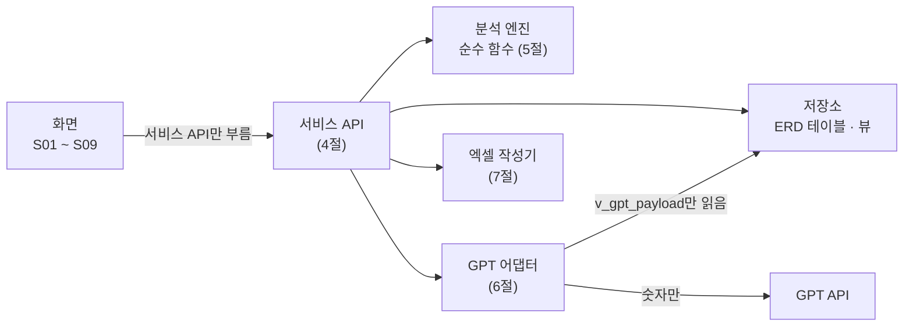
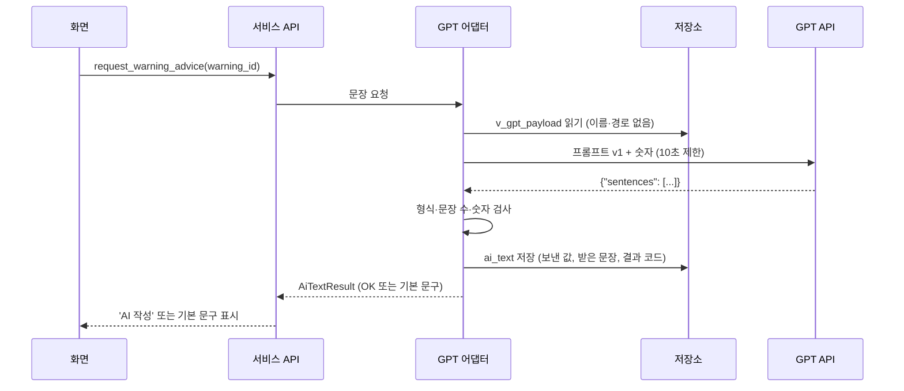
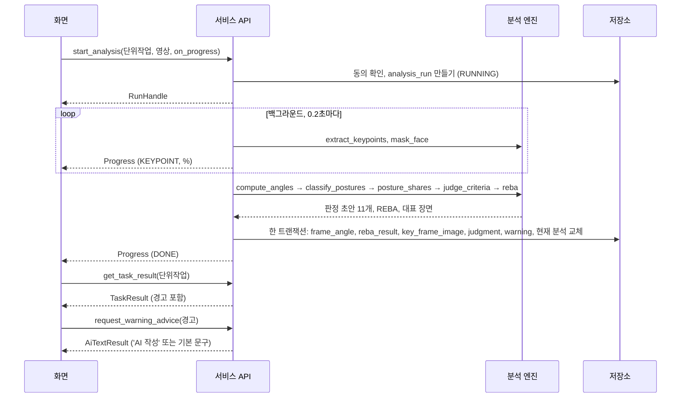
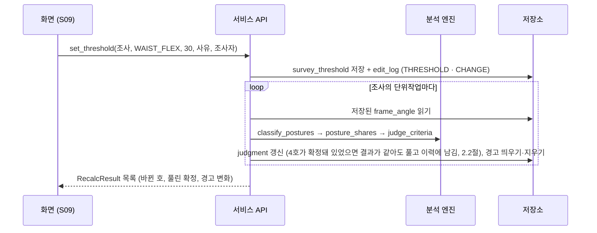

# API 계약서

> 근골격계 유해요인조사 보조 앱 · 화면 ↔ 앱 코어 · 분석 엔진 · GPT · 파일

## 문서 정보

| 항목 | 내용 |
|---|---|
| 문서 번호 | ERGO-API-001 |
| 버전 | v0.2 (초안), 계약 버전 `CONTRACT_VERSION = "0.2"` |
| 작성일 | 2026-10-12 |
| 작성 | 한정욱 (총괄) |
| 검토 | 김나리 · 유서하 · 정혁 |
| 상태 | 초안. 10/14 설계 1차에서 검토, 10/15 확정 |
| 상위 문서 | 기능정의서 v0.3 (ERGO-FD-001), 화면설계서 v0.1 (ERGO-UI-001), ERD · 데이터 설계서 v0.1 (ERGO-DD-001) |
| 다음 문서 | 일정서 (ERGO-SCH-001) |
| 멘토 WBS | 3.3 API / Data 계약 (10/14 ~ 10/15, 산출물 api-data-design.md)의 '요청·응답, 모듈 경계' 부분. '저장 데이터' 부분은 ERD |

### 개정 이력

| 버전 | 날짜 | 바뀐 내용 |
|---|---|---|
| v0.1 | 2026-10-12 | 초안. 서비스 함수 39개, 엔진 함수 8개, GPT 계약, 엑셀 파일 계약, 오류 코드 21개. 계약 코드(contracts.py)를 실행하고 ERD와 대조함 (10절) |
| v0.2 | 2026-10-12 | 화면설계서를 쓰며 찾은 빈 곳: 화면이 저장된 값을 다시 읽을 함수가 없었음. `get_task_inputs`, `get_reba_inputs`, `list_videos`, `get_posture_timeline` 추가 (DTO 3개 추가, 기존 함수는 그대로). 오류 코드 E-INPUT-003 추가. 계약 코드에 오류 코드 목록(`ERROR_CODES`)을 넣고 8절 표와 자동으로 대조함. 계약 버전 0.2. 지금 서비스 함수 {{N_FUNC}}개, 엔진 함수 {{N_ENGINE}}개, 오류 코드 {{N_ERR}}개 |

---

## 1. 범위와 구조

이 프로그램은 서버가 없다. 그래서 'API'는 세 가지다.

1. **서비스 API**: 같은 프로그램 안에서 화면이 부르는 Python 함수 (4절)
2. **외부 API**: GPT 호출 (6절)
3. **파일 계약**: 엑셀 보고서, DB 파일, 로그 (7절)



**층 사이의 규칙**

1. 화면은 서비스 API만 부른다. DB를 직접 읽거나 쓰지 않는다.
2. 분석 엔진은 DB와 화면을 모른다. 같은 입력이면 같은 출력이 나오는 순수 함수다 (NFR-004).
3. GPT 어댑터는 `v_gpt_payload` 뷰만 읽는다 (ERD 7절).
4. 계약의 원본은 코드(`ergo/contracts.py`, 부록 A)다. 이 문서는 그 코드를 설명한다. 둘이 다르면 코드를 기준으로 문서를 고친다.

---

## 2. 공통 규약

| 항목 | 규칙 |
|---|---|
| 이름 | 함수는 동사_명사 (`save_task_inputs`). 데이터 묶음(DTO)은 PascalCase. 필드 이름은 ERD 컬럼 이름과 같다 |
| 코드 값 | Enum 값은 ERD 코드 정의서와 같다 (자동 검사, 10절) |
| 단위 | 시간은 시간(float), 각도는 도(float), 비율은 0~1, 일시는 `YYYY-MM-DDTHH:MM:SS` 로컬 시각, 일자는 `YYYY-MM-DD` |
| 비어 있음 | `None`은 '아직 입력하지 않음'이다. 0으로 채우지 않는다. 판정에서는 '입력 필요'가 된다 |
| 성공 | DTO를 돌려준다. 막지 않는 알림은 DTO의 `notices`에 담는다 (W-…, I-…) |
| 실패 | `ErgoError(code, message, detail)`를 던진다 (E-…, 8절) |
| 트랜잭션 | 서비스 함수 하나 = DB 트랜잭션 하나. 중간에 실패하면 전부 되돌린다 |
| 수정 이력 | 값을 바꾸는 함수는 같은 트랜잭션 안에서 `edit_log`에 남긴다. `actor`는 조사자 이름이다 |
| 동시성 | 분석은 한 번에 하나만 백그라운드에서 돈다. 화면은 진행률 콜백으로 받는다. 나머지 함수는 짧게 끝난다 |
| 버전 | 필드를 더하면 0.x를 올리고, 이름·타입을 바꾸거나 빼면 1.0으로 올리고 문서를 개정한다 |

### 2.1 수정 이력 (edit_log) 남기는 규칙

기능정의서 F05-06이 정한 일을 남긴다. 동작 코드의 뜻은 ERD 4.4절. DB는 CHANGE에 사유가 없으면 저장을 막는다 (ERD 6.2절 edit_log).

| 규칙 | 언제 | 대상 · 동작 | 사유 |
|---|---|---|---|
| ① | 판정 확정 (`confirm_judgment`, `confirm_all`) | JUDGMENT · CONFIRM | 초안과 다른 결과이거나 '사람 확인'이면 필수 (기능정의서 3.2절 규칙 2) |
| ② | 이미 확정된 결과를 다른 결과로 고침 (`confirm_judgment`) | JUDGMENT · CHANGE | 필수 (3.2절 규칙 4) |
| ③ | 확정 해제 (`unconfirm_judgment`) | JUDGMENT · UNCONFIRM | 필수 |
| ④ | 각도 기준 변경 (`set_threshold`) | THRESHOLD · CHANGE | 필수 (BR-06, AC-34) |
| ⑤ | 각도 기준 되돌리기 (`reset_threshold`) | THRESHOLD · RESET | 없음 |
| ⑥ | 대표 장면 변경 (`set_key_frame`) | KEY_FRAME · SET | 없음 (AC-20) |
| ⑦ | 확정된 호가 있는 단위작업에서 입력값이 바뀜 (`save_*`, `update_unit_task`) | TASK_INPUT 또는 REBA_INPUT · SET. 바뀐 칸마다 한 줄 | 없음 |
| ⑧ | ④·⑤·⑦ 때문에 확정이 풀림 (자동) | JUDGMENT · UNCONFIRM | 앱이 채움: "입력값 변경으로 확정 해제" 또는 "각도 기준 변경으로 확정 해제" (3.2절 규칙 3) |
| ⑨ | 조사 확정 (`confirm_survey`) | SURVEY · CONFIRM | 없음 |
| ⑩ | 확정된 조사에서 무엇이든 바뀜 (자동) | SURVEY · UNCONFIRM | 앱이 채움: "확정 뒤 수정" (3.3절) |

- 값이 그대로면 남기지 않는다. 같은 값을 다시 저장해도 이력이 늘지 않는다.
- 이력과 원래 변경은 한 트랜잭션이다. 이력을 남기지 못하면 변경도 되돌린다.

### 2.2 다시 계산과 확정 해제

- 입력값, 각도 기준, 작업 기간 구분이 바뀌면 그 값을 쓰는 호를 저장된 프레임별 각도로 바로 다시 판정한다 (F05-04). 영상을 다시 분석하지 않는다.
- 어떤 값이 어느 호에 쓰이는지는 기능정의서 F02-02 표의 '쓰는 곳' 열을 따른다. 작업 기간 구분은 11개 호 전부 (F05-01 규칙 1), 각도 기준은 F07-02 표 (목·허리 기준은 4호, 팔꿈치 들기는 3호).
- 그 호가 확정돼 있었으면 결과가 같아도 확정을 푼다 (3.2절 규칙 3, OI-11 기본안). 규칙 ⑧로 남긴다.
- REBA 사람 입력과 대표 장면은 REBA만 다시 계산한다. REBA는 판정에 쓰지 않으므로 확정이 풀리지 않는다 (BR-15).
- 결과는 `RecalcResult`로 돌려준다: 바뀐 호(전·후 상태), 풀린 확정, 새로 뜬 경고와 사라진 경고.

---

## 3. 데이터 묶음 (DTO) 요약

전체 정의는 부록 A. 화면에서 많이 쓰는 것만 정리한다.

| DTO | 쓰는 곳 | ERD 원본 |
|---|---|---|
| SurveyCreate, SurveyUpdate, SurveyDetail, SurveySummary | 조사 만들기, 목록 | survey, survey_reason, participant, v_survey_list |
| UnitTaskCreate, UnitTask | 단위작업 | unit_task |
| TaskInputBundle | 작업 정보 화면 채우기 | task_input, repetition_input, lift_position_input |
| TaskInputs, RepetitionInput, LiftPositionInput, RebaInputs | 작업 정보 입력 | task_input, repetition_input, lift_position_input, reba_input |
| VideoInfo, RunHandle, Progress | 영상, 분석 진행 | video, analysis_run |
| PostureTimeline, PostureSegment | 분석 결과의 자세 시간 막대 | frame_angle과 v_effective_threshold로 계산 (저장하지 않음) |
| TaskResult, RebaScore, PostureShare, Judgment, JudgmentBasis, WarningItem | 분석 결과, 판정 | v_task_result, reba_result, judgment, judgment_basis, warning |
| RecalcResult, JudgmentChange, ConfirmAllResult | 다시 계산, 확정 | judgment, warning |
| Threshold | 각도 기준 | v_effective_threshold |
| EditLogEntry | 수정 이력 | v_edit_log |
| ExportResult, AiTextResult, Settings, PoseModel | 엑셀, AI 문장, 설정 | export_log, ai_text, app_setting, pose_model |

---

## 4. 서비스 API (화면 ↔ 앱 코어)

### 4.1 조사

| 함수 | 기능 | 화면 | 하는 일 | 오류 | 이력 |
|---|---|---|---|---|---|
| `create_survey(data)` → SurveyDetail | F01-01 | S02 | 조사와 수시 사유를 만든다. 수시조사면 사유가 1개 이상 있어야 한다 | E-INPUT-001, E-INPUT-002 | — |
| `list_surveys()` → SurveySummary 목록 | F01-02, F01-03 | S01 | v_survey_list를 조사일 최신순으로 | — | — |
| `get_survey(survey_id)` → SurveyDetail | F01-02 | S02, S03 | 조사, 참여자, 단위작업 | E-NOTFOUND-001 | — |
| `update_survey(survey_id, data, actor)` → SurveyDetail | F01-01 | S02 | 조사개요를 고친다 | E-INPUT-001 | 확정된 조사면 ⑩ |
| `delete_survey(survey_id, actor)` | F01-02 | S01 | 조사 전체를 지운다 (보존 기간이 지난 조사 정리). 화면에서 한 번 더 묻는다 | — | 함께 지워짐 (ERD 9절 P7) |
| `add_participant(survey_id, participant_type_cd, display_name)` → Participant, `remove_participant(participant_id)` | F02-03 | S03 | 참여 근로자 | E-INPUT-002 | 확정된 조사면 ⑩ |
| `confirm_survey(survey_id, actor)` → SurveyDetail | 3.3절 | S01, S07 | 모든 단위작업의 11개 호가 확정이면 조사를 확정한다 | E-CONFIRM-003 | ⑨ |

### 4.2 단위작업과 입력

| 함수 | 기능 | 화면 | 하는 일 | 오류 | 이력 |
|---|---|---|---|---|---|
| `create_unit_task(survey_id, data)` → UnitTask | F02-01 | S03 | 단위작업을 만들고 11개 호 판정 행을 '입력 필요'로 만든다 | E-INPUT-001, E-INPUT-002, E-INPUT-003 | — |
| `update_unit_task(id, data, actor)` → RecalcResult | F02-01 | S03 | 작업 기간 구분이 바뀌면 11개 호를 다시 판정 (BR-02) | E-INPUT-001 | ⑦ ⑧ |
| `delete_unit_task(id, actor)` | F02-01 | S03 | 단위작업과 영상·분석·판정을 지운다 | — | 이력은 남음 (ERD 9절 P8) |
| `save_task_inputs(id, inputs, actor)` → RecalcResult | F02-02, F05-04 | S03, S07 | 입력값을 저장하고 그 값을 쓰는 호를 다시 판정 (2.2절) | E-INPUT-001 | ⑦ ⑧ |
| `save_repetition_inputs(id, items, actor)` → RecalcResult | F02-02 | S03 | 2호 부위별 반복 시간 (보낸 목록으로 통째로 교체) | E-INPUT-001 | ⑦ ⑧ |
| `save_lift_position_inputs(id, items, actor)` → RecalcResult | F02-02 | S03 | 9호 위치별 횟수와 무게 (통째로 교체) | E-INPUT-001 | ⑦ ⑧ |
| `save_reba_inputs(id, inputs, actor)` → RecalcResult | F04-06 | S06 | REBA 사람 입력. REBA만 다시 계산 | E-INPUT-001 | ⑦ |
| `get_task_inputs(id)` → TaskInputBundle | F02-02 | S03 | 저장된 입력값을 읽는다. 넣지 않은 칸은 None | E-NOTFOUND-001 | — |
| `get_reba_inputs(id)` → RebaInputs | F04-06 | S06 | 저장된 REBA 사람 입력을 읽는다 | E-NOTFOUND-001 | — |

### 4.3 영상과 분석

| 함수 | 기능 | 화면 | 하는 일 | 오류·알림 | 이력 |
|---|---|---|---|---|---|
| `inspect_video(path)` → VideoInfo | F03-01 | S04 | 파일을 열어 길이·프레임·회전 정보를 읽는다. 저장하지 않는다 | E-VIDEO-001, W-VIDEO-002 (notices) | — |
| `list_videos(id)` → VideoInfo 목록 | F03-01, F03-03 | S04 | 단위작업에 붙인 영상과 동의 상태. 지금 결과에 쓴 영상은 `TaskResult.run.video_id`로 안다 | — | — |
| `attach_video(id, path, consent, actor)` → VideoInfo | F03-01, F03-03 | S04 | 영상 위치를 단위작업에 붙인다. 원본은 복사하지 않는다 | E-VIDEO-001 | — |
| `confirm_consent(video_id, actor)` → VideoInfo | F03-03 | S04 | 촬영 동의를 확인하고 시각을 남긴다 | — | — |
| `start_analysis(id, video_id, on_progress)` → RunHandle | F03-04 | S05 | 분석을 백그라운드로 시작하고 바로 돌아온다. 진행은 콜백으로 | E-VIDEO-003, E-VIDEO-004, E-ANALYSIS-004 | — |
| `cancel_analysis(run_id)` | F03-04 | S05 | 멈추고 결과를 저장하지 않는다 (CANCELED) | — | — |

**진행률 콜백** (`Progress`)

| 단계 (stage) | 뜻 | percent |
|---|---|---|
| DECODE | 영상을 여는 중 | 0 ~ 5 |
| KEYPOINT | 관절 추출과 얼굴 모자이크 | 5 ~ 85 (처리한 프레임 비율) |
| ANGLE | 각도 계산 | 85 ~ 90 |
| JUDGE | 자세 판별, 판정, REBA | 90 ~ 97 |
| SAVE | 한 트랜잭션으로 저장 | 97 ~ 100 |
| DONE · FAILED · CANCELED | 끝 | 100 |

- 콜백은 분석 스레드에서 불린다. 화면은 받은 값을 자기 스레드로 넘겨서 그린다.
- 콜백은 프레임마다가 아니라 0.2초에 한 번 정도로 부른다.
- 분석이 끝나면 이전 '현재' 분석을 내리고 새 분석을 '현재'로 올린다 (ERD ux_run_current).
- **분석 중에 생긴 문제는 예외로 던지지 않는다.** `start_analysis`는 이미 돌아왔기 때문이다.
  - 실패: 마지막 Progress가 `stage = FAILED`이고 `error_code`에 E-ANALYSIS-001 또는 E-ANALYSIS-009. analysis_run.error_cd에도 남긴다.
  - 취소: 마지막 Progress가 `stage = CANCELED` (I-ANALYSIS-005). 결과는 저장하지 않는다.
  - 여러 사람, 다리 잘림: 분석은 끝내고 `TaskResult.notices`에 W-ANALYSIS-002, W-ANALYSIS-003. 해당 호는 '사람 확인' (EX-05, EX-06).

### 4.4 결과와 판정

| 함수 | 기능 | 화면 | 하는 일 | 오류 | 이력 |
|---|---|---|---|---|---|
| `get_task_result(id)` → TaskResult | F04-05 ~ F05-03 | S06 | 현재 분석의 REBA, 자세 비율, 판정 11개, 경고, 대표 장면 (얼굴 가림) | E-NOTFOUND-001 | — |
| `get_frame_preview(run_id, frame_no)` → JPEG | F04-07 | S06 | 원본 영상에서 그 프레임을 읽어 얼굴을 가려 돌려준다. 저장하지 않는다 | E-VIDEO-004 | — |
| `get_posture_timeline(id)` → PostureTimeline | F04-04, F04-05, F04-07 | S06 | 현재 분석의 프레임별 자세를 구간으로 묶는다. 저장된 각도와 지금 각도 기준으로 계산하고 저장하지 않는다 | E-NOTFOUND-001 | — |
| `set_key_frame(id, frame_no, actor)` → TaskResult | F04-07 | S06 | 대표 장면을 바꾸고 REBA를 다시 계산 | E-INPUT-001 | ⑥ |
| `confirm_judgment(id, criterion_no, final_status, reason, actor)` → Judgment | F05-05 | S07 | 호 하나를 확정. 이미 확정된 호면 결과를 고친다 | E-CONFIRM-001, E-CONFIRM-002 | ① 또는 ② |
| `confirm_all(id, actor)` → ConfirmAllResult | F05-05 | S07 | 해당·비해당 초안을 그대로 확정. 사람 확인과 입력 필요는 목록으로 돌려줌 | — | ① (호마다 한 줄) |
| `unconfirm_judgment(id, criterion_no, reason, actor)` → Judgment | F05-05 | S07 | 확정을 푼다 | E-CONFIRM-002 | ③ |
| `list_edit_log(survey_id)` → EditLogEntry 목록 | F05-06 | S07 | 시간순 이력 | — | — |

### 4.5 각도 기준

| 함수 | 기능 | 화면 | 하는 일 | 오류 | 이력 |
|---|---|---|---|---|---|
| `get_thresholds(survey_id)` → Threshold 목록 | F07-02 | S09 | 조사에 실제 쓰는 각도와 출처 | — | — |
| `set_threshold(survey_id, code, value, reason, actor)` → RecalcResult 목록 | F07-02 | S09 | 그 조사에만 각도를 바꾸고 모든 단위작업을 다시 판정 | E-THRESHOLD-001, E-INPUT-001 | ④ ⑧ |
| `reset_threshold(survey_id, code, actor)` → RecalcResult 목록 | F07-02 | S09 | 해설 값으로 되돌리고 다시 판정 | — | ⑤ ⑧ |

### 4.6 보고서와 AI 문장

| 함수 | 기능 | 화면 | 하는 일 | 오류 | 이력 |
|---|---|---|---|---|---|
| `export_excel(survey_id, path, actor, with_db_backup)` → ExportResult | F06-01 | S08 | 7.1절 엑셀을 만든다. 원하면 DB 파일 사본도 같은 폴더에 | E-EXPORT-001 | export_log |
| `request_warning_advice(warning_id)` → AiTextResult | F06-02, F06-03 | S06 | 경고 조언 문장. 저장된 문장이 있으면 그대로 돌려준다. 없으면 GPT를 부르고, GPT를 쓸 수 없으면 기본 문구 (오류를 던지지 않음) | — | ai_text |
| `request_report_summary(survey_id)` → AiTextResult | F06-02, F06-03 | S08 | 보고서 요약 문장 | — | ai_text |
| `edit_ai_text(ai_text_id, text, actor)` → AiTextResult | F06-02 | S06, S08 | 조사자가 문장을 고친다 | E-INPUT-002 | ai_text.edited_text |

### 4.7 설정

| 함수 | 기능 | 화면 | 하는 일 | 오류 |
|---|---|---|---|---|
| `get_settings()` → Settings | F07-01, F07-03 | S09 | 모델, GPT 사용 여부, 키가 있는지 (키 자체는 돌려주지 않음) | — |
| `save_settings(pose_model_id, gpt_enabled, gpt_model)` → Settings | F07-01, F07-03 | S09 | 설정 저장 | E-INPUT-001 |
| `set_gpt_api_key(key)`, `delete_gpt_api_key()` | F07-03 | S09 | 키를 Windows 자격 증명 관리자에 저장·삭제 (6.6절) | E-INPUT-002 |
| `list_models()` → PoseModel 목록 | F07-01 | S09 | 고를 수 있는 모델 | — |

---

## 5. 분석 엔진 API (순수 함수)

서비스 API만 부른다. 화면은 부르지 않는다. 같은 입력이면 같은 출력이 나와야 한다.

| 함수 | 입력 → 출력 | 기능 | 시험 |
|---|---|---|---|
| `extract_keypoints(video_path, model, params, on_frame, cancel)` | 영상 → 프레임별 관절 17개와 신뢰도 (메모리에만) | F04-01 | 모델 두 개로 같은 영상 (AC-11) |
| `mask_face(frame, keypoints, params)` | 프레임 → 얼굴 가린 프레임 | F04-02 | 150프레임 모두 가림 (AC-12) |
| `compute_angles(keypoints, params)` | 관절 → 프레임별 각도 (ERD frame_angle 열과 같음) | F04-03 | 각도기 재연 영상 (AC-13) |
| `classify_postures(angles, thresholds)` | 각도 + 각도 기준 → 프레임별 자세 판별 | F04-04 | AC-14, AC-15 |
| `posture_shares(postures)` | 자세 판별 → 자세별 비율, 3호 합산 | F04-05 | AC-16, AC-17 |
| `judge_criteria(inputs)` | 비율·하루 작업시간·입력값·각도 기준·흔들기 폭 → 11개 호 판정 초안과 근거 | F05-01, F05-02 | 지침 부록 1 예시 11개 (AC-21 ~ AC-24) |
| `reba_for_frame(angles, reba_inputs)`, `pick_key_frame(scores)` | 각도 + 사람 입력 → REBA 단계별 점수, 대표 장면 | F04-06, F04-07 | 워크시트 8점 예시 (AC-18) |

엔진 결과는 ERD의 `v_posture_exposure_check` 뷰(SQL로 따로 계산)와 같아야 한다. 두 계산을 대조하는 것이 엔진 시험의 하나다.

---

## 6. GPT API 계약

### 6.1 흐름



### 6.2 보내는 값 (이것만)

GPT 어댑터는 `v_gpt_payload` 뷰만 읽는다 (ERD 7절). 뷰의 열을 이렇게 쓴다.

| 뷰의 열 | GPT에 보냄 | 뜻 |
|---|---|---|
| warning_id, survey_id, unit_task_id | 아니오 | 거르고 묶는 데만 쓴다. 결과는 ai_text에 저장 |
| criterion_no, criterion_summary, criterion_legal_text | 예 | 호 번호, 기준 요약, 고시 제3조 원문 (공개 법령) |
| daily_work_h, max_share_ratio, max_exposure_h | 예 | 하루 작업시간, 자세 비율, 하루 노출 시간 |
| reba_score, risk_level_cd | 예 | REBA 점수와 위험 단계 |
| survey_task_cnt | 보고서 요약에서만 | 조사의 단위작업 수 |

**경고 조언** (경고 1개, 예시 값은 ERD 9절 시험 데이터):

```json
{{PAYLOAD_EXAMPLE}}
```

**보고서 요약** (조사 1건): 열린 경고를 모두 `items`에 담는다. 단위작업은 이름 없이 수만 보낸다.

```json
{
  "purpose": "REPORT_SUMMARY",
  "task_cnt": 2,
  "warning_task_cnt": 1,
  "items": [ { "criterion_no": 4, "criterion_summary": "…", "…": "경고 조언과 같은 값 (purpose 제외)" } ]
}
```

- `task_cnt`는 뷰의 survey_task_cnt, `warning_task_cnt`는 경고가 있는 단위작업 수 (unit_task_id로 셈).
- 소수는 둘째 자리에서 반올림해 보낸다. 판정은 반올림 전 값으로 이미 끝났다 (F05-01 규칙 3).
- 열린 경고가 없으면 GPT를 부르지 않는다. 기본 문구 "법 기준(고시 제3조)을 넘는 작업이 없습니다."를 쓰고 result_cd는 NO_WARNING.

**보내지 않는 것**: 영상과 이미지, 사람·회사·부서·작업 이름, 파일 위치, 작업 내용 같은 자유 입력 글 (BR-21, OI-05). 어댑터는 `v_gpt_payload` 밖의 값을 읽지 않는다.

**기능정의서와 다른 점**: F06-02의 '보낼 수 있는 값'에 고시 원문은 없었다. 원문은 공개 법령이고 개인정보가 없으며, GPT가 "2시간", "25kg" 같은 법 기준 숫자를 문장에 쓸 때 숫자 검사(6.4절)를 통과하게 하려고 넣었다. 기능정의서 v0.2에 반영했다 (13절).

### 6.3 프롬프트 (prompt_version = "v1")

시스템 지시:

```text
너는 사업장 근골격계 유해요인조사 보고서의 문장을 쓰는 도우미다.
1. 받은 값에 있는 숫자만 쓴다. 새 숫자를 만들지 않는다.
2. 법 기준에 해당하는지는 이미 정해졌다. 판정을 바꾸거나 새로 판단하지 않는다.
3. 진단이나 치료 같은 의학적 조언을 하지 않는다.
4. 작업 방법, 도구, 배치를 바꾸는 개선 방법을 쉬운 말로 제안한다.
5. 존댓말로, 한 문장은 짧게 쓴다.
6. JSON으로만 답한다: {"sentences": ["문장", ...]}
```

사용자 메시지: 6.2절의 JSON. 경고 조언은 1~3문장, 보고서 요약은 3~5문장을 요청한다.

### 6.4 받은 문장 검사

| 검사 | 통과 조건 | 어기면 |
|---|---|---|
| 형식 | JSON이고 `sentences`가 글자 목록 | FALLBACK_ERROR |
| 문장 수 | 경고 조언 1~3, 보고서 요약 3~5 | FALLBACK_ERROR |
| 길이 | 문장 하나 200자 이하 | FALLBACK_ERROR |
| 숫자 | 문장의 모든 숫자가 보낸 JSON 안에 있음 (고시 원문 속 숫자 포함). 2.10과 2.1은 같은 숫자로 보고, 비율은 백분율도 인정 (0.35 → 35) | FALLBACK_NUMBER_MISMATCH |

### 6.5 호출 설정

| 항목 | 값 |
|---|---|
| 서비스 | OpenAI GPT API, 공식 Python 라이브러리 |
| 모델 | 설정값 `GPT_MODEL` (10/15 결정, D-API-03) |
| 시간 제한 | 10초 (TP-08) |
| 다시 시도 | 하지 않음 (화면이 기다리지 않게) |
| 창의성 | 낮게 (temperature 0.2. 제안값이며 D-API-03에서 모델과 함께 정함) |
| 호출 횟수 | 경고 1개에 1번, 조사 1건 요약에 1번. 같은 입력이면 저장된 결과를 다시 씀 |

### 6.6 실패와 키 보관

- GPT를 쓸 수 없으면 오류를 던지지 않고 기본 문구를 돌려준다. 점수, 판정, 경고, 엑셀은 그대로 동작한다 (F06-03).
- **GPT를 끄면 새 문장을 요청하지 않는다. 이미 저장된 문장(조사자가 고친 것 포함)은 그대로 둔다.** 끄는 것은 '보내지 않는다'는 뜻이지 '지운다'가 아니다. 경고에 딸린 문장이 없을 때만 기본 문구가 나온다 (AC-35).

| 상황 | result_cd |
|---|---|
| 설정에서 꺼 둠 | DISABLED |
| 보고서 요약인데 열린 경고가 없음 | NO_WARNING |
| 키가 없음 | FALLBACK_NO_KEY |
| 인터넷이 없음 | FALLBACK_OFFLINE |
| 10초를 넘김 | FALLBACK_TIMEOUT |
| 그 밖의 오류, 형식 오류 | FALLBACK_ERROR |
| 보낸 적 없는 숫자 | FALLBACK_NUMBER_MISMATCH |

- **API 키**는 Windows 자격 증명 관리자에 저장한다 (Python `keyring`, 서비스 이름 `ergo-assist`). DB, 설정 파일, 로그, 엑셀에는 절대 남기지 않는다. 화면에서는 가려 보인다.

---

## 7. 파일 계약

### 7.1 엑셀 보고서

- 파일 이름: `유해요인조사_{조사일}_{작업공정명}.xlsx`. 같은 이름이 있으면 `_2`, `_3`을 붙인다.
- 모든 시트 아래에 책임 문구: "부담작업 해당 여부 결정과 조사 결과의 책임은 사업주와 조사자에게 있습니다."
- 확정되지 않은 칸은 "초안"으로 표시하고 연노랑 배경을 칠한다.
- 엑셀 라이브러리는 10/14에 정한다 (D-API-02). 이 계약은 라이브러리와 관계없다.

| 시트 | 열 | 원본 (ERD 뷰) |
|---|---|---|
| 요약 | 조사 구분, 조사일, 조사자, 부서, 작업공정명, 작업명, 참여자, 다음 정기조사 예정일 / 단위작업, 해당 호, 초안 수, REBA, 위험 단계 / 보존 기간 안내, 증상설문조사 별도 필요 안내, 근거 법령, 요약 문장 ('AI 작성' 표시) | v_survey_list, v_excel_summary, participant, ai_text |
| 작업별 결과 | 단위작업, 하루 작업시간, REBA, 위험 단계, 부위 점수 (목·몸통·다리·위팔·아래팔·손목), 대표 장면 (얼굴 가린 이미지), 3·4·5호 자세별 하루 노출 시간, 판별 불가 비율, 모델 | v_task_result, reba_result, judgment_basis, key_frame_image |
| 경고 기록 | 단위작업, 호, 경고 문구, 근거, 뜬 시각, 사라진 시각, 조언 문장, 문장 출처 (AI 작성 · 기본 문구) | v_warning_log, ai_text |
| 판정 초안 | 단위작업, 호, 기준 이름, 상태, 초안·확정, 근거, 출처, 각도 기준 출처 (해설 · 조사자 변경과 사유), 사람 확인 사유, 확정자, 확정 시각, 사유 | v_judgment_sheet, judgment_basis |

### 7.2 DB 파일과 백업

- 위치: `%LOCALAPPDATA%\ergo-assist\ergo_assist.db` (ERD 6.1절)
- 엑셀과 함께 저장하는 사본: `ergo_assist_backup_{YYYYMMDD_HHMM}.db` (SQLite 온라인 백업)

### 7.3 로그

- 위치: `%LOCALAPPDATA%\ergo-assist\logs\`, 날짜별 파일, 30일 보관
- 남기는 것: 오류 코드, 처리 시간, 프레임 수
- **남기지 않는 것**: 이름, 파일 위치의 사용자 폴더 이름, GPT 키, GPT에 보낸 원문 (원문은 ai_text에만)

---

## 8. 오류 코드

| 코드 | 뜻 | 종류 | 화면 문구 | 기능정의서 |
|---|---|---|---|---|
| E-INPUT-001 | 값이 허용 범위를 벗어남 | 오류 | "{항목}은 {최소}~{최대} 사이로 입력해 주세요." | F02-02 |
| E-INPUT-002 | 필수 항목이 비어 있음 | 오류 | "{항목}을 입력해 주세요." | F01-01 |
| E-INPUT-003 | 같은 이름의 단위작업이 이미 있음 | 오류 | "같은 이름의 단위작업이 이미 있습니다." | F02-01 |
| E-NOTFOUND-001 | 없는 조사·단위작업 | 오류 | "찾을 수 없습니다. 목록을 새로 고쳐 주세요." | — |
| E-VIDEO-001 | 영상을 열 수 없음 | 오류 | "이 파일을 열 수 없습니다. mp4나 mov 파일을 골라 주세요." | EX-01 |
| W-VIDEO-002 | 영상이 짧음 | 알림 | "작업 한 사이클 이상 찍었는지 확인해 주세요." | EX-02 |
| E-VIDEO-003 | 동의 확인 전 분석 | 오류 | "촬영 동의를 먼저 확인해 주세요." | F03-03 |
| E-VIDEO-004 | 원본 영상이 옮겨짐 | 오류 | "영상을 찾을 수 없습니다. 위치를 다시 골라 주세요." | F01-02 |
| E-ANALYSIS-001 | 사람을 찾지 못함 | 오류 | "사람을 찾지 못했습니다. 전신이 보이게 옆에서 다시 찍어 주세요." | EX-04 |
| W-ANALYSIS-002 | 여러 사람 | 알림 | "여러 사람이 보입니다. 분석한 사람이 맞는지 확인해 주세요." | EX-05 |
| W-ANALYSIS-003 | 다리가 잘림 | 알림 | "다리가 보이지 않아 쪼그림·무릎 자세는 확인이 필요합니다." | EX-06 |
| E-ANALYSIS-004 | 이미 분석 중 | 오류 | "다른 분석이 끝난 뒤 시작해 주세요." | F03-04 |
| I-ANALYSIS-005 | 분석 취소됨 | 알림 | "분석을 취소했습니다." | EX-07 |
| E-ANALYSIS-009 | 분석 중 오류 | 오류 | "분석 중 문제가 생겼습니다. 다시 시도해 주세요." | EX-08 |
| E-CONFIRM-001 | '입력 필요'가 남음 | 오류 | "입력이 필요한 기준이 있어 확정할 수 없습니다." | EX-15 |
| E-CONFIRM-002 | 사유가 필요함 | 오류 | "확정하는 이유를 입력해 주세요." | EX-14 |
| E-CONFIRM-003 | 확정하지 않은 판정이 남음 | 오류 | "확정하지 않은 판정이 있어 조사를 확정할 수 없습니다." | 3.3절 |
| E-THRESHOLD-001 | 사유 없이 각도 변경 | 오류 | "바꾸는 이유를 입력해 주세요." | EX-14 |
| E-EXPORT-001 | 엑셀을 쓸 수 없음 | 오류 | "엑셀 파일이 열려 있습니다. 닫고 다시 저장하거나 다른 이름으로 저장해 주세요." | EX-12 |
| E-DB-001 | 저장소 파일을 열 수 없음 | 오류 | "저장된 조사를 열 수 없습니다." | EX-13 |
| E-DB-002 | 저장 규칙 위반 (DB 제약) | 오류 | "저장하지 못했습니다." (앱 버그 신호, 로그에 제약 이름) | ERD 9절 |
| W-GPT-001 | GPT 대신 기본 문구 | 알림 | (기본 문구만 보임) | EX-10, EX-11 |

- 단위작업 이름이 겹치면 (ERD: 조사 안에서 이름 유일) E-INPUT-003으로 바꿔 던진다.
- 그 밖의 DB 제약 위반(`sqlite3.IntegrityError`)은 E-DB-002로 바꿔 던진다. 화면에서 미리 막지 못한 잘못된 값이 들어오면 DB가 막고, 이 코드로 드러난다.

---

## 9. 주요 시나리오

### 9.1 영상 분석에서 경고까지



### 9.2 각도 기준을 바꾸면



### 9.3 엑셀 내보내기

1. 화면이 `export_excel(조사, 경로, 조사자)`를 부른다.
2. 서비스가 7.1절의 뷰를 읽어 시트 4개를 만들고, 대표 장면 이미지를 넣는다.
3. 원하면 DB 사본을 같은 폴더에 만든다.
4. `export_log`에 남기고 ExportResult(파일 위치, 초안 칸 수)를 돌려준다.

---

## 10. 계약 시험

| 시험 | 무엇을 | 수용 기준 |
|---|---|---|
| 계약 ↔ ERD 대조 | Enum 값이 ERD 코드와 같고, DTO 필드가 ERD 컬럼에 있는지 자동 비교 | — (아래 결과) |
| 서비스 함수 | 함수마다 정상 경로 1개와 오류 코드 경로 1개 이상 | 각 기능의 AC |
| 결정성 | 같은 입력으로 엔진을 두 번 돌려 결과가 같은지 | NFR-004 |
| 엔진 ↔ SQL 대조 | 엔진의 자세 비율과 `v_posture_exposure_check` 결과가 같은지 | AC-16 |
| GPT 요청 | 보낸 JSON에 금지 필드가 없는지 | AC-30 |
| GPT 응답 | 보내지 않은 숫자가 있으면 기본 문구, 10초를 넘기면 기본 문구 | AC-31, AC-32 |
| 엑셀 | 시트 4개, '초안' 표시, 얼굴 가림, 책임 문구 | AC-29 |
| DB 제약 | ERD 9절의 30개 시험을 그대로 다시 씀 | ERD 9절 |

### 10.1 계약 ↔ ERD 대조 결과 ({{CHECK_DATE}}, 자동 생성)

`check_contract.py`가 contracts.py와 ERD의 schema_v1.sql을 읽어 비교한 출력이다.

```text
{{CONTRACT_CHECK}}
```

**검사가 실제로 잡는지 확인**: contracts.py를 복사해 코드값 하나(`KNEE_ON_FLOOR` → `KNEE_FLOOR`)와 필드 이름 하나(`lift_people_cnt` → `lift_person_cnt`)를 일부러 틀리게 바꾸고 같은 검사를 돌린 결과다.

```text
{{CONTRACT_CHECK_MUT}}
```

---

## 11. 추적표 (기능 → API)

| 기능 | 서비스 함수 | 엔진 함수 |
|---|---|---|
| F01-01 조사 만들기 | create_survey, update_survey | — |
| F01-02 저장·목록 | list_surveys, get_survey, delete_survey | — |
| F01-03 다음 정기조사 예정일 | list_surveys | — |
| F02-01 단위작업 | create_unit_task, update_unit_task, delete_unit_task | — |
| F02-02 작업 정보 입력 | get_task_inputs, save_task_inputs, save_repetition_inputs, save_lift_position_inputs | judge_criteria |
| F02-03 참여 근로자 | add_participant, remove_participant | — |
| F03-01 영상 | inspect_video, attach_video, list_videos | — |
| F03-02 촬영 안내 | (화면만) | — |
| F03-03 촬영 동의 | confirm_consent | — |
| F03-04 분석 실행 | start_analysis, cancel_analysis | extract_keypoints |
| F04-01 ~ F04-05 | get_task_result, get_posture_timeline | extract_keypoints, mask_face, compute_angles, classify_postures, posture_shares |
| F04-06 REBA | get_reba_inputs, save_reba_inputs, get_task_result | reba_for_frame |
| F04-07 대표 장면 | set_key_frame, get_frame_preview, get_posture_timeline | pick_key_frame, mask_face |
| F05-01, F05-02 판정·확신도 | get_task_result | judge_criteria |
| F05-03 경고 | get_task_result | judge_criteria |
| F05-04 다시 계산 | save_*, set_threshold, reset_threshold, set_key_frame | classify_postures, posture_shares, judge_criteria |
| F05-05 확정 | confirm_judgment, confirm_all, unconfirm_judgment, confirm_survey | — |
| F05-06 수정 이력 | list_edit_log | — |
| F06-01 엑셀 | export_excel | — |
| F06-02, F06-03 GPT | request_warning_advice, request_report_summary, edit_ai_text | — |
| F07-01 모델 | list_models, save_settings | — |
| F07-02 각도 기준 | get_thresholds, set_threshold, reset_threshold | — |
| F07-03 GPT 설정 | get_settings, save_settings, set_gpt_api_key, delete_gpt_api_key | — |
| F07-04 모델 비교 | (내부 도구) | extract_keypoints, compute_angles |

---

## 12. 결정이 필요한 것

| ID | 무엇 | 선택지 | 언제 |
|---|---|---|---|
| D-API-01 | 화면 도구 | PySide6 · Streamlit + Edge 앱 창 · Flet. 이 PC에서 확인한 것: Edge 앱 창은 실행기로 띄우고 창을 닫으면 서버까지 꺼짐 (주소창이 없는지는 눈으로 확인 안 함). Flet 1.0.3은 mediapipe 1.1.0, OpenCV와 한 환경에 설치됨. 계약은 화면 도구와 관계없음 | 10/14 |
| D-API-02 | 엑셀 라이브러리 | openpyxl · XlsxWriter | 10/14 |
| D-API-03 | GPT 모델과 비용 상한 | 설정값으로 두고 팀이 정함 | 10/15 |
| D-API-04 | 키 보관 | keyring (Windows 자격 증명 관리자) 그대로 쓸지 | 10/15 |
| D-API-05 | 분석을 스레드로 돌릴지 별도 프로세스로 돌릴지 | 화면이 멈추는지 10/16 Pose MVP에서 재 보고 정함 | 10/16 |

---

## 13. 다른 문서에 반영한 것

API를 정하면서 앞 문서와 어긋난 곳을 찾아 같은 날 고쳤다.

| 문서 | 고친 것 | 이유 |
|---|---|---|
| ERD (ERGO-DD-001) | `v_gpt_payload`에 survey_id, unit_task_id, survey_task_cnt 추가 | 보고서 요약은 조사 단위로 모아야 하는데, 뷰가 경고 단위라 조사로 거를 열이 없었음. 바꾼 뒤 ERD 시험 30개를 다시 돌림 (P4가 새 열을 확인. 열을 빼거나 셈을 틀리게 바꾸면 P4가 실패하는 것도 확인) |
| ERD | ai_text.result_cd에 NO_WARNING 추가 | 열린 경고가 없을 때 GPT를 부르지 않은 것을 기록할 코드가 없었음 |
| ERD | edit_log.action_cd의 뜻을 'SET = 사유 없이 입력·교체, CHANGE = 사유가 필요한 변경'으로 명확히 | DB는 CHANGE에 사유를 요구하는데, 대표 장면 변경(AC-20)과 입력값 변경은 사유를 받지 않음. 2.1절 |
| 기능정의서 (ERGO-FD-001) v0.2 | F06-02 '보낼 수 있는 값'에 고시 원문 추가 | 6.2절 |

## 부록 A. 계약 코드 (contracts.py v0.2)

```python
{{CONTRACTS}}
```
