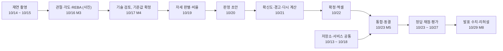

# 일정서

> 근골격계 유해요인조사 보조 앱 · 2026-10-12 ~ 10-30 · **개발 동결 10/23 (금)**

## 문서 정보

| 항목 | 내용 |
|---|---|
| 문서 번호 | ERGO-SCH-001 |
| 버전 | v0.6 (초안) |
| 작성일 | 2026-10-12 |
| 작성 | 한정욱 (총괄) |
| 검토 | 김나리 · 유서하 · 정혁 |
| 상태 | 초안. 10/13에 담당을 먼저 정하고 10/14 설계 1차 회의에서 확정 |
| 상위 문서 | 기능정의서 v0.5 (ERGO-FD-001), 화면설계서 v0.3 (ERGO-UI-001), ERD v0.3 (ERGO-DD-001), DB 아키텍처 설계서 v0.3 (ERGO-DBA-001), API 계약서 v0.4 (ERGO-API-001) |
| 기준 일정 | 멘토 WBS (마일스톤 9개, 작업 20개) |

### 개정 이력

| 버전 | 날짜 | 바뀐 내용 |
|---|---|---|
| v0.1 | 2026-10-12 | 초안. 개발 동결을 10/23으로 정하고 기능 30개의 끝나는 날, 날짜별 계획, 결정 기한 22개, 위험을 정함 |
| v0.2 | 2026-10-12 | 화면설계서 초안과 ERD 그림(draw.io)이 생겨 10/12·10/13 계획과 멘토 산출물 대응표를 고침 |
| v0.3 | 2026-10-12 | 고시 원문 대조를 마쳐 10/12 계획과 위험, 결정 일정을 고침 (해설 각도 값 대조는 10/14로 남음) |
| v0.4 | 2026-10-12 | DB 아키텍처 설계서와 저장소 LOCO-KOREA/LOCO의 프로젝트 뼈대(스텁, 시험, 문서 생성 도구)가 생겨 10/12·10/13 계획, 멘토 산출물 3.2를 고침. 같은 날 해설 각도 값의 확인 상태(글 3건으로 확인, 고용노동부 원문은 문의)를 고침 |
| v0.5 | 2026-10-12 | MVP의 분석 입력을 사진(스틸샷)으로, 관절 모델을 MoveNet Lightning으로 정함 (기능정의서 v0.4). 영상 단계(짧은 영상, 긴 영상)를 MVP 이후로 빼고 사진 여러 장(표본)으로 일정을 고침. 모델이 정해져 F07-04 모델 비교 도구를 일정에서 뺌 (기능 30개에서 29개가 됨) |
| v0.6 | 2026-10-14 | F04-02 얼굴 모자이크를 일정에서 뺐다 (기능 29개에서 28개가 됨). 10/20의 얼굴 가림 작업과 대표 사진 저장 순서의 제약을 없앴다 (기능정의서 v0.5) |

---

## 1. 한눈에 보기

- **10/23 (금) 개발 동결.** Must와 Should 기능을 이날까지 모두 넣는다. 그 뒤로는 새 기능을 만들지 않고 고치기, 시험, 평가, 배포, 발표 준비만 한다.
- 10/9 멘토링 조언: 일정은 마무리 1주 전에 끝낸다. 그래서 개발 끝을 10/23으로 약속했다. 멘토 WBS의 기능 동결(10/27, M7)보다 4일 이르고, 서비스 MVP (M5)와 같은 날이다. 당기면 생기는 것:
  1. 10/24 중간 발표 (M6)를 동결 버전으로 하고, 받은 피드백을 10/27까지 고칠 수 있다.
  2. 정답 채점과 일치율 측정 (NFR-015)을 바뀌지 않는 코드로 한다. 측정 중에 코드가 바뀌면 다시 재야 한다.
  3. 설치 파일을 팀원 PC 2대와 발표 노트북에서 시험할 시간이 생긴다 (NFR-016, NFR-007).
- **만드는 순서도 10/9 조언을 따른다**: 사진 한 장 → 사진 여러 장 (표본, 사진별 각도를 DB에 저장). MVP는 여기까지이고 영상은 시간이 남을 때 사진을 뽑아 쓰는 방식으로 붙인다 (기능정의서 D-MVP-01).
- **주요 경로**: 재연 촬영 → 관절·각도 → 기술 검토 (기준값 확정) → 자세 판별 → 판정 → 확정·엑셀 → 통합. 이 줄이 하루 밀리면 동결이 하루 밀린다 (8절).

```mermaid
{{GANTT}}
```

---

## 2. 마일스톤과 완료 기준

{{MILESTONES}}

---

## 3. 개발 동결 규칙

| 기간 | 해도 되는 것 | 하지 않는 것 |
|---|---|---|
| ~ 10/23 (금) | 기능 개발. 계약(ERD, API)을 바꾸면 같은 날 문서를 개정하고 계약 시험을 다시 돌린다 | — |
| 10/24 (토) ~ 10/27 (화) | 버그 수정 (기능정의서 수용 기준대로 동작하지 않는 것), 문구·표시, 속도, 10/24 피드백 중 수정 목록에 올린 것 | 새 기능, 새 화면, 계약 변경 |
| 10/28 (수) ~ 10/29 (목) | 발표를 막는 버그만. 고치면 설치 파일을 다시 만들고 다시 시험한다 | 그 밖의 코드 변경 |
| 10/29 (목) 리허설 뒤 | 없음. 발표 버전 고정 | 코드 변경 |

- 동결한 코드에 이름을 붙인다: `freeze-1023`. 중간 발표와 평가는 이 버전으로 한다.
- 동결 뒤에 고치는 것은 모두 수정 목록(번호, 내용, 고친 사람, 확인한 사람)에 적고 총괄이 승인한다.
- 계약을 바꿔야만 고칠 수 있는 버그는 총괄이 판단하고, ERD와 API 계약서를 개정한다.

---

## 4. 역할과 작업 묶음 (제안)

10/9 발표에서 정한 나눔 (자세 분석 · 경고와 확신도 · 판정과 보고서 · 총괄)을 기능 ID로 옮겼다. 사람 이름은 10/13에 정하고 10/14에 확정한다. 묶음마다 맡은 기능의 엔진 함수, 서비스 함수, 화면, 시험까지 끝낸다.

| 묶음 | 담당 | 기능 | 화면 | 엔진·서비스 (API 계약서 4·5절) |
|---|---|---|---|---|
| WP0 총괄·데이터 | 한정욱 | {{WP0}} | S01, S02, S03 (단위작업) | 저장소 (ERD), 트랜잭션과 수정 이력 공통 부분, 조사·단위작업 서비스 함수, 통합, 계약 시험 |
| WP1 자세 분석 | 배정 | {{WP1}} | S04, S05, S06 (REBA·대표 사진) | extract_keypoints, compute_angles, classify_postures, posture_shares, reba_for_still, pick_key_still |
| WP2 경고·확신도 | 배정 | {{WP2}} | S06 (경고), S09 (GPT) | 확신도 (각도를 ±5° 흔들어 세 번 판정), 경고, GPT 어댑터 |
| WP3 판정·보고서 | 배정 | {{WP3}} | S03 (작업 정보), S07, S08, S09 (각도 기준) | judge_criteria, 다시 계산, 엑셀 작성기 |
| 함께 | 전원 | 재연 촬영, 정답 채점 (팀원 2명이 따로 채점, requirements 3절), 시험, 평가, 발표 | | |

- WP1이 기능이 가장 많고 주요 경로에 있다. F03-02 촬영 안내, F03-03 촬영 동의, F07-01 모델 선택은 화면 작업이라 WP0이 가져가도 된다 (10/14에 정함).
- 10/9 멘토 조언대로 모듈마다 POC(단위 시험)를 먼저 하고, 함수를 부르듯 조립한다.
- **계약 덕분에 동시에 시작할 수 있다.** 스텁(가짜 값을 돌려주는 서비스)은 이미 있다 (`ergo/service/stub.py`, 값은 화면설계서의 예시와 같다). 화면은 스텁에 붙여 만들고, 진짜 함수는 하나씩 바꿔 끼운다. 바꿀 때마다 `tests/contract_suite.py`를 통과해야 한다.

---

## 5. 기능별 일정

기능 목록과 우선순위는 기능정의서 4절, 확인 항목은 기능정의서의 수용 기준(AC)에서 가져왔다. '끝'은 수용 기준을 확인한 날이다.

{{FEATURES}}

- Must {{N_MUST}}개와 Should {{N_SHOULD}}개가 모두 10/23 동결 전에 끝난다.
- 10/16 Pose MVP에는 {{M3_LIST}}의 핵심이 먼저 동작한다 (requirements.md 우선순위: 사진 올리기부터 REBA까지).
- 앞 기능이 끝나야 하는 관계 {{N_DEPS}}개를 확인했다 (예: F05-01 판정은 F04-05 비율과 F02-02 입력 뒤).

---

## 6. 날짜별 계획

{{DAILY}}

---

## 7. 결정 일정

기한까지 정하지 못하면 '기본안'으로 간다. OI의 기본안은 기능정의서 10절에 적힌 것이고, 나머지는 이 일정서가 제안하는 것이다 (10/14 회의에서 확인).

{{DECISIONS}}

---

## 8. 주요 경로와 버퍼



- **버퍼**: 10/18 (일)과 10/25 (일)은 예비일이다. 주요 경로가 밀렸을 때만 쓴다. 동결 뒤 10/24 ~ 10/27은 수정 목록을 처리하는 기간이다.
- **점검일**
  - 10/16 (M3): 관절·각도·REBA가 동작하지 않으면 REBA를 임시 점수로 두고 자세 판별 (F04-04)부터 끝낸다. 판정은 각도로 하고 REBA는 위험 정도만 보여 주기 때문이다.
  - 10/20 (화): 아직 통합하지 못한 Must가 있으면 9절 순서대로 Should를 뺀다.
  - 10/22 (목): 동결 전 리허설. UC-001 → UC-002 → UC-003을 처음부터 끝까지 한다.

---

## 9. 늦어질 때 빼는 순서

Should만 뺀다. Must는 빼지 않는다. 10/20 점검에서 팀이 정한다.

- Must 안에서 줄일 수 있는 것은 한 단위작업에 받는 사진 수의 상한 하나다. 처리가 늦으면 상한을 둔다 (표본이 줄면 TP-12 때문에 '사람 확인'이 늘어난다). 판정 방법 (자세 비율 × 하루 작업시간)은 그대로다.

| 순서 | 뺄 기능 | 빼면 대신하는 것 |
|---|---|---|
| 1 | F07-01 관절 모델 표시 | 모델 이름은 S04·S06 정보 줄에만 보이고 설정 화면에는 두지 않는다 |
| 2 | F02-03 참여 근로자 기록 | 면담 참여자는 엑셀에 손으로 적는다 |
| 3 | F01-03 다음 정기조사 예정일 | 화면 표시만 뺀다 (DB 뷰는 이미 계산함) |
| 4 | F05-06 수정 이력 화면 | 이력은 DB에 계속 남기고 화면 목록만 뺀다 |
| 5 | F06-02 GPT 문장, F07-03 GPT 설정 | 기본 문구로 동작한다 (F06-03은 Must). 과정이 생성형 AI 기반이라 마지막에 뺀다 |

---

## 10. 위험

| 위험 | 생기면 | 미리 하는 것 | 확인일 |
|---|---|---|---|
| 재연 촬영 공간을 못 구함 | 10/17에 각도 오차와 기준값을 못 정함 | 강의실에서 휴대폰으로 찍는다. 각도기·상자·선반은 있음 (requirements 3절) | 10/14 |
| 발표 노트북이 느림 | 사진 30장 1분 안 (NFR-007) 실패 | 10/16에 실측. MoveNet Lightning이 가장 가벼운 모델이라 느리면 사진 수의 상한을 둔다 | 10/16 |
| 담당이 늦게 정해짐 | 동시에 개발하지 못함 | 10/13에 먼저 정하고 10/14에 확정 | 10/13 |
| 화면 도구 결정이 늦음 | 화면 개발이 밀림 | 10/14에 못 정하면 총괄이 정함 | 10/14 |
| 통합 때 데이터 모양이 서로 다름 | 10/19 ~ 10/23 통합이 늦어짐 | 모두 contracts.py를 가져다 쓰고, 코드를 합치기 전에 계약 시험을 돌린다 | 매일 |
| GPT 키나 비용 문제 | GPT 문장을 시연하지 못함 | 기본 문구로 동작 (F06-03). 팀 키 1개에 사용 한도를 건다 | 10/15 |
| 정답 채점 시간이 모자람 | NFR-015 수치를 발표하지 못함 | 채점표 양식을 10/22까지 만들고 10/23부터 채점 | 10/22 |
| 배포를 웹 주소로 하라고 함 | 7.1 배포 작업이 커짐 | 10/17에 멘토 답을 받는다. 웹이면 D-API-01에서 Streamlit 쪽이 유리 | 10/17 |
| 해설 원문이 논문·기고와 다름 | 각도 기본값과 출처가 바뀜 | 값과 출처만 고친다 (ERD 기준 정보 초기 데이터). 고시 본문은 10/12에 원문 대조를 마쳤다. 해설 원문은 공개 사이트에서 못 찾아 문의한다 | 10/14 |

---

## 11. 멘토 산출물 대응표

{{DELIVERABLES}}

---

## 12. 매일 하는 것

- **아침 10분**: 어제 한 것, 오늘 할 것, 막힌 것. 멘토 WBS의 상태(예정·진행·완료·보류)를 그날 고친다.
- **코드를 합치기 전**: 계약 시험 (API 계약서 10절)과 DB 시험 (ERD 9절)을 돌린다. 실패하면 합치지 않는다.
- **주요 경로 작업이 반나절 넘게 막히면** 바로 총괄에게 알린다. 하루를 넘기면 9절을 검토한다.

---

## 13. 다른 문서에 반영한 것

| 문서 | 고친 것 |
|---|---|
| requirements.md | 우선순위의 뜻: Should 기한 10/27 기능 동결 → 10/23 개발 동결. 3절 개발 기간 줄에 개발 동결 10/23 추가 |
| project-overview.md | MVP 우선순위 표: Should 목표일 10/27 → 10/23 |
